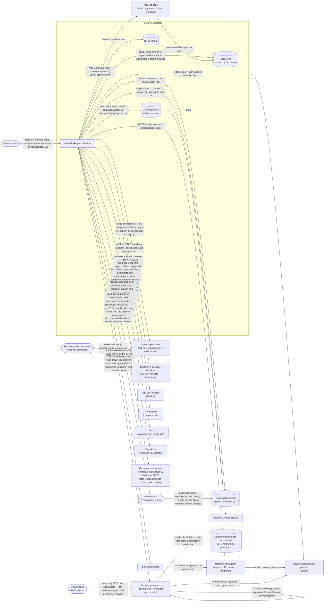

# ordin desktop — System Context

> **Mode:** draft
> **Generated from:** inline context — the user's decisions of January 2026
> **Revision:** 0.49.0
> **Last updated:** January 2026

## System Context

*From revision 0.61.0 (ADR-113) the diagram shows knowledge agents, the company knowledge repositories they read, and outside tools that search them over MCP.*

*From revision 0.27.0 (ADR-082, ADR-084, ADR-086, ADR-087) the diagram shows agent repositories on GitHub in place of the internal APM marketplace, which ordin reached through the bundled `apm` tool until revision 0.25.0.*

### External actors and neighbouring systems

- **Business user.** The signed-in person who starts tasks and crews, supplies inputs, approves actions and edits results. **Interaction:** the application's window, in-process.
- **Administrator (IT / platform team).** Publishes the organisation profile, decides which executable parts of agents are trusted (through the profile's executable-trust policy over tool bindings and hooks, ADR-082; before revision 0.25.0, through APM's organisation-recommended executable set), names the agent repositories and whether the person may add more (ADR-086), registers the wrightrun agents people may use, and receives the help requests the application sends when it cannot finish a step itself. **Interaction:** publishes the profile out of band; receives help requests through the channel the profile names (OQ-14). The business user never acts as administrator (G10, ADR-013). *Amended in revision 0.59.0 (ADR-110): may also name team knowledge folders every applicable workspace reads (`team_knowledge.read_folders[]`); naming one grants no access, and a folder that must be reviewed should use review rules its readers can see (GitHub rulesets; GitLab approval rules).*
- **Organisation profile.** The signed configuration the application reads on start and when it changes. **Interaction:** outbound HTTPS read from the address the installer carries; signature verified before use (ADR-013).
- **Agent repositories** (revision 0.25.0 as catalogue repositories; revision 0.27.0, ADR-086, ADR-087). GitHub repositories holding agents, each with a display name, a protected default branch and one format: the ordin format (crucible's component model) or the APM format. Some are named in the organisation profile; the person may add others unless the profile turns that off. GitLab waits on OQ-45. **Interaction:** outbound only. The Catalogue Service clones and fetches each repository over HTTPS with the person's GitHub sign-in (ADR-014) and follows its protected branch; repositories in APM format are read through the APM format plug-in, and no `apm` program runs (ADR-087). Publishing is a pull request opened through `gh` after the person approves (ADR-084). *Until revision 0.25.0 this was the **Internal APM marketplace**, reached only through the bundled `apm` tool (`apm marketplace add|browse|update`, `apm search`, `apm install`) with the person's GitHub token passed to each call (ADR-004, ADR-014); ADR-082 superseded ADR-004.*
- **Agent repository reviewers** (revision 0.25.0; ADR-084). The people the repository's own GitHub settings name. **Interaction:** none with ordin; they review a publishing pull request on GitHub, and the merge onto the protected branch is the publication. Who reviews, how many approvals are required and who may merge are set by IT on GitHub; ordin adds no approval role of its own.
- **Claude model service and Claude Code** (revision 0.9.0, revised 0.10.0). Claude Code, installed on the computer and signed in by the person through Anthropic's own flow, is the first harness (ADR-038, ADR-044). **Interaction:** the application starts the installed CLI per session; the CLI calls Anthropic's service with the person's own subscription. The application never sees the credential.
- **GitHub / Copilot service.** The source of model calls for local sessions, billed against the person's Copilot subscription. **Interaction:** the application starts a Copilot CLI server and talks to it with the Copilot SDK over JSON-RPC; the CLI calls GitHub with the person's GitHub OAuth credentials (ADR-001).
- **wrightrun deployment.** One deployment serves one agent (wrightrun ADR-039). **Interaction:** outbound HTTPS to the caller interface (`/v1/runs`, `/v1/threads/{thread_id}/runs`, `/v1/runs/{run_id}`, `/v1/runs/{run_id}/resume`, as named in `agent-wright-runtime/docs/spec/components/RuntimeServer.md`), with an OIDC bearer token carrying the caller role (wrightrun G8). *Amended in revision 0.43.0 (ADR-098): wrightrun is not built. Its place is taken by a hosted ordin agent (below), whose caller interface keeps these paths.*
- **Slack workspace.** The chat system where some wrightrun agents are reachable. **Interaction:** outbound Slack Web API calls with the person's user OAuth token. The application posts a message that mentions the agent in a thread of the dedicated channel, and reads the thread's replies (ADR-008). The application receives no Slack events. *From revision 0.43.0 (ADR-098) the agents reached this way are hosted ordin agents.* *Amended in revision 0.50.0 (ADR-102): with the same user token, the application also reads the Slack channels a workspace links (never direct messages), and posts handover notices and approved drafts there or to one receiver as the person.*
- **Chat service** (revision 0.18.0; ADR-073). The chat app through which one person reaches their ordin server: Telegram first, through a bot created for that server installation. **Interaction:** outbound HTTPS from the server only, by long polling (`getUpdates`) and sending messages, with the bot token; no webhook and no inbound connection. Only the paired person's private chat is answered. *From revision 0.20.0 (ADR-075)* the bot also reads the groups and channels it is added to and a workspace links, and posts there only after the person's approval.
- **The person's own ordin servers, seen from the desktop** (revision 0.42.0; ADR-096). An ordin server the person's desktop is paired with. **Interaction:** the desktop's core calls the server's Remote API over HTTPS, REST calls for commands and one Server-Sent Events stream for events, with the desktop key as a bearer token; straight to the server's address on the company network. The server never connects to the desktop.
- **Slack as a chat channel** (revision 0.21.0; ADR-076). A Slack app for the server installation, created and approved by the company's Slack administrators. **Interaction:** an outbound Socket Mode WebSocket opened with the app-level token, and Web API calls with the bot token; only the paired person's direct message with the app is answered. Separate from the person's own Slack sign-in that reaches wrightrun agents (ADR-008).
- **Company NATS servers** (revision 0.19.0; ADR-074). The company's NATS messaging system, named in the organisation profile with the subjects ordin may subscribe to. **Interaction:** an outbound TLS connection from the ordin server only, with credentials set through the server's setup command; JetStream durable pull consumers with explicit acknowledgement where a subject is kept in a stream, plain subscriptions otherwise. ordin publishes nothing.
- **Hosted ordin agents** (revision 0.43.0; ADR-097, ADR-098). An ordin server in the agent profile, running one agent under its own identity; one or many per organisation, each its own deployment. **Interaction, from a person's desktop:** outbound HTTPS to the hosted agent's caller interface, with the person's company sign-in, through the Hosted Agent Adapter; what the desktop may see follows the person's role (caller, approver or operator). A desktop never pairs with a hosted agent.
- **Callers of a hosted agent** (revision 0.43.0; ADR-098). Programs and ordin desktops that start, follow, resume, cancel and read runs through the caller interface, with an identity-provider token carrying the caller or operator role; and senders of events to the intake routes, with a token or a signature.
- **Knowledge agents** (revision 0.61.0; ADR-113). Hosted ordin agents whose agent configuration has a knowledge section: each reads the Git repositories it is configured with into its own memory graph and answers retrieval questions from its audience. A team's workspace talks to one, its **front door**, which asks other knowledge agents (**proxies**) in parallel. **Interaction, from a person's desktop or personal server:** outbound HTTPS to the knowledge query route group on the agent's Caller API port, with the person's company sign-in; only the question and its filters are sent, never the conversation, workspace facts or file contents. **Interaction between knowledge agents:** HTTPS queries and a kept-open change stream, with the front door's own service identity, which the proxy's configuration lists. A desktop or personal server never answers a query.
- **Company knowledge repositories** (revision 0.61.0; ADR-112, ADR-113). Git repositories on GitHub or GitLab holding documents, Open Knowledge Format bundles, teams' knowledge folders and glossaries. **Interaction:** read-only fetches by knowledge agents, with the credential of the connection each repository names; a knowledge agent never writes to them. A person's ordin reads a glossary as a read folder (ADR-110). *Amended in revision 0.63.0 (ADR-115): knowledge agents also read Confluence spaces and SharePoint libraries with accounts of their own, and ask GitHub, GitLab, Confluence and SharePoint, while answering, whether the person may open each source; repository owners may send knowledge agents sharing-change notices from GitHub and GitLab.*
- **Outside tools over MCP** (revision 0.61.0; ADR-113). Agents and developer tools not built on ordin that search the knowledge fabric. **Interaction:** a read-only MCP endpoint (streamable HTTP) on each knowledge agent, with the company sign-in of a person or a service, checked against the agent's audience; two tools, search and read the table of contents. On unless the agent's configuration turns it off.
- **People in the hosted agent's chat** (revision 0.43.0; ADR-097). Members of the Slack channels the agent's account has been added to, and the users the configuration lists for direct messages. Approvers among them receive approval cards in their direct chat with the agent.
- **Infrastructure of a hosted agent** (revision 0.43.0; ADR-098). The organisation's **container registry** (agent releases, written by the publish command and read by every instance at start, verified by digest); **PostgreSQL** in the scaled shape (the only service it runs); the organisation's **model provider or gateway**, reached by Claude Code with the organisation's key; the **trace collector** where tracing is switched on; and **Kubernetes** in the scaled shape.
- **Organisation identity provider (Okta).** Issues the tokens wrightrun verifies. **Interaction:** an interactive OIDC sign-in from the application; tokens are kept in the OS keychain. *From revision 0.43.0 (ADR-097, ADR-098) it also issues the tokens a hosted ordin agent verifies, for callers, approvers and operators, and for a desktop reaching a hosted agent by role.*
- **Systems a package declares.** MCP servers and HTTP interfaces a local session may reach. **Interaction:** started or called by the Copilot CLI on the session's behalf, only when the package declares them, the reviewer approved them and the rules engine allows the call (ADR-005).
- **ArtCraft apps.** Open-source desktop editors: PhotoCraft, VectorCraft, FilmCraft, LightCraft, PdfCraft, EffectCraft, DesignCraft, FigCraft, WordCraft, SoundCraft, DeckCraft, CADCraft and GridCraft, as listed on getartcraft.com/apps on January 2026. Each is described as drivable "from a CLI, a JSON control channel or an MCP server". **Interaction:** the application starts a Craft CLI on behalf of an agent's tool call or of a person's action, with arguments limited to files in places. It opens an app's window with a file when the person chooses *Edit*. It never uses the JSON control channel in the first release (ADR-017).
- **ArtCraft releases.** GitHub releases of each app (for example `storytold/photocraft`). **Interaction:** the Setup Assistant downloads the versions the organisation profile approves, verifies them and installs them under the application data root. The ArtCraft Launcher is not used (ADR-016).
- **Confluence.** The company's Confluence Cloud site, named in the organisation profile with the client identifier of the Atlassian OAuth app IT registers (OQ-23, settled). **Interaction:** outbound HTTPS with the person's own Atlassian OAuth token, obtained through the authorisation-code flow in the system browser (C-12). The application reads spaces, page trees, pages and attachments for the Confluence locations a workspace links, and creates or updates pages and attachments when it publishes a linked folder (ADR-026). It receives no events; it detects edits made in Confluence by comparing page versions when a workspace is open.
- **Jira** (revision 0.54.0; ADR-106). The company's Jira Cloud site (A-53). **Interaction:** outbound HTTPS to Jira's REST API version 3, with the person's own credential: an Atlassian API token the person creates and pastes, sent with Basic authentication to the site, or, when the organisation profile names the Atlassian OAuth app IT registered for Confluence, an OAuth token through Atlassian's API gateway (C-87). The application reads the issues a workspace links — summary, description, comments, attachments and the list of sub-tasks and linked issues — and the issues handed to the person. It writes only for a handover, after the person approves: it creates an issue when there is none to travel on, adds the note and the record as comments, adds the label `ordin-handover` and assigns the issue. It never changes an issue's status, fields or work log. Desktop only.
- **SharePoint** (revision 0.8.0). The company's Microsoft 365 document libraries, typically Word and PowerPoint. **Interaction:** Microsoft Graph over HTTPS with the person's own Microsoft account; reading, and pushing new file versions only after the person approves (ADR-029; C-14). *From revision 0.14.0 (ADR-069):* creating published copies of Markdown originals (Word, PDF, slides) on an approved first publish, and updating copies the person chose to keep up to date when a change reaches the original's origin.
- **Company mail system** (revision 0.15.0; ADR-070, ADR-071). The person's own mailbox, as the organisation profile names, in this order of release: the company's own mail server, read through IMAP and sent through SMTP submission, both over TLS, with the company's single sign-on or the person's mail password (revision 0.16.0); Microsoft 365 (Outlook) through Microsoft Graph; Google Workspace (Gmail) through the Gmail API. **Interaction:** with the person's own sign-in: reading messages that match a workspace's email links, and sending an email only after the person approves it on a card the Approval Service built. Messages from outside the company are untrusted content (R-27, R-58).
- **Git repositories on the computer** (revision 0.8.0). Clones holding documentation, typically Markdown kept on GitHub. **Interaction:** read as places; approved changes are committed and pushed under ADR-023.
- **GitLab** (revision 0.10.8, ADR-051). gitlab.com or the company's own GitLab, for documents and code repositories. **Interaction:** git over HTTPS and the bundled `glab`, with the person's own GitLab token, held by Identity and Credentials in the keychain (*amended in revision 0.49.0, decision 80*).
- **Microphone and speech services.** The person's microphone, and Apple's on-device speech framework on macOS 26 and later. **Interaction:** audio captured only while the person dictates, transcribed on the computer, never stored or sent (ADR-043).
- **OS keychain.** Stores the GitHub, Okta and Slack tokens, any connector secrets and, where the company's mail server takes only a password, the person's mail password (ADR-071). **Interaction:** the platform keychain interface, in-process.
- **Local files.** Documents the person attaches to a task, and folders the person adds to a workspace and grants to its agents. **Interaction:** read and write, limited to each agent's own agent folder and the places granted to it in the workspace a run started in.

## Trust boundaries

1. **The WebView and the Rust core.** The interface reaches only the commands the Rust core exposes. It has no shell, no file-system access and no network access of its own (Tauri capabilities).
2. **The Rust core and the vendor harness** (the Claude Code CLI or the Copilot CLI server). The harness executes model-chosen tools. Every call to an ordin service is decided by the rules engine inside the MCP Front (ADR-037); every remaining built-in tool request that reaches the permission handler, a hook or the permission-prompt tool is decided by the rules engine first (ADR-005, ADR-038).
3. **The person's computer and the network.** Every outbound call carries one of the person's own credentials: GitHub, Okta, Slack, Confluence, Jira (*from revision 0.54.0, ADR-106*), company git, or Microsoft or Google for SharePoint and email (ADR-070), or the company mail server's sign-in (ADR-071). The application holds no shared secret of the organisation and no model credential: each vendor harness holds its own sign-in (ADR-044).
4. **Package content.** *From revision 0.25.0 every part read from an agent repository, in either format, passes the Checker before it is offered (ADR-082, ADR-087).* The text of packages, remote replies, fetched pages and, from revision 0.19.0, NATS event payloads (ADR-074) is data, never instructions to the application. Only the guardrail and rule declarations are read as configuration, and only from the fields their format defines.
5. **The ordin server and the chat service** (revision 0.18.0; ADR-073; Slack from revision 0.21.0, ADR-076). Every message, file, voice note and approval card in the chat passes through the chat service and is treated as readable by it (R-63). Only button presses and messages from the paired chat account cross into the core; each press is checked by the Approval Service against an open card's single-use reference. A typed message is data for Ordin, never an approval. No secret is accepted from the chat.
6. **The desktop and the ordin server** (revision 0.42.0; ADR-096). Only the desktop's core crosses this boundary; the WebView makes no network call. Every Remote API call carries a paired desktop's key over TLS 1.3, and the server checks it before reading the request. What the desktop shows of the server is the server's own state; nothing the desktop holds is sent to the server except the person's commands and the files they choose to send. An approval from the desktop is checked by the server's Approval Service as a chat button press is: an open card, used once, from a paired desktop. The server's Remote API listens on one private address chosen at setup, unless the organisation profile forbids it; it is never offered on the internet.
7. **A hosted agent and the people and programs it serves** (revision 0.43.0; ADR-097, ADR-098). Every request to a hosted agent but health, metrics and a signed intake carries an identity-provider token, checked in ordin's own code before the request is read; a chat message crosses only over the link the agent's chat app opened, from an enabled channel or a listed user. Whoever may reach the agent reaches what the agent may reach, so who may reach it is closed by default and printed in the start-up report. The agent holds the organisation's model key and the credentials of its connections, never a person's; the model key reaches Claude Code only. Messages, events, files and knowledge items are data, never instructions.
8. **A knowledge agent and those who ask it** (revision 0.61.0; ADR-113). Every knowledge query, from a desktop, another knowledge agent or an outside tool over MCP, carries an identity-provider token checked in ordin's own code; an asker outside the agent's audience gets no facts. The agent reads only repositories every member of its audience may read, so an answer holds nothing its asker may not read in Git; caches are kept per access group. Statements, names, link words and tables of contents from documents and from other knowledge agents are data, never instructions. A person's own memory is never reachable from outside: desktops and personal servers only ask. *Amended in revision 0.63.0 (ADR-115): a source the whole audience may not read is served per person — the agent asks the source system whether this person may open it, while answering, and withholds it on any doubt; it keeps no reader list and never reveals a document to someone the source would hide it from. A person's sign-ins reach a front door once, to link accounts, and are dropped; the Microsoft token for SharePoint checks lives for one question.*
