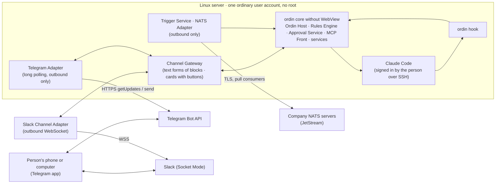
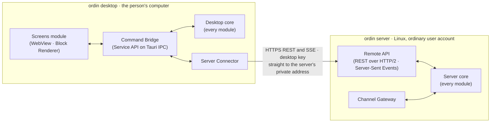
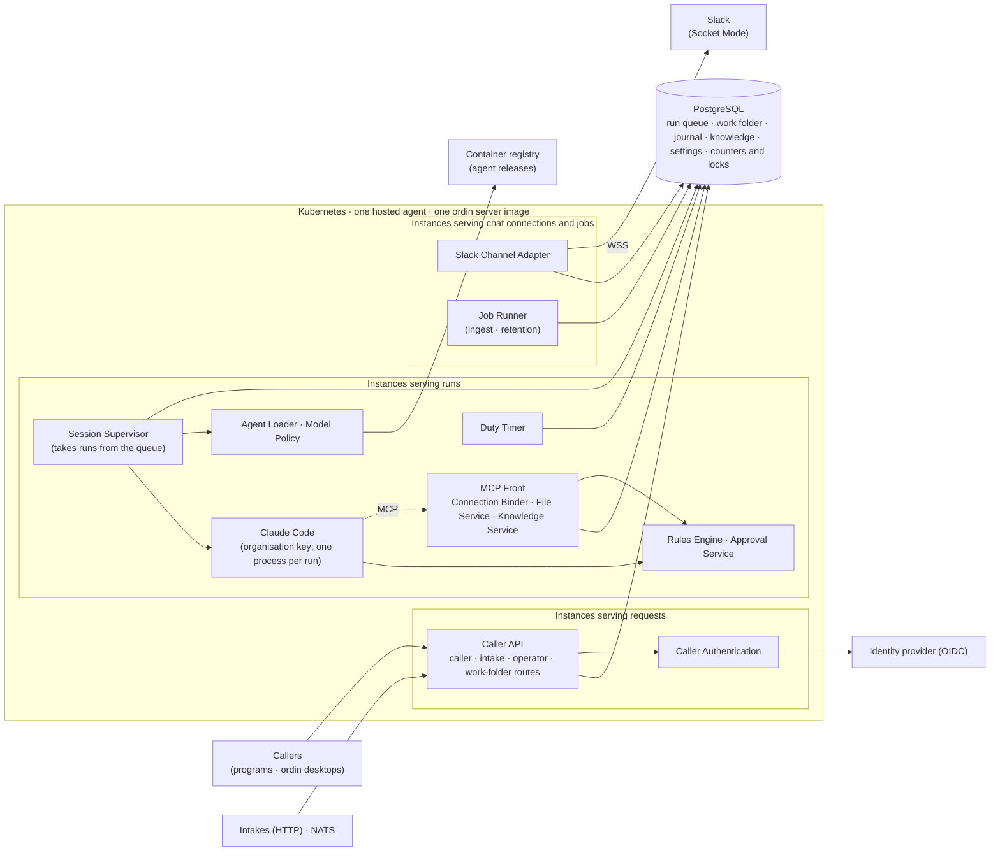
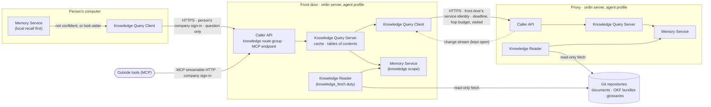

# ordin desktop — System Architecture

> **Mode:** draft
> **Generated from:** inline context — the user's decisions of January 2026
> **Revision:** 0.58.0
> **Last updated:** January 2026

## System Architecture

```mermaid
flowchart TB
    subgraph UI["WebView (interface)"]
        SH["App Shell<br/>Home · Search or go to · Workspace switcher · Conversation with Ordin · Needs you · pinned blocks · Settings · engineering views"]
        BLK["Block Renderer<br/>(fixed catalogue)"]
    end

    subgraph Core["Rust core"]
        BR["Command Bridge"]
        CAT["Package Catalogue"]
        AGC["Agent catalogue<br/>Agent Model · Catalogue Service · Checker · Resolver and Compiler · Installers · Authoring Service · Format Plug-ins"]
        INS["Package Inspector"]
        WSM["Agent Folder Manager"]
        SUP["Session Supervisor"]
        RE["Rules Engine"]
        APS["Approval Service"]
        CO["Crew Orchestrator"]
        JR["Journal and Artefact Store"]
        ID["Identity and Credentials"]
        OP["Organisation Profile"]
        SA["Setup Assistant"]
        FSV["File Service"]
        CT["Craft Toolkit"]
        PS["Project Service"]
        WKS["Workspace Service"]
        CFA["Confluence Adapter"]
        JRA["Jira Adapter"]
        ORD["Ordin Host"]
        MEM["Memory Service<br/>(memory, in-process)"]
        KNS["Knowledge Service<br/>(workspace pages)"]
        HOS["Home and Search<br/>(application code, no model call)"]
        SBX["Sandbox<br/>(sandboxd, in-process)"]
        SPA["SharePoint Adapter"]
        PUSH["Push Service"]
        RA{{"Runtime Adapter interface"}}
        CLA["Claude Local Adapter"]
        CPA["Copilot Local Adapter"]
        MCPF["MCP Front<br/>(ordin-served MCP servers)"]
        HKR["Hook Relay"]
        LOC["Localisation"]
        BRD["Brand"]
        DIC["Dictation Service"]
        WHA["wrightrun HTTP Adapter"]
        SLA["Slack Thread Adapter"]
        MLS["Mail Service<br/>(IMAP and SMTP; then Graph; then Gmail)"]
        HOV["Handover Service"]
        SLS["Slack Service<br/>(person's Slack sign-in)"]
        TKS["Team Knowledge Service<br/>(team folder in GitHub or GitLab)"]
    end

    subgraph Bundled["Bundled programs (sidecars)"]
        CCLI["Copilot CLI server<br/>(one per local session)"]
        CLCLI["Claude Code CLI<br/>(the person's installed harness; one per local session)"]
        HOOK["ordin hook<br/>(run by the harness before each tool call)"]
    end

    SH <--> BR
    BR --> CAT & INS & SUP & CO & APS & JR & ID
    CAT --> AGC
    AGC --> OP & WSM & PS & MCPF & PUSH
    CAT --> WSM
    CAT --> INS
    INS --> RE
    SUP --> RA
    CO --> RA
    CO --> RE
    RA --- CLA & CPA & WHA & SLA
    CLA --> CLCLI
    CLA --> RE
    CLCLI & CCLI -.->|MCP| MCPF
    MCPF --> RE
    MCPF --> SBX & MEM & CT & ORD & KNS & MLS
    MLS --> RE & APS & FSV & ID & JR
    KNS --> FSV & MEM
    BR --> HOS
    HOS --> JR & KNS & FSV & WKS
    CLCLI & CCLI --> HOOK
    HOOK -.->|local channel| HKR
    HKR --> RE
    BR --> LOC & BRD & DIC
    BRD --> OP
    CPA --> CCLI
    CPA --> RE
    RE --> APS
    SUP --> JR
    CO --> JR
    APS --> JR
    CPA & WHA & SLA --> ID
    WSM --> JR
    HOV --> AGC
    HOV --> APS
    HOV --> PUSH
    HOV --> SPA
    HOV --> MLS
    HOV --> SLS
    SLS --> ID
    SLS --> APS
    SLS --> MCPF
    SLS --> WKS
    SLS --> JR
    HOV --> WKS
    HOV --> JR
    BR --> TKS
    TKS --> MEM & KNS & PUSH & PS & WKS & ID & JR
    BR --> WKS
    WKS --> FSV
    WKS --> CFA
    WKS --> JR
    CFA --> ID
    CFA --> APS
    HOV --> JRA
    WKS --> JRA
    JRA --> ID
    JRA --> JR
    BR --> SA
    SA --> OP & ID & CAT & CCLI
    CAT --> OP
    CO --> OP
    BR --> FSV
    FSV --> WSM
    FSV --> CT
    CPA --> CT
    CT --> RE
    CT --> CRAFTX["ArtCraft CLIs and apps"]
    SA --> CT
    CT --> OP
    BR --> PS
    PS --> FSV
    PS --> RE
    PS --> ID
    PS --> LSPX["Language servers"]
    CPA --> PS
    SH --- BLK
    BR --> ORD
    ORD --> CO
    ORD --> SUP
    ORD --> MEM
    ORD --> KNS
    ORD --> INS
    ORD --> CAT
    ORD --> BLK
    CPA --> SBX
    SBX --> ID
    WKS --> SPA
    SPA --> ID
    ORD --> PUSH
    PUSH --> APS
    PUSH --> SPA & CFA & PS
    PUSH --> CT & FSV
    PUSH --> JR
```

*From revision 0.27.0 the diagram shows the agent catalogue components (ADR-081, ADR-086, ADR-087) as one node and no longer shows the `apm` sidecar, which left the bundle in revision 0.25.0 (ADR-082). The agent catalogue's edges follow each component's* Depends on *list below: the Organisation Profile, the Agent Folder Manager through the Installers, the Project Service (`gh`) through the Catalogue Service, and the MCP Front and Push Service through the Authoring Service.*

*From revision 0.54.0 the diagram shows the Jira Adapter (ADR-106), reached by the Handover Service and the Workspace Service.*

*From revision 0.48.0 the edges follow the corrected* Depends on *lists (ADR-100); the diagram's older edges `CPA --> CT`, `CPA --> SBX`, `CPA --> PS` and `MCPF --> SBX & MEM & CT & ORD & KNS & MLS` read in the direction the lists give.*

From revision 0.8.0 (ADR-027 to ADR-032), the person's requests reach the core through the Ordin Host. Ordin is a local session on the Copilot Local Adapter like any other, so its edges to the Crew Orchestrator and Session Supervisor are the crew tools, decided in fixed code.

The Rust core is the only owner of state and policy. Every technical step is performed by the core — the Setup Assistant, the Package Catalogue and the adapters — and never by the person (G10, ADR-012). The WebView renders and collects input. Bundled programs execute work only on the core's instruction. The core decides each tool request through the Rules Engine before it runs.

### Headless server deployment (revision 0.18.0; ADR-073)

No connection reaches the server from outside: the Telegram Adapter polls Telegram, the NATS Adapter connects out to the company's NATS servers (revision 0.19.0), and every other call is outbound as on the desktop (A-39).

### Module structure and remote screens (revision 0.42.0; ADR-096)

ordin is a modular monolith: one Cargo workspace, one process per program, and one crate per module. A module is a component listed below, or a small group of components that always change together; the grouping is fixed in `/spec`. *Amended in revision 0.48.0 (ADR-100): one crate per component, plus three contract crates — shared types, the Service API (with the block catalogue and its schema check) and the Runtime Adapter interface; a hub owns the trait its providers implement (MCP Front `ToolProvider`, Crew Orchestrator `Coordinator`, Agent Model `PartSource`, Journal `EventSink`, Service API `ServiceApi`); only the desktop and server programs wire modules together.* Three rules hold for every module:

- **One service interface.** A module's crate exposes Rust traits and data types; everything else is private to the crate.
- **It owns its data.** Only the owning module writes and reads the tables its *Owns* list names. The journal is one SQLite file (ADR-010), divided by table.
- **Dependencies point one way.** A module depends only on what its *Depends on* list names. A build test reads the crate graph (`cargo metadata`) and fails on any other dependency and on any cycle.

The same crates build two programs. The screens module depends only on the Service API, and reaches each backend through a backend handle, without knowing where that backend runs:

The desktop's screens send commands for the desktop's own workspaces to the desktop core, and commands for a server's workspaces to the Server Connector, which calls that server's Remote API. Events from every backend reach the screens through the Command Bridge, each with its backend and its sequence number. The server never connects to the desktop.

### Server profiles and replacing wrightrun (revision 0.43.0; ADR-097, ADR-098)

The ordin server runs in one of two profiles, chosen at setup: the **personal profile** (ADR-073 to ADR-076, ADR-096: one person's own ordin) or the **agent profile** (ADR-097: one hosted agent with an identity of its own). The agent profile replaces wrightrun (ADR-098). It runs in one of two shapes: **single**, one process with SQLite, or **scaled**, one image started in roles on Kubernetes, with PostgreSQL as the only service.

In the single shape, every box above runs in one process, with SQLite in place of PostgreSQL and no Kubernetes. Each instance obtains the agent release from the container registry at start and checks its digest. The personal profile is the server of the earlier sections, unchanged.

**Replacing wrightrun.** Each component and cross-cutting unit of wrightrun's design (`agent-wright-runtime/docs/design/agent-runtime/02-architecture.md`, revision 0.24.2) and spec set (`agent-wright-runtime/docs/spec/components/`, `agent-wright-runtime/docs/spec/cross-cutting/`) is provided by the ordin module named here. *New* is a component this revision adds; *extended* is an existing component given more to do; *existing* is unchanged.

| wrightrun component | ordin module | Status |
|---|---|---|
| Configuration validator (`ConfigurationValidator.md`) | Agent Configuration | New |
| Prepare stage (`PrepareStage.md`) | Release Builder, using the Checker and the Resolver and Compiler (ADR-082) in place of `apm compile` | New |
| Agent release (`AgentRelease.md`) | Release Builder (publish) and Agent Loader (obtain) | New |
| Load stage (`LoadStage.md`) | Agent Loader | New |
| File tree (`FileTree.md`) | File Service: bundle read-only on disk, work folder in the datastore, file tools on the MCP Front | Extended |
| Runtime server (`RuntimeServer.md`) | Caller API | New |
| Run queue (`RunQueue.md`) | Run Queue | New |
| Run executor (`RunExecutor.md`), command expansion (`CommandExpansion.md`) | Session Supervisor, taking runs from the Run Queue, through the Claude Local Adapter | Extended |
| Duty timer (`DutyTimer.md`) | Duty Timer | New |
| Tool binder (`ToolBinder.md`) | Connection Binder on the MCP Front | New |
| HTTP connector (`HttpConnector.md`) | HTTP Connector, in the Connection Binder | New |
| Outbound publisher (`OutboundPublisher.md`) | Outbound Publisher, in the Connection Binder | New |
| Connector plug-ins (`ConnectorPlugins.md`) | MCP servers the organisation installs, declared as connections (ADR-098 item 2) | Existing, through the MCP Front |
| Event intake (`EventIntake.md`) | Caller API (intake routes) and Trigger Service | Extended |
| Chat connector, chat client (`ChatConnector.md`, `ChatClient.md`) | Slack Channel Adapter and Channel Gateway | Extended |
| Knowledge sources, index and ingest (`KnowledgeIndex.md`, `KnowledgeIngest.md`) | Knowledge Service, with ingest by the Job Runner | Extended |
| Control evaluator (`ControlEvaluator.md`) | Rules Engine, full vocabulary (ADR-098 item 4) | Extended |
| Run guard (`RunGuard.md`) | Session Supervisor: run limit, run summary | Extended |
| Model policy (`ModelPolicy.md`) | Model Policy | New |
| Settings store (`SettingsStore.md`) | Settings Store | New |
| Authentication check (`AuthenticationCheck.md`) | Caller Authentication | New |
| Operator routes (`OperatorRoutes.md`) | Caller API (operator and work-folder routes) | New |
| Trace writer, metrics emitter (`MetricsEmitter.md`) | Telemetry | New |
| Start-up report (`StartupReport.md`) | The start-up report (08 — Interfaces), built by the Agent Loader with wrightrun's items | Extended |
| Runtime database (`RuntimeDatabase.md`) | Each module's own tables, on SQLite or PostgreSQL (ADR-098 item 5) | Extended |
| Job runner (`JobRunner.md`) | Job Runner | New |
| Worker (`Worker.md`) | The ordin server started in the chat or jobs role | Extended (ordin server) |
| Retention and erasure (`RetentionAndErasure.md`) | Retention and Erasure | New |
| Operator commands (`OperatorCommands.md`) | The ordin server's command, with wrightrun's sub-commands | Extended (ordin server) |
| Deployment files (`DeploymentFiles.md`) | Helm chart of the ordin server | New |
| The reviewer as a read-only sub-agent (wrightrun G5, FR-16) | Rules Engine, deciding by sub-agent (C-78) | Extended |
| Cross-cutting: authentication, environment configuration, error handling, graceful shutdown, health checks, input validation, licence check, logging, metrics, pagination, testing | 07 — Cross-cutting, agent-profile rows (ADR-098 item 6) | Extended |

What does not carry across: Deep Agents, LangGraph and its checkpointer (the harness and the datastore take their place); the Python connector plug-in contract (replaced by MCP); a sampling temperature and Gemini models (ADR-098 item 3, OQ-65). Each is reported by the check command and the start-up report (G9).

### Knowledge agents (revision 0.61.0; ADR-112, ADR-113)

A **knowledge agent** is the ordin server in the agent profile with a `knowledge-agent` section in its agent configuration: the same build, image and deployment shapes as every hosted agent (ADR-097, ADR-098). A team's workspaces talk to one, the **front door**; the front door answers from its own graph and asks other knowledge agents, its **proxies**, in parallel. Only knowledge agents answer; desktops and personal servers ask through the Knowledge Query Client and are never asked, so a person's own memory is never reachable by others. What a person shares reaches knowledge agents only through a team folder in Git (ADR-103).

On a question's path no model is called and nothing is fetched from Git: the graphs are built in the background, and the reply is written by the person's own ordin. Deadlines, backup requests, hop budgets, caches dropped when a repository moves, hot copies and kept-open connections bound the time a person waits (ADR-113; A-62 to A-64). Access is by audience: an agent reads only repositories its whole audience may read and serves only that audience. ordin's own knowledge wiki is an Open Knowledge Format bundle (ADR-112), so knowledge agents read pages as pages and rank checked knowledge first.

**Per-person access (revision 0.63.0; ADR-115).** A new module, **Source Access** (agent profile only, build phase 2), is the knowledge agent's client of GitHub, GitLab, Confluence and SharePoint for anything but Git fetching: it links a person's accounts by asking each system whose sign-in it was given, answers access checks per system with a short in-process memory, accepts GitHub and GitLab sharing-change notices, and reads Confluence spaces and SharePoint libraries for the Knowledge Reader. The Knowledge Query Server filters each answer for the asking person through it, after recall and before merging; the Knowledge Reader depends on it for the two new kinds of source. Edges: Knowledge Query Server → Source Access; Knowledge Reader → Source Access; Source Access → Agent Configuration, Journal, Telemetry.

### Releases and updates (revision 0.62.0; ADR-114)

ordin ships in increments planned in the release roadmap (kept by the maintainers outside the repository) over the Generation Playbook's dependency order. Each program composes only the modules its **build switches** turn on: Cargo features named after features (`sandbox`, `copilot`, `mail`, `personal-profile`, `agent-profile` and others), each adding the modules of that feature. The roadmap decides which switches each release turns on; this design and the specs do not. When the screens greet a backend it names the module groups it answers, and the screens draw nothing of a group it does not answer. A command of an absent group is refused with "This needs a newer version of ordin."

Every shipped version publishes one **release feed** in Tauri's updater format, carrying the macOS and Windows installers and the Linux server archives, each signed with the **update key**. The unbranded build carries the project's feed address; a branded build may carry another; a verified organisation profile may redirect it.

| Program | Who updates it | How |
|---|---|---|
| ordin desktop | the person | The Setup Assistant checks 60 s after start, every 24 hours and on **Check for updates**; the desktop's updater downloads and verifies a newer version in the background; **Restart to update** installs and restarts, or the update installs when the person quits. **What's new** shows the notes once after the first start. |
| ordin server, personal profile | the person, when they ask | `ordin-server update`, or **Update server…** from a paired desktop: the Setup Assistant reads the same feed, verifies the archive for the server's architecture with the update key, replaces the programs and asks systemd to restart the user unit. A server in a container or not run by its user unit only announces. |
| ordin server, agent profile | the operator | Announces a newer version only; the operator deploys the new image or archive. |

Before a new version applies its first migration the Journal copies the datastore; migrations stay forward-only, and a release is undone by restoring that copy with the previous version.

### Component responsibilities

- **App Shell.** *From revision 0.8.0 (ADR-028) the shell is minimal: the workspace switcher, the conversation with Ordin, the* Needs you *list, pinned blocks beside the conversation, Settings, and engineering mode's fixed views. *From revision 0.10.2 (ADR-046) the pinned blocks are replaced by a screen area in the centre, with one tab per open screen, and the conversation has its own panel with one tab per open workspace.* *From revision 0.10.14* Needs you *is that panel's fixed first tab, before the workspaces' tabs (UX-A37).* The views listed below remain as blocks Ordin shows, rendered by the Block Renderer, except the guided crew builder, which is removed (ADR-027), and Diagnostics, which stays under Settings.* The interface is task-oriented. Its code editor is an embedded editor component (ADR-020) used by Projects and for any text file in Files: *Amended in revision 0.62.0 (ADR-114): it draws nothing of a module group the backend does not answer, and adds Settings › About, the update line and **What's new**.*
  - **Getting ready**: the first-start sequence of the Setup Assistant.
  - **Start**: the installed agents with their commands, the crews, and *Add an agent* from the marketplace. *From revision 0.25.0, from the agent library, which lists the agents of every agent repository (ADR-082, ADR-086).* *Amended in revision 0.36.0: an added agent appears under* Agents *in the workspace tree, and a task starts by asking Ordin, with any form opening as a screen in the centre (ADR-027, UX-A33, UX-A35).*
  - **Inputs**: the arguments of a command, attached files and folder grants.
  - **Work**: the current step, completed checks, blockers and the start-up report.
  - **Approvals**: the exact action, its destination and its consequence.
  - **Results**: artefacts with preview, edit and export.
  - **Crews**: a guided crew builder (pick a purpose, pick the agents, accept or lower the suggested limits) and running crews with their rounds. The person never edits a charter file. *Amended in revision 0.36.0: there is no crew builder. Ordin proposes a crew plan as a screen, and nothing starts until the person presses* Start *(ADR-027, UX-A35).*
  - **Memory**: each agent's `memory/` pages, kept in its agent folder. *From revision 0.36.0 the person can edit these pages by hand; from 0.36.1 with the formatting toolbar, like any Markdown document (UX-A59).*
  - **Workspace switcher** (revision 0.7.0): the current workspace, the person's other workspaces and *New workspace* (ADR-025). *From revision 0.10.1 it is one tree in the side rail, holding each workspace's documents, agents, kept crews, running work and memory, with actions beside each node; the Projects view's project tree is the same component (11 — UX guidelines §4, UX-A14).*
  - **Home** and **Search or go to…** (revision 0.10.13; ADR-058, ADR-059): fixed views, like Settings, drawn from the Home and Search component; the changed marks in the tree come from the same component (ADR-079).
  - **Files**: the current workspace's folder tree with its Confluence locations, a sortable list with breadcrumb and search, publishing state, places, previews, versions, origin, and the actions *open*, *edit in ArtCraft*, *give to an agent*, *save a copy elsewhere*; drag and drop in and out. *Amended in revision 0.36.0: inside ordin the person edits by hand only Markdown documents, knowledge pages, agents' own memory pages and email drafts. Every other kind is changed by agents or opened in its own app: Word, Excel and PowerPoint in the person's own Microsoft app, PDF in PdfCraft and images in PhotoCraft (ADR-029, ADR-048).*
  - **Projects** (engineering mode only): the project tree, search, code editors in tabs, change review, git status, history, branches and commit. *From revision 0.10.4 (ADR-047) there is no separate Projects view: a workspace that links a repository shows engineers a Code group in the side-rail tree, and the code editor, Changes waiting (change review with commit and push) and the terminal open as screens in that workspace.*
  - **Diagnostics**: journal events, versions and technical names, for support. This is the only view that shows them.

  Chat opens beside every view and is an equal way to start, steer and ask about work; anything it asks to do returns as the same task form or approval card (11 — UX guidelines, P2 and §5.12). The shell holds no state that is not also in the journal, apart from view preferences.
  - **Owns:** nothing durable. *Amended in revision 0.49.0:* the person's notification and display preferences (2D-3) are kept by the desktop program in its own preferences file, because the core raises the notifications (2B-2 D6); the shell reads and writes them through `settings.get` and `settings.change`.
  - **Depends on:** Command Bridge.

- **Block Renderer** (revision 0.8.0). Renders the blocks of the fixed catalogue (ADR-028) with the application's own code.
  - **Validates** each block Ordin sends against its schema; drops an invalid block and returns the reason to Ordin.
  - **Never renders an approval** from Ordin's data; approval cards come only from the Approval Service.
  - **Pins** a block beside the conversation on the person's request, and keeps it current from the events of the run or crew it shows. *From revision 0.10.2 (ADR-046): draws a block as a screen in the centre, or as a one-line card in the conversation, and keeps an open screen current from the events of the run or crew it shows.*
  - **Reports and progress** (revision 0.13.0; ADR-067, ADR-068). Draws the Table, Chart, Key figures and Report kinds, checking each against its schema and A-34's limits; draws charts with the application's charting library (C-40) in the theme's chart palette, each with **Show as table**; draws progress in three layers — Now, steps, what happened — from the Journal's plan, marks and events.
  - **Email** (revision 0.15.0; ADR-070). Draws the Email list and Email kinds: senders outside the company marked with a word and an icon, never colour alone; an Email from an agent always as a draft, with **Send…** that asks the Approval Service, never a send of its own.
  - **Owns:** nothing durable; pinned blocks are a view preference. *From revision 0.10.2, open screens and tabs are a view preference.*
  - **Depends on:** App Shell, Command Bridge. *Amended in revision 0.48.0 (ADR-100): the block catalogue and its schema check are in the Service API's crate, so the Ordin Host and the MCP Front check blocks without depending on the WebView; the drawing side is part of the screens module and depends only on the Service API.*

- **Ordin Host** (revision 0.8.0). Runs Ordin (ADR-027) as a local session per workspace conversation and gives it its tools.
  - **Agent directory.** Builds from the Package Inspector a summary of every installed instance — commands, skills, arguments, lifecycle, authority, declared rules — and gives it to Ordin at session start and on change.
  - **Tools.** Offers Ordin, through the Copilot SDK's custom tools: the crew tools (delegate, finish, escalate, create crew, keep crew — *from revision 0.11.0 save workflow, propose workflow change and take over*); *show* (a block); *remember* and *recall* (Memory Service); *find agent* and *propose agent* (Package Catalogue, ADR-032); *propose push* (Push Service). Ordin has no other tool. Tool names are fixed in `/spec`.
  - **Crews.** Turns Ordin's *create crew* into a charter within the guardrail defaults and maxima, and hands it to the Crew Orchestrator unchanged in its enforcement; saves the charter under a name on *keep crew*.
  - **Workflows** (revision 0.11.0, ADR-064). Saves a workflow — inputs, agents, steps, limits, origin — under a name in the workspace, as versions, on *save workflow* or on the person's **Save** on the workflow screen; checks every version in fixed code before saving (agents in the workspace, inputs and earlier results each step uses, at most the company's maximum running at once, limits within the maxima); duplicates a workflow into this or another workspace; exports a version as a `.workflow.yaml` file (08 — Interfaces) through the system's save dialog; imports a file after the checks of sequence *Import a workflow*, never through Ordin's model. A kept charter from before revision 0.11.0 becomes a workflow with no steps, coordinated by Ordin as it goes until it is next saved. *From revision 0.12.0 (ADR-065, ADR-066):* the check also covers control blocks — paths, conditions, maxima, nesting at most 4 deep, at most 50 steps and blocks, results used only where they exist, and workflows run from others at most 3 levels deep with no cycle; the Ordin Host lists workflow files in the workspace's linked GitHub and GitLab folders and in the company's workflow repository named in the organisation profile, reads each through the Project Service's `gh` and `glab` and checks it as an import, notices newer versions there, and sends a shared or changed workflow back through the Push Service after the person's approval.
  - **Summarise and start fresh** (revision 0.10.6, ADR-049). Starts a new Ordin session for the workspace, seeded with Ordin's summary or with nothing, plus the items still waiting and the agent directory; keeps the earlier conversation read-only; refuses to start fresh while a crew Ordin coordinates is running. *From revision 0.36.0 Ordin no longer works from an earlier conversation, and reads one only when the person asks (**Ask Ordin about it**).* *From revision 0.57.0 an earlier conversation can be continued: a new conversation linked to it, seeded with its stored summary and most recent messages (ADR-108).*
  - **Owns:** Ordin's session per workspace, the workspace's earlier conversations, and saved charters; *from revision 0.11.0, workflows and their versions.* *Amended in revision 0.48.0: it also owns the person's voice settings.*
  - *Amended in revision 0.58.0 (ADR-109):* states the person's interface language in the voice section of Ordin's seed and in a one-line notice when it changes; offers Ordin one tool that changes a setting the person asks for in words — tone, formality, length, name, or the interface language — refused for words that came from other people; offers to draft a missing language and runs the draft as a background job on the person's plan, through the Usage Planner, handing every reply to Localisation's check.
  - *Amended in revision 0.60.0 (ADR-111):* Ordin's *remember* carries the things a fact is about, the links between them and, for a summary, the facts it was made from; the seed tells Ordin when to state links. At the end of a run that wrote five or more facts about one thing, with no summary of it in the last day, Ordin is given one fixed turn to write a summary (at most three a run). Each answer records the recalls it used, so the screens can show **What Ordin used**.
  - **Depends on:** Copilot Local Adapter, Package Inspector, Package Catalogue, Crew Orchestrator, Session Supervisor, Memory Service, Push Service, Block Renderer, Journal. *Amended in revision 0.48.0 (ADR-100): Runtime Adapter interface, Service API, MCP Front, Package Inspector, Package Catalogue, Crew Orchestrator, Session Supervisor, Usage Planner, Memory Service, Knowledge Service, Push Service, Project Service, Workspace Service, Journal. Ordin runs on the harness the profile names, so the Copilot Local Adapter gives way to the Runtime Adapter interface; the Block Renderer gives way to the Service API, which holds the block check; it implements the MCP Front's `ToolProvider` and registers its tools with the MCP Front at start; and it implements the Crew Orchestrator's `Coordinator`, passed in when it starts a crew run.* *Amended in revision 0.49.0 (`/spec` Phase 3):* the Ordin Host does not depend on the Organisation Profile: the program passes it the voice defaults, the company workflow repository and the crew limits from the verified profile (`OrdinHostPolicy`, an input value; ADR-100 item 1). *Amended in revision 0.50.0 (ADR-102):* it also answers the programs' call when the Slack Service asks Ordin about new messages in a linked channel: a fixed turn in the workspace's Ordin conversation that hands Ordin the messages as data, with the Slack tools to read and draft; Ordin drafts a reply, offers a saved workflow run (`propose_workflow_run`) or asks the person, and nothing is posted or started without the person. *Amended in revision 0.58.0 (ADR-109): + Localisation.*

- **Memory Service** (revision 0.8.0). Wraps the memory component (`memory/`), linked in-process, with its store in the application's data folder (ADR-030). *From revision 0.34.0 it honours each agent's memory part: what it may keep, what it must not, and for how long (ADR-090).*
  *Amended in revision 0.43.0 (ADR-097): in the agent profile, memory is kept by scope — one per channel, one per direct chat, one agent-wide — and a direct chat's content is never written to another scope; on PostgreSQL in the scaled shape (C-82).*
  *Amended in revision 0.48.0 (ADR-101): the memory component keeps its store behind a storage interface, implemented on the journal's SQLite file and, in the scaled shape, PostgreSQL; SurrealDB is not part of ordin's build.*
  *Amended in revision 0.51.0 (ADR-103): it exports the workspace's facts for a team share — never facts used in all workspaces, facts from page sections, or facts awaiting the person's check for personal data — and imports a team's facts keeping their identifiers and validity times, through the write gate's personal-data and instruction checks but without fact extraction; the person can mark a flagged fact as checked.*
  *Amended in revision 0.59.0 (ADR-110): facts got from another team's folder are tagged with that folder, recalled with its name and description, never exported, and removed in one step when the folder is no longer read; a person's correction of such a fact stays on the computer; it adopts a fact as a new item through the memory component's checks; recall may be restricted to some folders and may take typed sub-queries.*
  *Amended in revision 0.60.0 (ADR-111): memory is a core capability every agent session uses — Ordin, crew members and agent task sessions whose agent has memory rules (an agent without them gets none) — under one model. A fact may carry the things it is about and the links between them; the memory component resolves them, stores each link with its own validity and closes a link a newer fact says no longer holds, with no model call. Recall finds the things a question names and follows live links one step (two at most) as one more ranked signal, ranks a page-backed fact above an equal document-backed one, and marks fading facts. Ordin's summaries are kept with the facts they came from. The person sees and governs things, links, a fact's history, fading, what each answer used (from a record of recall ids, ids only) and what each run remembered. Knowledge page titles and other names name things, and links between pages become links between things (memory change M-9, memory ADR-021).*
  - **Scope.** One tenant per installation, one user, one team scope per workspace.
  - **Writes and recalls** facts for Ordin and for members of crews Ordin runs; content from documents enters through the memory component's write gate as data.
  - **Shows** facts to the person through the memory block, and applies their corrections and deletions.
  - **Owns:** the memory store. *Amended in revision 0.48.0: it also owns the memory facts, whose type is the memory component's own, imported unchanged.*
  - **Depends on:** bundled embedding and reranking models (ADR-033; C-18), Journal. The wrapped code is the memory component copied from recall (ADR-034). *Amended in revision 0.48.0 (ADR-100): + MCP Front; it implements the MCP Front's `ToolProvider` and registers its tools with the MCP Front at start.*
  *Amended in revision 0.61.0 (ADR-112, ADR-113): a page-backed fact's trust follows its concept's Open Knowledge Format verification — human-reviewed 1.0, machine-confirmed 0.9, unverified 0.8, documents still 0.5 — and a deprecated concept's facts are returned only when nothing else matches; draft and out-of-date marks travel with the fact. In a workspace connected to a front door, recall asks the front door through the Knowledge Query Client when its own answer is not confident (fewer than three facts above the reranker's threshold, or the question names a thing the front door knows and the workspace does not), or when the person asks to look wider, and fuses the two by rank; the recall record keeps each knowledge-agent fact's agent, repository, path, commit, section, "as of" and answer id, never its statement. In the agent profile it keeps a knowledge agent's graph in one scope of kind *knowledge*, lists the most-connected things for the table of contents, and never asks a front door.* *Depends on: + Knowledge Query Client.*

- **Knowledge Service** (revision 0.10.12). Keeps each workspace's knowledge pages (ADR-057).
  *Amended in revision 0.43.0 (ADR-098): in the agent profile it also keeps wrightrun's knowledge sources — chat history of enabled scopes, entries operators add and verify, and the agent's notes — ingested by the Job Runner and searched by ranked full-text match, and serves wrightrun's knowledge tools on the MCP Front.*
  *Amended in revision 0.51.0 (ADR-103): it exports and imports page files for team shares; a page's header records who first shared it and when; when two people changed the same page, the newer version is used and the other kept as an earlier version; a shared page citing a file on another person's computer is withheld from agents.*
  *Amended in revision 0.59.0 (ADR-110): another team's pages are kept read-only in a table of their own, apart from the workspace's pages and never exported; their links resolve within their own folder; a page is adopted as a new page of the workspace through the same checks.*
  *Amended in revision 0.60.0 (ADR-111): it gives the Memory Service each page's title, other names and links to other pages when it indexes the page, so the page's title names a thing and a link between pages becomes a link between things; it answers which page explains a thing, for "Explained in".*
  *Amended in revision 0.52.0 (ADR-104): it keeps page header keys written by other Markdown apps, follows files renamed, moved, created or deleted in `knowledge/`, keeps a link graph with the pages that link to each page, other names and tags, rewrites links in other pages when a page is renamed, and suggests links and possible duplicates for the person to accept.*
  - **Pages.** Reads and writes Markdown pages in the workspace's own folder, through the File Service, which keeps their versions. Only Ordin's *write page* tool and the person's edits change a page.
  - **Freshness.** Compares the version of each cited source recorded on a page with the source's current version, from the File Service's watcher and the SharePoint and Confluence adapters, and marks the page "may be out of date". Re-checks before Ordin relies on a page.
  - **Serving.** Answers *search pages* and *read page* for sessions in the workspace through the MCP Front, withholding a page that cites a place the agent cannot read (Rules Engine). Gives the Memory Service each page's sections to index, and the File Service's search index the page text.
  - **Agents' reference.** Lists each installed package's `knowledge/` folder as read-only pages.
  - **Owns:** the knowledge pages of every workspace. *Amended in revision 0.48.0: in the agent profile it also owns knowledge entries and the agent's notes, whose types are imported from wrightrun's domain (`agent-wright-runtime/docs/design/agent-runtime/04-domain.md`), because this HLD gives them no fields.*
  - **Depends on:** File Service, Workspace Service, Memory Service, Rules Engine, Push Service (publishing a page to Confluence), Journal. *Amended in revision 0.48.0 (ADR-100): + MCP Front; it implements the MCP Front's `ToolProvider` and registers its tools with the MCP Front at start.*
  - *Amended in revision 0.55.0 (ADR-107):* adds a lookup of the question, the same ranked search with no model, used by the knowledge-lookup context step; chat-history ingest also reads thread replies.
  *Amended in revision 0.61.0 (ADR-112): every page file is an Open Knowledge Format 0.2 concept. Beside ordin's own keys it writes `type` (Explanation, How-to, Decision, Reference or Glossary; Explanation by default), `title`, a one-sentence `description`, `tags` and `generated`, adds a `verified` entry with the person's Git host login when the person writes or edits a page or accepts **Use the update**, and gives each `sources` entry `resource`, `id` and `last_modified`; it reads `status` and `stale_after`. `index.md` and `log.md` are never pages; it writes the knowledge folder's `index.md` when pages change. Links it writes are standard Markdown links to the page's path; `[[Title]]` links are still read and left as typed. It reads concepts written by other producers as pages, tolerating unknown types and keys, broken links and a missing index, and keeps every key and `sources` field it does not own, byte for byte, when it rewrites a file. It gives the Memory Service each page's trust and status, and its Open Knowledge Format reader and writer are the ones the Knowledge Reader uses.*

- **Usage Planner** (revision 0.10.14; ADR-062). Chooses the model level for each step from the person's usage settings and the organisation profile, estimates a crew's or a large task's use before it starts, steps a failed step up one level once, decides when to reuse an answer and when to summarise, and counts each run's turns, tool calls, level, tokens and cache share in the journal.
  - **Owns:** usage settings, the answer-reuse index (request, agent, workspace, input versions, answer reference) and the daily counters.
  - **Depends on:** Organisation profile, Journal, Session Supervisor, Ordin Host, each harness adapter's level-to-model map. *Amended in revision 0.48.0 (ADR-100): Organisation Profile, Journal, Runtime Adapter interface. It is a policy module: each harness's level-to-model map is reached through the Runtime Adapter interface, and the Session Supervisor, the Crew Orchestrator and the Ordin Host call it, not the other way round.*
- **Home and Search** (revision 0.10.13). Answers Home, the tree's changed marks and the search box for the person, in the application's own code, with no model call (ADR-058 to ADR-060).
  - **Home.** Lists, across every workspace, the items waiting for the person (the same as *Needs you*), every running task and crew run with its state, and what finished or changed since the person last opened Home: finished runs from the journal, documents changed at their origin from the File Service's watcher and the SharePoint and Confluence adapters, knowledge pages that may be out of date from the Knowledge Service, and replies from agents that answer in Slack from the journal.
  - **Changed marks** (ADR-079, replacing the catch-up of ADR-058). Returns, per workspace, the documents someone changed where they live since the person last opened each one, from the adapters' change marks; a document's mark is cleared when the person opens it. Writes nothing into the conversation.
  - **Search.** Answers the search box from the workspaces, agents, workflows (kept crews before revision 0.11.0), dashboards (from revision 0.36.0) and earlier conversations the core already lists, the Knowledge Service's pages, and each workspace's File Service index (A-22), within A-21's 1 s for first results. Results go to the WebView for the person only; nothing here is offered to an agent session or through the MCP Front.
  - **Run again.** Reads a finished run's inputs, with the version read, from the journal, compares each with its source's current version, and gives the task form or crew plan the inputs to fill, naming each newer version (A-29).
  - **Decides nothing.** Opens, switches workspace and fills forms only; approvals, pushes and posts stay with the Approval Service and the Push Service.
  - **Owns:** each workspace's *last seen* mark and the person's Home marks.
  - **Depends on:** Journal, Knowledge Service, File Service, Workspace Service, SharePoint Adapter, Confluence Adapter.

- **Sandbox** (revision 0.8.0). Wraps `sandboxd` (copied from faraday into `sandbox/`), linked in-process (ADR-031; C-17).
  - **Runs** code an agent writes — Python through `python_sandbox`, shell scripts and JavaScript through the sandbox's other tools (ADR-040) — with no network and no files of its own; passes in inputs from granted places and returns outputs as artefacts; keeps a working folder for the length of an agent session when asked.
  - **Brokers** calls to company systems the Rules Engine allows, with the person's tokens from the keychain; the code never holds a token.
  - **Owns:** nothing durable.
  - **Depends on:** Rules Engine, Identity and Credentials, Journal. *Amended in revision 0.48.0 (ADR-100): + MCP Front; it implements the MCP Front's `ToolProvider` and registers its tools with the MCP Front at start.* *Amended in revision 0.49.0 (`/spec`): input files from granted places are read through a place reader the Sandbox defines and the program implements over the File Service (`PlaceFiles`, ADR-100 item 1), so the Sandbox's crate does not depend on the File Service; outputs are written to the agent's folder through the Journal and Artefact Store.*

- **SharePoint Adapter** (revision 0.8.0). Reads from and pushes to SharePoint through Microsoft Graph with the person's own Microsoft account (ADR-029; C-14).
  - **Reading.** Lists sites, libraries and folders the person can see; fetches files and their versions into the working copy.
  - **Pushing.** Uploads a new version of a file on an approved push, after checking that the origin's version is still the one read.
  - **Copies** (revision 0.14.0, ADR-069). Creates a file in a chosen site, library and folder on a copy's first publish, after checking whether a file of that name exists; uploads each update of a copy as a new version after checking that the copy's version is still the one ordin pushed; reports who can see the destination for the approval card and before each automatic update (C-42).
  - **Owns:** SharePoint links' sync state. Published copies are recorded by the File Service.
  - **Depends on:** Identity and Credentials (the person's Microsoft token), Journal.

- **Mail Service** (revision 0.15.0; ADR-070). The person's own mailbox, offered to sessions through the MCP Front as the mail tools.
  - **Adapters** (amended in revision 0.16.0, ADR-071), in order of release; the organisation profile names which one a company uses:
    1. **IMAP and SMTP**, for the company's own mail server: IMAP over TLS to read, SMTP submission over TLS to send, at the servers and ports the profile names, with the company's single sign-on (SASL XOAUTH2 or OAUTHBEARER) or the person's mail password from the keychain (C-45). Reads without marking messages read (`BODY.PEEK`); tracks each folder by its validity value and message numbers (`UIDVALIDITY`, `UID`); after SMTP accepts a message, saves a copy in the Sent folder unless the profile says the server does. POP3 is not offered.
    2. **Microsoft Graph** for Outlook, with the person's Microsoft sign-in and the mail permissions of C-43.
    3. **The Gmail API** for Google Workspace (C-44).
  - **Scope.** Answers *search email* and *read email* only with messages that match the workspace's email links, for Ordin and for agents the person granted email in that workspace. Records each grant with the Workspace Service.
  - **Attachments.** *save attachment* copies one attachment into the workspace's own folder as a new file through the File Service, after the incoming-file safety check.
  - **Drafts.** Keeps every draft on this computer, with the agent that wrote it, the message it answers and its attachments' sources; takes attachments only from places the session may read; **Save to mail drafts** on the person's choice (named for the mailbox: mail, Outlook or Gmail).
  - **Sending.** *ask to send* hands the draft to the Approval Service; nothing else sends. On approval it gives the message its own Message-ID, records an external action with a unique key and that Message-ID in the Journal, sends from the person's mailbox, and records the sent message's identifier. After a crash it looks for that message in the Sent folder before offering to send again. *With SMTP (ADR-071):* a refused recipient stops the whole send, with the address and the server's reason; a message over the server's announced size is reported before sending; a failed copy to Sent leaves the email *sent*, marked "not saved in your Sent folder", with **Save it there**; a send without SMTP's acceptance and no copy in Sent shows "Not sure this was sent" with **Send again** and **Mark as sent**.
  - **Profile rules.** Email off; recipients inside the company only; the most recipients per email (default 20); places whose files may not be attached; the required foot line for agent drafts. Each is checked by the Rules Engine when the draft is written and again before sending.
  - **New email.** Checks each workspace's email links at workspace open, at start and every 15 minutes (A-37), and reports new messages to Home and Search; starts no work.
  - **Safety.** Marks senders outside the company; reports hidden text in a message as for documents; never follows a link in a message.
  - **Owns:** email links' check state, drafts, email grants' enforcement, sent-email records.
  - **Depends on:** Identity and Credentials, Rules Engine, Approval Service, File Service, Workspace Service, Journal, Organisation Profile. *Amended in revision 0.48.0 (ADR-100): + MCP Front; it implements the MCP Front's `ToolProvider` and registers its tools with the MCP Front at start.*

- **Push Service** (revision 0.8.0). Sends changes back to their origins (ADR-029).
  - **Groups** the changes of one request into one approval request: each file, its origin, a one-line summary and the change view.
  - **Checks** before each push that the origin has not changed since the working copy was read (A-25); stops and reports both versions if it has.
  - **Pushes** after approval, through the SharePoint Adapter, the Confluence Adapter, or the Project Service (commit and push under ADR-023).
  - **Never** pushes a change an agent made without approval, including in folders linked under ADR-026.
  - **Copies** (revision 0.14.0, ADR-069). When an original changes, it lists that original's published copies. For each copy kept up to date whose original's change reached its origin, it asks the Craft Toolkit or the Confluence Adapter to remake the copy from that version, and pushes it without a new card, as an external action in the journal with a unique key. It holds a copy that changed at its destination, or whose audience grew, and asks the person. Every other update of a copy joins the original's approval card.
  - **Team shares** (revision 0.51.0; ADR-103). After one card, pushes a team-knowledge commit the Team Knowledge Service prepared in its own repository copy, without force, or to a review branch with a pull request or merge request where the branch requires review; reports a branch that moved, so the commit is rebuilt without a new card.
  - **Owns:** pending pushes.
  - **Depends on:** Approval Service, SharePoint Adapter, Confluence Adapter, Project Service, Craft Toolkit and File Service (copies, from revision 0.14.0), Journal.

- **Command Bridge.** The typed command and event interface between the WebView and the core, exposed through Tauri IPC and limited by Tauri capabilities. It validates every command's input at the boundary, and pushes events (session progress, approval requests, crew round changes) to the shell.
  *Amended in revision 0.42.0 (ADR-096): the command and event catalogue becomes the **Service API**, defined once as Rust data types that serialise to JSON, versioned, with every event carrying its backend's journal sequence number. The Command Bridge is the Service API's transport on Tauri's IPC, and routes each command to the desktop core or, for a server's workspace, to the Server Connector.*
  - **Owns:** the command and event catalogue.
  - **Depends on:** every core service it exposes; Server Connector (revision 0.42.0). *Amended in revision 0.48.0 (ADR-100): Service API, Server Connector, Journal. It reaches the core services through the Service API, wired by the desktop program; it receives events, approval requests included, by subscribing to the Journal's `EventSink`, and server events through a channel it gives the Server Connector.*

- **Package Catalogue.** Drives the bundled `apm` tool so that, for the person, adding an agent is one action: *Add*. *From revision 0.25.0 it no longer drives `apm` (ADR-082): adding stays one action, carried out by the agent catalogue components below. The marketplace, install, trust and update bullets describe revision 0.24.0.*
  - **Marketplace** *(revision 0.24.0; superseded by ADR-082)*. It registers the marketplace the organisation profile names (`apm marketplace add`) and keeps the list fresh in the background (`apm marketplace update`). It presents packages as agents with a plain description and what they can do (`apm marketplace browse`, `apm search`); technical names, versions and targets are shown only in Diagnostics.
  - **Install** *(revision 0.24.0; superseded by ADR-082: the Resolver and Compiler and the Installers)*. It installs into a new agent folder with the Copilot target (`apm install … --target copilot`), records the lock file, and runs `apm audit`. An audit finding cancels the install and removes the agent folder; the person sees "This agent could not be added safely" with an offer to tell IT.
  - **Trust** *(revision 0.24.0; superseded by ADR-082: the Checker and the profile's trust policy over tool bindings and hooks)*. Executable parts (hooks, MCP servers, bundled programs) are never put to the business user. The Catalogue applies the organisation's recommended executable set (`apm approve --recommended`). An agent whose executable parts are outside that set is shown as "needs IT approval", and the person may send IT a request with one action (ADR-013).
  - **Updates** *(revision 0.24.0; the rule of A-16 stands, and from revision 0.25.0 an update is a newer version on the agent repository's protected branch, ADR-082)*. It checks for updates in the background (`apm outdated`). Updates within the same major version are applied automatically between runs; others are offered in plain language ("A new version of Release planner is available: what changed"). *Amended in revision 0.36.0: the rule follows what changes, not the version number. An update that does not change what the agent may do or read is applied between runs without a question, and the agent's line says "Updated between runs today; what it may do hasn't changed, so nothing was asked." An update that changes what it may do or read reaches* Needs you *and the person chooses (A-16).*
  - **Removal.** It removes an agent instance after the person confirms, and its agent folder is deleted.

  It never edits a package's files.
  - **Owns:** the list of agent instances and their install records, *the workspaces each instance serves, and the pack choices recorded for each (decision 64; revision 0.49.0)*.
  - **Depends on:** the agent catalogue components below, Organisation Profile, Agent Folder Manager, Package Inspector, Journal. *Until revision 0.25.0 it depended on the `apm` CLI instead of the agent catalogue components.* *Amended in revision 0.49.0 (`/spec` Phase 3):* it owns `InstanceActivity`, which the programs implement over the Session Supervisor, so that it applies agent updates between runs (A-16) without an edge to the Session Supervisor (ADR-100 item 1).

*Agent catalogue (revision 0.25.0; ADR-081 to ADR-085; revision 0.27.0, ADR-086 and ADR-087; revision 0.29.0, ADR-088).* Seven components, ported from crucible and written in Rust in the one build. Each decision they make is fixed code, with no model call (ADR-085). Each lists under **Carries** the crucible code it is ported or rewritten from (ADR-088).

- **Agent Model.** The 25 kinds, overlays and vocabularies of crucible's component model, unchanged (`apiVersion: ai.enterprise/v1`). It reads and writes manifests, generates every file of a draft from its fields, and produces the canonical form used for content digests. *Corrected in revision 0.37.0 (ADR-091): 25 kinds, as `crucible/pkg/types/kinds.go` declares them; until this revision this entry said 23, a count taken before Memory and ControlLoop were added to crucible.*
  - **Owns:** the format.
  - **Carries:** `crucible/pkg/types`, `crucible/pkg/canonical` (port); `journey` and `agent-identity` parts are read and checked, never offered (ADR-090); plus one optional WorkspaceProfile field of ordin's own: the packs the agent's maker fixed (ADR-089). *Amended in revision 0.49.0 (`/spec` Phase 3):* + the Forge file convention `pathFor` and `render` (`crucible/internal/registry/forge/render.go`) and the manifest parsing, file grouping and canonical archive of `crucible/internal/registry/artefactbuild`, because the Format Plug-ins (build phase 2) and the Authoring Service both need them.
  - **Depends on:** nothing.
- **Catalogue Service.** Clones each agent repository the profile names or the person added (ADR-086), with the person's GitHub sign-in (GitLab waits on OQ-45). When the person adds one, it checks read access, asks the Format Plug-ins which format the tree is in, and counts the agents before **Add**. It records, per repository, its display name, host, format, source (profile or person) and whether the person can open a review in it. It follows the protected default branch, checking signed merges where the profile requires them, reads the withdrawn list, and keeps a local search index with facets. It answers the agent library and Ordin's *find agent*, and matches each requirement Ordin drew from a request against the library, as *covered*, *partly covered* or *not covered*, naming the parts that matched (ADR-088). The index is SQLite full-text search; the boundaries between the three answers are set for it, not taken from crucible's PostgreSQL scores (R-76).
  - **Owns:** the clones and the index.
  - *Amended in revision 0.37.0 (ADR-091):* it also answers the catalogue view (11 — §5.27):
    - **Used by:** the reverse closure over the index's dependency edges, across every agent repository it reads, for any part (crucible's `GetReverseDependencyClosure`, `crucible/internal/registry/datastore/store.go`, rewritten on SQLite);
    - **Health:** a report per repository after each fetch, which blocks nothing: parts no agent uses, parts of one kind that look alike (the search of `similarityAdvisories`, `crucible/internal/registry/forge/similarity.go`, run across the repository), identifiers two repositories both carry, borrowed references that no longer resolve, parts used while deprecated or withdrawn, and vocabulary terms no part cites;
    - **History of a part:** its versions on the protected branch and its `metadata.supersedes` chain;
    - **The withdrawn list** in the file format ADR-091 proposes (`withdrawn.yaml` at the repository root, confirmed by `/spec`): it keeps every entry it has read, so an entry removed by hand stays in force and the removal goes to Diagnostics; a list that cannot be read keeps the last one read, stops updates from that repository and goes to Diagnostics.
  - **Carries:** the ingest steps of `crucible/internal/registry/syncworker` (walk the tree, group files into parts, validate, cross-check references, build dependency edges, all or nothing per commit), rewritten; the search of `crucible/internal/registry/datastore`, rewritten on SQLite. Signing and the PostgreSQL store are not carried. It resolves a reference to a borrowed part in the agent's own repository, then the profile's repositories, then the bundled catalogue, and reads withdrawal per part, with its replacement (ADR-090).
  - **Depends on:** Organisation Profile, Project Service (`gh`), Format Plug-ins, Checker. *Amended in revision 0.49.0 (`/spec` Phase 3):* + Agent Model, because it implements the Agent Model's `PartSource` (ADR-100); + Journal and Artefact Store, because its index tables live in the journal's database and register their migrations there.
- **Checker.** Runs crucible's checks on every part read and every draft: vocabulary first, then each part, then cross-checks between parts. It adds the trust policy over tool bindings and hooks, name collisions, and coverage of each job by a task. It also applies the wording rules, and it checks each rehearsal expectation against the run's journal and result.
  - **Owns:** check results. *Amended in revision 0.48.0: it also owns the executable-part decisions, which the Package Catalogue's superseded* Trust *bullet described.*
  - *Amended in revision 0.37.0 (ADR-091):* before any part draft, withdrawal or vocabulary change is published, it checks the whole repository with the change, all or nothing as crucible's ingest is: `CrossCheckPartial` (`crucible/internal/registry/authoringcheck/authoringcheck.go`) and `CrossCheckReferences` (`crucible/internal/registry/authoringcheck/references.go`), resolving against the repositories this one borrows from, and it rebuilds and checks every agent that uses the changed part. It also checks: a `metadata.supersedes` that names no part; the withdrawn list (append-only, no second entry for one version, the target exists, the replacement resolves and every agent using the part passes with it); a retired vocabulary term still cited in the same repository (a failure naming the parts) or in another repository ordin reads (a warning); the three status terms, which cannot be retired; and applicability (`sync_pack_not_applicable`, `sync_overlay_not_applicable`, `sync_applies_to_unsatisfiable`, `sync_applies_to_unbound`).
  - **Carries:** `crucible/internal/registry/authoringcheck`, `compositioncheck`, `artefactbuild` (port). On drafts it also runs the Resolver's conflict detection over each pair of parts that can be installed together; a conflict fails the draft (ADR-088). A draft also fails unless the packs its maker fixed satisfy every required pack rule on their own (ADR-089). *Amended in revision 0.49.0 (`/spec` Phase 3):* `artefactbuild` is removed from this list; the Agent Model carries it.
  - **Depends on:** Agent Model, Organisation Profile, Journal.
- **Resolver and Compiler.** Resolves a WorkspaceProfile with its practice packs and overlays, builds a deterministic bundle, and writes its lock file: repository, commit and digest per part.
  - **Owns:** bundles and lock files.
  - **Carries:** `crucible/internal/registry/resolver`, `compiler`, `crucible/internal/cli/lockfile` (port). The Checker runs its conflict detection on every draft, so no published agent has conflicting parts (ADR-088, decision 61). Open practice packs are picked from the languages of the workspace's linked code, otherwise from the packs the agent's maker fixed (ADR-089); the fixed packs are an optional field of the ordin format (ADR-089). A required choice the maker left for the agent to ask is resolved when the person answers, and the bundle is rebuilt (decision 64). Overlays are chosen the same way, the language overlay following the person's interface language (ADR-090). It hands each agent's resolved tool policy to the install record for the Rules Engine (ADR-090).
  - **Depends on:** Agent Model, Catalogue Service. *Amended in revision 0.48.0 (ADR-100): Agent Model only. It fetches parts through the Agent Model's `PartSource`, which the Catalogue Service implements and the program passes in, so the Checker, the Resolver and the Catalogue Service no longer form a cycle.*
- **Installers.** Write a bundle into an agent folder for the session's harness: Claude Code first, then Copilot. Updating and removing an agent restore the folder exactly as it was. *Amended in revision 0.48.0 (C-61, spike of January 2026): Claude Code under `--restricted` reads nothing from the agent folder, so the Claude Code Installer writes, besides crucible's layout, two things the Claude Local Adapter passes by flag: `instructions.md`, the bootstrap `CLAUDE.md` with its `@` imports inlined (`--append-system-prompt-file`), and `plugin/`, the agent's skills, commands and sub-agents as a plugin named after the agent (`--plugin-dir`). Commands are then named `<agent>:<command>` (R-94).*
  - **Owns:** the install record.
  - **Carries:** `crucible/internal/cli/converters` (`claudecode`, `vscode`, `agentsmd`) and the offline lock-file check of `crucible/internal/cli/verify`, the restore on removal of `crucible/internal/cli/commands/activate.go` and `uninstall.go`, and the control-loop check of `crucible/internal/cli/converters/controlloop.go` (port). The `cursor` converter is not carried. The tool policy is not written into the agent folder's settings, which `--restricted` ignores; the Rules Engine applies it (ADR-090).
  - **Depends on:** Agent Folder Manager, Resolver and Compiler. *Amended in revision 0.49.0 (`/spec` Phase 3):* + Agent Model.
- *Amended in revision 0.39.0 (ADR-094): the Format Plug-ins gain two read-only import plug-ins, Claude Code and Copilot; the Authoring Service writes part drafts for every kind a person can write and imports single parts; the Checker runs on demand for **Check it**, against an installed agent's lock file.*
- **Authoring Service.** Holds drafts on a branch of the person's clone of the agent repository chosen in **Publish to** (ADR-086). It runs the Foundry on a role write-up when the person approves *Make this agent*, runs assisted drafting and rehearsals, and prepares the pull request's contents for the Push Service, written by the target repository's format plug-in; a non-empty loss report is a failing check (ADR-087). It serves the authoring tools to the agent maker's session only, through the MCP Front. They return structured fields, never files. It reads the agent maker's role write-up against the `role-dossier` output contract and runs the gap check on it (ADR-088). Assisted drafting, the Foundry and the Assayer's scored and narrative checks reach a model as a session on the person's own harness (ADR-044), never through a model account of ordin's.
  - **Owns:** drafts and rehearsal records.
  - *Amended in revision 0.37.0 (ADR-091):* it also holds **part drafts**, each creating or changing one part of a kind in crucible's `ForgeAuthorableKinds` (Rule, Skill, PracticePack, Guideline, Memory, ControlLoop) outside any agent draft, on a branch of the person's clone. It scaffolds a new part as `crucible init` does (`crucible/internal/cli/commands/init.go`), places its file where crucible's Forge does (`pathFor`, `crucible/internal/registry/forge/render.go`) and computes its version by crucible's cadence (`crucible/models/REGISTRY.md` § "Version cadence"). It also prepares, each as its own change: a status change to `deprecated`; an entry appended to the withdrawn list, with its reason and optional replacement; a vocabulary term added or retired; a writing guide changed; and `appliesTo` on a practice or overlay. Each goes to the Push Service as one pull request after an approval card, never as a commit to the protected branch (ADR-084). It carries no approval, rejection or waiver of its own: crucible's `Approve`, `Propose`, `Reject` and `waiveBlocks` are replaced by the review on GitHub.
  - **Carries:** `crucible/internal/registry/forge`, `foundry`, `assay`, `generate`, `assist`, `buildplan`, `dossier`, and the tool surface of `crucible/internal/registry/mcp` (port; the OpenRouter model client is replaced; `draft_propose` and `attestation_get` are left out of the tools, ADR-090). It records for each field whether the person or a model wrote it, and the pull request lists it (ADR-090). When the target agent repository lacks the starting files its format needs, the Authoring Service generates them in fixed code and adds them to the first publish (ADR-088, decision 61). *Amended in revision 0.49.0 (`/spec` Phase 3):* `pathFor` through the Agent Model.
  - **Depends on:** Agent Model, Catalogue Service, Checker, MCP Front, Ordin Host, Push Service. *Amended in revision 0.48.0 (ADR-100): + Format Plug-ins, because the pull request is written by the target repository's format plug-in.* *Amended in revision 0.49.0 (`/spec` Phase 3):* + Journal and Artefact Store, because it owns drafts and rehearsal records in the journal's database.
- **Format Plug-ins** (revision 0.27.0; ADR-087; was *APM Import*). One Rust module per agent format, compiled into the build, each with four operations: *detect*, *read* (format files → Agent Model parts, with a mapping report), *write* (Agent Model parts → format files, with a loss report) and *version*. First release: the ordin format (lossless) and the APM format, pinned to the APM format versions tested. No plug-in is loaded at run time. Opening an APM package as a draft is APM *read*. Anything that does not map is reported, never guessed.
  - **Owns:** mapping and loss reports.
  - **Carries:** for APM *write*, `crucible/internal/cli/converters/apm` as the starting point. APM *read* is new code: crucible never imported APM packages.
  - **Depends on:** Agent Model.

- **Package Inspector.** *Amended in revision 0.39.0 (ADR-093): it reads an installed agent's folder and its lock file (ADR-085), and answers **What it's made of** and **Show the installed files**; `apm.yml` and the other APM-era sources below are read only through the APM format plug-in (ADR-087).* Reads an installed package without executing it:
  - `apm.yml` (name, version);
  - the commands, skills, instructions, knowledge and loop texts the package deploys;
  - the build report;
  - `wrightrun-declaration.yaml` when present.

  It derives the agent's task list (its commands), its declared tools and connections, its authority (document-only, system-changing or routing-only, as the builder states it) and the parts the application cannot carry across. Text it reads is data; it obeys none of it.
  - **Owns:** the parsed package model per instance.
  - **Depends on:** Rules Engine, which loads the parsed declaration. *Amended in revision 0.49.0 (`/spec` Phase 3):* + Agent Model.

- **Agent Folder Manager.** Creates, locks and removes agent folders. One agent folder per agent instance, under one application data root. It grants a session access to a folder outside its agent folder only through a grant the person made in the workspace the run started in (ADR-025), and records each grant. (Called the Workspace Manager before revision 0.7.0.)
  - **Owns:** agent folders and the session-level application of folder grants.
  - **Depends on:** Journal.

- **Session Supervisor.** Owns the lifecycle of every run, local or remote. It:
  *Amended in revision 0.43.0 (ADR-098): in the agent profile it takes runs from the Run Queue, expands a run's command into its message, bounds each stretch of a run by the run limit, writes one run summary per stretch, stores the harness's session record in the datastore at a pause and restores it on whichever instance resumes the run (C-80), and lets its runs finish within the stop period when told to stop.*
  - starts and stops runs through the Runtime Adapter interface;
  - applies per-run limits (wall-clock time, request budget, idle timeout);
  - limits concurrent local sessions;
  - propagates cancellation;
  - records every state change in the journal;
  - on application start, reconciles runs the journal shows as in progress (sequence *Recovery after restart*).
  - **Owns:** run state. *Amended in revision 0.48.0: it also owns tasks and the start-up report of each run.*
  - **Depends on:** Runtime Adapter interface, Journal. *Amended in revision 0.48.0 (ADR-100): + Usage Planner, which it calls for each step's level; + Run Queue in the agent profile.* *Amended in revision 0.49.0:* start-of-run and end-of-run rules are asked by the local adapter (`begin_run`), not by the Session Supervisor, which has no edge to the Rules Engine. It owns `SupervisorHost`, which the program implements for start-up report lines, command expansion and run controls (ADR-100 item 1).
  - *Amended in revision 0.55.0 (ADR-107):* the Supervisor asks for the input check before the harness starts and the output check on the final text, and records the checks and every context step's outcome and size on the run summary; it no longer reads a content-filter block from the harness's output.
  - *Amended in revision 0.60.0 (ADR-111):* before a task session of an agent whose package carries a memory part starts, the Supervisor registers that agent's memory rules with the Memory Service (and clears any earlier rules when the package now carries none); rules are not cleared when the session ends, so a crew member of the same agent keeps its checks; the session is then offered the memory server's *remember* and *recall*. An agent with no memory part gets no memory.

- **Runtime Adapter interface.** One interface for every kind of agent. Its verbs follow wrightrun's caller vocabulary (ADR-003):
  - start a run with a command and arguments, or with free text;
  - receive progress events where the route offers them;
  - receive a pause for a decision;
  - resume with approve or reject;
  - read state and result;
  - cancel where the route offers it.

  Each adapter states the verbs it cannot offer, and the start-up report shows them (G9).
  *Amended in revision 0.49.0 (`/spec`):* starting a run carries the model level and model the Usage Planner chose (`StartRun.model`); local harness adapters expose their level-to-model defaults through `HarnessModels`.

- **Claude Local Adapter** (revision 0.9.0, revised 0.10.0; ADR-038, ADR-044, ADR-045). The first local adapter. Runs a local session on the person's installed, unmodified Claude Code CLI:
  *Amended in revision 0.43.0 (ADR-097): in the agent profile it starts Claude Code with the organisation key in place of a person's sign-in, never runs `claude auth login`, switches off the harness's file-writing tools and limits its reading tools to the bundle (C-74, C-79).*
  - checks the harness's version and sign-in (`claude auth status --json`) before each session, and starts the harness's own sign-in flow when it is signed out (ADR-044);
  - starts one CLI process per session in headless mode with streamed JSON in and out, with the agent folder as its working folder (A-11), with `--restricted` and `--strict-mcp-config` and without `--bare`, and with credential variables removed from its environment (C-26; `--safe-mode` until revision 0.28.0);
  - registers only the MCP servers the MCP Front serves for the session and those the package declares, and switches off the CLI's shell, code-running and web tools;
  - registers the ordin hook for every tool call through `--settings`, with `--permission-prompts none` (ADR-045);
  - *from revision 0.48.0 (C-61):* passes the agent's instructions with `--append-system-prompt-file` and its skills and commands with `--plugin-dir`, both from the Claude Code Installer's output, because `--restricted` ignores the agent folder's own `CLAUDE.md` and `.claude/`;
  - turns the CLI's streamed events into run progress.
  - **Owns:** session processes and the mapping of CLI events to run events.
  - **Depends on:** Claude Code CLI, MCP Front, Hook Relay, Rules Engine.

- **MCP Front** (revision 0.9.0; ADR-037, ADR-039). Serves ordin's services to any harness session as MCP servers: the sandbox's `python_sandbox`, the memory component's tools, the Craft tools relayed from each ArtCraft app's MCP mode, and the Ordin tools (to Ordin's session only). From revision 0.10.14 (ADR-062) it answers each session's tool list with only the tools that session's role, package and workspace grants allow; keeps each tool's description to one line, because Ordin's tool catalogue is in its fixed instructions; answers a call with wrong arguments with a short error naming the correct form, with no model call; returns the relevant parts of long documents and tool output with a reference to the rest when **Give agents only the parts they need** is on; and offers the same tools to the sandbox as a generated Python and JavaScript module, under the same Rules Engine decision. *From revision 0.13.0 (ADR-067, ADR-068)* it serves two more tools to every agent session in a workspace and to Ordin: **report**, which hands a Report, Table, Chart or Key figures to the Block Renderer's check and keeps the result in the Journal and Artefact Store; and **plan**, which records a task's three to seven steps and each step's mark in the Journal. It relays MCP progress notifications from the sandbox and the ArtCraft apps' servers to the Journal as counts, with their total when given. It does not draw MCP Apps interfaces; the start-up report names a package that offers them. *From revision 0.15.0 (ADR-070)* it serves the **mail tools** of the Mail Service: *search email* and *read email* to Ordin and to agents granted email in the workspace; *save attachment*, *draft email* and *ask to send* to agents granted **Read and draft email** there. No tool sends.
  - Decides every call through the Rules Engine before passing it on, so enforcement for ordin's services does not depend on a harness's hooks.
  - Reaches the harness over a local transport chosen in `/spec` (C-22).
  - **Owns:** the per-session list of offered servers and tools.
  - **Depends on:** Rules Engine, Sandbox, Memory Service, Craft Toolkit, Ordin Host, Journal. *Amended in revision 0.48.0 (ADR-100): Rules Engine, Journal. The MCP Front owns the `ToolProvider` trait; the Sandbox, Memory Service, Craft Toolkit, Ordin Host, Knowledge Service, Mail Service, Telegram Service, Authoring Service, Project Service, File Service (agent profile) and Connection Binder depend on the MCP Front and register their tools with it at start.* *Amended in revision 0.49.0 (`/spec` Phase 3):* + Service API (the block catalogue and its check, 2B-2 L2).

- **Hook Relay** (revision 0.10.0; ADR-045). The core's end of the ordin hook's local channel.
  - Authenticates each hook call by its session's secret, turns it into a tool request for the Rules Engine, and returns allow, deny or ask.
  - On *ask*, holds the hook on the approval the Rules Engine opened until the person decides or the hook's deadline passes; past the deadline it answers deny, and resumes the session with the decision once it is made. *Amended in revision 0.49.0 (`/spec` Phase 3): until this revision this bullet said the Hook Relay raised the approval card.*
  - Denies on any error, so the hook fails closed.
  - **Owns:** per-session hook secrets and pending hook calls.
  - **Depends on:** Rules Engine, Approval Service, Session Supervisor, Journal.

- **Localisation** (revision 0.10.0; ADR-042). Loads the message catalogues of the person's locale and the profile's fallback, serves them to the WebView, formats core-built text (approval cards, errors, notifications) with CLDR rules, and reports the locale to Ordin's sessions and the Dictation Service.
  *Amended in revision 0.58.0 (ADR-109): it also keeps the person's languages — edits to shipped languages per message, and whole languages the person made with Ordin or imported — in a person-owned layer in ordin's own storage, served with the compiled-in catalogues and never read from the network or the profile; one fixed check guards every way text enters that layer (edit, draft, import, and the re-check after an update); the safety wording of a drafted or imported language is used only once the person has checked it; it exports and imports language files; the person's own languages are offered beside the company's list.*
  - **Owns:** the person's locale preference. *Amended in revision 0.58.0 (ADR-109): and the person's languages.*
  - **Depends on:** Organisation Profile (offered locales and fallback). *Amended in revision 0.49.0 (`/spec` Phase 3):* + Journal and Artefact Store, for the tables it owns, reached through the Journal's `Datastore` (decision 80, D4).

- **Brand** (revision 0.10.0; ADR-041). Applies the run layer of the brand pack from the organisation profile: brand strings, logos, design tokens and fonts. Refuses a pack that fails the contrast check and falls back to the build's own brand, reporting the reason to IT.
  - **Owns:** the active brand pack.
  - **Depends on:** Organisation Profile, Localisation. *Amended in revision 0.49.0 (`/spec` Phase 3):* + Journal and Artefact Store, for the tables it owns, reached through the Journal's `Datastore` (decision 80, D4).

- **Dictation Service** (revision 0.10.0; ADR-043). Captures microphone audio while the person holds dictation on, and turns it into text on the computer: Apple's `SpeechAnalyzer` through a Swift bridge on macOS 26 and later, otherwise the bundled speech model. Returns the text to the focused field; never sends it. Keeps no audio.
  - **Owns:** the downloaded speech model. *From revision 0.22.0 (ADR-078): no speech model; dictation runs only on macOS 26 and later through `SpeechAnalyzer`, and is off on Windows, older macOS and the server.*
  - **Depends on:** Localisation, Setup Assistant (model download). *Amended in revision 0.48.0 (ADR-100): Localisation only; the Setup Assistant is removed, because there is no speech model to download (ADR-078).*

- **Copilot Local Adapter.** The second local adapter (ADR-038). Runs a local session with the Copilot SDK for Rust:
  - starts a Copilot CLI server for the session, with the agent folder as its working folder;
  - authenticates with the person's GitHub sign-in;
  - registers a permission handler and hooks that send every tool request to the Rules Engine before execution;
  - subscribes to the session's streaming events and turns them into run progress.

  Crew members receive the crew tools only when the session is a coordinator.
  - **Owns:** session handles and the mapping of SDK events to run events.
  - **Depends on:** Copilot CLI server, Rules Engine, Identity and Credentials. *Amended in revision 0.48.0 (ADR-100): + Runtime Adapter interface, which it implements; + MCP Front and Hook Relay, because Craft and sandbox tools reach every harness through the MCP Front (ADR-037) and every harness runs the ordin hook (ADR-045). The diagram's edges to the Craft Toolkit, the Sandbox and the Project Service do not hold.* *Amended in revision 0.49.0 (`/spec`): the permission handler and the SDK's pre-tool-use hook both call the Hook Relay in process, so the decision, the approval hold and fail-closed are the Hook Relay's single implementation; no hook file is written into the agent folder.*

- **wrightrun HTTP Adapter.** Reaches a wrightrun deployment's caller interface:
  - starts a run on a new or existing thread;
  - polls the run's state, because wrightrun sends no partial output (wrightrun A-33);
  - resumes a paused run with approve or reject when the person decides in the application;
  - reads the result.

  It offers no cancel, because wrightrun has none in its first release. It queues a second request for a thread until the first ends, because wrightrun refuses a second run on a busy thread (wrightrun ADR-064).
  *Amended in revision 0.43.0 (ADR-098): this becomes the **Hosted Agent Adapter**. It reaches a hosted ordin agent's caller interface with the person's company sign-in, follows the run's event stream instead of polling, and offers cancel; it still queues a second request on a busy thread.*
  - **Owns:** remote run handles. *Amended in revision 0.49.0 (`/spec`): held in memory and in the run handle the Session Supervisor journals; the adapter keeps no table, because it depends on Identity and the Runtime Adapter interface only (ADR-100).*
  - **Depends on:** Identity and Credentials (OIDC token).

- **Slack Thread Adapter.** Reaches a wrightrun agent through Slack, as the person (ADR-008):
  - posts a message that mentions the agent, in a thread of the dedicated channel, with the person's user token;
  - polls that thread for the agent's replies;
  - treats the reply as the run's result.

  *From revision 0.43.0 (ADR-098) the agent it reaches is a hosted ordin agent.*
  When the agent asks for an approval in Slack, the adapter reports the run as paused and shows a link to the thread; the decision is made in Slack. It requires that the remote agent's trigger delivers into the thread (`delivery: thread`), because wrightrun's default private reply (`chat_postEphemeral`, wrightrun A-16) cannot be read back (ADR-009).
  - **Owns:** thread bindings per remote agent. *Amended in revision 0.49.0 (`/spec`): held in memory and in the run handle the Session Supervisor journals; the adapter keeps no table, because it depends on Identity and the Runtime Adapter interface only (ADR-100).*
  - **Depends on:** Identity and Credentials (Slack user token). *Amended in revision 0.49.0:* the approval to post as the person is raised before the adapter is called — by the Rules Engine's decision on Ordin's `delegate` call in the MCP Front, or by the Crew Orchestrator's approval point — because the Slack Thread Adapter does not depend on the Approval Service (ADR-100).

- **ordin server** (revision 0.18.0; ADR-073). The same core built without the WebView, running headless on a Linux server as one person's ordin, under ADR-072's user-space rules. The Command Bridge is replaced by the Channel Gateway. The server's setup command, run over SSH, sets the profile's address, shows the pairing code and takes secrets that must be typed in; the chat never asks for one. Secrets go in the session's Secret Service where one runs, or an encrypted `0600` file under the application data root with a key supplied at start (C-50). Not offered on the server in the first step: engineering mode's screens, ArtCraft windows for the person and microphone dictation; Confluence until C-49 confirms a sign-in route.
  *Amended in revision 0.42.0 (ADR-096): the Remote API is a second way in beside the Channel Gateway, for the person's own paired desktops; both reach the core through the Service API.*
  *Amended in revision 0.43.0 (ADR-097, ADR-098): the setup command chooses the personal or the agent profile. In the agent profile the server runs one hosted agent with the agent profile components below, in the single or the scaled shape; it is started in a role (requests, runs, chat connections, jobs, or chat connections with jobs) and refuses desktop pairing.*
  - **Owns:** the server's start, stop on `SIGTERM` (journal flushed, sessions given their stop deadline, recovered on next start as on the desktop) and its setup command. *Amended in revision 0.48.0: it also owns the server profile record the setup command writes.*
  - **Depends on:** every core component; Identity and Credentials (secret store above).
  *Amended in revision 0.62.0 (ADR-114): it composes only the modules its build switches turn on, with a switch for each profile, and in the personal profile `ordin-server update` replaces its own programs when the person asks, never unasked; the agent profile only announces a new version.*

- **Remote API** (revision 0.42.0; ADR-096). The ordin server's second way in, beside the Channel Gateway, serving the Service API to the person's paired ordin desktops.
  - **Commands:** REST calls over HTTP/2 with TLS 1.3 under `/v1/`, one resource per Service API command (paths fixed in `/spec`), JSON bodies, each checked against the command's schema before it reaches a module.
  - **Events:** one Server-Sent Events stream per desktop, `GET /v1/events`, each event's `id:` its journal sequence number; resumes from `Last-Event-ID`; sends `reset` when that number is older than the journal keeps; a comment line every 20 seconds.
  - **Listening:** one private address and a port above 1024, chosen at setup, with the server owner's certificate and, if the profile says so, client certificates; any other address is refused by the setup command; the profile can forbid listening, which switches the Remote API off.
  - **Keys:** pairs desktops through the setup command's one-time code; keeps each desktop key as a hash; refuses an address for 10 minutes after 10 failed key checks in a minute; ends a pairing at once when asked.
  - **Owns:** desktop pairings, open event streams.
  - **Depends on:** every core module through the Service API; Approval Service (presses from a desktop); Journal (sequence numbers and replay); Identity and Credentials (TLS key); Organisation Profile (where it may listen, client certificates).

- **Server Connector** (revision 0.42.0; ADR-096). The desktop's side of the link to the person's ordin servers.
  - pairs with a server from **Settings › Servers › Connect to a server…**, and keeps each desktop key in the keychain;
  - connects to the server's address through the computer's proxy settings and trusted certificates (A-39);
  - keeps one Server-Sent Events stream per server, reconnects with backoff from 1 second to 60 seconds while ordin is open, catches up with `Last-Event-ID`, and reloads on `reset`;
  - marks a server **Not connected** after 45 seconds without an event or heartbeat, and keeps the last state received, read-only;
  - refuses a server whose Service API version it cannot use, saying which side to update;
  - raises the computer's notifications for a server's items under UX-A4.
  - **Owns:** server connections (address, last sequence number, state).
  - **Depends on:** Command Bridge, Identity and Credentials (desktop keys), App Shell (notifications). *Amended in revision 0.48.0 (ADR-100): Service API, Identity and Credentials. It hands server events to the Command Bridge through a channel the Bridge gives it, and the desktop program raises notifications from Service API events.* *Amended in revision 0.49.0 (`/spec` Phase 3):* + Journal and Artefact Store: it stores server connections in the journal's database and writes `server_state_changed` events.

- **Channel Gateway** (revision 0.18.0; ADR-073). The one channel-neutral interface between the core and a chat channel.
  - **In:** the person's text (to Ordin, as the conversation), voice notes (to the Dictation Service's bundled model; *from revision 0.22.0, ADR-078, answered with "I can't listen to voice notes here. Please type your message."*), files (saved to the workspace's inbox) and button presses (to the Approval Service or the waiting question).
  - **Out:** Ordin's replies; approval and question cards with buttons, each button carrying a random single-use card reference; files; images; and edits of earlier cards once decided. Everything *Needs you* would show is sent as it happens.
  - **Text forms of blocks:** every block of the fixed catalogue has a text form (11 — §5.23); a block without one says so and saves its content as a file in the workspace.
  - **Commands:** **/stop** pauses every run; **/status** lists what is running; from revision 0.19.0, **/run** starts a saved workflow and **/triggers** lists triggers (ADR-074).
  - **Owns:** the pairing (one chat account per installation), open card references and the channel's send queue within its rate limit. *Amended in revision 0.49.0 (`/spec` Phase 3):* pending questions and delivered replies, as wrightrun's chat connector kept them.
  - **Depends on:** Ordin Host, Approval Service, Dictation Service, Workspace Service, Journal, Organisation Profile (allowed channels, A-40). *Amended in revision 0.48.0 (ADR-100): the Dictation Service is removed, because voice notes are answered with fixed text on the server (ADR-078).* *Amended in revision 0.49.0 (`/spec` Phase 3):* + Retention and Erasure, whose scope registry enables a scope.
  - *Amended in revision 0.55.0 (ADR-107):* the Gateway runs the configured **context steps** before the model (thread, images, channel documents, knowledge lookup, recent messages, precedence note); decides **list-backed link** buttons by keywords in fixed code; posts a hand-off to its target channel with mentions and offers it only when it has a route; replaces an asker-only reply after a button is used; and shows the **working** signal while a run is queued or running.

- **Telegram Adapter** (revision 0.18.0; ADR-073). The Channel Gateway's first adapter, for a Telegram bot created for this installation:
  - receives updates by long polling (`getUpdates`); never sets a webhook, so no port is opened; from revision 0.20.0 it passes messages from linked groups and channels to the Telegram Service (ADR-075), and posts its approved drafts;
  - accepts only the paired Telegram user identifier in its private chat; anything else gets no reply, and the journal counts it without content;
  - sends within Telegram's limits (C-52): files of up to 50 MB, received files of up to 20 MB, button data of up to 64 bytes, about one message per second; longer text is split at paragraph ends.
  - **Owns:** the polling offset and the pairing code while it is valid (10 minutes).
  - **Depends on:** Identity and Credentials (bot token), Channel Gateway.

- **Slack Channel Adapter** (revision 0.21.0; ADR-076). The Channel Gateway's second adapter, for the server installation's Slack app:
  *Amended in revision 0.43.0 (ADR-097, ADR-098): in the agent profile it is the hosted agent's chat connection: it answers mentions, commands and thread mentions in enabled channels and direct messages from listed users, enables and disables channels as the agent's account is added and removed (checked against Slack's list once an hour), and offers reply actions, the settings form, entry commands, job commands and a version command, as wrightrun's chat connector does. In the scaled shape it runs in instances started in the chat role.*
  - connects by Socket Mode (an outbound WebSocket opened with the app-level token), acknowledges each envelope on receipt, and reconnects with backoff from 1 second to 5 minutes, never giving up;
  - accepts only the paired Slack user identifier in that workspace's direct message with the app;
  - sends cards as Block Kit messages whose button values are single-use card references, and updates them once decided; reads the words **stop**, **status**, **run** and **triggers** in the direct message.
  - **Owns:** the Slack pairing and the connection state.
  - **Depends on:** Identity and Credentials (bot token, app-level token), Channel Gateway. *Amended in revision 0.49.0 (`/spec` Phase 3):* + Retention and Erasure, whose scope registry enables a scope.
  - *Amended in revision 0.55.0 (ADR-107):* reads thread replies (`conversations.replies`), keeps the text of rich blocks and attachments, reads canvases from the channel and from its tabs by type within the size limit and converts their HTML to text, renders workflow buttons, and replaces an ephemeral reply through the interaction's `response_url`. No Slack scope is added.

- **Telegram Service** (revision 0.20.0; ADR-075). Telegram for agents, offered to sessions as the Telegram tools on the MCP Front (*search Telegram*, *read Telegram*, *save Telegram file*, *draft Telegram post*, *ask to post*; named in `/spec`).
  - keeps the messages the bot receives in chats a workspace links, from the time of linking, in the local database; earlier history is not available to bots;
  - answers reads only from the session's workspace's links and only for agents granted **Read Telegram** or **Read and draft Telegram** there;
  - hands drafts to the Approval Service, whose card goes to the paired private chat; posts through the Telegram Adapter only after **Post**, recording the posted message's identifier;
  - never exposes the paired private chat, and never treats a linked chat's message as a command.
  - **Owns:** Telegram links, kept messages, drafts and post records.
  - *On the desktop (revision 0.22.0; ADR-077):* offered only when the Telegram app is found for this user; its own bot, connected on a guided screen with the key kept in the keychain; polls only while ordin is open; post cards are the desktop's ordinary approval cards.
  - **Depends on:** Telegram Adapter, MCP Front, Rules Engine, Approval Service, File Service, Workspace Service, Organisation Profile (Telegram allowed, listed chats, foot line). *Amended in revision 0.48.0 (ADR-100): the list is unchanged; it implements the MCP Front's `ToolProvider` and registers its tools with the MCP Front at start.* *Amended in revision 0.49.0 (`/spec` Phase 3):* + Journal and Artefact Store — it owns tables in the journal database, records each post as an external action, and learns approval decisions through the Journal's `EventSink` (2B-2 D1).

- **Slack Service** (revision 0.50.0; ADR-102). Slack for working together, with the person's own Slack sign-in: offered to sessions as the Slack tools on the MCP Front (*search Slack*, *read Slack*, *draft Slack post*, *ask to post*; named in `/spec`), and used by the Handover Service for handover notices.
  - reads the Slack channels a workspace links, from the time of linking, every 60 seconds (desktop: while ordin is open; personal server: always); never reads a direct message or a group direct message;
  - answers reads only from the session's workspace's links, and only for Ordin and agents granted **Read Slack** or **Read and draft Slack** there;
  - posts as the person, only after an approval card that named the post or under a Slack rule the person set once, recording each post as an external action with its link;
  - asks Ordin about new messages only when the person turned that on for a link, at most once every 5 minutes per link and 20 times a day, through an interface the programs implement over the Ordin Host; tells the Trigger Service of each message it keeps (personal server);
  - never treats a message as a command.
  - **Owns:** Slack links, kept Slack messages, drafts, Slack rules, post records, and the person's own Slack app identifier when the profile names none.
  - **Depends on:** Identity and Credentials (Slack user token), Approval Service, MCP Front, Workspace Service (grants), Organisation Profile (Slack allowed, listed channels, rules allowed), Journal and Artefact Store.

- **Team Knowledge Service** (revision 0.51.0; ADR-103). Shares a workspace's knowledge with a team through a folder in a GitHub or GitLab repository, with no server, on the desktop and the personal server.
  - binds a workspace in **Team Knowledge** mode to one repository folder the workspace links, and keeps its own copy of that repository in the application data folder, fetched and pushed with the person's own sign-in;
  - checks the folder at start, when the workspace opens and every 15 minutes, and says what is new and from whom;
  - **Get** takes the team's facts and pages into the person's own memory and page folder, through the Memory Service's write gate, carrying a colleague's deletions; **Share** first gets, then writes every new, changed and removed item as one commit built on the branch's head and hands it to the Push Service with one card that uses no Git words;
  - resolves two people's edits of one item: facts merge field by field; for a page the newer version is used and the other kept as an earlier version;
  - holds back facts flagged as possibly holding personal data until the person checks them;
  - never shares facts used in all workspaces, facts from page sections, search vectors or usage fields.
  - **Owns:** team knowledge bindings, the record of each shared file as last seen on the branch, team shares, and the files it could not read.
  - *Amended in revision 0.59.0 (ADR-110):* a workspace has one own folder and up to 20 read folders, each checked, got and reported on its own; nothing got from a read folder is shared; **Adopt** copies one item into the own folder with an adoption record, and a later get marks the copy when its source changed; folders the organisation profile names are reconciled on each verified profile and read only while their access and, where asked, their review rule allow; one copy of each repository serves every folder in it, fetched once per check from a random point in the interval; it reads each folder's descriptions and recall-check files and gives the Memory Service each item's folder name and description. **Also owns:** adoption records and the own folder's descriptions. **Also depends on:** Organisation Profile.
  - **Depends on:** Memory Service, Knowledge Service, Push Service, Project Service (sign-in for the repository host, access, branch rules), Workspace Service, Identity and Credentials (the person's name on shared items), Journal and Artefact Store.
  *Amended in revision 0.61.0 (ADR-112): the own folder carries an `index.md`, regenerated on each share, and a `log.md` with one dated entry per share naming what was created, updated or deprecated, without statement text; both are skipped when a folder is got. A read folder may be any Open Knowledge Format bundle, such as a glossary, read as pages only. It is still not built in the agent profile: knowledge agents read team folders as plain repositories, read-only (ADR-113).*

- **Always on** (revision 0.21.0; ADR-076). On the ordin server the core runs until the server owner stops it: a systemd user unit (restart after 5 seconds, doubling to 5 minutes) or a container restart policy with a health check supervises it; the core signals systemd's watchdog every 30 seconds; harness sessions idle for 30 minutes are stopped and resumed from ordin's summary (ADR-049); the journal is compacted weekly; the harness sign-in is checked every 6 hours and before each harness session (Claude Code reports no expiry, so there is no warning before it ends; decision 50); a new version is announced once, and installed by the server owner. When Telegram and Slack are both paired, a card goes to both and the first press decides.

- **Trigger Service** (revision 0.19.0; ADR-074). Starts saved workflows on the ordin server from chat triggers and NATS event triggers.
  *Amended in revision 0.43.0 (ADR-098): in the agent profile runs also start from the Caller API's intake routes, each starting one fixed command within its limit of runs in progress.* *Amended in revision 0.49.0 (`/spec`): the agent profile's intake routes belong to the Caller API (02 — Caller API), and the Trigger Service is started in the personal profile only, since the agent profile has no Ordin to propose triggers and reads no organisation profile (decision 80, D5).*
  - matches a file sent to the chat, a **/run** command or a **Run again** press, and each event a NATS consumer delivers, against the triggers that are on;
  - applies the filter in fixed code (equals, is one of, exists, number comparisons) and fills each workflow input from a payload field (text, at most 4,000 characters) or a fixed value;
  - records each event in the journal as started, skipped by the filter, duplicate or refused by a limit, then has the NATS Adapter acknowledge it;
  - keeps the limits: one run at a time per trigger, up to 10 waiting, at most 20 triggered runs a day per installation (profile: up to 200);
  - starts the workflow run through the Ordin Host, which hands it to the Crew Orchestrator (03 — *Run a saved workflow*), with "started by" recorded; approvals go to the chat as for any run. *Amended in revision 0.49.0 (`/spec` Phase 3): until this revision it started the run through the Session Supervisor.*
  - **Owns:** triggers, event identifiers seen in the last 7 days, daily counts.
  - **Depends on:** Workspace Service (saved workflows), Session Supervisor, Journal, Channel Gateway (trigger cards, notices), NATS Adapter, Organisation Profile (allowed subjects, daily limit). *Amended in revision 0.48.0 (ADR-100): saved workflows come from the Ordin Host, which owns workflows and their versions, in place of the Workspace Service.* *Amended in revision 0.49.0 (`/spec` Phase 3):* − Session Supervisor: workflow runs start through the Ordin Host. *Amended in revision 0.50.0 (ADR-102):* + Slack Service — a trigger may listen for a phrase in a linked Slack channel, under the same queue, daily limit and approvals.

- **NATS Adapter** (revision 0.19.0; ADR-074). The ordin server's connection to the company's NATS servers:
  - connects outbound over TLS with the credentials from the server's secret store; reconnects with exponential backoff and jitter, 1 to 60 seconds;
  - per trigger, a JetStream durable pull consumer with explicit acknowledgement where the subject is in a stream, pulling no more than the trigger's free places; a plain subscription otherwise;
  - accepts only subjects within the profile's list, JSON payloads (CloudEvents in JSON included) of at most 1 MB, and publishes nothing.
  - **Owns:** consumer names and connection state.
  - **Depends on:** Identity and Credentials (NATS credentials), Organisation Profile (servers, TLS, allowed subjects).

- **Rules Engine.** A fixed-code, deterministic evaluator. It makes no model call (ADR-005, ADR-007). *From revision 0.34.0 it also applies each installed agent's own tool policy — prohibited verbs, forbidden flags, actions sent for approval — which can only narrow what is allowed (ADR-090).* It decides:
  - the declaration's gates, tool-call rules and argument rules for local sessions, with the semantics of wrightrun's ControlEvaluator spec;
  - the application's own policy: the agent-folder and folder-grant limits (grants resolved per workspace), the shell-command policy and the approval policy for externally visible actions.
  - *Amended in revision 0.55.0 (ADR-107):* the Rules Engine owns the **content check**: at the start of a hosted run it sends the question, and at the end the final answer, to the checker a `content-check` control names, through a trait it owns and the program implements over the Connection Binder's checker operation (ADR-100 form); a block, or an unreachable checker under the default, ends the run with the safe reply or retries once without gathered context.

  Each decision is one of allow, deny, or ask a person. Every decision is journalled with the rule that produced it. The engine is tested against the scenarios of wrightrun's spec set that apply to a local session (ADR-007).
  *Amended in revision 0.43.0 (ADR-098): the engine implements wrightrun's ControlEvaluator semantics in full, for every profile: at the start of a run, before a tool call and at the end of a run, with counters and locks in the datastore and patterns matched by the Rust `regex` crate. In the agent profile it also decides by sub-agent (the reviewer reads and searches only, C-78), allows an approved call once on resume (C-80), and applies ADR-097's approver rules through the Approval Service. There is no second implementation.*
  - **Owns:** loaded rule sets per instance; the application policy.
  - **Depends on:** Approval Service. *Amended in revision 0.48.0 (ADR-100): + Journal, because every decision is journalled; + Organisation Profile, from which the application policy comes.* *Amended in revision 0.49.0 (`/spec` Phase 3):* on *ask* it opens the approval through the Approval Service before it returns, so the Hook Relay, the MCP Front and the Copilot adapter all receive the approval to wait on. It owns `RulesHost`, which the program implements for work-folder facts, settings, runs in progress, and card and start-up wording (ADR-100 item 1).

- **Approval Service.** Turns an "ask a person" decision into an approval request: the exact action, destination, affected records and consequence. *From revision 0.15.0 (ADR-070) it builds the card that sends an email from the draft the Mail Service holds: From, To, Cc and Bcc with recipients outside the company marked, subject, the whole message, attachments with where they come from, and the agent that drafted it.* It holds the run paused until the person approves or rejects, and returns the decision to the asking component. A pending approval survives a restart.
  *Amended in revision 0.43.0 (ADR-097): in the agent profile a card goes to the configuration's approvers, the first to decide decides once, and the person who asked may not approve their own run's action that leaves the company; with no approvers named, operators decide through the caller interface's resume.*
  - **Owns:** approval records.
  - **Depends on:** Journal, Command Bridge (events to the shell). *Amended in revision 0.48.0 (ADR-100): Journal only. It writes its events to the Journal, and the Command Bridge, the Remote API and the Channel Gateway receive them through the Journal's `EventSink`.*

- **Crew Orchestrator.** Runs a crew from its charter (ADR-006):
  - **Starting.** It validates the charter, starts the coordinator and the members through the Session Supervisor, and shows the crew's start-up report.
  - **Each round.** It gives the coordinator the purpose, the crew's state and the members' latest results. It receives the coordinator's crew-tool calls. It checks each call against the guardrails: is the member allowed, is the hand-off allowed, is there round, time and request budget left, is a step needing approval routed to the Approval Service. It dispatches the allowed step to the member, and records the round.
  - **Saved steps** (revision 0.11.0, ADR-064). When the charter carries a workflow's steps, the orchestrator dispatches them itself in order, steps marked to run at the same time together (*from revision 0.12.0 it walks the outline of ADR-065: it takes one path of each If, runs a For each's steps for each item within the limit of agents at once, repeats a Repeat until up to its maximum, runs another workflow's steps in place, and applies each step's *if it fails*; it decides application conditions itself, asks the person through Ordin's question with choices (the approval card has only approve and reject; amended in revision 0.49.0), and asks Ordin only for conditions written in words*), with the same checks as a coordinator's call and no coordinator turn per step. It calls Ordin at each *Ordin checks the result* mark, for a member's question, at the end, and when the steps do not fit — a step fails twice, a check finds a shortfall, an agent is missing or at another version, or an input is missing. From then on the run continues round by round under Ordin, and each changed step is journalled as changed by Ordin.
  - **Stopping.** The crew stops on `finish`, on `escalate`, on a guardrail limit, on the same member failure twice in a row, or on the kill switch.

  Members never address each other; every message passes through the orchestrator.
  - **Owns:** crew runs, rounds and guardrail counters. *Amended in revision 0.48.0: it also owns the start-up report of each crew run.*
  - **Depends on:** Session Supervisor, Runtime Adapter interface, Rules Engine, Approval Service, Journal. *Amended in revision 0.48.0 (ADR-100): + Usage Planner, which it calls for each step's level; + Organisation Profile. It owns the `Coordinator` trait, which the Ordin Host implements and passes in when it starts a crew run, so it no longer calls the Ordin Host directly.* *Amended in revision 0.49.0 (`/spec` Phase 3):* it owns `CrewHost`, which the program implements for agent presence and version, another workflow's steps, and step-approval wording (ADR-100 item 1).

- **Journal and Artefact Store.** An append-only local journal of:
  - runs, rounds, tool requests, rule decisions and approvals;
  - external actions, each with a unique action key;
  - artefacts and their versions;
  - runtime session identifiers;
  - *from revision 0.13.0 (ADR-067, ADR-068)*, each run's stated plan, changes to it and step marks, with the events seen during each step, and the reports runs produced and the dashboards kept from them.

  Content is stored in the agent folder, or in the place it was written to; the journal holds references and hashes. The journal is the source of truth for recovery: a resumed run reads which external actions completed and does not repeat them (G8).
  - **Owns:** the local database and the artefact index.
  - **Depends on:** nothing.
  *Amended in revision 0.49.0 (`/spec` Phase 3):* it owns `PruneParticipant`, through which every module with history tables prunes its own history to the Journal's one cut-off (ADR-100 item 1). A module that owns tables depends on the Journal and reaches the database through its `Datastore` wherever its build phase allows (decision 80, D4). *A module in the Journal's own build phase that owns tables (Organisation Profile, Identity and Credentials) receives the datastore's pool from the program and exports its migrations as data; the program registers them with the Journal's migration registry, which applies every module's steps in one transaction after one backup copy.*

- **Identity and Credentials.** Signs the person in:
  - GitHub, for Copilot;
  - the organisation's OIDC provider, for wrightrun;
  - Slack, as a user, for the Slack route;
  - *from revision 0.15.0 (ADR-070)*, the company's mail system: Microsoft, adding the mail permissions to the SharePoint sign-in (C-43), or Google (C-44), asked the first time a workspace links email;
  - *from revision 0.16.0 (ADR-071)*, the company's own mail server: its single sign-on where the profile says the servers accept it, otherwise the person's mail password or app password, kept in the keychain and handed only to the Mail Service's IMAP and SMTP adapter. After one refused sign-in it stops and asks the person again, so a stale password never locks the account.
  - *from revision 0.49.0 (`/spec` Phase 3, decision 80)*, GitLab — gitlab.com or the company's own — whose token Identity and Credentials holds in the keychain like GitHub's, so the in-process git library pushes to GitLab remotes over HTTPS and the bundled `glab` is given the same token.
  - *from revision 0.54.0 (ADR-106)*, Jira, on the desktop only: an Atlassian API token the person creates and pastes, with the email address of their Atlassian account, kept in the keychain; or, when the organisation profile names the Atlassian OAuth app IT registered for Confluence, a separate Jira sign-in through that app.

  Tokens are kept in the OS keychain and refreshed. No credential reaches the WebView, a log line or the journal.
  - **Owns:** tokens and sign-in state.
  - **Depends on:** OS keychain.

- **Organisation Profile.** Reads the organisation profile from the address the installer carries, verifies its signature, and serves its settings to the rest of the core:
  - the marketplace; *from revision 0.25.0 the agent repositories, with whether the person may add more from revision 0.27.0 (ADR-082, ADR-086);*
  - the executable-trust policy; *from revision 0.25.0 over tool bindings and hooks (ADR-082);*
  - the remote agent catalogue (each wrightrun agent with its route, address and identity settings);
  - the Slack workspace and dedicated channel;
  - the approved ArtCraft apps with pinned versions, and the file-type map;
  - identity-provider settings;
  - default and maximum limits;
  - the update feed;
  - where help requests go.

  It refreshes the profile on start and periodically. A profile that fails verification is ignored, and the last good one is kept.
  - **Owns:** the cached, verified profile. *Amended in revision 0.48.0: it also owns each remote agent's status (enabled, verified).*
  - **Depends on:** nothing in the core.

  *Amended in revision 0.59.0 (ADR-110): the profile may name read folders for team knowledge (`team_knowledge.read_folders[]`), which the Team Knowledge Service applies.*
  *Amended in revision 0.61.0 (ADR-113): the profile may name default front doors (`knowledge_agents.front_doors[]`), each applied to every workspace or to Team Knowledge workspaces only; the person can remove one, and it is not added again.*
- **Setup Assistant.** Makes the computer ready without technical steps from the person:
  - **First start.** It runs a short guided sequence ("Getting you ready"). It reads the organisation profile, checks the bundled Copilot CLI, and asks the person to sign in to GitHub (Copilot) with one click. It signs in to the organisation's identity provider and Slack only when a remote agent first needs them. It has the Catalogue Service clone the agent repositories the profile names and shows the Start view with the agents the organisation recommends. *Amended in revision 0.36.0: it checks the harness the profile names, Claude Code first, and when the harness is signed out it starts the harness's own sign-in ("Sign in to Claude"); nothing is asked when it is already signed in. Copilot, with "Sign in with GitHub to use Copilot", is the alternative (ADR-038, ADR-044). Setup ends in Ordin's conversation, not a Start view (ADR-027).*
  - **On every start and on demand.** It repeats the checks in the background and repairs what it can without asking: it restarts a stopped CLI server, refreshes an expired token, fetches an agent repository whose clone is damaged and re-installs a damaged agent folder from its lock file.
  - *Until revision 0.25.0 the first start also checked the bundled `apm` and registered the marketplace, and every start re-registered it; `apm` left the bundle with ADR-082.*
  - **When a repair fails.** It tells the person in one plain sentence what does not work and what they can do. It offers "Send to IT", which sends a help request with redacted diagnostic details.
  - **No administrator rights** (revision 0.17.0, ADR-072). Everything it installs goes under the application data root in the person's account; it never asks for an administrator password and never writes to a location shared by every user. After installing or updating a program it checks that the program starts. When the operating system refuses one — company allow-listing, or a missing signature — it names the program and the reason in one sentence, turns off only what depends on it, and offers "Send to IT" with the program's name, publisher and hash (UX-A46). A harness whose vendor offers only a machine-wide installer is left to IT in the same way.
  - **Updates** (revision 0.62.0, ADR-114). It decides when ordin checks the release feed (60 s after start, every 24 hours and when the person asks), starts the download of a newer signed version at once, offers **Restart to update** when it is ready, and keeps the release notes for **What's new**. On a personal server it carries out `ordin-server update` and a paired desktop's **Update server…**: archive for the server's architecture, signature checked with the update key, programs replaced, user unit restarted.
  - **Owns:** setup state and the results of checks. *Amended in revision 0.48.0: it also owns the harness attachments.*
  - **Depends on:** Organisation Profile, Identity and Credentials, Package Catalogue, the sidecars. *Amended in revision 0.49.0 (`/spec` Phase 3):* + Journal and Artefact Store, for the tables it owns, reached through the Journal's `Datastore` (decision 80, D4). It owns `HarnessProbe`, which the program implements over the Copilot Local Adapter to probe the Copilot CLI, so it has no edge to an adapter or sidecar (ADR-100 item 1).

- **File Service.** The person's friendly access to the file system (ADR-015). *From revision 0.10.5 (ADR-048) it also records, for each Markdown original, its published copies — where each lives and its format — and holds the person's own edits to Markdown documents until they go back.* *From revision 0.14.0 (ADR-069) it keeps a **published copy** record for every copy of an original (04 — Domain), including the files of Confluence linked folders, and tells the Push Service when an original in a local folder has a new version saved by the person.* *Amended in revision 0.52.0 (ADR-104): it moves a file within a workspace's own folder keeping its versions, and carries the versions of a file another app renamed.*
  *Amended in revision 0.43.0 (ADR-098): in the agent profile it keeps the hosted agent's work folder in the datastore under one namespace per agent, serves it to the harness as file tools on the MCP Front, keeps the bundle read-only, refuses writes outside the paths the configuration lists, and refuses the agent's removal of a duty's `STOP` and `escalation.md`.*
  - **Places.** It lists places by name: the folders the person added with the system's folder picker or by dropping them into a workspace, and each workspace's own folder. Agent folders are places too but are never listed. A path is never typed.
  - **Grants.** It records which agent instances and crews may read, or read and write, each place in each workspace, and hands those grants to the Agent Folder Manager and the Rules Engine.
  - **Showing files.** It previews the common kinds (images, PDF, text, office documents where the platform offers a preview). It keeps versions of every file a run changes, and shows each file's origin from the journal.
  - **Bringing files in.** It imports dropped files into a place, as a copy unless the person chose a place that is a folder of their own.
  - **Removing files.** Deletion moves the file to the system's bin; nothing in a place is deleted permanently by the application or an agent.
  - **Owns:** places, file versions and the file index.
  - **Depends on:** Agent Folder Manager, Workspace Service, Craft Toolkit (open and edit), Journal. *Amended in revision 0.48.0 (ADR-100): Agent Folder Manager, Rules Engine, Journal. It takes a workspace identifier and does not call the Workspace Service, which calls it; the action* Edit in ArtCraft *is routed by the Command Bridge to the Craft Toolkit. In the agent profile its file tools reach the MCP Front through the Agent Loader, which registers them; the File Service does not depend on the MCP Front.*
  - **At scale (revision 0.7.0, A-21, A-22).** It lists folders in pages, keeps a local index of names and document text for each workspace's places, watches those places for changes, and answers search across a workspace.

- **Workspace Service.** The person's workspaces (ADR-025). From revision 0.8.0 a workspace is a set of source links — local folders, git repository folders, SharePoint locations and Confluence locations — with a local working copy of what has been read (ADR-029); loose dropped files are linked where they are, not copied (A-23 superseded). (Not the Agent Folder Manager, which manages per-instance agent folders.)
  - **Workspaces.** Creates, renames, archives and removes workspaces; adds and removes places and Confluence links; creates each workspace's own folder for loose files (A-23).
  - **Scope.** Records the workspace of every task, crew run and conversation, and gives the File Service and the Rules Engine the grants that apply in that workspace. A grant in one workspace gives nothing in another. *Amended in revision 0.49.0 (`/spec`):* the workspace of each task, crew run and conversation is a field of that record; the Workspace Service refuses to start work in an archived or binned workspace.
  - **Email links** (revision 0.15.0; ADR-070). Adds and removes a workspace's email links — a mail folder or label, or a set of people and domains — and records each agent's email grant there (**Read email** or **Read and draft email**).
  - **Owns:** workspaces, their membership of places and links, per-workspace grants. *Amended in revision 0.48.0: it also owns the working-copy items.*
  - **Depends on:** File Service, Confluence Adapter, Rules Engine, Journal. *Amended in revision 0.48.0 (ADR-100): + SharePoint Adapter, because SharePoint locations are workspace links.* *Amended in revision 0.54.0 (ADR-106): + Jira Adapter, because Jira issues are workspace links.*
  - **Jira issues** (*added in revision 0.54.0, ADR-106*). Links a Jira issue, pasted as its address or picked from a search, on the desktop. Its summary and description, each comment except ordin's record comments, each attachment and one list of its sub-tasks and linked issues become read-only working-copy items, each recording the version read; a change in Jira is shown as changed at its origin and never overwrites the local copy. Removing the link removes the local copy only.

- **Handover Service** (revision 0.38.0; ADR-092). Hands work between people through places they already share; it serves one person, as every component does.
  - **Sending.** Holds the person's handover drafts, asks Ordin for the note's draft, runs the Checker's handover checks (results readable by the receiver, the stage's contract sections, the receiver reachable), and after the approval card writes the note and the record to the handover place: in Git through the Push Service and the Project Service (`gh`), as a branch and a pull request that requests the receiver's review; in SharePoint through the SharePoint Adapter. When the receiver does not use ordin it hands an email to the Mail Service, inside the same approval. *Amended in revision 0.50.0 (ADR-102): it also asks the Slack Service for a direct message to the receiver and for posts in the stage's Slack channel, listed on the same card or covered by the stage's rule, and sends them after the record is written; any Slack refusal leaves the email as the notice.*
  - **Receiving.** At start, when a workspace opens and every 15 minutes, reads GitHub's review requests labelled `ordin-handover` and the SharePoint handover places of the stages the person's workspaces follow. A new handover becomes an item in *Needs you* and Home and a notice. **Accept and start** asks the Workspace Service for the workspace and links the results; **Send back…** appends the event after its approval card. *Amended in revision 0.50.0 (ADR-102): it also reads the SharePoint places the person's ordin started following from a handover link, and opens the handover the link names.*
  - **Lifecycles.** Reads lifecycle parts from the Catalogue Service, keeps which stage each workspace follows, and answers the lifecycle screen from the records it can read.
  - **Owns:** *Amended in revision 0.48.0: handovers, handover places and the stage each workspace follows.*
  - **Jira** (*added in revision 0.54.0, ADR-106*). A Jira project is a third kind of handover place. The handover travels on one issue: the issue the workspace links in that project, or a new one the approval card names. The receiver is chosen among the people who can be assigned issues there. After the card it adds the note and the record without its events as one comment, one comment per event, the label `ordin-handover`, and assigns the issue to the receiver; Jira's own notification is the notice, so no email is sent. It receives by one issue search per Jira site per check (A-54). **Accept and start** links the issue to the receiving workspace; **Return to…** and **Take it back…** assign the issue back to the sender. A receiver without ordin answers in Jira: reassigning the issue to the sender with a comment reads as returned, and a status in Jira's Done category as accepted.
  - **Depends on:** Catalogue Service, Checker, Approval Service, Push Service, Project Service, SharePoint Adapter, Mail Service, Workspace Service, Identity and Credentials, Journal. *Amended in revision 0.48.0 (ADR-100): + Ordin Host, because it asks Ordin for the note's draft.* *Amended in revision 0.50.0 (ADR-102): + Slack Service.* *Amended in revision 0.54.0 (ADR-106): + Jira Adapter.*
- **Confluence Adapter.** Reads from and publishes to the company's Confluence Cloud site with the person's own Atlassian OAuth token (ADR-026; OQ-23 settled; C-12). Word documents become pages through WordCraft's CLI once C-13 confirms its export; until then they are attached (OQ-24). *From revision 0.14.0 a page made from a Markdown original is a published copy under ADR-069, and its updates go through the Push Service.*
  - **Reading.** Lists spaces and page trees, fetches pages and attachments for the locations a workspace links, and offers a page to a run as an input.
  - **Publishing.** For each Confluence link, compares local versions with published items. Pushes updates to already-published files automatically, except changes an agent made, which go through the Push Service (ADR-029); puts new, renamed and removed files in *Ready to publish* for the person; turns text documents into pages and attaches every other kind as the exact file (Word: OQ-24).
  - **Changes in Confluence.** Compares page versions when a workspace is open and marks items *Changed in Confluence*; never overwrites a local file.
  - **Safety.** Linking a folder goes through the Approval Service; every push is an external action in the journal with a unique key, never resent automatically after a crash.
  - **Owns:** Confluence links' sync state. Published copies, including a linked folder's, are recorded by the File Service (ADR-069).
  - **Depends on:** Identity and Credentials (the person's Confluence token), Approval Service, File Service, Journal.

- **Jira Adapter** (revision 0.54.0; ADR-106). Reads from and writes to the company's Jira Cloud site with the person's own credential: an Atlassian API token the person makes, sent with Basic authentication to the site, or an Atlassian OAuth token through the API gateway when the organisation profile names the company's Atlassian app (C-87, R-103). Desktop only.
  - **Reading.** Parses project and issue addresses; fetches an issue's summary, description, comments, attachments, sub-tasks and linked issues; searches issues by text, and the handovers assigned to the person; lists the people who can be assigned issues in a project.
  - **Writing.** Creates an issue, adds a comment, adds a label and assigns an issue — only for the Handover Service, after its approval card. It never changes an issue's status, fields or work log.
  - **Conversion.** Turns Markdown into Atlassian Document Format and back for headings, paragraphs, lists, links, emphasis and code blocks; anything else is read as plain text.
  - **Safety.** Builds every Jira query itself from typed requests, never from text a caller passes through. Every write is an external action in the journal with a unique key, never resent blindly after a crash; a refused-for-rate response is retried with back-off at most three times. Everything read from Jira is data, never instructions.
  - **Owns:** nothing beyond the calls; handover records and working-copy items belong to their callers.
  - **Depends on:** Identity and Credentials (the person's Jira credential), Journal.

- **Craft Toolkit.** Makes the ArtCraft apps available to people and agents (ADR-016, ADR-017).
  - **Install.** With the Setup Assistant, it installs the Craft CLIs and apps the organisation profile approves, at the pinned versions, from their GitHub releases. It verifies each download, and updates when the profile pins a newer version. *From revision 0.17.0 (ADR-072)* the apps and CLIs live under the application data root and are started from there, for agents and for the person's windows, with no administrator rights; downloads come from a company mirror when the profile names one.
  - **For the person.** It resolves a file's kind through the file-type map, and opens the file in the matching app's window (*Edit in PhotoCraft*). It falls back to the system's default app when no ArtCraft app is mapped or installed.
  - **For ordin's own conversions** (revision 0.10.5, ADR-048): it makes the Word, PDF and slides copies of a Markdown original through WordCraft's, PdfCraft's and DeckCraft's local MCP mode, under the same path checks, and writes each copy as a new version through the File Service. *From revision 0.14.0 (ADR-069) it makes each copy from the version of the original the Push Service names — for a repository original, the file as it is in the fetched commit — and adds the line naming the original at the top of the copy.*
  - **For agents.** It offers each local session the Craft tools its package and the profile allow. It starts a Craft CLI's MCP mode for the session where the CLI offers one; an app with no MCP mode gives agents no tool (ADR-039). *Amended in revision 0.49.0 (`/spec` Phase 3): until this revision it offered custom tools that called the CLI's run and batch commands.*
  - **Checks.** Every Craft tool call passes through the Rules Engine, whose path rules limit input and output files to the session's places. Outputs are written as new versions through the File Service.
  - **Owns:** Craft installations, the file-type map in use, and Craft tool definitions.
  - **Depends on:** Organisation Profile, Rules Engine, File Service. *Amended in revision 0.48.0 (ADR-100): + MCP Front; it implements the MCP Front's `ToolProvider` and registers its tools with the MCP Front at start.* *Amended in revision 0.49.0 (`/spec` Phase 3):* + Journal and Artefact Store, for the tables it owns.

- **Project Service.** Supports software engineering in projects (ADR-019 to ADR-021).
  - **Originals in repositories** (revision 0.14.0, ADR-069). For every repository folder, in engineering mode or not, that holds a Markdown original with published copies, it fetches the followed branch when the workspace opens, when ordin starts and every 15 minutes while ordin runs (A-36). It reads a changed original from the fetched commit without changing the person's working copy, and tells the Push Service the commit and its author.
  - **Projects.** It opens a place as a project, detects whether it is a git repository, and indexes its files for the tree and search.
  - **Language servers.** It starts the language servers a project needs and relays the Language Server Protocol between them and the code editor in the WebView. The servers are pinned in the organisation profile. *Until revision 0.25.0 they could also come from packages through APM, which installs MCP and LSP dependencies; `apm` left the bundle with ADR-082.*
  - **Change review.** It records the edits an agent session makes to a project as a change set, with one entry per file and hunk. The person accepts or rejects each entry, and a rejected entry is reverted. *From revision 0.10.9 a change set belongs to one coding task; accepting an entry applies it to the engineer's working copy with a three-way merge, and a rejected entry is dropped (ADR-053).*
  - **Coding tasks.** For each coding task it creates a git worktree under the application data root on a local branch `ordin/<task name>`, grants it to the task's session as its only place in the repository, runs the task's check commands there, and removes worktree and branch once the task is settled or set aside. Attempts at one request are coding tasks in one group, compared in *Changes waiting* (ADR-053).
  - **Code intelligence.** It serves the code-intelligence MCP server to sessions on a coding task — definitions, references, symbols, hover and diagnostics from the task's own language-server instance — through the MCP Front, under the Rules Engine; and it reports each change's new problems to change review (ADR-054).
  - **IDE.** It finds the IDEs installed on the computer, opens the one the engineer picks (one action per IDE found, chosen in Settings) with a repository or file, and watches the working copy for the engineer's edits (ADR-052, C-32).
  - **Editing.** It relays completion, signature and resolve requests between the code editor and the file's language server, and writes a saved file to the engineer's working copy through the File Service, recording it as the engineer's own change (ADR-056).
  - **Language server settings.** It starts, for each language, the server the engineer chose among those the profile approves, passes the engineer's JSON settings to it as its configuration, and stops it when the engineer turns it off; the editor's highlighting does not depend on it (ADR-055).
  - **Git.** It shows status, diffs, history and branches. Committing the accepted entries of a change set, branching and pushing are available to the engineer in the interface. An agent's edits reach the repository's history only through the change set and through GitHub operations (ADR-023).
  - **GitHub CLI.** It runs `gh`, which the Setup Assistant installs, pins and signs in with the engineer's GitHub sign-in. Agents reach `gh` only through a GitHub tool whose calls the Rules Engine classifies by operation kind. Each kind needs the engineer's approval unless the engineer has switched approval off for that kind in this project, within the ceiling the organisation profile sets.
  - **Terminal.** It gives the engineer a terminal in the project folder, through a pseudo-terminal in the core. Only the engineer types into it. No agent can read from it or write to it, and its content is not journalled (ADR-022). *From revision 0.36.0* Commit, Push *and* Show history *run in this terminal, showing the git commands and their output, as the engineer's own actions.*
  - **Language plug-ins.** Each language's server is a plug-in (ADR-024): the first four are Go, Rust, Java and TypeScript, and new ones are added without a new release of the application.
  - **Check commands.** It runs the check commands the package carries (build, tests, lint, as the AgentWright dossier lists them) on the person's or the agent's request. Each one passes through the Rules Engine, with approval unless a declared rule allows it, and the output is shown in the project.
  - **Owns:** project records, change sets, language-server lifecycles and git operations.
  - **Depends on:** File Service, Rules Engine, Identity and Credentials, Copilot Local Adapter (agent edits), language servers. *Amended in revision 0.48.0 (ADR-100): MCP Front, File Service, Rules Engine, Identity and Credentials; language servers. The Copilot Local Adapter is removed: a coding task's change set comes from the task's own worktree (git diff against its base commit). it implements the MCP Front's `ToolProvider` and registers its tools with the MCP Front at start.* *Amended in revision 0.49.0 (`/spec` Phase 3):* + Journal and Artefact Store, for the tables it owns.

**Agent profile components** (revision 0.43.0; ADR-097, ADR-098). These run only on an ordin server in the agent profile, and in the check and run-once commands where marked. Each is a module under ADR-096's rules: one service interface, its own tables, dependencies as listed.

- **Agent Configuration.** Reads the agent configuration file (wrightrun's format, with ADR-097's optional keys) and checks it against its schema. An unknown key, a missing required key, a credential value where a variable name is expected, a rule or setting that names something that does not exist, a value that would make a bundle path writable or weaken a package's gate, and a schedule shorter than the run limit are each an error that names the key, as wrightrun's configuration validator states them. It refuses an agent configuration that names Copilot until C-75 is settled.
  - **Owns:** the configuration schema and its versions.
  - **Depends on:** none.
  *Amended in revision 0.61.0 (ADR-113): the configuration may carry a `knowledge-agent` section — the repositories and glossaries to read with the connection each uses, the audience groups and the claim that carries them, the front doors allowed to ask and the proxies to ask, the reading budget, the fetch interval, the hot-copy threshold, the MCP endpoint switch and the sources record with its retention. The check refuses an empty audience, a repository without the operator's statement that its whole audience may read it, an address that is not HTTPS, and lists over their limits.*

- **Release Builder.** Turns a package and an agent configuration into a bundle and its manifest with the Checker and the Resolver and Compiler (ADR-082), runs the check (load with no model call, start-up report), and, for publish, writes one immutable agent release to the container registry, refusing an existing identifier with different content. Runs in the prepare, check and publish commands.
  - **Owns:** the bundle layout, the manifest, the release record.
  - **Depends on:** Agent Configuration, Checker, Resolver and Compiler, Agent Loader (for the check). *Amended in revision 0.49.0 (`/spec` Phase 3):* it owns `PackageReader` and `HarnessLayoutWriter`, which the server program implements over the Format Plug-ins and the Installers, to read the package and to write the Claude Code form (ADR-100 item 1).

- **Agent Loader.** Obtains the named agent release at start and verifies its digest; refuses a release prepared with a runtime or contract version outside the range this ordin supports, and a datastore schema older than ordin needs; builds what each run's harness session is given: the bundle as the working folder, read-only; the model settings; the tools the Connection Binder exposes; the reviewer and general-purpose sub-agents under the Rules Engine; the controls; and the paths of the single-call answer.
  - **Owns:** the loaded release.
  - **Depends on:** Agent Configuration, Model Policy, Connection Binder, Rules Engine, File Service. *Amended in revision 0.49.0 (`/spec` Phase 3):* it owns `LoaderStore`, which the server program implements over the Journal, for the schema version, the release record and the start-up report (ADR-100 item 1).
  It also builds the start-up report (08 — Interfaces) with wrightrun's items, and logs it once when an instance starts.

- **Caller API.** The agent profile's HTTP routes, served by instances in the requests role: the caller interface (wrightrun-compatible, plus one run's event stream and cancel), one intake route for each intake, the operator routes and the work-folder routes, health and metrics. It executes no run: it records an accepted run in the Run Queue and answers with the thread and run identifiers. A thread takes one run at a time.
  - **Owns:** the routes, the error form, the page form.
  - **Depends on:** Caller Authentication, Run Queue, File Service, Settings Store, Knowledge Service, Retention and Erasure, Rules Engine (intake limits), Telemetry. *Amended in revision 0.49.0 (`/spec` Phase 3):* + Approval Service, for the approver card routes a desktop reaches by role (ADR-097 item 9). It also serves an approver's open cards and their presses, with the card's single-use reference (routes to be named with the Hosted Agent Adapter; Gap G-HAA-2), and reaches the Job Runner for the operator job routes through an interface the Caller API owns (`JobDesk`, ADR-100).
  *Amended in revision 0.61.0 (ADR-113): when the configuration has a `knowledge-agent` section it also serves the knowledge query route group — query, table of contents (also as an Open Knowledge Format `index.md`), about, and a change stream — and a read-only MCP endpoint, unless turned off, mounted from the Knowledge Query Server and kept apart from the caller interface.* *Depends on: + Knowledge Query Server.*

- **Caller Authentication.** Verifies the identity-provider token of every request but health, metrics and a signed intake, in ordin's own code: signature, issuer, audience, then the role from the claim the configuration names. A caller starts runs and reads and resumes its own; an operator may do everything a caller may, and use the operator and work-folder routes. Also checks the company sign-in of a desktop that connects by role (ADR-097 item 9).
  - **Owns:** the mapping from role to permitted request.
  - **Depends on:** Agent Configuration, the identity provider's public keys.
  *Amended in revision 0.61.0 (ADR-113): it also reads the groups claim the configuration names, tells a person's token from a service's, and admits a knowledge query when the caller is in one of the agent's audience groups, or is a front door the configuration lists asking for one of those groups.*

- **Run Queue.** The records of runs: queued, executing, paused, ended or interrupted, with who started each run and thread, its input, state and result. A run instance takes one queued run with a lease it renews; a run whose lease lapses is recorded as interrupted and not started again. A paused run is queued again when its decision arrives.
  - **Owns:** run records, leases, thread ownership.
  - **Depends on:** the datastore.

- **Duty Timer.** Fires the schedule entries of the running release. The run of one firing is queued in one statement on the Run Queue's own records, unique by entry and due instant, so that one firing starts one run across instances; the instance whose call queued it then records the firing; a firing older than one minute is not made up. *Amended in revision 0.49.0 (`/spec` Phase 3): until this revision the firing was recorded and its run queued in one statement.*
  - **Owns:** when an entry is due and which instance asks. *Amended in revision 0.48.0: it also owns the schedule firings, whose type is imported from wrightrun's domain, because this HLD gives it no fields.*
  - **Depends on:** Agent Configuration, Run Queue, Telemetry. *Amended in revision 0.49.0 (`/spec` Phase 3):* + Journal and Artefact Store, which holds the schedule firings it owns.
  *Amended in revision 0.61.0 (ADR-113): it owns a built-in duty interface; a knowledge agent's fetch-and-read cycle is a built-in duty, `knowledge_fetch`, fired on the configured interval with one firing per interval across instances, which calls the Knowledge Reader instead of starting a harness run.*

- **Connection Binder.** Turns every connection the agent configuration declares — MCP servers, HTTP interfaces, outbound messages, chat systems and organisation MCP plug-ins — into tools on the MCP Front, passing on only the operations the configuration lists by name. Applies the mappings of declared operations, offers the runtime contract's tools, the reply-action tool and the channel-document tool when the configuration switches each on, and tells the Agent Loader which tools pause for approval. Contains the **HTTP Connector** (one tool for each listed operation of an OpenAPI 3 description, or of operations declared one by one; no redirect followed; a time limit on every call) and the **Outbound Publisher** (one tool for each outbound connection, its destination fixed by the configuration).
  - **Owns:** the exposure of each connection, operation mappings.
  - **Depends on:** Agent Configuration, MCP Front, Rules Engine, Telemetry. *Amended in revision 0.48.0 (ADR-100): the list is unchanged; it implements the MCP Front's `ToolProvider` and registers its tools with the MCP Front at start.*
  - *Amended in revision 0.55.0 (ADR-107):* an operation a `content-check` control names is bound for the Rules Engine only and is never offered to the model as a tool.

- **Model Policy.** Applies the configuration's model choices to the harness: primary model, fallback model, gateway address, the safe reply when both models fail or a content filter blocks the agent's own call, and the fixed text that replaces a sub-agent's failure. Reports the sampling temperature and Gemini models as not carried (C-77, OQ-65).
  - **Owns:** the model settings of the loaded release.
  - **Depends on:** Agent Configuration, Identity and Credentials (the organisation key).

- **Settings Store.** Keeps the values of declared settings by scope: read fresh on every use, changed through the chat's settings form, the entry commands and the operator routes, with wrightrun's edit rules.
  - **Owns:** setting values. *Amended in revision 0.48.0: the setting value type is imported from wrightrun's domain, because this HLD gives it no fields.*
  - **Depends on:** Agent Configuration, the datastore.

- **Job Runner.** Executes work that makes no model call and is not a run: knowledge ingest and the retention job. A job is requested by writing its record; one instance takes it with a lease and resumes from its checkpoint after a lapse; a second job for the same key is refused while one is requested or running; progress is readable by operators and chat users.
  - **Owns:** job records, the configuration's job timers. *Amended in revision 0.48.0: the job record type is imported from wrightrun's domain, because this HLD gives it no fields.*
  - **Depends on:** Knowledge Service, Retention and Erasure, the datastore, Telemetry.

- **Retention and Erasure.** Applies the configuration's retention period for each kind of stored content, and erases the stored content of one person or of one scope on an operator's request, with a statement of what it covers and what it does not.
  - **Owns:** retention periods, erasure records. *Amended in revision 0.48.0: it also owns the scopes content is kept by.* *Agent profile (revision 0.49.0, `/spec`):* the scopes of the hosted agent (one per channel, one per direct chat, one agent-wide), each with its chat connection, and the scope registry through which the Channel Gateway and the Slack Channel Adapter enable them.
  - **Depends on:** every module that keeps content by scope, through their service interfaces. *Amended in revision 0.49.0 (`/spec` Phase 3):* it owns `RetainedContent`, which the Channel Gateway or the Slack Channel Adapter, the Job Runner, and the program over the Rules Engine implement for content kept by modules built after it (ADR-100 item 1).

- **Telemetry.** Prometheus counters on every instance, and OpenTelemetry traces sent to the organisation's collector when the configuration switches them on, with no content in a span. In the agent profile only (A-10 holds elsewhere). *Amended in revision 0.49.0 (`/spec` Phase 3):* counters of modules that do not depend on Telemetry (Run Queue, Rules Engine, Session Supervisor, Slack Channel Adapter, Knowledge Service, Settings Store) are recorded by the ordin server program from their Journal events.
  - **Owns:** metric and span names, fixed in `/spec` from wrightrun's.
  - **Depends on:** none.

- **Knowledge Query Client** (revision 0.61.0; ADR-113). The asking side of knowledge queries, in every program. On a desktop or personal server it keeps each workspace's front-door connections, sends a question — the question and up to four sub-queries, never the conversation — to each connection in parallel with the person's company sign-in, and fuses the answers by rank; in the agent profile a front door uses it to ask its proxies with the agent's own service identity. It applies the deadlines (first result by 1 s, **More found** until 5 s), asks a backup proxy covering the same repositories when the first has not answered after 300 ms, carries the hop budget and the list of agents visited, keeps connections open between questions, and caches each front door's table of contents to tell when a question names a thing the workspace does not know.
  - **Owns:** knowledge connections (a workspace's front doors, added by the person or named by the company), fan-out, deadlines, backup requests, rank fusion of remote answers.
  - **Depends on:** Identity and Credentials, Journal.
  - **Programs:** desktop, personal server, agent profile.

- **Knowledge Query Server** (revision 0.61.0; ADR-113). The answering side, in the agent profile only; a front door and a proxy are the same code. It admits a question only from its audience (through Caller Authentication), answers from its cache when the commits a cached answer relied on have not moved, otherwise from its own graph through the Memory Service and from the proxies whose tables of contents match the question, asked in parallel through the Knowledge Query Client; it fuses by rank with checked knowledge first, caches per access group, and returns ranked facts naming agent, repository, path, commit and "as of", with what did not answer in time. It makes no model call and no Git fetch on a question's path. It serves the same search and table of contents to outside tools over a read-only MCP endpoint, publishes its table of contents (also as an Open Knowledge Format `index.md`), streams repository changes to the front doors that use it and drops affected cache entries, starts a hot copy of a repository it asks a proxy about too often, and keeps the optional sources record.
  - **Owns:** the knowledge query route group and MCP endpoint, the answer cache and the commits it relied on, the tables of contents (its own and its proxies'), the per-repository ask counts, the sources record.
  - **Depends on:** Knowledge Query Client, Memory Service, Caller Authentication, Agent Configuration, Journal, Telemetry, Source Access *(added in revision 0.63.0, ADR-115)*. It owns the hot-copy interface, which the server program implements over the Knowledge Reader (ADR-100 item 1).
  - **Programs:** agent profile.

- **Knowledge Reader** (revision 0.61.0; ADR-112, ADR-113). The background side of a knowledge agent, in the agent profile only. On each `knowledge_fetch` duty it fetches the configured repositories read-only, glossaries first, and reads each changed Markdown or text document: a knowledge page or Open Knowledge Format concept is read as a page, with no model call (its title and other names name a thing, its links become links between things, each section becomes a fact at the concept's trust); any other document is read with one fixed model turn that returns facts, things and links, checked in Rust and written at document trust. Names that match a glossary take the glossary's preferred name, keeping the document's as another name. Facts name repository, path, section and commit; a changed document's earlier facts are replaced and unchanged documents are not read again. It keeps a daily reading budget, reports documents left unread, repositories it can no longer read and glossary conflicts in its status, writes no knowledge page and nothing to any repository, and after each fetch hands its table of contents and the repositories that moved to the Knowledge Query Server.
  - **Owns:** the repositories it reads and their last commits, the documents it has read, shared identities from glossaries, glossary conflicts, the reading budget.
  - **Depends on:** Agent Configuration, Memory Service, Knowledge Service (the Open Knowledge Format reader), Duty Timer (it is the built-in duty that fetches), Journal, Telemetry, Source Access *(added in revision 0.63.0, ADR-115)*. It owns the model-turn and outlet interfaces, which the server program implements over the Session Supervisor and the Knowledge Query Server, and implements the Duty Timer's built-in duty interface (ADR-100 item 1).
  - **Programs:** agent profile.

- **Source Access** (revision 0.63.0; ADR-115). The knowledge agent's client of GitHub, GitLab, Confluence and SharePoint for anything but Git fetching, in the agent profile only: it learns a person's account from the system a sign-in belongs to, answers access checks per system in batches with a short in-process memory, accepts GitHub and GitLab sharing-change notices, and reads Confluence spaces and SharePoint libraries for the Knowledge Reader.
  - **Owns:** the per-system check routes, the in-process memory of check answers, the notice replay guard, the Confluence and SharePoint read clients.
  - **Depends on:** Agent Configuration, Journal, Telemetry.
  - **Programs:** agent profile.

- **apm CLI (sidecar).** *Superseded in revision 0.25.0 (ADR-082): `apm` is no longer bundled. From revision 0.27.0 APM packages are read and written by the APM format plug-in, in ordin's own code (ADR-087).* The bundled `apm` binary, pinned to a tested version.
- **Claude Code CLI.** The person's installed, unmodified Claude Code, at a version the profile lists as tested, signed in through its own flow, and started per session by the Claude Local Adapter (ADR-038, ADR-044). Not bundled in the first step; later installed by the Setup Assistant from the vendor's installer.
  *Amended in revision 0.43.0 (ADR-097, ADR-098): in the agent profile it is added to the server image by the deploying organisation from Anthropic's installer, at the version ordin pins, and runs with the organisation's key (C-81).*
- **ordin hook.** ordin's signed Rust program that each harness runs before every tool call (ADR-045).
- **Copilot CLI server (sidecar).** The bundled Copilot CLI, pinned to a tested version. The Rust SDK does not bundle it by default, so the application bundles it (ADR-001).

### Placement of the four control loops

Four control loops are kept separate. This design places them as follows:

| Loop | Owner in this design |
|---|---|
| Agent reasoning and tool use | The Copilot CLI server (local) or wrightrun (remote). The package's own control loop text guides the model. *From revision 0.43.0 (ADR-098): the vendor harness in every case — on the desktop, the personal server and a hosted ordin agent.* |
| Business workflow | One agent: the package's command and loop, bounded by the Session Supervisor. A crew: the Crew Orchestrator, directed by the coordinator. |
| Runtime supervision | Session Supervisor: timeouts, failures, cancellation and budgets. |
| Knowledge and memory lifecycle | Ordin's memory: the Memory Service (ADR-030). The workspace's knowledge pages: the Knowledge Service (ADR-057). Each package's own `memory` skill still writes `memory/` in its agent folder; the application shows and edits those pages in the agent's details. *Until revision 0.10.12 this row said the application adds no store of its own, which ADR-030 had already reversed.* |
