# ordin desktop — Principal Sequences

> **Mode:** draft
> **Generated from:** inline context — the user's decisions of January 2026
> **Revision:** 0.49.0
> **Last updated:** January 2026

Logical order of operations only. Command names, event names and payloads are fixed in `/spec`.

*Harness in the diagrams.* The golden path and the other sequences drawn with the Copilot Local Adapter and the Copilot CLI server date from before revision 0.9.0. From then Claude is the first harness and Copilot the second (ADR-038): the same steps run through the Claude Local Adapter and the person's installed Claude Code CLI, with the ordin hook and the MCP Front deciding each tool request (ADR-037, ADR-045). The sequences are not redrawn per harness.

### Sequence: First start ("Getting you ready")

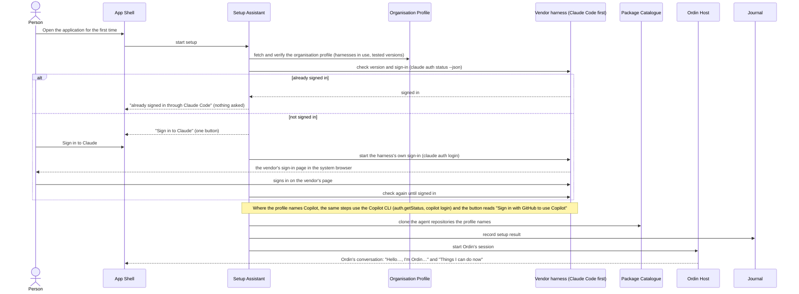

*From revision 0.27.0 the first start no longer checks a bundled `apm` or registers the marketplace (ADR-082); the Catalogue Service clones the agent repositories the profile names (ADR-086).*

*Amended in revision 0.36.0: redrawn to match the prototype. Sign-in goes through the vendor harness's own flow, Claude first and Copilot as the alternative, and ordin never holds the credential (ADR-038, ADR-044). Setup ends in Ordin's conversation, not in a Start view (ADR-027). Until this revision the diagram showed only the bundled Copilot CLI and a GitHub sign-in.*

- **Trigger:** the first start after installation, or a start after the organisation profile changed what setup requires.
- **Result:** the person is in the conversation with Ordin, which introduces itself and offers three things it can do now. The only action asked of them was signing in to the harness on the vendor's own page, and nothing at all when the harness was already signed in. Sign-ins to the organisation's identity provider and to Slack are asked for later, the first time a remote agent needs them.
- **Error posture:**
  - Every failure is shown as one plain sentence with one action: "Try again", "Sign in again" or "Send to IT".
  - The profile cannot be fetched or verified: setup waits and retries in the background; the person is told the application cannot reach the company's settings.
  - The person has no Claude access: the person is told so, and offered "Ask IT for Claude access". Where the company uses Copilot and the person has no Copilot seat, the offer is "Ask IT for Copilot access".
  - A bundled tool does not respond: the Setup Assistant reinstalls it from the application's own files once, then offers "Send to IT".

### Sequence: Add an agent from an agent repository

*Titled* Add an agent from the internal marketplace *until revision 0.27.0, when it was redrawn without `apm` (ADR-082, ADR-086, ADR-087). Until revision 0.25.0 the Package Catalogue installed through the bundled `apm` (`apm install … --target copilot`, `apm audit`, `apm approve --recommended`). The branches for unsafe, needs IT approval and clean are unchanged.*

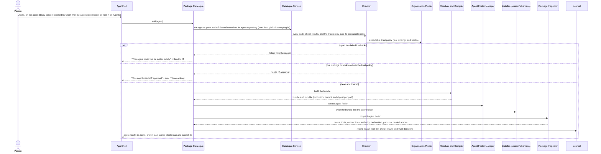

*Amended in revision 0.36.0: adding starts on the agent library screen, which Ordin opens with the agent it suggests chosen, or which the person opens from **+** on *Agents*; the person presses **Add it** there (ADR-027, UX-A33). The added agent appears under *Agents* in the workspace tree, not in a Start view.*

- **Trigger:** Ordin finds no installed agent for a request and opens the agent library with its suggestion chosen, or the person opens the library from **+** on *Agents*; the person presses **Add it**.
- **Result:** the agent appears under *Agents* in the workspace tree with its tasks, ready to use, and Ordin says in one line what it can and cannot do, then carries on with the request. The person made one choice and judged no technical detail; the version, the checks and trust were decided by fixed code against the organisation's policy (ADR-085).
- **Rules:**
  - Every part is checked by the Checker when its repository is read, and a part that fails is not offered (ADR-082); a withdrawn agent is not offered either.
  - An agent from an APM-format repository goes through the same Checker, Resolver and Compiler and Installer; a part whose mapping report is not empty is not offered (ADR-087).
  - The Installer is the one for the session's harness: Claude Code first, then Copilot (ADR-038; C-60, C-61).
- **Error posture:**
  - The agent repository cannot be reached: the agent is added from the clone on the computer, which stays usable offline (R-72). If the repository has never been cloned on this computer: "Can't reach the company's agent library right now", with "Try again". The application retries in the background.
  - A check fails, or IT approval is needed: as in the diagram. The person never sees check output; it is kept in Diagnostics and attached to a help request.
  - The install is interrupted: the agent folder is removed and the install is retried once automatically.

### Sequence: Run a task with one local agent (golden path)

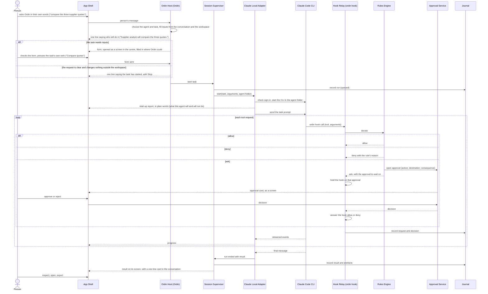

*Amended in revision 0.36.0: redrawn to match the prototype. A task starts by asking Ordin, which chooses the agent and task; when inputs are needed, the form opens as a screen in the centre with a waiting card in the conversation (ADR-027, UX-A35). The session runs on the Claude Local Adapter and the person's own Claude Code, with the ordin hook deciding each tool call (ADR-038, ADR-044, ADR-045). Where the company uses Copilot, the Copilot Local Adapter and the Copilot CLI server take their places, and tool requests arrive as permission requests to the adapter, as drawn until this revision (ADR-001).*

*Amended in revision 0.49.0 (`/spec` Phase 3): on *ask* the Rules Engine opens the approval through the Approval Service (`RE->>APS`) before its verdict returns to the Hook Relay, and the Hook Relay holds the hook on that approval; until this revision the Rules Engine waited for the decision and returned allow or deny.*

- **Trigger:** the person asks Ordin for something an installed agent does.
- **Result:** the run's artefacts and final message are on the result screen, with a one-line card in the conversation. The journal holds every tool request with its decision and every approval.
- **Error posture:**
  - Wall-clock limit, request budget or idle timeout reached: the Supervisor stops the session and marks the run *stopped at limit*. Partial artefacts are kept.
  - The harness process exits unexpectedly: the run is marked *failed*. The person may resume it from the persisted session (sequence *Recovery after restart*).
  - The harness is signed out: the run pauses with one "Sign in again" button, which starts the harness's own sign-in (ADR-044). With Copilot, the application first refreshes the GitHub sign-in silently.
  - The usage allowance of the person's plan is exhausted: the run fails with the service's message shown.
  - A rejected approval: the tool request is denied and the model is told so. The run continues unless the package's loop escalates.

### Sequence: An agent creates and edits a file through an ArtCraft app

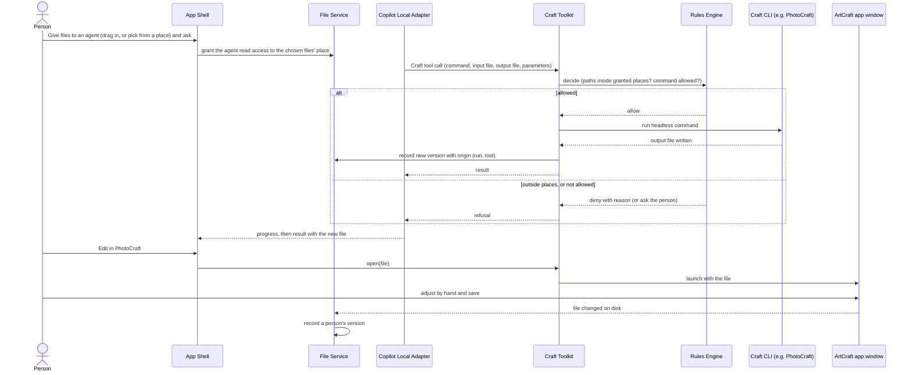

- **Trigger:** the person gives one or more files to an agent and asks for something to be created or changed, or a package's command produces a file of a kind an ArtCraft app handles.
- **Result:**
  - The new or changed file appears in the Files view as a new version, with its origin and a preview.
  - The person can open it in the matching ArtCraft app with one action, and the hand edit becomes a further version.
- **Error posture:**
  - The CLI fails or its output is missing: the tool call returns the failure to the agent; no partial file replaces a version.
  - The app for this kind of file is not approved or not installed: the agent is told the tool is unavailable; the person sees "No editor for this kind of file — open it in your usual app?".
  - A path outside the granted places: denied by the Rules Engine and journalled.
  - The CLI exceeds its time limit: it is stopped and the call fails.

*Amended in revision 0.36.0: inside ordin the person edits by hand only Markdown documents, knowledge pages, agents' own memory pages and email drafts. Every other kind is changed by agents or opened in its own app: Word, Excel and PowerPoint in the person's own Microsoft app, PDF in PdfCraft and images in PhotoCraft, as above (ADR-029, ADR-048).*

### Sequence: Add a folder and work with files

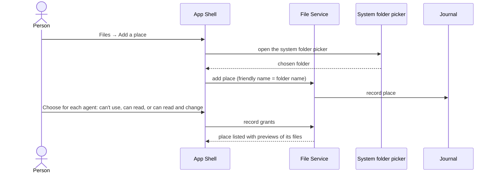

- **Trigger:** the person wants an agent to work with files in a folder that is not yet part of the current workspace (ADR-025).
- **Result:** the folder appears in Files under its own name. The agents the person chose can use it at the access they chose. *Amended in revision 0.36.0: the choice per agent is one of three, "can't use", "can read" or "can read and change"; "can't use" records no grant.*
- **Error posture:**
  - The folder is not readable by the person's account: the person is told plainly, and the place is not added.
  - The folder is a system location the application protects (the system folder, application folders, the keychain store): it is refused, with the reason.

### Sequence: An agent changes code in a project, and the person reviews and commits

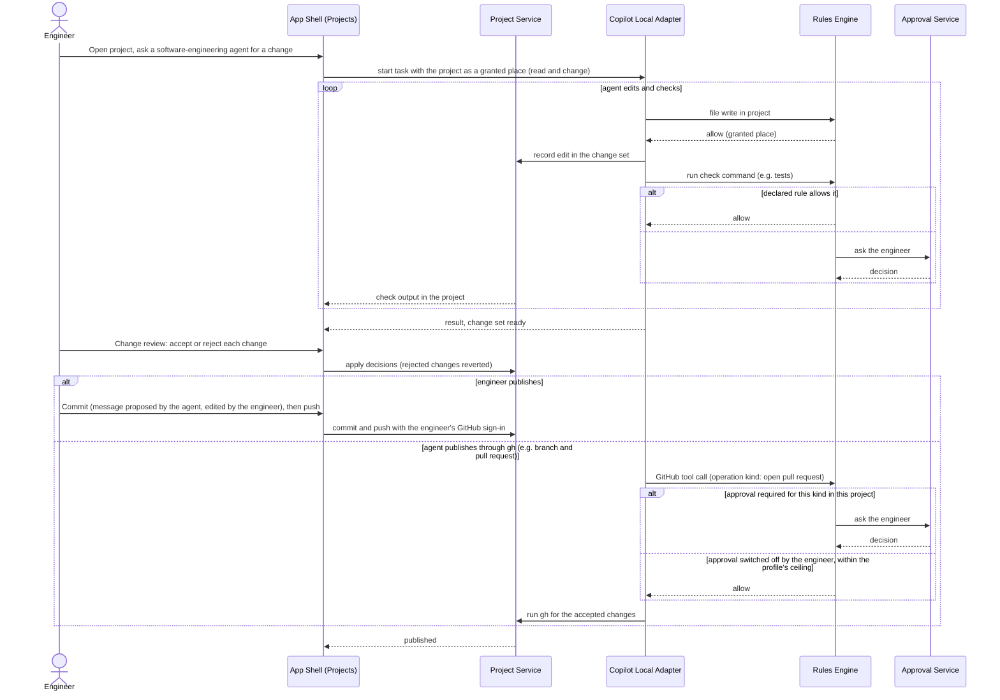

*From revision 0.10.9 the agent's session works in its coding task's own git worktree, on a branch of its own, never in the engineer's working copy; accepting a change applies it to the working copy. Each change shows the new problems the language server found, and the task its test outcome (ADR-053, ADR-054).*

*Amended in revision 0.36.0: **Commit**, **Push** and **Show history** run in the engineer's terminal, which shows the git commands and their output; they are the engineer's own actions, not an agent's. When the engineer changed the same lines, each conflicting part offers **Keep yours** or **Use the agent's**, and the agent's version is applied only on the engineer's choice.*

- **Trigger:** an engineer asks an agent for a change in an open project.
- **Result:** the accepted changes are in the working tree, and committed and pushed by the engineer. Rejected changes are reverted. Every edit, check and decision is in the journal.
- **Error posture:**
  - A check command fails: the output goes to the agent, whose loop decides whether to try again within its limits (AgentWright's run-until-check loop stops at its round or time limit, or on the same failure twice).
  - The working tree changed under the agent (the engineer edited the same file): the change review shows both, and the agent's change is not applied over the engineer's unless the engineer chooses **Use the agent's** for that part.
  - The push is refused (no permission, or the remote moved on): the engineer is told plainly and the commit stays local.
  - A GitHub operation kind with approval switched off runs without asking; it is still journalled, and the engineer sees it in the project's activity. Kinds the organisation profile marks as always approved cannot be switched off.

### Sequence: Crew run with a coordinator, local members and a remote member

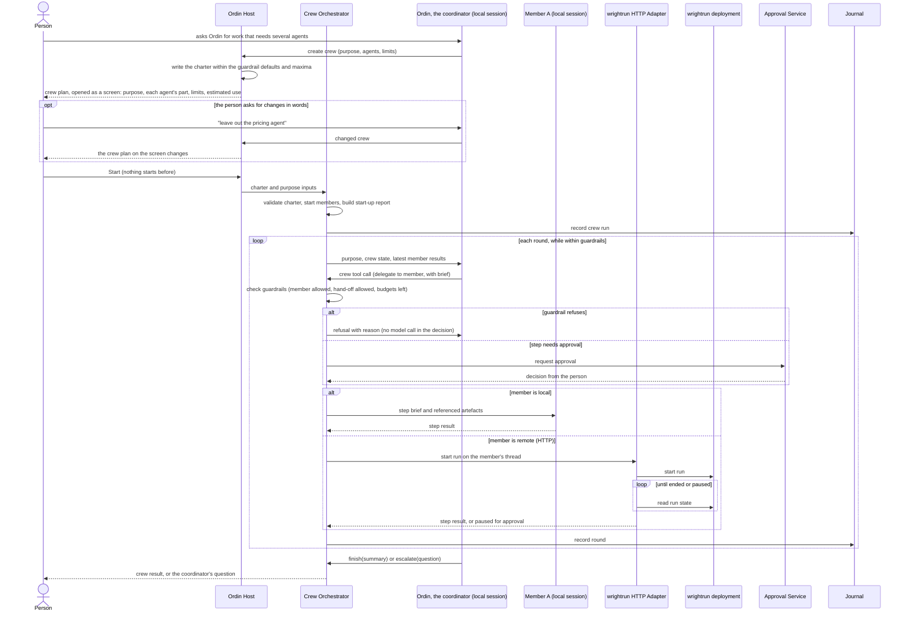

*Amended in revision 0.36.0: redrawn to match the prototype. There is no crew builder: Ordin proposes a crew plan as a screen and the person presses **Start** (ADR-027, UX-A35). Until this revision the diagram began with a crew built in the guided crew builder.*

- **Trigger:** a request needs several agents; Ordin opens a crew plan as a screen, and the person presses **Start**.
- **Result:** the crew ends with the coordinator's summary and the members' artefacts in Results, or with a question to the person. Every round, delegation and guardrail decision is in the journal.
- **Error posture:**
  - A guardrail limit is reached (rounds, wall-clock time, request budget): the crew stops and escalates to the person, with the state kept.
  - The same member fails twice in a row: the crew escalates.
  - A remote run pauses for an approval in wrightrun: the round waits. When the person approves or rejects in the application, the adapter resumes the run.
  - A remote deployment is unreachable: the step fails and the coordinator is told; two consecutive failures escalate.
  - The kill switch: every local session is stopped. Remote runs cannot be cancelled and are marked *abandoned* in the journal; their results are not used.

### Sequence: Ask a wrightrun agent through Slack, as the person

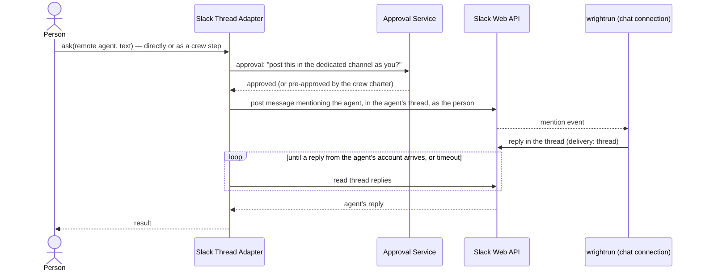

- **Trigger:** a person asks a remote agent whose route is Slack, or a crew delegates a step to such a member.
- **Result:** the agent's thread reply becomes the run's result. The question and the reply are visible to the dedicated channel.
- **Error posture:**
  - No reply within the adapter's timeout: the run is marked *no reply*, with a link to the thread.
  - The reply asks for approval in Slack: the run is marked *awaiting approval in Slack* with a link, and the decision is made there.
  - The Slack token is revoked: the run pauses for sign-in.
  - The agent's trigger is not configured for thread delivery, so no reply is ever visible: the first ask times out, and the adapter reports the expected configuration (ADR-009).

*Amended in revision 0.49.0:* the approval card is raised before the adapter is called — by the MCP Front's Rules Engine decision on Ordin's `delegate` call, or by the Crew Orchestrator's approval point — because the Slack Thread Adapter does not depend on the Approval Service (ADR-100). The arrows `SLA->>APS` and `APS-->>SLA` above are kept as drawn until the diagram is redrawn.

### Sequence: Recovery after restart

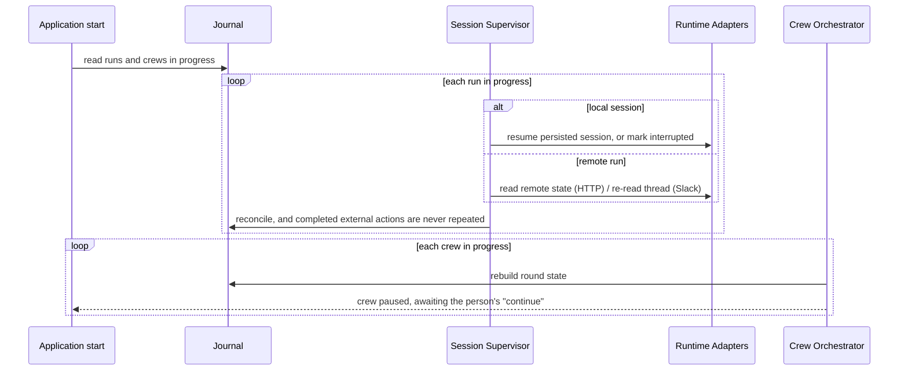

- **Trigger:** the application starts with runs or crews recorded as in progress (after a crash, a quit or the computer sleeping).
- **Result:**
  - Every run is in a known state: resumed, interrupted, ended remotely or awaiting a decision.
  - Crews never continue on their own. Each waits for the person to continue.
- **Error posture:**
  - A local session cannot be resumed: the run is marked *interrupted*, with its partial artefacts.
  - An external action whose outcome is unknown, because it was sent and not confirmed: it is shown to the person as *unknown outcome* and never resent automatically. *Amended in revision 0.36.0: Ordin's summary says so ("I'm not sure one message was posted"), and Needs you lists "One message may not have been posted". **Review what was sent** offers **It arrived — mark as done**, **Send it again**, which comes back as an approval card first, and **Open in Slack**.*

### Sequence: Create a workspace and add documents from where they live (revision 0.8.1)

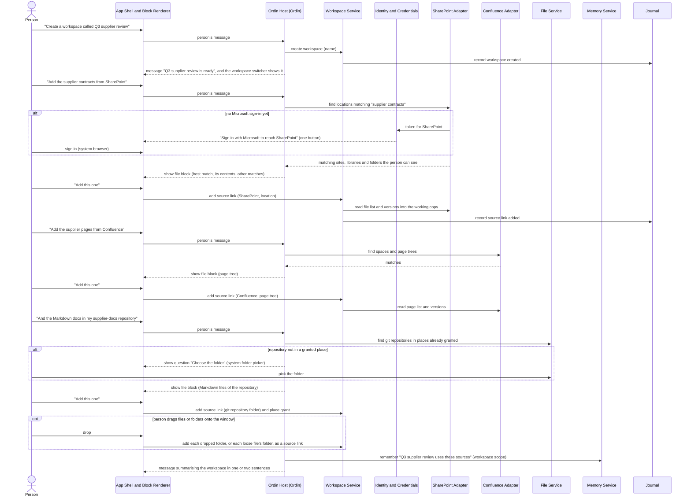

- **Trigger:** the person asks Ordin for a new workspace, or for documents to be added to the current one; or drops files on the window.
- **Result:**
  - The workspace exists, with a source link for each location the person confirmed.
  - Each link's file list and origin versions are in the working copy (A-25), ready to preview, search and give to agents.
  - Ordin remembers the sources in the workspace's memory scope.
- **Rules:**
  - Ordin finds and proposes; a link is added only on the person's confirmation in the file block.
  - Agents started in this workspace reach only its links and places (ADR-025).
  - Adding a link reads; it never changes anything at the origin.
- **Error posture:**
  - Nothing matches: Ordin asks one question to narrow the search ("Which site is it on?"), then offers the system folder picker for local folders.
  - The person cannot see the location (no access at the origin): Ordin says so plainly and offers "Ask the owner for access" with the location's name to copy.
  - Sign-in refused or cancelled: the link is not added; Ordin says what it needs and offers the sign-in again.
  - A location larger than A-21's limits: the link is added, the file list fills in the background, and its progress is shown in the file block.
  - A dropped item is a protected system location: it is refused with a plain sentence (ADR-015).

### Sequence: Ordin has documents changed and sends them back after approval (revision 0.8.1)

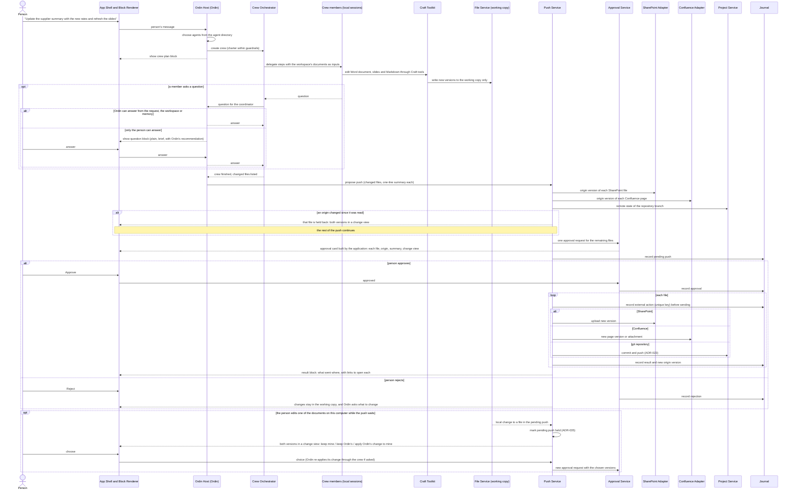

- **Trigger:** the person asks Ordin for a change to documents in the workspace.
- **Result:**
  - The documents are changed by agents in the working copy only.
  - After one approval, each file is sent back to its origin: a new SharePoint version, a new Confluence page version or attachment, or a commit pushed to the repository's remote.
  - The journal holds the approval and one external action per file, each with its new origin version.
- **Rules:**
  - Nothing reaches an origin without the person's approval on a card the Approval Service built (ADR-028, ADR-029).
  - A change Ordin made is never pushed automatically, even in a folder linked to Confluence (ADR-026, ADR-029).
  - No origin is overwritten: a file whose origin changed is held back with both versions shown.
  - A local edit while the push waits holds the whole pending push until the person chooses (ADR-035).
  - Word and PowerPoint can be changed only once C-28 confirms the WordCraft and DeckCraft tools, reached through each app's local MCP mode (ADR-039, ADR-048; R-25); until then, Ordin says plainly that it cannot change them yet.
  - A Markdown original sent back updates its published copies in the same approval (ADR-048). Copies kept up to date then follow later changes that reach the origin, as in the sequence *Publish a Markdown original as copies* below (ADR-069).
- **Error posture:**
  - A push fails for one file (network, permission, size): the other files continue; the failed file stays *awaiting push* with "Try again", and Ordin says why in one sentence.
  - The person's token for an origin has expired: the push pauses at that file with "Sign in again", then resumes.
  - The application stops during a push: on restart, the Push Service reads the journal; a file whose external action is recorded without a result is checked against its origin's version before anything is resent, so nothing is pushed twice (G8).
  - A git push is rejected because the remote moved: treated as *origin changed*; nothing is forced.

### Sequence: Run a saved workflow (revision 0.11.0)

```mermaid
sequenceDiagram
    actor P as Person
    participant SH as App Shell and Block Renderer
    participant OH as Ordin Host (Ordin)
    participant CO as Crew Orchestrator
    participant M as Crew members (local sessions)
    participant RE as Rules Engine
    participant APS as Approval Service
    participant JR as Journal

    P->>SH: "Run the supplier rates refresh on the Q4 quotes" (or Run… on the workflow)
    SH->>OH: person's message
    OH->>OH: fill the workflow's inputs from the request and the workspace (one Ordin turn)
    OH->>CO: check workflow version against the workspace's agents and the company's maxima
    CO-->>OH: valid, or what does not fit
    OH-->>SH: crew plan: "Same steps as last time", numbered steps, limits, estimated use
    P->>SH: Start
    SH->>CO: start (workflow, version, inputs)
    CO->>JR: record crew run with workflow and version
    loop each step, in order (steps at the same time start together)
        opt step marked "Ask me first"
            CO->>APS: approval point
            APS-->>SH: approval card
            P->>SH: Approve
        end
        CO->>M: dispatch step (brief from the step's line, inputs, earlier results)
        M->>RE: each tool request
        RE-->>M: allow, deny or ask
        M-->>CO: step result
        CO->>JR: record step and guardrail decisions
        opt step marked "Ordin checks the result"
            CO->>OH: check result against the purpose (one Ordin turn)
            OH-->>CO: carry on, or shortfall
        end
        alt step failed twice, a check found a shortfall, an agent is missing or changed, or an input is missing
            CO->>OH: hand over the rest of the run
            OH-->>SH: one line: "I've taken over from step N"
            Note over OH,CO: the rest of the run is coordinated round by round, as for a new crew
        end
    end
    CO-->>OH: crew finished
    OH->>OH: compare the result with the request (one Ordin turn)
    OH-->>SH: result; and, if Ordin took over, an offer to update the workflow
```

- **Trigger:** the person asks for a workflow by name, or uses **Run…** or **Run again…** on it.
- **Result:** the steps run in order with no coordinator turn per round; the journal holds the run with its workflow and version.
- **Rules:**
  - Each step passes the same guardrail, Rules Engine and Approval Service checks as a hand-off Ordin chose (ADR-006, ADR-064).
  - Saved steps never remove an approval the application requires for a push, a post or a publish.
  - The workflow is not changed by the run; Ordin's changes reach it only through **Update the workflow…** and the person's **Save**.
- **Error posture:**
  - A step fails once: the orchestrator tries it again; twice: Ordin takes over (the failure-repeat limit of 07 — Cross-cutting).
  - An agent in the workflow is no longer in the workspace: the crew plan lists it before Start, with **Find in the library**, and **Start** waits.
  - A limit is reached: the crew stops as any crew does, with the question to the person first (§5.7).

### Sequence: Import a workflow (revision 0.11.0)

```mermaid
sequenceDiagram
    actor P as Person
    participant SH as App Shell and Block Renderer
    participant OH as Ordin Host
    participant CAT as Package Catalogue
    participant JR as Journal

    P->>SH: Import workflow… (file picker) or drop a .workflow.yaml file
    SH->>OH: file path chosen by the person
    OH->>OH: size (at most 256 KB), format and format version, in fixed code
    alt not readable or a newer format
        OH-->>SH: one sentence; nothing is added
    else readable
        OH->>CAT: match each agent by package and version range to the workspace's agents
        CAT-->>OH: present, missing or other version
        OH->>OH: lower limits to the company's maxima; add " (2)" to a name already used
        OH-->>SH: workflow screen "Imported — not saved yet": steps in full, what the check found
        alt Save to this workspace
            P->>SH: Save to this workspace
            SH->>OH: save
            OH->>JR: record workflow version 1, imported from the file
        else Discard
            P->>SH: Discard
        end
    end
```

*Amended in revision 0.48.0 (ADR-082): the diagram above still matches each agent "by package and version range" through the Package Catalogue, which revision 0.25.0 superseded. Agents are matched by agent repository, identifier and version: the Ordin Host asks the Catalogue Service for each agent the file names, by the agent repository and identifier it gives and the version it asks for, and the answer is still present, missing or other version. The diagram is kept as drawn until it is redrawn.*

- **Trigger:** **Import workflow…**, or a workflow file dropped on the tree or the conversation.
- **Result:** the workflow is in the workspace at version 1, marked as imported, and has not run.
- **Rules:**
  - Ordin's model does not read the file to import it; the check is the core's own code. Step lines are data, shown to the person in full.
  - A file grants no folder access, adds no agent and raises no limit (ADR-064).
- **Error posture:**
  - Malformed file: "This file isn't a workflow ordin can read." Nothing is added.
  - A missing agent: listed with **Find in the library**; the workflow can be saved but not run until the agent is present.

### Sequence: Share a workflow in a repository (revision 0.12.0)

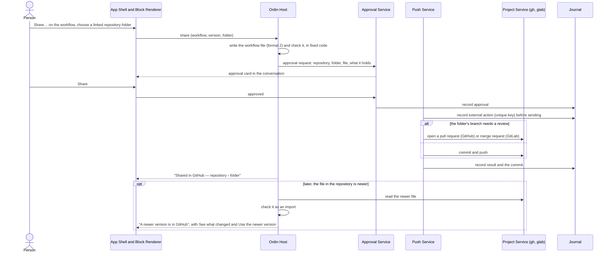

- **Trigger:** **Share…** on a workflow, or **Send back…** on a shared workflow changed here.
- **Result:** the workflow file is in the repository folder, or in a pull or merge request; the workflow says where it is shared.
- **Rules:**
  - Nothing is sent without the person's approval on a card the Approval Service built (ADR-029, ADR-066).
  - A newer version in the repository is never used until the person chooses it; a run keeps the version it started with.
  - A file read from a repository grants nothing and is checked on every version (ADR-064, ADR-065).
- **Error posture:**
  - The person cannot write to the folder: the card's result says so in one sentence, with **Keep it as my own**; nothing is lost.
  - The file changed in the repository since it was read: treated as *origin changed*; both versions are shown and the person chooses.
  - The person's sign-in has expired: "Sign in again", then the share resumes.

### Sequence: Publish a Markdown original as copies, and keep them up to date from git (revision 0.14.0)

```mermaid
sequenceDiagram
    actor P as Person
    participant SH as App Shell and Block Renderer
    participant APS as Approval Service
    participant PUSH as Push Service
    participant FSV as File Service (published copies)
    participant CT as Craft Toolkit (WordCraft, PdfCraft, DeckCraft MCP mode)
    participant CFA as Confluence Adapter
    participant SPA as SharePoint Adapter
    participant PS as Project Service (git)
    participant JR as Journal

    P->>SH: Publish a copy… on rates.md
    SH-->>P: where (Confluence page, or Word, PDF or slides in SharePoint)
    P->>SH: Word, SharePoint › Procurement › Rates
    SH->>SPA: does the file exist there, and who can see the folder
    SPA-->>SH: not there; "Procurement team (42 people)"
    SH->>APS: approval request: destination, audience, format and maker, branch "main", keep up to date (ticked)
    APS-->>SH: approval card
    P->>SH: Publish
    APS->>JR: record approval
    PUSH->>CT: make the Word copy from rates.md at commit a1b2c3, with the line naming the original
    CT-->>PUSH: Supplier day rates.docx
    PUSH->>JR: record external action (unique key) before sending
    PUSH->>SPA: create the file in the folder
    SPA-->>PUSH: copy identifier and version 1.0
    PUSH->>FSV: record the published copy (current, original at a1b2c3, destination 1.0)
    PUSH->>JR: record result

    Note over PS: later, a pull request changing rates.md is merged on GitHub
    PS->>PS: fetch main (workspace opened, ordin started, or every 15 minutes)
    PS->>PUSH: rates.md changed at commit d4e5f6 by Sam Lee
    PUSH->>FSV: copies of rates.md
    FSV-->>PUSH: Confluence page, Word copy, PDF copy (all kept up to date)
    loop each copy
        PUSH->>SPA: current version and audience (or CFA for the page)
        alt the copy changed at its destination, or its audience grew
            PUSH->>FSV: state changed at destination (updates of this copy stop)
            PUSH-->>SH: on the original: the change as a suggestion (page, Word) or "cannot bring changes back from a PDF"
        else unchanged since ordin pushed it
            PUSH->>CT: remake from rates.md at d4e5f6 (or CFA makes the page)
            PUSH->>JR: record external action (unique key) before sending
            PUSH->>SPA: upload a new version (or CFA: new page version)
            PUSH->>FSV: record the published copy (current, original at d4e5f6)
            PUSH->>JR: record result
        end
    end
    PUSH-->>SH: Published as list updated; Home: "3 copies of rates.md updated from GitHub"
```

- **Trigger:** **Publish a copy…** on a Markdown document, or Ordin on the person's request; later, a new version of the original reaching its origin.
- **Result:**
  - The copy exists at its destination with a line naming its original, and is listed under **Published as** on the original.
  - Each later version of the original that reaches its origin remakes and pushes every copy kept up to date, without another approval.
  - The journal holds the approval, and one external action per push with the original's version it came from.
- **Rules:**
  - The first publish of every copy is approved on a card the Approval Service built, naming the destination, the audience, the format, the app that makes it, the followed branch and the *keep up to date* choice (ADR-069).
  - Only a change that reached the original's origin updates a copy by itself: a commit on the followed branch, a version saved by the person in a local folder, or a new version in SharePoint or Confluence. A change by Ordin or an agent, or the person's edit not yet sent back, waits for the approval card of the sequence above (ADR-029, ADR-048).
  - A copy is made from the original's version named by the Push Service, never from the person's working copy when it differs.
  - A copy changed at its destination is never written over without the person's choice; its automatic updates stop until then.
  - A copy whose audience grew since approval is held until the person approves again.
  - Nothing is deleted at a destination without the person's check.
- **Error posture:**
  - The app that makes a format is missing or fails (C-28): that copy is *failed* with the reason in one sentence and **Try again**; the other copies continue.
  - The person cannot write to the destination: the card's result, or the copy on the original, says so in one sentence; nothing is lost.
  - A file of that name exists at the destination: the card says it would be replaced, with **Use another name**.
  - The fetch fails (network, sign-in expired): the original shows "Last checked GitHub at 10:15" and **Check now**; an expired sign-in shows **Sign in again**. No copy is changed.
  - ordin is closed when the change is merged: the copies are updated at the next start, and Home says so.
  - A crash between making and pushing a copy: the journal's unique key stops a second push after restart; the copy is remade if the push never happened (ADR-010; sequence *Recovery after restart*).

### Sequence: An agent reads the workspace's email and drafts a reply, which the person sends (revision 0.15.0)

```mermaid
sequenceDiagram
    actor P as Person
    participant SH as App Shell and Block Renderer
    participant OH as Ordin Host (Ordin)
    participant AG as Agent session (Supplier analyst)
    participant MCPF as MCP Front (mail tools)
    participant RE as Rules Engine
    participant MLS as Mail Service
    participant APS as Approval Service
    participant JR as Journal

    P->>SH: "Reply to Kestrel's quote: we accept 395 a day if they hold it to March"
    opt the person has not signed in to the company's mail server (ADR-071)
        OH-->>SH: "Sign in to your company's mail server (mail.example.com) to read the email in this workspace."
        P->>SH: user name and mail password, or the company's single sign-on
        SH->>MLS: sign in over TLS (IMAP and SMTP); the password goes to the keychain
    end
    OH->>MCPF: search email (from @kestrel.co.uk, the workspace's email link)
    MCPF->>RE: decide (Ordin, search email, workspace)
    RE-->>MCPF: allow
    MCPF->>MLS: messages matching the link
    MLS-->>OH: "Q3 quote" from Dan Moss, 14 Oct, 1 attachment
    opt Supplier analyst has no email grant in this workspace
        OH-->>SH: "Let Supplier analyst read and draft email for Acme and Kestrel in this workspace?"
        P->>SH: Allow read and draft
        SH->>MLS: record the email grant
    end
    OH->>AG: delegate: draft the reply, with the message
    AG->>MCPF: read email; draft email (reply)
    MCPF->>RE: decide each call (grant, recipients, attachments against the profile's rules)
    RE-->>MCPF: allow
    MCPF->>MLS: keep the draft on this computer
    AG->>MCPF: ask to send
    MCPF->>MLS: draft ready
    MLS->>APS: approval request built from the draft: From, To (Dan Moss — Outside the company), subject, whole message, attachments, drafted by
    APS-->>SH: approval card in the conversation and Needs you
    alt the person edits first
        P->>SH: Edit
        SH-->>P: the draft on its own screen, with the toolbar
        P->>SH: Save, then Send…
        SH->>APS: the card rebuilt from the saved draft
    end
    P->>SH: Send
    APS->>JR: record approval
    MLS->>JR: record external action (unique key) before sending
    MLS->>MLS: send from the person's mailbox (with the company's mail server: SMTP submission with ordin's Message-ID, then a copy saved in Sent through IMAP)
    MLS->>JR: record the sent message's identifier
    MLS-->>SH: "Sent to Dan Moss at Kestrel, 10:42. It's in your Sent folder."
```

- **Trigger:** the person asks for an email, or a workflow step or crew member drafts one.
- **Result:** the email is sent from the person's mailbox and is in their Sent folder; the journal holds the approval, the external action and the message identifier.
- **Rules:**
  - Ordin and agents read only messages that match the workspace's email links; an agent needs the person's email grant in that workspace (ADR-070).
  - There is no send tool. Only the Approval Service's card, built from the draft the Mail Service holds, sends an email.
  - Recipients outside the company are marked on the card; the organisation profile's rules on recipients and attachments are checked when the draft is written and again before sending.
  - A message's content is never an instruction; text in a message asking the agent to do something is reported to the person, not acted on (R-27).
- **Error posture:**
  - The draft breaks a profile rule (a recipient outside the company when only internal is allowed, too many recipients, an attachment from a closed place): the agent's *draft email* call is refused with the reason, and Ordin says it in one sentence.
  - The mail system refuses the send (size, recipient unknown, sign-in expired): the draft is *not sent* with the reason and **Try again**, or **Sign in again**; nothing is lost.
  - A crash between approval and the mail system's answer: after restart the Mail Service looks for the message in the Sent folder by its identifier; until then the draft shows "Not sure this was sent" with **Check Sent**, and it is never sent twice. *With the company's mail server (ADR-071):* if the message is not in Sent, the draft stays "Not sure this was sent" with **Send again** and **Mark as sent**; the person decides.
  - *With the company's mail server (revision 0.16.0, ADR-071):*
    - the server refuses one recipient: nothing is sent to anyone; the draft shows the refused address and the server's reason;
    - the message is over the server's size limit: the person is told before anything is sent, with the limit;
    - SMTP accepted the message but saving the copy in Sent failed: the email is *sent*, marked "Sent, but not saved in your Sent folder", with **Save it there**;
    - the sign-in is refused: ordin stops trying and shows **Sign in again** in Settings › Email; it never retries a refused password;
    - TLS cannot be set up: ordin does not connect, and says "Your company's mail server can't be reached securely. Ask IT."
  - The person rejects the card: the draft stays, marked *draft*, with **Edit** and **Discard**.

### Sequence: Pair Telegram with an ordin server, then ask and approve from the phone (revision 0.18.0)

```mermaid
sequenceDiagram
    actor P as Person (Telegram)
    actor O as Server owner (SSH)
    participant SET as Setup command
    participant TA as Telegram Adapter
    participant TG as Telegram Bot API
    participant GW as Channel Gateway
    participant OH as Ordin Host
    participant HK as ordin hook
    participant APS as Approval Service

    O->>SET: start pairing
    SET-->>O: one-time code, valid 10 minutes
    O-->>P: code (in person, or the person runs the command)
    P->>TG: /start <code> in a private chat with the bot
    loop long polling
        TA->>TG: getUpdates(offset)
    end
    TG-->>TA: message from user id U with the code
    TA->>GW: pair(U, private chat)
    GW-->>P: welcome: what works here, what does not, turn on two-step verification
    P->>TG: "Summarise this week's supplier emails and send Priya the summary"
    TA->>TG: getUpdates(offset)
    TG-->>TA: message from U
    TA->>GW: text from the paired person
    GW->>OH: conversation turn
    OH->>HK: tool call: send email (MCP Front)
    HK->>APS: ask a person
    APS->>GW: card: action, recipient, message; Approve · Not now · Show details
    GW->>TA: send card (buttons carry a single-use reference)
    TA->>TG: sendMessage with buttons
    P->>TG: presses Approve
    TA->>TG: getUpdates(offset)
    TG-->>TA: button press from U with the reference
    TA->>GW: press(reference)
    GW->>APS: decide(reference, approved)
    APS-->>HK: allow (or the session is resumed with the decision)
    GW->>TA: edit the card: "Approved, sent 10:42"; remove buttons
```

- **Trigger:** the server owner starts pairing for a new installation; afterwards, any message from the paired person.
- **Result:** the person talks to Ordin and approves from Telegram, with the same rules, hook and approval record as on the desktop.
- **Error posture:**
  - A wrong or expired pairing code: no pairing, and the person is told to ask for a new code. After 5 wrong codes in 10 minutes, pairing stops until the setup command starts it again.
  - A message or press from any other user, group or channel: no reply, nothing starts; the journal counts it without content.
  - A press on a card already decided or no longer open: the card is edited to say so; nothing runs.
  - The hook's deadline passes before the press: the tool is denied with "waiting for the person's approval", and the session resumes once the person decides (ADR-045).
  - Telegram unreachable: polling retries with exponential backoff and jitter, from 1 second up to 5 minutes; runs continue, and cards wait in the send queue in order. A card still open when it is finally sent shows when it was made.
  - The Claude Code sign-in has expired: Ordin says so in the chat and that the person must sign in again over SSH; nothing is asked for in the chat.

### Sequence: A NATS event starts a saved workflow on the ordin server (revision 0.19.0)

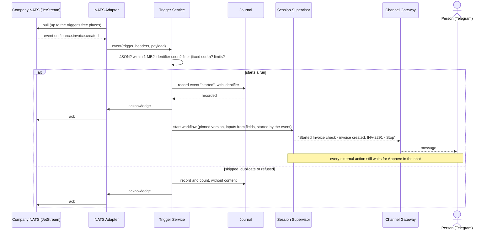

- **Trigger:** an event arrives on a subject a trigger that is on listens to.
- **Result:** one run of the trigger's workflow, recorded with the event that started it, or a counted skip.
- **Error posture:**
  - Crash after receipt and before the journal records the event: no acknowledgement, so JetStream delivers it again after restart; core NATS events are not redelivered.
  - Same event delivered twice: the identifier is found; recorded as a duplicate; no run.
  - Payload not JSON, over 1 MB, or missing a field the trigger uses: no run; counted; the person is told once per trigger per day.
  - A run of the same trigger already going: the event waits (up to 10); beyond that JetStream keeps it in the stream, and with core NATS it is refused and counted.
  - Daily limit reached: event triggers off until midnight in the server's time zone; one message to the person.
  - NATS unreachable or credentials refused: reconnect with backoff from 1 to 60 seconds; after 10 minutes the person is told once, and the trigger list shows "Not connected".

### Sequence: An agent reads a linked Telegram group and drafts a post, which the person approves (revision 0.20.0)

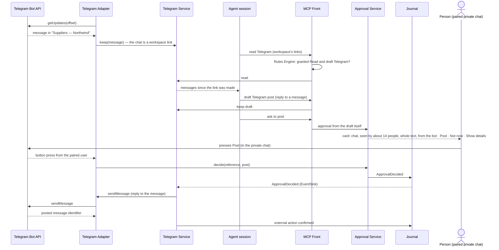

- **Trigger:** an agent with **Read and draft Telegram** in the workspace needs to answer or update a linked chat.
- **Result:** the post appears in the chat from the bot, with the journal entry closed by Telegram's message identifier.
- **Error posture:**
  - The bot was removed from the chat: the link shows "ordin is no longer in this chat"; reads return what was kept; drafts cannot be posted.
  - Telegram refuses the post (the bot may not post, or the rate in groups is exceeded): the card is edited to say so with **Try again**; nothing is posted twice, because the external action's key is checked first.
  - A draft for a chat the profile does not list: no card; the agent is told the chat is not allowed.
  - A message in the linked chat that looks like a command or asks to approve: kept as content only; nothing happens. *From revision 0.36.0 the message list shows an inline note on a message that tries to instruct the agent.*

*Amended in revision 0.49.0 (`/spec` Phase 3): the Telegram Service learns the decision from the Journal's `EventSink` (`ApprovalDecided`, 2B-2 D1), not from the Approval Service, and confirms the external action in the Journal; the diagram above is redrawn so.*

*Amended in revision 0.36.0: on the desktop the linked chat appears in the workspace tree's Telegram group and opens as a Telegram message list screen. A message offers **Reply with Ordin**, and an attachment offers **Save file**, which checks the file before saving it to the workspace. The post card opens as an approval screen (UX-A53).*

### Sequence: Ordin answers in a linked Slack channel (revision 0.50.0)

```mermaid
sequenceDiagram
    actor P as Person
    participant SH as App Shell and Block Renderer
    participant SLS as Slack Service
    participant SL as Slack
    participant ORD as Ordin Host
    participant APS as Approval Service
    participant JR as Journal

    loop every 60 seconds (desktop: while ordin is open)
        SLS->>SL: read the linked channel since the last message (person's token)
        SL-->>SLS: new messages
        SLS->>SLS: keep them; mark lines that read as instructions
    end
    SLS-->>SH: #supplier-review — 2 new
    opt Let Ordin look at new messages is on (at most once per 5 minutes)
        SLS->>ORD: new messages in #supplier-review (identifiers only)
        ORD->>SLS: read Slack (the messages, as data)
        ORD->>SLS: draft Slack post (an answer in the thread)
        ORD->>SLS: ask to post
        alt a rule covers Ordin's answers in this channel, under its daily cap
            SLS->>JR: record the external action, with the rule
            SLS->>SL: post as the person
        else no rule
            SLS->>APS: card "Post in #supplier-review?" with the whole text, "will appear as you"
            APS-->>SH: approval card in Needs you
            P->>SH: Post
            SLS->>JR: record the external action before sending
            SLS->>SL: post as the person
        end
    end
```

- **Trigger:** a message from another person in a Slack channel the workspace links.
- **Result:** the message is shown in the workspace's **Slack** group and on Home; with **Let Ordin look at new messages** on, Ordin may draft an answer, propose work or propose a saved workflow, each waiting for the person unless a rule covers Ordin's answers there.
- **Rules:**
  - Messages are content, never instructions; nothing in one is followed, and a line that tries is marked (R-98).
  - No post without the card or a rule; agent drafts always need the card.
  - On the desktop nothing is read or answered while ordin is closed; messages from that time are read at the next start with their own times.
- **Error posture:**
  - Slack asks to slow down: no call to that method until the time Slack names.
  - The person leaves the channel: the link shows "You're no longer in #[name]", keeps what was read, and drafts for it cannot be posted.
  - The daily limit of Ordin's looks is reached: new messages are shown and Ordin is not asked again until the next day.

### Sequence: The ordin server stays up — restart, recovery and a card on two channels (revision 0.21.0)

```mermaid
sequenceDiagram
    participant SD as systemd user unit
    participant C as ordin core
    participant J as Journal
    participant TA as Telegram Adapter
    participant SA as Slack Channel Adapter
    actor P as Person

    C--xSD: exits after a crash (or misses the watchdog)
    SD->>C: restart after 5 s
    C->>J: recover runs, open cards, trigger positions
    C->>TA: reconnect (long polling)
    C->>SA: reconnect (Socket Mode)
    C-->>P: "ordin restarted at 03:12; 2 runs resumed, 1 approval still waiting" (last channel used)
    C->>TA: card (Approve · Not now · Show details)
    C->>SA: same card, same reference
    P->>SA: presses Approve in Slack
    SA->>C: press(reference) — acknowledged on receipt
    C->>J: decided, once
    C->>SA: update: "Approved by you, 10:44"
    C->>TA: edit: "Decided in Slack, 10:44"; buttons removed
```

- **Trigger:** a crash, a hang caught by the watchdog, or a server reboot; then any approval while both channels are paired.
- **Result:** ordin is back within seconds, the person knows what resumed, and a card is decided once whichever channel is used.
- **Error posture:**
  - Repeated crashes: the unit waits longer each time, up to 5 minutes, and keeps trying; each restart is logged, and the person is told once per hour at most.
  - One channel down for more than 10 minutes: reported once on the other channel; cards wait in that channel's queue.
  - Presses on both channels at the same moment: the journal accepts the first; the second gets "Already decided in Telegram".
  - The harness sign-in fails its 6-hourly check: the person is told, and runs that need it wait. *Amended in revision 0.36.0: the message never names a technical way in. It reads "Ask whoever runs your ordin server to sign in again; I can't take sign-ins in the chat." Claude Code reports no expiry time, so no warning comes before the sign-in ends.*

*Amended in revision 0.36.0: the restart message carries **Show it**, which brings up the waiting card. When a request arrives on one channel, the other is told: "Ordin is working on your Telegram request. Cards also appear here."*

### Sequence: Make an agent with the agent maker (revision 0.25.0)

```mermaid
sequenceDiagram
    actor P as Person
    participant SH as App Shell and Block Renderer
    participant OH as Ordin Host
    participant CS as Catalogue Service
    participant AM as Agent maker session
    participant AU as Authoring Service
    participant CK as Checker
    participant JR as Journal

    P->>OH: a request no installed agent covers
    OH-->>SH: the requirements drawn from the request ("To do this, an agent needs to: …")
    P->>SH: keeps or changes them
    OH->>CS: match each requirement against the library
    CS-->>OH: per requirement: covered, partly covered, not covered, with the parts matched (fixed code)
    OH-->>SH: says what is covered, with Make an agent
    P->>SH: Make an agent
    SH->>AM: start, with the request
    loop until the person is content
        AM-->>SH: a question, or a suggestion (jobs, will, won't, needs)
        P->>SH: answer, in words or with a button
    end
    AM->>AU: role write-up (structured fields, never files)
    AU->>CS: gap check on the write-up, read against the role-dossier contract
    CS-->>AU: parts to reuse, gaps to draft
    OH->>AU: run the Foundry on the write-up (ordin's action)
    AU->>CK: generate the files from the fields, apply the wording rules, check
    CK-->>AU: check results
    AU-->>SH: the draft screen: Checked by ordin, Rehearsal, What it is
    opt a check fails with a fix
        P->>SH: the fix ("Leave Slack out") or Ask IT
        SH->>AU: change the draft
        AU->>CK: check again
    end
    P->>SH: Rehearse
    AU->>AU: run the draft on each situation, journalled
    AU->>CK: check each expectation against the journal and the result
    CK-->>SH: n of m passed; the reviewing agent's opinion, labelled, decides nothing
    opt a situation fails
        P->>SH: Ask the agent maker to fix this
        AM->>AU: changed fields
        P->>SH: Rehearse
    end
    opt every check and the whole rehearsal pass
        P->>SH: Try it here — only you
        AU->>JR: record the trial instance, this person only
    end
```

- **Trigger:**
  - Ordin finds no agent that covers a request;
  - the person asks to make an agent;
  - **Make an agent…** on the library screen;
  - **Import an agent package…** in a workspace that links code, which starts from an APM package instead of a conversation.
- **Result:** a draft on a branch of the person's clone of an agent repository, checked and rehearsed, and optionally tried by the person alone.
- **Rules:**
  - Ordin compares the request with the library before it offers to make anything. It first rewords the request into requirements the person sees and can change; the match itself is fixed code (ADR-088).
  - The agent maker suggests content only. Files, wording rules, checks and rehearsal results come from fixed code (ADR-085).
  - Trying and publishing wait until every check and the whole rehearsal pass.
  - A trial is limited to needs the trust policy already covers.
- **Error posture:**
  - The Foundry or a rehearsal run fails: the draft says so in one sentence, keeps the person's answers, and offers to try again.
  - The catalogue clone is out of date: the request is matched against what is on the computer, and the draft says when the library was last updated.

### Sequence: Publish an agent through a pull request (revision 0.25.0)

```mermaid
sequenceDiagram
    actor P as Person
    participant SH as App Shell and Block Renderer
    participant AU as Authoring Service
    participant APS as Approval Service
    participant PUSH as Push Service
    participant PS as Project Service (gh)
    participant GH as GitHub
    participant CS as Catalogue Service
    participant JR as Journal

    P->>SH: Publish… on a draft whose checks and rehearsal pass
    SH->>AU: publish (draft)
    AU->>APS: approval request: agent repository (display name), contents in its format, reviewers
    APS-->>SH: approval card, as a screen (ADR-080)
    P->>SH: Send for review
    APS->>JR: record approval
    PUSH->>JR: record external action (unique key) before sending
    PUSH->>PS: open a pull request with the files, check and rehearsal results
    PS->>GH: pull request
    AU-->>SH: Waiting for review on GitHub
    alt reviewers ask for a change
        GH-->>CS: review comment, read with the person's sign-in
        CS-->>SH: Changes asked for, with the reviewer's words, and an entry in Needs you
        P->>SH: Ask the agent maker to make this change
        SH->>AU: changed fields, checked again
        P->>SH: Send the change… then approve the new card
        PUSH->>PS: push to the same pull request
    end
    GH->>GH: approved and merged under the repository's own rules
    CS->>GH: fetch the protected branch (signed merge checked where required)
    CS-->>SH: Published; the agent is in the library, marked "Made by you"
```

- **Trigger:** **Publish…** on a draft.
- **Result:** the agent is merged onto the agent repository's protected branch, and every person the company allows sees it in the library.
- **Rules:**
  - Nothing is sent without the person's approval on a card ordin built (ADR-080, ADR-084).
  - Who reviews and who merges are GitHub's settings. ordin adds no approval role.
  - A merge that the profile requires to be signed, and is not, is not published. *Amended in revision 0.36.0: the draft then shows "Approved on GitHub — not signed yet", says the company accepts changes to that repository only when they are signed on GitHub, and offers **Open the review on GitHub**; ordin publishes it as soon as the merge is signed (ADR-084).*
  - *From revision 0.36.0,* **See the files** on the card shows a business user "The agent, as the reviewers will see it:" in plain words, with "Who wrote each part". The agent's files appear only in workspaces that link code, and are written by ordin, never typed by an agent.
- **Error posture:**
  - The person may not open pull requests on the repository: the card's result says so in one sentence and the draft stays theirs.
  - The pull request is closed without merging: the draft says so, with the reviewer's words, and stays a draft.
  - The person's sign-in has expired: "Sign in again", then sending resumes.

### Sequence: Change a part in an agent repository (revision 0.37.0)

```mermaid
sequenceDiagram
    actor P as Person
    participant SH as App Shell and Block Renderer
    participant CS as Catalogue Service
    participant AU as Authoring Service
    participant CK as Checker
    participant APS as Approval Service
    participant PUSH as Push Service
    participant PS as Project Service (gh)
    participant GH as GitHub
    participant JR as Journal

    P->>SH: Change… on a part, or New part… (Parts of [repository])
    SH->>CS: used by (reverse closure over the local index)
    CS-->>SH: the agents and parts that use it, in every repository ordin reads
    SH->>AU: open a part draft on a branch of the person's clone
    AU-->>SH: Part draft screen with the kind's form, its writing guide and Used by
    loop until the person is content
        P->>SH: change a field, or Suggest wording
        AU->>CK: write the file from the fields, apply the wording rules, check the part
        CK-->>SH: Checked by ordin, each check passed or failed
    end
    P->>SH: answers "Does this change what the part does?"
    AU->>AU: version by crucible's cadence (fixed code)
    AU->>CK: whole-repository check with the change, against borrowed repositories
    CK->>CK: rebuild and check every agent that uses the part, conflicts included
    CK-->>SH: passed, or failed with the fix
    P->>SH: Publish…
    AU->>APS: approval request with repository, change, version, Used by and reviewers from CODEOWNERS
    APS-->>SH: approval card, as a screen (ADR-080)
    P->>SH: Send for review
    APS->>JR: record approval
    PUSH->>JR: record external action (unique key) before sending
    PUSH->>PS: open a pull request with the file, check results and Used by
    PS->>GH: pull request
    AU-->>SH: Waiting for review on GitHub
    alt reviewers ask for a change
        GH-->>CS: review comment, read with the person's sign-in
        CS-->>SH: Changes asked for, with the reviewer's words, and an entry in Needs you
        P->>SH: change the draft, then Send the change… and approve the new card
        PUSH->>PS: push to the same pull request
    end
    GH->>GH: approved by the required reviewers and merged under the repository's rules
    CS->>GH: fetch the protected branch and ingest it, all or nothing
    CS-->>SH: Published, and the part's History shows the new version
```

- **Trigger:** **Change…** or **Stop using in new agents…** on a part, or **New part…**, on the screen *Parts of [repository]* (11 — §5.27).
- **Result:** the part is merged onto the agent repository's protected branch. Installed agents that use it receive it as an update under the existing rules (A-16), and the agent maker reuses it in new drafts unless it is deprecated.
- **Rules:**
  - Only kinds in crucible's `ForgeAuthorableKinds` are written as a part draft; an agent is changed through the agent maker (ADR-083, ADR-091). **Stop using in new agents…** changes only the status and is offered on any kind.
  - Files, versions and every check come from fixed code (ADR-085). **Suggest wording** is a model's suggestion, recorded as model-drafted (ADR-090).
  - **Publish…** waits until the whole-repository check passes, including every agent that uses the part. Nothing can be waived (ADR-090).
  - Who reviews and who merges are GitHub's settings; ordin adds no approval role (ADR-084).
- **Error posture:**
  - The whole-repository check fails: *Checked by ordin* names each failure in one sentence, with its fix where one exists, and the draft stays the person's.
  - The person may no longer open a review in the repository: the card's result says so and the draft stays theirs (ADR-084).
  - The protected branch moved while the draft was open: the draft is checked again against the new branch before **Publish…** is available.
  - The pull request is closed without merging: the draft says so, with the reviewer's words, and stays a draft.

### Sequence: Withdraw a part, with its replacement (revision 0.37.0)

```mermaid
sequenceDiagram
    actor P as Person
    participant SH as App Shell and Block Renderer
    participant CS as Catalogue Service
    participant AU as Authoring Service
    participant CK as Checker
    participant RC as Resolver and Compiler
    participant APS as Approval Service
    participant PUSH as Push Service
    participant PS as Project Service (gh)
    participant GH as GitHub
    participant JR as Journal

    P->>SH: Withdraw… on a part (Parts of [repository])
    SH->>CS: used by (reverse closure over the local index)
    CS-->>SH: the agents that will stop, shown before anything else
    P->>SH: the reason in words, and a replacement part if there is one
    SH->>AU: withdrawal draft (one entry for the withdrawn list)
    AU->>CK: check the entry
    CK->>CK: the part exists and is not already withdrawn
    CK->>CK: the replacement resolves (same kind, not deprecated or withdrawn, reachable)
    CK->>RC: rebuild every agent that uses the part, with the replacement
    RC-->>CK: bundles
    CK-->>SH: passed, or failed with the agents that would not pass
    P->>SH: Withdraw…
    AU->>APS: approval request with the withdrawn list, the agents that stop or move, and reviewers
    APS-->>SH: approval card, as a screen (ADR-080)
    P->>SH: Send for review
    APS->>JR: record approval
    PUSH->>JR: record external action (unique key) before sending
    PUSH->>PS: open a pull request that appends one entry
    PS->>GH: pull request
    GH->>GH: approved by the required reviewers and merged
    CS->>GH: fetch the protected branch and read the withdrawn list
    CS->>CS: keep every entry read (append-only)
    alt a replacement is named and the agent passes with it
        CS->>RC: rebuild each installed agent that uses the part
        RC-->>SH: an update, under the existing rules (A-16)
    else no replacement
        CS-->>SH: each installed agent that uses the part stops, and Ordin says which ability was withdrawn
    end
```

- **Trigger:** **Withdraw…** on a part on the screen *Parts of [repository]* (11 — §5.27), in an ordin-format or an APM-format agent repository.
- **Result:** one entry is appended to the repository's withdrawn list (proposed as `withdrawn.yaml`, ADR-091). On every computer that reads the repository, agents that use the part stop, or move to the replacement where one is named and the Checker passes (ADR-090 §6).
- **Rules:**
  - **Used by** is shown before the person writes anything, and the pull request lists it.
  - The reason is required; the replacement is optional.
  - The list is append-only: an entry is never changed or removed, and a withdrawn part comes back only as a new part that names it in `metadata.supersedes`.
  - Nothing is sent without the person's approval on a card ordin built (ADR-080, ADR-084).
- **Error posture:**
  - The replacement does not resolve: the check says why in plain words, and the person can pick another replacement or withdraw without one. *Amended in revision 0.37.4 (UI-D99): an agent that does not pass with the replacement no longer fails the check. The screen lists it under* Stop *before anything is sent, and it stops when the withdrawal is published.*
  - The part is already withdrawn: the check says so, with when and why, and nothing is sent.
  - The withdrawn list on the protected branch cannot be read: the Catalogue Service keeps the last list it read, offers no update from that repository, and reports it to Diagnostics (R-78).

### Sequence: Hand work over (revision 0.38.0)

*Amended in revision 0.45.0 (ADR-099 item 3): when the stage leads to a choice, the person first chooses the next stage on the draft, with Ordin's recommendation, and the checks run for that stage; when it leads to stages side by side, the steps below run once per stage, from one approval card, and each record names the others in `sentWith`.*

```mermaid
sequenceDiagram
    actor P as Person (sender)
    participant SH as App Shell and Block Renderer
    participant ORD as Ordin Host
    participant HOV as Handover Service
    participant CK as Checker
    participant APS as Approval Service
    participant PUSH as Push Service
    participant PL as Handover place (Git or SharePoint)
    participant MLS as Mail Service
    participant JR as Journal

    ORD-->>SH: the stage's result is ready; offers Hand over…
    P->>SH: Hand over…
    SH->>HOV: open a handover draft (lifecycle, stage, results)
    HOV->>ORD: draft the note from the workspace (four headings)
    ORD-->>HOV: note, marked Drafted by Ordin
    HOV-->>SH: Handover draft screen, To: suggested from the stage's last handover
    loop until every check passes
        P->>SH: choose To:, results, change the note
        HOV->>CK: results readable by the receiver, contract sections, receiver reachable
        CK-->>SH: Checked by ordin, each check passed or failed
    end
    P->>SH: Hand over…
    HOV->>APS: approval request with place, receiver, note and results
    APS-->>SH: approval card, as a screen (ADR-080)
    P->>SH: Hand over
    APS->>JR: record approval
    PUSH->>JR: record external action (unique key) before sending
    alt the place is a Git repository
        PUSH->>PL: branch with handover.md and handover.yaml, pull request requesting the receiver's review, label ordin-handover
    else the place is a SharePoint folder
        HOV->>PL: folder with handover.md and handover.yaml (event: sent)
    end
    opt the receiver does not use ordin
        HOV->>MLS: email with the note and links, inside the same approval
    end
    HOV-->>SH: Waiting for [name]
```

- **Trigger:** **Hand over…**, offered by Ordin when a stage's result is ready, or chosen on a workspace or a result document (11 — §5.28).
- **Result:** the note and the record are in the handover place, the receiver is asked to take the work over, and the sender's draft reads *Waiting for [name]*.
- **Rules:**
  - Only the person sends a handover, through its card; agents and crews may prepare a draft and stop (ADR-092 item 9).
  - Every check is fixed code; **Hand over…** waits until each passes, and nothing is waived (ADR-090).
  - The record's events are appended, never rewritten; each installation writes only its own (R-83).
- **Error posture:**
  - A result is only on this computer: the check fails, with **Put it in [place]…**.
  - The place refuses the write (no access, the folder moved): the card's result says so in one sentence, the draft stays the person's, and nothing is recorded as sent.
  - A restart between the approval and the write: the Push Service's unique key stops a second pull request or folder (ADR-080).

### Sequence: Receive a handover (revision 0.38.0)

```mermaid
sequenceDiagram
    actor R as Person (receiver)
    participant HOV as Handover Service
    participant PL as Handover place (Git or SharePoint)
    participant SH as App Shell and Block Renderer
    participant APS as Approval Service
    participant WKS as Workspace Service
    participant ORD as Ordin Host
    participant JR as Journal

    loop at start, on workspace open, every 15 minutes
        HOV->>PL: review requests labelled ordin-handover; handover folders of followed stages
        PL-->>HOV: handovers addressed to this person
    end
    HOV->>PL: append event seen
    HOV-->>SH: Handed to you in Needs you and Home, and a notice
    R->>SH: open it
    SH-->>R: handover screen: from, stage, note, results, checks passed
    alt Accept and start
        R->>SH: Accept and start, new workspace or an existing one
        HOV->>PL: append event accepted (Git: approve and merge where allowed)
        HOV->>WKS: workspace follows the next stage, results linked as inputs
        WKS-->>SH: the workspace, with the stage's agent offered (asks before installing)
        ORD-->>SH: first message drawn from the note
    else Send back…
        R->>SH: reason, required
        HOV->>APS: approval request naming the sender
        APS-->>SH: approval card
        R->>SH: Send back
        HOV->>PL: append event sent back with the reason (Git: request changes)
    end
    HOV->>JR: record the answer
```

- **Trigger:** a handover addressed to the person is found in a place ordin reads.
- **Result:** the receiver works from the results in a workspace that follows the next stage, or the sender has the work back with a reason in *Waiting for you*.
- **Rules:**
  - The note and the results are data from another person; nothing in them is followed as an instruction (R-81).
  - Accepting asks before installing the stage's agent (ADR-012).
- **Error posture:**
  - The sender took the handover back: the screen says so and offers nothing but **Close**.
  - A result can no longer be opened: it is listed as "Can't be opened: [reason]", and **Send back…** stays available.
  - Another installation wrote the record at the same moment: the write is refused and retried from the record as it now reads (A-44).

### Sequence: Hand work over with a Slack notice (revision 0.50.0)

```mermaid
sequenceDiagram
    actor P as Person (sender)
    participant SH as App Shell and Block Renderer
    participant HOV as Handover Service
    participant SLS as Slack Service
    participant APS as Approval Service
    participant PL as Handover place (Git or SharePoint)
    participant SL as Slack
    participant JR as Journal
    actor R as Receiver

    P->>SH: Handover draft — To: Priya Shah
    SH->>HOV: update the draft
    HOV->>SLS: can Priya be reached in Slack?
    SLS->>SL: find the member by address (person's token)
    SLS-->>HOV: found
    HOV-->>SH: Also tell them in Slack (ticked); stage channel #design-reviews
    P->>SH: Hand over…
    HOV->>SLS: prepare the direct message and the stage-channel post
    SLS-->>HOV: post ids, destinations, text, rule (if any)
    HOV->>APS: card with place, receiver, note, and one line per Slack post "as you"
    APS-->>SH: approval card
    P->>SH: Hand over
    HOV->>PL: write the note and the record (as *Hand work over*)
    HOV->>SLS: send each prepared post
    SLS->>JR: record the external action (unique key) before sending
    SLS->>SL: direct message to Priya; post in #design-reviews mentioning her
    SL-->>SLS: message time stamps
    SLS->>JR: confirm; keep each message's link
    HOV->>PL: append the Slack message links to the record
    R->>SL: opens "Open in ordin"
    Note over R: the link opens the handover in the receiver's ordin, which starts following the place
```

- **Trigger:** **Hand over…** on a draft whose sender is signed in to Slack, with **Also tell them in Slack** ticked or a stage that names a Slack channel.
- **Result:** the handover is in its place as before; the receiver has one direct message from the sender; the stage channel has one post; the record lists the messages' links.
- **Rules:**
  - Every Slack post is listed on the card that causes it, or covered by the stage's rule; nothing is posted before the record is written.
  - Posts appear as the person, never as a bot; direct messages are opened, never read.
  - The link in the message opens the handover only in the receiver's own ordin; without ordin it reaches the place's own page.
- **Error posture:**
  - The receiver is not found in Slack, Slack is not allowed, or the person declines the extra Slack permission: the draft says "Not found in Slack — they'll get an email", and the email is the notice.
  - Slack refuses a post or the sign-in has ended: the handover stands, the post is marked refused, the email is offered, and nothing posts later by itself.
  - Slack does not answer: the post is "Not sure this happened" and is never sent again automatically.

### Sequence: Hand work over on a Jira issue (revision 0.54.0)

*Added in revision 0.54.0 (ADR-106).*

```mermaid
sequenceDiagram
    actor P as Person (sender)
    participant SH as App Shell and Block Renderer
    participant HOV as Handover Service
    participant CHK as Checker
    participant APS as Approval Service
    participant JRA as Jira Adapter
    participant JI as Jira Cloud (the issue)
    participant JR as Journal
    actor R as Receiver (their own ordin)

    P->>SH: Hand over… (place: Jira project ABC)
    SH->>HOV: open the draft
    HOV->>HOV: issue to travel on: ABC-12, linked in the workspace (or none: a new issue)
    P->>SH: To: "sam"
    HOV->>JRA: people who can be assigned issues in ABC, matching "sam"
    JRA->>JI: assignable-user search (person's token)
    JRA-->>HOV: Sam Lee (account id)
    HOV->>CHK: handover checks (results readable, contract sections, receiver reachable = assignable)
    CHK-->>HOV: all pass
    HOV->>APS: card — Where: ABC-12 (or "A new issue will be created in ABC"); Affects: Sam Lee
    APS-->>SH: approval card
    P->>SH: Hand over
    HOV->>JR: record each write as an external action (unique key) before sending
    opt no linked issue
        HOV->>JRA: create the issue with the handover's title
    end
    HOV->>JRA: comment: the note, then the record without its events
    HOV->>JRA: comment: sent event
    HOV->>JRA: add label ordin-handover; assign to Sam Lee
    JRA->>JI: comments, label, assignee
    JI-->>R: Jira's own notification
    R->>JI: next check — issues assigned to me with label ordin-handover
    Note over R: the receiver's ordin reads the comments, shows "Handed to you: [title] — from [name]"
    alt Accept and start
        R->>JI: comment: accepted event
        Note over R: the new workspace links ABC-12 and every Git or SharePoint result
    else Return to [name]…
        R->>JI: comment: sent_back event with the reason; assign back to the sender
    end
    HOV->>JRA: next check — the sender's open handovers, by issue key
    HOV-->>SH: "Accepted by Sam Lee" or "Returned to you"
```

- **Trigger:** **Hand over…** in a workspace whose stage, or whose chosen place, is a Jira project.
- **Result:** one Jira issue carries the note, the record and every answer as comments, is labelled `ordin-handover` and is assigned to the person whose turn it is; the receiving workspace links the issue once accepted.
- **Rules:**
  - Nothing is written to Jira before the card is approved; a new issue is created only when the card says so.
  - Comments only ever append, so two installations answering at the same moment never lose an event; the first answer in comment order counts, and the other person is told what happened first.
  - An event comment counts only when Jira names its author as the person the event names; an edited record comment is ignored and listed in Diagnostics (R-104).
  - ordin never changes the issue's status, fields or work log.
- **Error posture:**
  - Jira refuses the issue, a comment or the assignment before the *sent* event is written: the draft stays a draft, and the person sees "The handover place didn't accept it; the draft is still yours."
  - Jira asks to slow down: ordin waits and retries at most three times, then says the place could not be reached; no event is lost.
  - Jira does not answer a write: ordin reads the issue's comments for the event before trying again, and never posts it twice.
  - The receiver does not use ordin: reassigning the issue to the sender with a comment shows the handover as returned, with that comment as the reason; a status in Jira's Done category shows it as accepted.

### Sequence: Import an agent or a part, check it and fix it (revision 0.39.0)

```mermaid
sequenceDiagram
    actor P as Person
    participant SH as App Shell and Block Renderer
    participant FP as Format Plug-ins
    participant AU as Authoring Service
    participant CK as Checker
    participant ORD as Ordin Host (agent maker)
    participant JR as Journal

    P->>SH: Import… (a folder, archive, package or file), or Import as an agent… / as a part… on a file
    SH->>FP: detect the format (ordin, APM, Claude Code, Copilot)
    FP-->>AU: Agent Model parts and a mapping report (read only; nothing obeyed)
    alt a whole agent
        AU-->>SH: agent draft, "Imported from [source]"
    else one part
        AU-->>SH: "This reads like [kind]"; the person confirms or chooses another
        AU-->>SH: part draft in the repository the person chooses
    end
    AU->>CK: check the draft, and the whole repository with it
    CK-->>SH: Checked by ordin: each finding in plain words, with its fix
    loop until every check passes
        alt the fix is certain
            P->>SH: Fix it
            AU->>AU: apply the fix in fixed code
        else judgement is needed
            P->>SH: Ask Ordin to fix it
            ORD-->>AU: suggested text, marked Suggested by a model
        end
        AU->>CK: check again
    end
    AU->>JR: record the import, the fixes and who made each
    Note over P,SH: then Try it, Publish… and the review on GitHub, as for any draft (ADR-083, ADR-084)
```

- **Trigger:** **Import…** on the agent library, **Import as an agent…** or **Import as a part…** on a file, or **Fix it** under **Check it** on an agent or part (11 — §5.30).
- **Result:** a draft that passes every check, the person's own until they publish it.
- **Rules:** the plug-ins read and never write the Claude Code and Copilot layouts; nothing in an imported file is followed as an instruction (R-84); a fix is always made on a draft, and model-written text is marked (ADR-090).
- **Error posture:**
  - The format is not recognised: one sentence says so, with the formats ordin reads; nothing is created.
  - Part of the source does not map: a failed check names it ("[what] has no place in an ordin agent"), with **Leave it out** and **Ask Ordin to fix it**.
  - A tool the organisation profile does not allow: a failed check with no fix but **Leave it out** and **Ask IT** (ADR-012).

### Sequence: Start a workspace for a stage (revision 0.40.0)

```mermaid
sequenceDiagram
    actor P as Person
    participant SH as App Shell and Block Renderer
    participant HOV as Handover Service
    participant CS as Catalogue Service
    participant WKS as Workspace Service
    participant ORD as Ordin Host

    P->>SH: Start a workspace for this stage… (or New workspace › For a stage, or asks Ordin)
    SH->>HOV: the lifecycle and the stage
    HOV->>CS: the stage's agent, OutputContract and handover place
    CS-->>SH: "Start a workspace for [stage]": name, what happens, what this stage hands on
    P->>SH: Start
    SH->>WKS: create the workspace; follow the stage; link the handover place
    WKS-->>SH: the workspace opens, header showing the stage
    ORD-->>SH: first message names the stage and offers the agent with Add (asks before installing)
```

- **Trigger:** **Start a workspace for this stage…**, **New workspace › For a stage of a lifecycle**, or a request to Ordin (11 — §5.28).
- **Result:** a workspace that follows the stage, receives its handovers and knows what it must hand on.
- **Error posture:** the handover place cannot be reached with the person's sign-in: the screen says so in one sentence and **Start** creates the workspace without the link, which the person can add later; the stage's agent is not allowed by the organisation profile: it is listed with **Ask IT**, and the rest goes ahead.

### Sequence: Connect the desktop to an ordin server (revision 0.42.0)

```mermaid
sequenceDiagram
    actor O as Server owner (over SSH)
    actor P as Person
    participant SH as App Shell and Block Renderer
    participant BRG as Command Bridge
    participant SC as Server Connector
    participant RA as Remote API (server)
    participant APS as Approval Service (server)
    participant JR as Journal (server)

    O->>RA: setup command: pair a desktop
    RA-->>O: one-time code, valid 10 minutes
    P->>SH: Settings › Servers › Connect to a server… (address and code)
    SH->>BRG: connect command
    BRG->>SC: connect
    SC->>RA: pairing request with the code (HTTPS, straight to the server's address)
    RA-->>SC: desktop key (kept in the keychain; the server keeps its hash)
    SC->>RA: GET /v1/events
    RA-->>SC: the server's workspaces and Needs you as events, then each new event with its sequence number
    SC-->>SH: the server under its own name in the tree; its items in Needs you
    JR-->>RA: an approval card opens on the server
    RA-->>SC: card event
    SC-->>SH: the card as a screen, with the server's name; a notification under UX-A4
    P->>SH: Approve
    SH->>SC: approve command
    SC->>RA: POST, with the card's single-use reference
    RA->>APS: press from a paired desktop
    APS-->>RA: decided; the cards in the chats read "Decided on Asha's laptop"
    Note over SC,RA: the link drops: no event or heartbeat for 45 seconds
    SC-->>SH: "Not connected" on the server; last state kept, read-only
    SC->>RA: reconnect with Last-Event-ID
    RA-->>SC: every event after that number (or reset, then the desktop reloads)
```

- **Trigger:** the person connects a desktop to their ordin server, after its owner has started **pair a desktop** in the setup command.
- **Result:** the server appears in the desktop's tree beside the desktop's own workspaces, with its own conversation with Ordin; its approvals, questions and finished work reach the desktop as they happen while it is open, and on reconnecting.
- **Error posture:** a wrong or expired code: "That code didn't work. Ask for a new one from whoever runs your ordin server."; the server cannot be reached: "Can't reach [server] right now. ordin will keep trying while it's open."; a different Service API version: one sentence naming which side to update; a refused key (the pairing was ended): the server is marked **Disconnected** with **Connect again…**. The server's work never depends on the desktop: runs, chats and triggers go on while it is closed.

### Sequence: Publish and deploy a hosted agent (revision 0.43.0)

```mermaid
sequenceDiagram
    actor T as Team member (operator)
    participant CMD as ordin server command (operator's machine or CI)
    participant RB as Release Builder
    participant REG as Container registry
    participant SCH as Schema step (Helm hook)
    participant PG as PostgreSQL
    participant AL as Agent Loader (each instance)

    T->>CMD: publish (package folder, agent configuration)
    CMD->>RB: prepare: Checker, Resolver and Compiler, manifest
    RB->>RB: check: load with no model call, start-up report
    alt any stop or faulty declaration
        RB-->>T: named error with file and entry; nothing written
    else check passes
        RB->>REG: write agent release (refused if the identifier exists with different content)
        REG-->>T: release reference and digest
    end
    T->>T: set the release reference in the Helm values (one change)
    SCH->>PG: apply the schema of this ordin version (only adds within a minor line)
    AL->>REG: obtain the release, verify its digest
    AL->>PG: check the schema version
    AL->>AL: build the session set-up; log the start-up report once
    AL-->>T: instances report ready
```

- **Trigger:** a team publishes a new package or configuration for a hosted agent.
- **Result:** an immutable agent release in the registry, and instances running it. The schedules, connections and rules are those of the running release.
- **Error posture:** a failed check writes nothing and names the file and entry; a digest mismatch, a release prepared outside the supported runtime or contract range, or a schema older than ordin needs stops the instance before it reports ready, with the named error in its log.

### Sequence: A hosted agent answers in a channel and an approver approves (revision 0.43.0)

```mermaid
sequenceDiagram
    actor U as Person in #help-desk
    actor A as Approver
    participant SL as Slack
    participant SCA as Slack Channel Adapter (chat role)
    participant RQ as Run Queue
    participant SUP as Session Supervisor (run role)
    participant CLA as Claude Local Adapter
    participant RE as Rules Engine
    participant CC as Claude Code (organisation key)
    participant MF as MCP Front
    participant APS as Approval Service

    U->>SL: @support-agent please email the supplier the corrected invoice
    SL->>SCA: event over Socket Mode
    SCA->>SCA: enabled channel? addressed to the agent? acknowledge
    SCA->>RQ: queue run (scope #help-desk, asker U)
    SUP->>RQ: take run with lease
    SUP->>CLA: start run
    CLA->>RE: start-of-run rules (message rules, limits)
    RE-->>CLA: allow
    SUP->>CC: start session (bundle read-only, scope's memory and tools)
    CC->>MF: send email (outside address)
    MF->>RE: before tool call
    RE-->>MF: ask a person: approvers; the asker may not approve (leaves the company)
    MF->>APS: card
    SUP->>SUP: store session record; end Claude Code; run paused
    APS->>SL: card in A's direct chat with the agent
    SCA-->>U: fixed text: "This request is waiting for approval."
    A->>SL: Approve
    SL->>SCA: button press
    SCA->>APS: press from an approver, open card, once
    APS->>RQ: queue the run again
    SUP->>RQ: take run (any run instance)
    SUP->>CC: restore session record; resume
    CC->>MF: send email (same tool and arguments)
    MF->>RE: before tool call
    RE-->>MF: allow once (approved)
    MF-->>CC: sent
    CC-->>SUP: reply
    SUP->>RQ: run ended, result
    SCA->>SL: reply in the thread
```

- **Trigger:** a person in an enabled channel addresses the hosted agent.
- **Result:** the reply in the thread. The email leaves only after an approver who is not the asker approves the exact message. The channel's memory holds what was said there, and no other scope does.
- **Error posture:** a message from a channel that is not enabled, or a direct message from a user not listed, starts nothing. A model failure or a content-filter block gives the configuration's safe reply. Any other failure gives the configuration's fixed text, and the cause goes to the log. A run whose instance stops without warning is recorded as interrupted and is not started again.

*Amended in revision 0.49.0 (`/spec` Phase 3): start-of-run rules are asked by the local adapter (`begin_run`), not by the Session Supervisor, which has no edge to the Rules Engine; until this revision the arrow was drawn `SUP->>RE`.*

### Sequence: A desktop uses a hosted agent by role (revision 0.43.0)

```mermaid
sequenceDiagram
    actor P as Person (caller and approver)
    actor O as Operator
    participant D as Person's desktop core
    participant HA as Hosted Agent Adapter
    participant IDP as Identity provider
    participant CAPI as Caller API (hosted agent)
    participant CAU as Caller Authentication
    participant APS as Approval Service (hosted agent)

    P->>D: ask Ordin to have support-agent answer (an agent that runs elsewhere)
    D->>HA: start run
    HA->>IDP: company sign-in (token in the keychain)
    HA->>CAPI: POST /v1/runs with the token
    CAPI->>CAU: verify signature, issuer, audience; role caller
    CAPI-->>HA: thread and run identifiers
    HA->>CAPI: follow the run's event stream
    CAPI-->>HA: progress, then the result
    HA-->>D: shown in the person's conversation; only this person's threads
    Note over P,APS: the person is also an approver for another run
    CAPI-->>HA: approval card for an approver
    HA-->>D: card in Needs you, with who asked and the scope
    P->>D: Approve
    D->>HA: resume with the decision
    HA->>CAPI: resume, with the card's single-use reference
    CAPI->>APS: decision from an approver
    O->>D: open Hosted agents › support-agent (operator role)
    D->>CAPI: operator routes: runs, duties, settings, knowledge entries
    CAPI-->>D: lists; no conversation content beyond what the routes return
    D->>CAPI: pair this desktop (desktop key)
    CAPI-->>D: refused: hosted agents are reached by sign-in, not paired
```

- **Trigger:** a person's ordin desktop uses a hosted agent registered in the profile's remote agent catalogue.
- **Result:** what the desktop shows depends on the person's role. A caller sees their own threads, an approver sees cards in *Needs you*, and an operator sees the operator screens (UX-A67). The hosted agent never becomes the person's own server.
- **Error posture:** a token without the needed role gets "You don't have access to [agent]. Ask IT if you need it."; an agent that cannot be reached is marked **Not connected**, as a remote agent is today (11 — §5.8).

### Sequence: Share what we've learned (revision 0.51.0)

```mermaid
sequenceDiagram
    actor P as Person
    participant SH as App Shell and Block Renderer
    participant TKS as Team Knowledge Service
    participant GH as GitHub or GitLab
    participant MEM as Memory Service
    participant KNS as Knowledge Service
    participant PUSH as Push Service
    participant APS as Approval Service
    participant JR as Journal

    P->>SH: Share what we've learned
    SH->>TKS: share
    TKS->>GH: fetch the branch (person's sign-in)
    TKS->>MEM: take in what the team shared since the last get
    TKS->>KNS: take in the team's pages
    TKS->>MEM: export the workspace's facts (held facts left out)
    TKS->>KNS: export the workspace's pages
    TKS->>TKS: compare with the folder; build one commit on the branch's head
    TKS->>PUSH: propose the team share
    PUSH->>APS: card "Share what you've learned with acme/supplier-team?" — "12 new facts, 2 changed pages, 1 page removed"
    APS-->>SH: approval card in Needs you
    P->>SH: Share
    PUSH->>JR: record the external action before sending
    alt the branch needs no review
        PUSH->>GH: push without force
    else the branch requires review
        PUSH->>GH: push a review branch; open a pull request or merge request
        GH-->>SH: "Waiting for review in acme/supplier-team"
    end
    PUSH-->>TKS: sent
    TKS->>JR: team knowledge shared (counts only)
```

- **Trigger:** the person chooses **Share what we've learned** in a Team Knowledge workspace.
- **Result:** every new, changed and removed fact and page since the last share is in the team folder as one commit, or in one review request; facts awaiting the person's check stay on the computer.
- **Rules:**
  - The card names the repository and folder and gives counts; it uses no Git word, and says that what is shared stays in the repository's history.
  - Nothing is pushed without the card (ADR-029); nothing is forced; history is never rewritten.
- **Error posture:**
  - Someone shared at the same moment and the branch moved: the commit is rebuilt on the new head without a new card, at most three times, then "Your team was sharing at the same time; try again."
  - Read-only access: **Share** is shown as unavailable with "You can read this team's knowledge but not add to it."
  - No network or sign-in ended: nothing is sent; the card's outcome says what to do, and recall and search keep working.

### Sequence: Get what the team has learned (revision 0.51.0)

```mermaid
sequenceDiagram
    actor P as Person
    participant SH as App Shell and Block Renderer
    participant TKS as Team Knowledge Service
    participant GH as GitHub or GitLab
    participant MEM as Memory Service
    participant KNS as Knowledge Service
    participant FSV as File Service
    participant JR as Journal

    loop at start, when the workspace opens, every 15 minutes
        TKS->>GH: fetch the branch (person's sign-in)
        TKS->>TKS: compare the folder with the last get (no file parsed when unchanged)
    end
    TKS-->>SH: "8 new facts and 1 page from Priya Shah and Sam Okafor"
    P->>SH: Get them
    SH->>TKS: get
    TKS->>MEM: import the facts (personal-data scan and write gate, no extraction)
    MEM-->>TKS: kept, unchanged, or not taken in
    TKS->>KNS: import the page
    KNS->>FSV: write the page as a new version (the other kept when both changed)
    TKS->>MEM: forget facts the team deleted
    TKS->>KNS: remove pages the team deleted
    TKS->>JR: team knowledge got (counts only)
    TKS-->>SH: used straight away; not taken in listed
```

- **Trigger:** the person chooses **Get them**; the check that finds new items runs by itself.
- **Result:** the team's facts and pages are in the person's own memory and page folder, with who shared them and when, and are used by Ordin and the workspace's agents at once.
- **Rules:**
  - Files are data: a fact whose text reads as an instruction is not taken in, starts nothing and is listed.
  - The local database stays the working copy; recall never reads the repository.
- **Error posture:**
  - A file that cannot be read is skipped and listed once; every other file is taken in.
  - A folder written by a newer ordin: nothing is taken in, and "This team knowledge needs a newer ordin."
  - The repository cannot be reached: "Your team's knowledge can't be reached just now", and the next check tries again.

### Sequence: Adopt another team's fact (revision 0.59.0)

```mermaid
sequenceDiagram
    actor P as Person
    participant SH as Screens
    participant TKS as Team Knowledge Service
    participant MEM as Memory Service
    participant JR as Journal

    P->>SH: Adopt into [own folder]… on a fact from a read folder
    SH-->>P: the text (editable) and where it came from
    P->>SH: Adopt
    SH->>TKS: adopt (interface only)
    TKS->>MEM: adopt the fact as a new item of the own folder
    MEM->>MEM: personal-data scan, instruction check, write gate
    alt refused
        MEM-->>TKS: refused, with the reason
        TKS-->>SH: one sentence; nothing written
    else kept
        MEM-->>TKS: the new fact
        TKS->>TKS: keep the adoption record (folder, source, its version, who, when, edited)
        TKS->>JR: fact adopted (ids only)
        TKS-->>SH: "Adopted from acme/platform-team › knowledge"
    end
    Note over TKS: the copy and its record go out at the next Share, behind the usual card
    loop each later get of the read folder
        TKS->>TKS: compare the source file's version with the record
        TKS-->>SH: "Changed at its source since you adopted it" or "Removed at its source"
    end
```

- **Trigger:** the person chooses **Adopt into [own folder]…** on a fact or page from a read folder. No tool, command reachable from a run, or workflow step can start it.
- **Result:** a new item of the own folder with a new id and an adoption record; the original stays an item of its read folder and is never shared.
- **Rules:** the copy changes only when the person chooses **Adopt again**; **Keep as it is** clears a mark until the source changes again; a page keeps its links as written.
- **Error posture:**
  - Text that may hold personal data or reads as an instruction: refused in one sentence, nothing written.
  - A workspace with no own folder, or one the person can only read: **Adopt** is not offered.

### Sequence: Folders the company names (revision 0.59.0)

```mermaid
sequenceDiagram
    participant OPS as Organisation Profile
    participant TKS as Team Knowledge Service
    participant PRJ as Project Service
    participant GH as GitHub or GitLab
    participant MEM as Memory Service

    OPS-->>TKS: a newly verified profile (team_knowledge.read_folders)
    TKS->>TKS: for each applicable workspace, add, keep, move or drop company read folders
    loop each check
        TKS->>GH: one fetch per repository (person's sign-in)
        opt the folder must be reviewed
            TKS->>PRJ: branch review status
            PRJ->>GH: review rules readable with the person's access
            PRJ-->>TKS: required, not required, or cannot tell
        end
        alt readable and, where asked, review required
            TKS->>MEM: take in the folder's items, tagged with the folder
        else no access, or review not shown
            TKS->>MEM: the folder's items leave recall
            TKS-->>TKS: status: "You can't open [name] yet" (Ask IT) or "set to need review, but its changes aren't reviewed"
        end
    end
```

- **Trigger:** a newly verified organisation profile; then every check.
- **Result:** every applicable workspace reads the named folders, shown *Set by your company*.
- **Rules:** the profile grants no access and carries no token; a profile that fails verification changes nothing (ADR-013); a folder the profile drops leaves recall in every workspace that read it only because of the profile, and adopted copies stay.
- **Error posture:** a folder the person cannot open, or whose review rule cannot be seen, leaves the rest of the workspace working.


### Sequence: Remember a fact with its things and links (revision 0.60.0)

```mermaid
sequenceDiagram
    participant AG as Agent session (Ordin, crew member or agent task)
    participant MCP as MCP Front / Ordin Host
    participant MEM as Memory Service
    participant MC as Memory component (in-process)

    AG->>MCP: remember {statement, about?, entities[], links[]}
    MCP->>MEM: remember(caller from the session, never from arguments)
    MEM->>MEM: agent memory rules (class allowed?)
    MEM->>MC: remember body with entities, links
    MC-->>MEM: accepted (job)
    MEM-->>AG: receipt (pending)
    MC->>MC: resolve each thing (name, then near-same name, else new)
    MC->>MC: personal-data and instruction check over statement, names and link words
    alt admitted
        MC->>MC: store the fact; for each link: find the live link, else create it; "ended" closes it
    else quarantined or rejected
        MC->>MC: nothing kept, no link written
    end
```

- **Trigger:** an agent session calls *remember* with the things a fact is about and the links it states ("Borealis" supplies "packaging").
- **Result:** one fact, its things (existing ones reused, other names added) and its links, each link with when it became true; a link stated as ended is closed, not overwritten.
- **Rules:** memory makes no model call — the agent names the things and links (ADR-015 of the memory design); the agent's memory rules apply to the whole write; names and link words are data, never instructions, and pass the personal-data scan as statements do.
- **Error posture:** a link that names a thing the fact does not name is refused with the call; a write the gate does not admit keeps nothing, links included; a store failure is retried by the memory component's queue with the same identifiers, so nothing is written twice.

### Sequence: Recall with link expansion (revision 0.60.0)

```mermaid
sequenceDiagram
    participant AG as Ordin or another agent session
    participant MEM as Memory Service
    participant MC as Memory component
    participant ST as Store (journal file or PostgreSQL)

    AG->>MEM: recall {query}
    MEM->>MC: recall under the workspace's read filter
    MC->>ST: meaning, keyword and per-folder runs (as before)
    MC->>ST: things named in the query (names and other names)
    MC->>ST: facts naming those things; live links one step out, then facts naming the linked things
    MC->>MC: fuse every list by rank; rerank; weight by recency and source trust
    MC-->>MEM: ranked facts, fading marks, the links followed
    MEM->>MEM: log the recall by id (fact and link ids only)
    MEM-->>AG: facts, links, recall id
```

- **Trigger:** any agent session's *recall*.
- **Result:** facts ranked as before, plus facts about things linked to the things the question names, one step away on the desktop (two at most by configuration); a page-backed fact ranks above an equal document-backed one; the answer that uses the recall carries its id, so the person can open **What Ordin used**.
- **Rules:** a link is followed only when the reader may read a current fact that states it, so nothing crosses a workspace; the expansion is bounded by steps and by a cap on candidates; the whole recall stays within its time limit.
- **Error posture:** before the one-time name index is built, recall runs without the thing and link lists and says so in its log; a store failure fails the recall as before.

### Sequence: Ordin writes a summary at the end of a run (revision 0.60.0)

```mermaid
sequenceDiagram
    participant OH as Ordin Host
    participant MEM as Memory Service
    participant O as Ordin (session)

    OH->>MEM: what this run remembered
    MEM-->>OH: facts with their things
    loop each thing with 5 or more new facts, no summary in the last day (at most 3)
        OH->>MEM: last summary of this thing?
        MEM-->>OH: none in 24 h
        OH->>O: fixed turn: "Write one short summary of what these facts say about [thing]"
        O->>OH: remember {statement, made_from: [those facts]}
        OH->>MEM: remember (a summary)
    end
```

- **Trigger:** a run ends that wrote five or more facts naming one thing.
- **Result:** a summary kept with the facts it was made from; the person sees "Made from [n] facts" and can open them.
- **Rules:** only Ordin writes summaries; the memory component makes none of its own (memory ADR-015); at most one summary per thing per day and three per run; no summary when the person's plan says stop.
- **Error posture:** a refused or failed summary leaves the facts as they were; nothing is retried in the same run.

### Sequence: Forget everything about a thing (revision 0.60.0)

```mermaid
sequenceDiagram
    actor P as Person
    participant UI as Screens
    participant MEM as Memory Service
    participant MC as Memory component

    P->>UI: Forget everything about this… (on "Borealis")
    UI->>MEM: count
    MEM-->>UI: 12 facts, 4 links, 0 summaries
    UI-->>P: "Forget everything about Borealis? This forgets 12 facts and 4 links."
    P->>UI: Forget all of it
    UI->>MEM: forget the thing, expecting those counts
    alt counts unchanged
        MEM->>MC: erase the thing: its facts, their summaries, its links, the thing
        MC-->>MEM: proof with counts, checked by re-count
        MEM-->>UI: forgotten (journal: ids and counts only)
    else counts changed
        MEM-->>UI: counts changed — the dialog shows the new numbers
    end
```

- **Trigger:** the person's **Forget everything about this…** on a thing.
- **Result:** every fact that names the thing, every summary made from them, every link that touches it, and the thing itself are deleted with proof; recall never returns any of them again.
- **Rules:** the person always sees what will be deleted before it is; nothing an agent says can start this; the journal records ids and counts, never names or statements.
- **Error posture:** a delete that cannot be verified is reported as not finished, with **Try again**; nothing is reported forgotten until the re-count is zero.

### Sequence: A question goes to the front door (revision 0.61.0)

```mermaid
sequenceDiagram
    participant AG as Ordin or another agent session (desktop)
    participant MEM as Memory Service
    participant KQC as Knowledge Query Client
    participant FD as Front door (knowledge agent)

    AG->>MEM: recall {query, wider?}
    MEM->>MEM: local recall (workspace, read folders)
    alt confident (three or more facts above the reranker's threshold, and no name the front door knows that the workspace does not) and not "look wider"
        MEM-->>AG: local facts only — nothing leaves the computer
    else not confident, or the person asked to look wider
        MEM->>KQC: ask {query, sub-queries, limit} — no conversation, facts or files
        KQC->>FD: POST knowledge query (person's company sign-in; first deadline 1 s)
        FD-->>KQC: ranked facts with agent, repository, path, commit, "as of"; what did not answer
        KQC-->>MEM: remote facts by the first deadline
        MEM->>MEM: fuse local and remote by rank; record ids, sources and answer ids
        MEM-->>AG: facts, recall id
        FD-->>KQC: More found (until 5 s)
        KQC-->>MEM: late facts, added to the recall record and shown as More found
    end
```

- **Trigger:** recall in a workspace with at least one front door connected.
- **Result:** one ranked list, local and remote fused by rank; the model writes the reply on the person's own ordin; **What Ordin used** names each knowledge-agent fact's agent, repository, file, commit and "as of".
- **Rules:** only the question and its filters leave the computer; a workspace with no connection behaves as before; the person can always ask Ordin to look wider.
- **Error posture:** a front door that does not answer by the first deadline is named under the answer as "did not answer in time"; a refusal (outside the audience, signed out) is shown in one sentence and the local answer stands.

### Sequence: Front door fans out to proxies with deadlines and a backup (revision 0.61.0)

```mermaid
sequenceDiagram
    participant KQC as Knowledge Query Client (desktop)
    participant FD as Front door: Knowledge Query Server
    participant MEM as Front door's Memory Service (knowledge scope)
    participant P1 as Proxy 1
    participant P2 as Proxy 2 (covers the same repositories as Proxy 1)
    participant P3 as Proxy 3

    KQC->>FD: query {hop budget 1, visited [], access group from the token}
    FD->>FD: audience check; cache by query, access group and the commits relied on
    alt cache hit, no commit moved
        FD-->>KQC: cached result
    else
        FD->>MEM: recall (never wider)
        FD->>FD: pick proxies whose tables of contents match the query's things and words (at most the configured number)
        par
            FD->>P1: query {hop budget 0, visited [front door]}
        and
            FD->>P3: query {hop budget 0, visited [front door]}
        end
        Note over FD,P2: Proxy 1 silent after 300 ms
        FD->>P2: same query (backup)
        P2-->>FD: ranked facts
        P3-->>FD: ranked facts
        FD->>FD: fuse by rank; trust tier, then page over document; one copy of a fact per repository, path and commit; group by shared identity
        FD->>FD: cache per access group; sources record row if on
        FD-->>KQC: result by 1 s, naming Proxy 1 as not answered in time
        P1-->>FD: late answer
        FD-->>KQC: More found (before 5 s)
    end
```

- **Trigger:** a knowledge query that the cache cannot answer.
- **Result:** one merged, ranked, sourced result within the first deadline, with later results as **More found** until the second.
- **Rules:** no model call and no Git fetch on this path; a proxy answers from its own graph and never forwards with a hop budget of 0; an agent refuses a request whose visited list holds its own name; content from proxies is data.
- **Error posture:** a proxy that refuses or fails is named as not answered; nothing is retried after the second deadline.

### Sequence: A knowledge agent reads changed documents (revision 0.61.0)

```mermaid
sequenceDiagram
    participant DT as Duty Timer
    participant KR as Knowledge Reader
    participant GIT as Git repositories
    participant MOD as Model (one fixed turn)
    participant MEM as Memory Service (knowledge scope)
    participant KQS as Knowledge Query Server

    DT->>KR: knowledge_fetch (one firing per interval across instances)
    KR->>GIT: read-only fetch, glossaries first
    KR->>KR: glossary names and other names; conflicts to status
    KR->>KR: changed files since the last read commit
    loop each changed Markdown or text file, within the daily budget
        alt knowledge page or Open Knowledge Format concept
            KR->>KR: read as a page, no model call: title and other names, links, one fact per section, trust from verification
        else other document
            KR->>MOD: the document, fixed instruction
            MOD-->>KR: facts, things, links (JSON)
            KR->>KR: check in Rust; map names to glossary names
        end
        KR->>MEM: replace the file's earlier facts; remember with source repository, path, section, commit
    end
    KR->>KQS: table of contents; repositories that moved
```

- **Trigger:** the `knowledge_fetch` duty, every configured interval with a random start.
- **Result:** facts that name repository, path and commit; a changed file's earlier facts closed; unchanged files not read again; a new table of contents.
- **Rules:** the memory component makes no model call; the agent writes no page and nothing to any repository; `index.md` and `log.md` are never read as facts; text from documents is data.
- **Error posture:** a repository that cannot be read is skipped and named in the status, and its facts are no longer returned; a model turn whose output fails the check writes nothing for that file and counts it; when the daily budget is spent, the rest waits and the status says how many.

### Sequence: A proxy's repository moves and caches drop (revision 0.61.0)

```mermaid
sequenceDiagram
    participant KR as Proxy's Knowledge Reader
    participant PX as Proxy's Knowledge Query Server
    participant FD as Front door's Knowledge Query Server

    FD->>PX: open change stream (kept open)
    KR->>PX: repository moved {repository, commit}
    PX->>PX: drop own cache entries that relied on it
    PX-->>FD: repository_moved {repository, commit}
    FD->>FD: drop cache entries that relied on it
```

- **Trigger:** a fetch that moves a repository a knowledge agent reads.
- **Result:** within 10 s of the fetch, no front door serves a cached answer that relied on the old commit.
- **Rules:** a cached answer records the commits it relied on and is served only while they are current.
- **Error posture:** a broken change stream is opened again at once; until it is, the front door checks the commits in the proxy's table of contents before serving a cached answer from that proxy.

### Sequence: A question with per-person checks (revision 0.63.0)

Trigger: a person's recall is not confident and asks the workspace's front door (ADR-113 item 6). Result: the person receives only facts whose documents they may open now. Error posture: any failed, refused or late check withholds its facts; the answer says "Some sources couldn't be checked."; a late check releases its facts under **More found** (ADR-115).

```mermaid
sequenceDiagram
    participant D as Person's ordin
    participant FD as Front door
    participant SA as Source Access (front door)
    participant PX as Proxy
    participant SYS as GitHub · GitLab · Confluence · SharePoint
    D->>FD: question, company token, SharePoint token for the front door
    FD->>FD: recall, shortlist ×3
    par own knowledge
        FD->>SA: check units of the first 10 (person's linked accounts)
        SA->>SYS: may this person open these? (batched, ≤300 ms)
        SYS-->>SA: yes / no per unit
    and proxies
        FD->>PX: question + asker statement (30 s), signed in as the front door
        PX->>PX: recall, check its own units for the person
        PX-->>FD: checked facts, plus SharePoint facts marked for checking
        FD->>SA: check marked units as the person
    end
    FD->>FD: drop refused and unchecked, merge, cut to the limit
    FD-->>D: result (unchecked_sources), later More found
```

### Sequence: ordin writes a page as an Open Knowledge Format concept (revision 0.61.0)

```mermaid
sequenceDiagram
    participant P as Person or Ordin
    participant KS as Knowledge Service
    participant FS as Knowledge folder

    P->>KS: write or edit a page
    KS->>KS: header: ordin's keys and type, title, description, tags, generated; verified for the person; sources with resource, id, last_modified
    KS->>KS: keep every key and sources field it does not own, in order
    KS->>KS: links it writes as [Title](/path.md)
    KS->>FS: write the page file
    KS->>FS: regenerate index.md (okf_version "0.2", one line per page with its description)
```

- **Trigger:** any page write or edit, by the person or by Ordin.
- **Result:** a page any Open Knowledge Format 0.2 reader reads, and a folder index that lists it.
- **Rules:** `index.md` and `log.md` are never pages; a `[[Title]]` link the person typed is left as typed unless a rename rewrites it; a page written before revision 0.61.0 opens unchanged and gains the new keys at its next save.
- **Error posture:** a header that cannot be written leaves the old file in place and is reported as before.

### Sequence: Updating ordin on a computer (revision 0.62.0)

```mermaid
sequenceDiagram
    participant P as Person
    participant SC as Screens
    participant SA as Setup Assistant
    participant UP as Desktop's updater (Tauri)
    participant RF as Release feed

    alt 60 s after start, every 24 hours, or Check for updates
        SA->>UP: check (release feed address)
        UP->>RF: read the feed
        RF-->>UP: newer version, notes, signed installer for this platform
    end
    UP-->>SA: offer {version, notes}
    SA->>UP: download
    UP->>UP: verify the installer with the update key
    UP-->>SA: ready
    SC->>SA: update offer
    SA-->>SC: "ordin <version> is ready" · Restart to update
    alt the person presses Restart to update
        P->>SC: Restart to update
        SC->>SA: install update
        SA->>SC: quit flow (asks first when work is running)
        SA->>UP: install and restart
    else the person quits ordin
        P->>SC: quit
        SA->>UP: install on the way out
    end
    Note over SA: next start of the new version
    SC->>SA: what's new
    SA-->>SC: release notes of the new version (once, until seen)
```

- **Trigger:** the update check 60 s after start, every 24 hours, or the person pressing **Check for updates** in Settings › About.
- **Result:** the new version runs after the person restarts or quits, and **What's new** shows its release notes once.
- **Rules:** nothing is downloaded that is not newer than the running version; nothing is installed that fails the update key's check; the person is never asked before the download, and installing never happens while ordin runs; the Journal copies the datastore before the new version's first migration.
- **Error posture:** an unreachable feed or a failed download is logged and retried at the next check, with no pop-up; a signature that fails clears the offer and is logged, with **Send to IT** available through Diagnostics; a failed install shows one sentence with **Try again**.

### Sequence: Updating a personal server (revision 0.62.0)

```mermaid
sequenceDiagram
    participant P as Person
    participant D as Paired desktop
    participant SV as ordin server (personal profile)
    participant SA as Server's Setup Assistant
    participant RF as Release feed
    participant SD as systemd (user unit)

    D->>SV: server update?
    SV->>SA: check the feed
    SA->>RF: read the feed
    RF-->>SA: newer version, notes, archive per architecture
    SA-->>D: "<server> can update to ordin <version>"
    P->>D: Update server… then confirm (running work stops)
    D->>SV: update server {version}
    SV-->>D: accepted
    SA->>RF: download the archive for this architecture
    SA->>SA: verify with the update key
    SA->>SA: keep each current program as .previous, put the new one in place
    SA->>SD: restart ordin-server.service
    SD->>SV: stop (runs get 30 s, then interrupted), start the new version
    SV-->>D: reconnects with the new version
```

- **Trigger:** the person presses **Update server…** in Settings › Servers and confirms, or runs `ordin-server update` over SSH.
- **Result:** the server runs the new version within a minute; the desktop reconnects to it.
- **Rules:** a server never updates unasked; one update at a time; the version asked for must be the one the feed offers; a server in a container, one not run by its user unit, and the agent profile cannot replace themselves and say so.
- **Error posture:** a feed with no archive for the server's architecture, a signature that fails and a replacement that fails each leave the running version in place and show one sentence; a failed replacement keeps the current programs and can be tried again.
