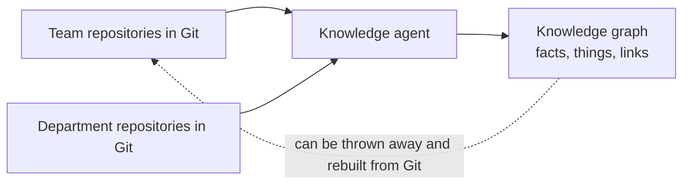
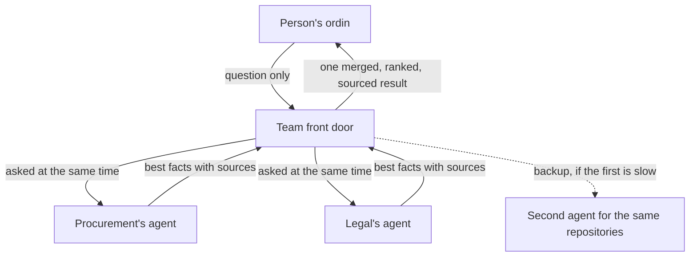
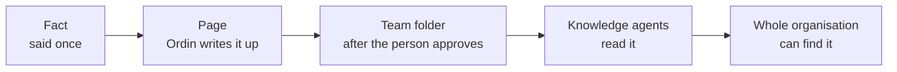
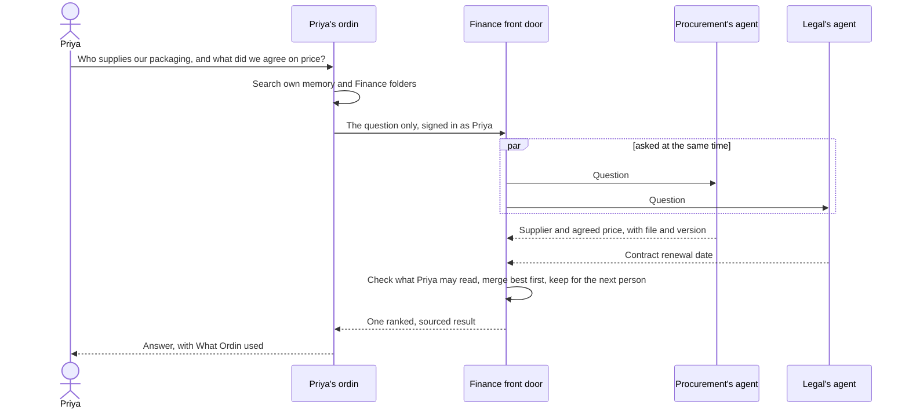

  <picture>
    <source media="(prefers-color-scheme: dark)" srcset="logo/ordin-lockup-on-dark.svg">
    
  </picture>

<b>Your AI workplace for everyday business.</b> 
Agents do the work, you stay in charge, and no technical skills are needed.

---

# An agentic knowledge fabric for a large organisation

## The problem

A large organisation knows a great deal, but the knowledge is scattered. It sits in hundreds or thousands of repositories, owned by different teams, changing every day. People spend time hunting for what a colleague in another department already wrote down. AI agents have the same problem, only faster: an agent that cannot find what the company already knows either asks the person or guesses.

The usual answers are to copy everything into one big search system, or to give an AI access to everything. Both are hard to keep current, hard to secure, and they take control away from the teams who own the knowledge.

This paper describes a different approach, built from ordin's existing parts: a **knowledge fabric**, in which every ordin learns from what it reads, and a network of knowledge agents lets any team reach the rest of the organisation's knowledge quickly and safely.

## Nine ideas

### 1. Git is the library

Teams keep their knowledge where they already keep their work: as files in Git repositories, on GitHub or GitLab. Facts, pages, decisions and documents.

Git gives three things for free:

- **Who may read what.** A repository's access rules are already set by its owners.
- **History.** Every change has a version, so you always know what was true when.
- **Copies.** Anyone allowed can take a copy, and it stays in step.

Nothing else in the fabric is the source of truth. Every map, every index and every saved answer can be thrown away and rebuilt from Git. That keeps the whole thing honest, and it means no team has to hand its knowledge to anyone.

### 2. Every ordin builds a knowledge graph

When ordin reads something, it doesn't just store the text. Its agents turn what they read into **facts** ("Borealis supplies our packaging"), the **things** those facts are about (Borealis, packaging), and the **links** between things (supplies). Each fact remembers where it came from (which file and which version) and when it was true. When something changes, the old fact is closed, not erased, so the history stays.

This is the same memory on a person's laptop and on a server. On a laptop it holds what that person and their agents learned, and the team folders they read. On a server it holds far more. The memory itself never uses AI. The agents do the reading and the memory keeps it in order, which keeps it predictable and cheap.

The person can see all of it: the things ordin knows about, the links between them, where each fact came from, which facts are fading, and which facts an answer used. They can correct or forget any of it.

### 3. Knowledge agents read what no laptop can

A **knowledge agent** is ordin running on a server, as an agent with its own identity, not as a person. It is given a set of repositories to read, perhaps everything a department owns. It keeps copies of them, and whenever one changes, it reads the changed documents and updates its knowledge graph.

It is the same software as the desktop. A team that wants one can run one, and a department or the whole company can run bigger ones. There is no separate product to buy or install.

### 4. Each team has one front door

A team doesn't need to know which agent knows what. It talks to one knowledge agent, its **front door**.

The front door has its own graph, and it keeps a list of other knowledge agents it may ask: other teams', a department's, a company-wide one. Each of those publishes a small **table of contents**: the repositories it reads, and the main things it knows about. When a question comes in that the front door can't answer alone, it looks at those tables of contents and asks only the two or three agents that fit, all at the same time.

Those other agents act as **knowledge proxies**: they answer from their own graphs and send back their best facts, each with its source. The front door combines them, best first, and sends the result back.

The network has no fixed shape. A front door can ask any agent it's allowed to, so a small company might have three agents and a large one three hundred, arranged however the organisation is.

### 5. Answers in about a second

Speed decides whether people use this. The fabric is designed around a few rules:

- **Look locally first.** Your own ordin answers from what it already knows. Only when that isn't enough does the question go to the front door, and only the question goes, never your conversation.
- **No AI and no downloading while you wait.** Agents read documents in the background, whenever a repository changes. When a question arrives, the front door and the proxies only search what they've already built, which takes a fraction of a second. AI is used once, on your own ordin, to write the reply.
- **Ask in parallel, with a deadline.** The front door asks its proxies at the same time and waits about a second. Whatever arrives in time is used. Anything later is added as **More found**. The answer says which sources didn't reply.
- **Ask a backup.** If two agents cover the same repositories and one is slow, the front door asks the other too and takes whichever answers first.
- **Remember recent answers.** Teams ask the same things often. The front door keeps recent results, labelled with the Git versions they relied on. While those versions haven't moved, the answer is immediate. When a repository changes, the agent that reads it tells the front doors that rely on it, and they drop the old answers at once.
- **Bring popular knowledge closer.** If a front door keeps asking another agent about the same repository, it starts reading that repository itself and stops asking.
- **Usually one hop.** Every extra step adds delay and another thing that can fail, so a proxy does not pass a question further on unless it is allowed to.

### 6. The wiki is the knowledge people trust

ordin keeps three layers, on purpose:

- **Sources:** documents and code, where they live.
- **Knowledge pages (the wiki):** explanations of what things are, how they work and why, each citing its sources and the versions read. Only Ordin and the person write them. They're kept, and marked "may be out of date" when a source changes.
- **Memory:** small facts that fade on purpose.

The wiki is the layer people read and stand behind. The graph is the index that lets agents find things quickly, and it points back to the wiki. When ordin, or a knowledge agent, reads a page, the page's title and other names become the name of the thing it explains, and its links to other pages become links between things. When an answer uses a fact that a page backs, the page wins over a loose fact from a document, and you see the page and its section, not just a sentence.

Knowledge grows upward, one deliberate step at a time:

1. something said once becomes a **fact**;
2. if it matters, Ordin writes it up as a **page**;
3. if the team needs it, the person shares the page to the **team folder**, after approving it;
4. once it's in Git, **knowledge agents** read it and the whole organisation can find it.

Knowledge agents read pages but never write them. Enterprise documents become facts, searchable but fading, never pages. So the wiki stays something people wrote and checked. Later, a knowledge agent may *suggest* a page where many facts exist and no page does, as a change the team approves.

### 7. One open format for knowledge

Knowledge only travels well if everyone can read it. ordin writes its wiki in the **Open Knowledge Format (OKF)**, an open format for knowledge: plain Markdown files with a short header, kept in a folder, best in a Git repository. Each file is one concept, with a type, a title, a one-line description, tags, its sources, who generated it and who checked it, and whether it's a draft, stable or deprecated. Links between concepts are ordinary links.

This matters in three ways:

- **No lock-in.** A team's knowledge folder is readable by any tool that understands OKF, not only by ordin, and by any Markdown app.
- **ordin reads other people's knowledge too.** A knowledge agent can read OKF folders that other tools and teams produce, not only ordin's own, and turn them into its knowledge graph.
- **Trust is written down.** OKF records whether a person has checked a concept, whether only a machine has, or nobody has. ordin uses that to rank answers: knowledge a person checked comes first, deprecated knowledge comes last, and knowledge past its review date is marked "may be out of date".

### 8. One name for one thing

Different teams call the same thing by different names. Finance writes "BRL", Procurement writes "Borealis", Legal writes "Borealis Ltd". Unless something says these are one supplier, an answer shows three.

A **glossary** says it. It is an ordinary knowledge folder in Git, written in the same open format, with one short entry per thing the organisation names: the preferred name, the other names, and a line saying what it is. The teams who know a subject own its entries and change them the way they change anything else in Git, with a review. There can be one glossary or several, and none is required.

Knowledge agents read the glossaries they are given before anything else. When a document says "BRL", the agent files the fact under "Borealis Ltd". Every agent that reads the same glossary uses the same name, so a front door can put the answers from Finance's, Procurement's and Legal's agents together under one supplier. A person's own ordin can read the glossary too, as a team folder, so their laptop uses the same names with no server at all. If two glossaries disagree, the agent says so and the owners settle it.

### 9. Open to other tools, with a record if you need one

The fabric is not only for ordin. Every knowledge agent also answers through MCP, the open protocol AI tools use to reach outside services, so another team's agent or a developer's coding tool can search the same knowledge. Such tools get the same answers as a person's ordin and the same rules: they sign in, they get only what their audience may read, and they can only search, never change anything. An agent's owner can turn this off.

Some organisations must be able to show an auditor which sources an answer used. A knowledge agent can keep a **sources record** for that: for each answer, an answer number, the time and the sources it returned, but never the question or who asked. The person's own ordin keeps the answer number beside the conversation. So proving what an answer rested on needs both halves, and the agent alone can never tie a question to a person. The record is off unless the agent's owner turns it on, and ordin tells people whether it is on before they connect.

## How a question travels

> Priya, in Finance, asks ordin: *"Who supplies our packaging, and what did we agree on price?"*

1. Priya's ordin searches its own memory and the Finance team's folders. It finds last month's invoice but not the contract.
2. It sends the question, and nothing else, to Finance's front door, signed in as Priya.
3. The front door hasn't seen this question recently. Its own graph knows the supplier's name. Procurement's table of contents mentions packaging suppliers and contracts, so it asks Procurement's agent, and the Legal agent, at the same time.
4. Procurement answers in a fraction of a second with the supplier and the agreed price, from the contract file and its version. Legal answers a moment later with the contract's renewal date.
5. The front door checks that Priya may read what came back, combines the facts best first, saves the result for the next person in Finance who asks, and replies.
6. Priya's ordin writes the answer. Procurement's supplier page backs the price, so that fact comes first. Under **What Ordin used**, Priya sees each fact, which agent it came from, and the file it was read from, with a link to open it.

The whole exchange takes about a second, and Priya never needed to know that Procurement or Legal had an agent.

## Keeping it safe

- **You only see what you may open.** A knowledge agent shows you a fact only if the system holding its document would let you open that document now. It keeps no copy of who may read what: while answering, it asks GitHub, GitLab, Confluence or SharePoint about the few documents behind your answer, remembers the answer for a minute, and leaves out anything it cannot confirm. It never tells you a document exists if you couldn't see it yourself.
- **Documents are information, never instructions.** Whatever a document says, it cannot tell an agent what to do. That applies to tables of contents and to answers from other agents too.
- **No conversations travel.** Only questions leave a person's computer, and the agents don't record who asked what, only how many questions and how long they took. An agent that keeps a sources record stores what each answer used, never the question or the person.
- **Every answer says how fresh it is.** Each fact says when its source was last read, and the answer says which sources it couldn't reach.
- **Nothing writes back.** Knowledge agents only read. Sharing knowledge stays a deliberate act by a person, approved by them, through their team's folder.
- **No one has to wait for IT.** A person's ordin works fully without any of this. A team can run its own front door. Bigger agents are run by whoever owns the knowledge they read.

## Growing with the organisation

| Size | What it looks like |
|---|---|
| A few teams | Each person's ordin reads their team's folder and a few others. No servers. |
| A department | One knowledge agent for the department, as the front door for its teams. |
| Many departments | One front door per team or department, each asking a handful of agents run by the departments that own the knowledge. |
| The whole organisation | The same, with a company-wide agent for the most-asked knowledge, and large agents that split their own storage across several units as they grow. |

At no stage does all the knowledge have to sit in one place. Each agent holds what its owners read, and the front doors join it up when someone asks.

## Features this paper rests on

- [Memory](features/memory.md): facts, things and links, which the person can see, correct and forget.
- [Knowledge pages](features/knowledge-pages.md): the wiki, written by Ordin and the person.
- [Team knowledge](features/team-knowledge.md): sharing and reading knowledge through a repository folder.
- [Open Knowledge Format](features/open-knowledge-format.md): the open format the pages are written in.
- [Knowledge agents](features/knowledge-agents.md): the front door, the proxies and the table of contents.
- [Hosted company agent](features/hosted-agent.md): the server agent that knowledge agents are built on.
