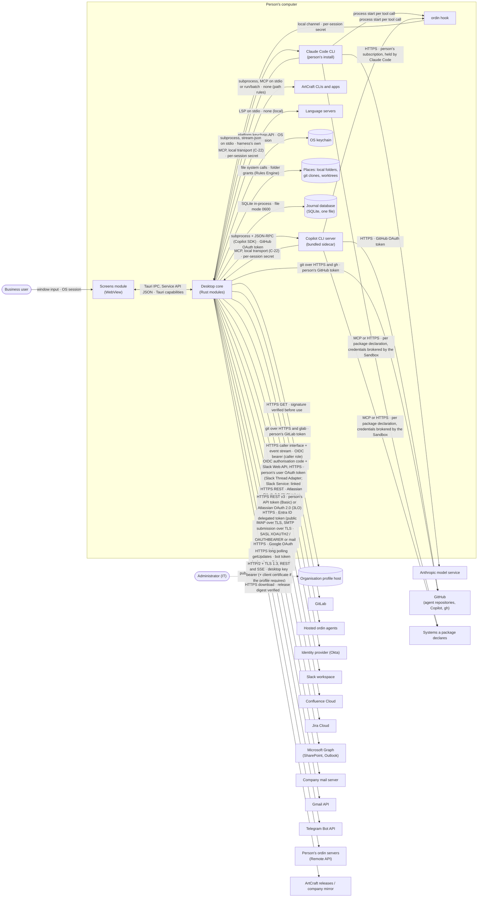
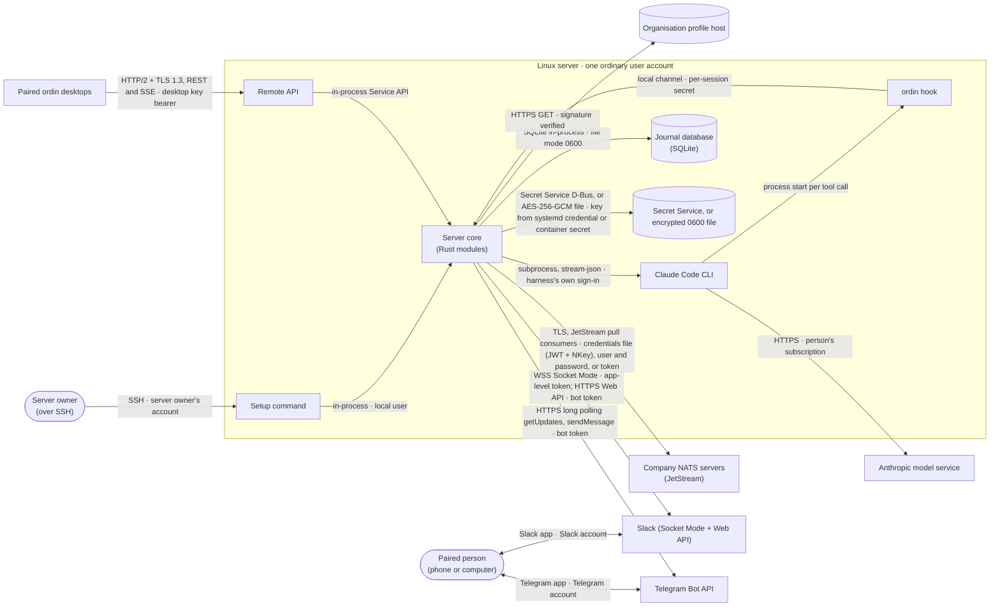
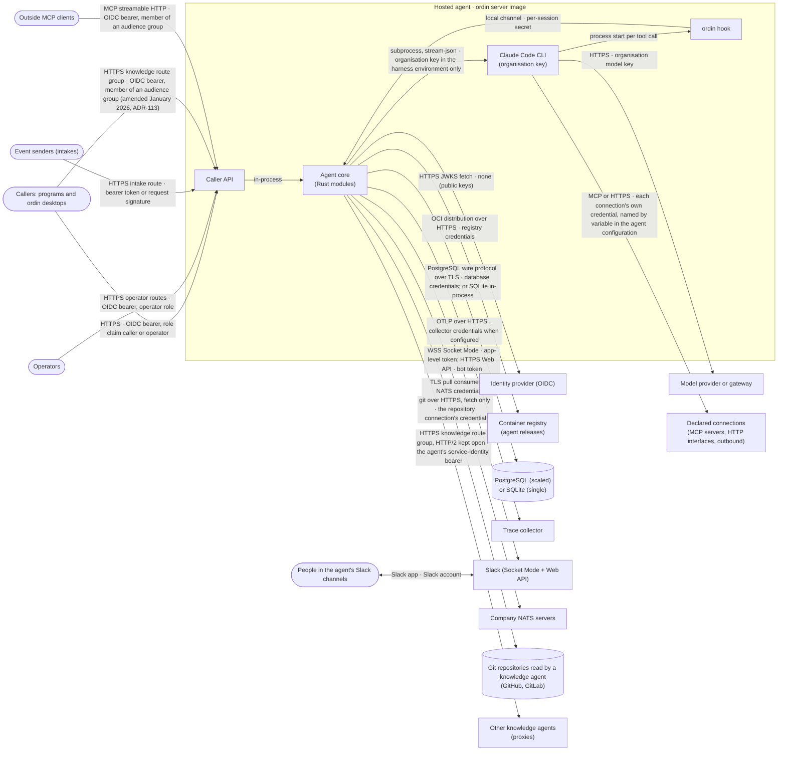

# Phase 2 — Architecture Artefacts

> **Spec set:** `ordin-desktop` · **Mode:** greenfield · **Status:** Approved (user, January 2026; Phase 6 passed) · amended January 2026 (ADR-106; promoted to Approved by the user January 2026) · amended January 2026 (ADR-107; promoted to Approved by the user January 2026) · amended January 2026 (ADR-109; promoted to Approved by the user January 2026) · amended January 2026 (ADR-110; promoted to Approved by the user January 2026) · amended January 2026 (ADR-111; promoted to Approved by the user January 2026) · amended January 2026 (ADR-112, ADR-113; promoted to Approved by the user January 2026) · amended January 2026 (ADR-115)
> **derivedFromHld:** 0.63.0 · **Source HLD:** `docs/design/ordin-desktop/` · **Authored:** January 2026 · **Amended:** January 2026 (HLD-impact edits approved, decision 79; C-61 result); January 2026 (Phase 3 corrections, decision 80); January 2026 (ADR-103: Team Knowledge Service row, 2D-4 constants); January 2026 (ADR-106: Jira Cloud in 2A-1, Jira Adapter row and two edges, `confluence.oauth_client_id` also for Jira); January 2026 (ADR-107: provider settings made vendor-neutral in 2D-1c and item 4, C-77 settled, two Helm values; no row, edge or phase changes); January 2026 (ADR-109: edge Ordin Host → Localisation; 2D-4 language limits); January 2026 (ADR-110: edge Team Knowledge Service → Organisation Profile, the inverted `MemoryFolders` seam, 2D-4 constants for read folders, one repository copy per repository); January 2026 (ADR-112, ADR-113: rows Knowledge Query Client, Knowledge Query Server and Knowledge Reader; edges Memory Service → Knowledge Query Client and Caller API → Knowledge Query Server; 2A-3 arrows; 2D-1d secret names, 2D-2 `knowledge_agents.front_doors[]`, 2D-4 knowledge constants); January 2026 (ADR-115: row Source Access; edges Knowledge Query Server → Source Access and Knowledge Reader → Source Access; 2D-1d secret names; 2D-4 access-check constants)

## Table of contents

- [2A — System Context](#2a--system-context)
- [2B — Component Inventory and build order](#2b--component-inventory-and-build-order)
- [2C — Shared Types Catalogue](#2c--shared-types-catalogue)
- [2D — Configuration & Environment Variables](#2d--configuration--environment-variables)

---

## 2A — System Context

Three diagrams, one per program and profile, because one diagram carrying all three is not readable. Every arrow is labelled `protocol · authentication`. "Local" means the call stays on one computer.

### 2A-1 ordin desktop (the person's computer)

### 2A-2 ordin server, personal profile (one person's Linux server)

### 2A-3 ordin server, agent profile (one hosted agent; single or scaled shape)

*Amended January 2026 (ADR-113):* a knowledge agent is a hosted agent whose configuration has a `knowledge-agent:` section. The last four arrows exist only for such an agent: desktops and other knowledge agents acting as front doors call its knowledge route group; outside MCP clients call its knowledge MCP endpoint unless the configuration turns it off; it fetches its repositories read-only and never pushes; as a front door it asks its proxies. In 2A-1 and 2A-2 the desktop and the personal server gain one arrow each to the front doors a workspace connects: `HTTPS knowledge route group · the person's company sign-in (OIDC bearer)`; they never answer knowledge queries.

## 2B — Component Inventory and build order

### 2B-1 Module rules (from ADR-096, made concrete)

1. **One crate per module.** Each component of HLD 02 is one crate under `crates/`, named `ordin-<kebab-case component name>`. No two components share a crate except where the table below says so.
2. **Three crates are not components.** `ordin-types` holds the Phase 2C shared types; `ordin-service-api` holds the Service API commands, events, block catalogue and its schema check, and the `ServiceApi` trait; `ordin-runtime-adapter` holds the Runtime Adapter interface trait and its event types. They depend on nothing inside the workspace except `ordin-types`.
3. **Programs are composition roots.** `apps/desktop` (Tauri) and `apps/server` (headless) are the only crates that depend on concrete adapters and on every module, construct them, and pass trait objects between them. `apps/hook` is the ordin hook binary and depends on `ordin-types` only.
4. **Hubs define the traits their providers implement.** Where a hub module must call modules that themselves call the hub, the hub owns a trait and the providers implement it and register with the hub at start-up (ADR-100). This applies to: the MCP Front (`ToolProvider`), the Crew Orchestrator (`Coordinator`), the Agent Model (`PartSource`, implemented by the Catalogue Service and given to the Resolver and Compiler), the Journal (`EventSink` subscription, which carries every Service API event with its sequence number), and the Service API (`ServiceApi`, implemented by the program).
5. **The datastore belongs to the Journal crate.** `ordin-journal` exposes the `Datastore` handle (SQLite on the desktop, the personal server and the single shape; PostgreSQL in the scaled shape) and a per-module migration registry. Each module registers and owns its own tables (ADR-096 item 1); no module reads another's tables.
6. **The screens module** (`apps/desktop/ui/`) is TypeScript and depends only on TypeScript types generated from `ordin-service-api`.
7. **The embedded components** `memory/` (crate `memory`, library target) and `sandbox/sandbox-host/` (crate `sandboxd`, library target) are path dependencies of `ordin-memory-service` and `ordin-sandbox`. The root workspace lists them under `exclude`, because each keeps its own `Cargo.lock` and, for `sandboxd`, its own workspace.
8. **The build test** (`crates/ordin-arch-test`) reads `cargo metadata`, compares every edge with the *Dependencies* column below, and fails on an edge not listed or on any cycle.

### 2B-2 Dependency corrections

The HLD's *Depends on* lists, read literally, contain nine cycles. A literal build would fail the ADR-096 build test. Each is resolved without moving a responsibility; the corrected lists are the *Dependencies* column below, and each correction is an HLD edit in the HLD-impact block of this phase.

| # | Cycle in HLD 02 | Resolution |
|---|---|---|
| D1 | Approval Service → Command Bridge → every service → Approval Service | Approval Service writes its events to the Journal; the Command Bridge, the Remote API and the Channel Gateway subscribe through `EventSink`. Approval Service depends on the Journal only. |
| D2 | File Service ↔ Workspace Service | File Service takes a `WorkspaceId` (shared type) and does not call the Workspace Service. The Workspace Service calls the File Service. |
| D3 | File Service ↔ Craft Toolkit | *Edit in ArtCraft* is routed by the Command Bridge to the Craft Toolkit. File Service does not depend on the Craft Toolkit. |
| D4 | MCP Front → Ordin Host → (local adapter) → MCP Front; and MCP Front → Sandbox, Memory Service, Craft Toolkit | MCP Front owns `ToolProvider`; Sandbox, Memory Service, Craft Toolkit, Ordin Host, Knowledge Service, Mail Service, Telegram Service, Authoring Service, Project Service, Connection Binder and Agent Loader depend on the MCP Front and register; the Agent Loader registers the agent profile's file tools, served from the File Service, because the File Service and the MCP Front sit in the same build phase. MCP Front depends on the Rules Engine and the Journal only. |
| D5 | Project Service ↔ Copilot Local Adapter | Project Service derives a coding task's change set from its own worktree (git diff against the task's base commit). It does not depend on any local adapter. |
| D6 | Command Bridge ↔ Server Connector; Server Connector → App Shell | Server Connector depends on `ordin-service-api` and Identity and Credentials; it hands server events to the Command Bridge through a channel the Bridge gives it. Notifications are raised by the desktop program from Service API events. |
| D7 | Ordin Host ↔ Crew Orchestrator (Ordin is called at "Ordin checks the result", member questions, end, and when steps do not fit) | Crew Orchestrator owns `Coordinator`; Ordin Host implements it and passes it when starting a crew run. |
| D8 | Checker → Resolver (conflict detection) → Catalogue Service → Checker | Resolver and Compiler fetches parts through `PartSource` (defined in `ordin-agent-model`), implemented by the Catalogue Service and injected. Resolver depends on the Agent Model only. |
| D9 | Usage Planner → Ordin Host / Session Supervisor, while both need its level choice | Usage Planner is a policy module: Profile, Journal and the level-to-model map exposed through `ordin-runtime-adapter`. Session Supervisor, Crew Orchestrator and Ordin Host call it. |

Further list corrections that are not cycles, found in the same pass:

| # | HLD 02 says | Correction | Reason |
|---|---|---|---|
| L1 | Ordin Host depends on Copilot Local Adapter | Runtime Adapter interface | Ordin runs on the harness the profile names, Claude Code first (ADR-038, ADR-044). |
| L2 | Ordin Host and MCP Front depend on Block Renderer | `ordin-service-api` (block catalogue and schema check) | A core crate cannot depend on the WebView; ADR-096 item 2 already splits the Block Renderer into a drawing side. |
| L3 | Rules Engine depends on Approval Service only | + Journal, Organisation Profile | Every decision is journalled; application policy comes from the profile. |
| L4 | Workspace Service list lacks SharePoint Adapter | + SharePoint Adapter | HLD 02 diagram edge `WKS --> SPA`; SharePoint locations are workspace links. |
| L5 | Authoring Service list lacks Format Plug-ins | + Format Plug-ins | It writes the pull request "by the target repository's format plug-in". |
| L6 | Channel Gateway depends on Dictation Service | removed | ADR-078: voice notes are answered with fixed text on the server. |
| L7 | Trigger Service gets saved workflows from the Workspace Service | Ordin Host | Ordin Host owns workflows and their versions (HLD 02, Ordin Host *Owns*). |
| L8 | Dictation Service depends on Setup Assistant (model download) | removed | ADR-078: no bundled speech model. |
| L9 | Copilot Local Adapter → Craft Toolkit, Sandbox (diagram edges) | MCP Front, Hook Relay | Craft and sandbox tools reach every harness through the MCP Front (ADR-037); hooks are the ordin hook for every harness (ADR-045). |
| L10 | Handover Service lacks Ordin Host | + Ordin Host | It "asks Ordin for the note's draft". |

### 2B-3 Inventory

Phase = depth in the dependency graph (0 = the shared types crate; 1 = depends on the shared types only). Every module in a phase depends only on modules in lower phases, so the order is a valid build order. Complexity: S (< 1,000 lines), M (1,000–4,000), L (4,000–12,000), XL (> 12,000, or a port of more than 4,000 lines of crucible Go). Programs: D desktop, P personal server, A agent profile.

| Component | Crate | Type | Phase | Dependencies | Complexity | Programs |
|---|---|---|---|---|---|---|
| Shared types | `ordin-types` | foundation | 0 | — | M | D P A |
| Service API | `ordin-service-api` | foundation (contract) | 1 | Shared types | L | D P A |
| Runtime Adapter interface | `ordin-runtime-adapter` | foundation (trait) | 1 | Shared types | S | D P A |
| Journal and Artefact Store | `ordin-journal` | module (datastore owner) | 1 | Shared types | L | D P A |
| Organisation Profile | `ordin-organisation-profile` | module | 1 | Shared types | M | D P A |
| Identity and Credentials | `ordin-identity` | module | 1 | Shared types | L | D P A |
| Agent Model | `ordin-agent-model` | module (port) | 1 | Shared types | XL | D P A |
| Agent Configuration | `ordin-agent-configuration` | module | 1 | Shared types | M | A |
| Telemetry | `ordin-telemetry` | module | 1 | Shared types | S | A |
| Approval Service | `ordin-approval` | module | 2 | Journal | M | D P A |
| Localisation | `ordin-localisation` | module | 2 | Organisation Profile, Journal | M | D P A |
| Agent Folder Manager | `ordin-agent-folders` | module | 2 | Journal | S | D P A |
| Format Plug-ins | `ordin-format-plugins` | module (ordin and APM formats; Claude Code and Copilot import) | 2 | Agent Model | L | D P A |
| Resolver and Compiler | `ordin-resolver` | module (port) | 2 | Agent Model | L | D P A |
| SharePoint Adapter | `ordin-sharepoint` | adapter | 2 | Identity, Journal | M | D P |
| Jira Adapter | `ordin-jira` | adapter | 2 | Identity, Journal | M | D |
| Hosted Agent Adapter | `ordin-hosted-agent-adapter` | adapter | 2 | Identity, Runtime Adapter interface | M | D P |
| Slack Thread Adapter | `ordin-slack-thread-adapter` | adapter | 2 | Identity, Runtime Adapter interface | M | D P |
| NATS Adapter | `ordin-nats` | adapter | 2 | Identity, Organisation Profile | M | P A |
| Usage Planner | `ordin-usage-planner` | module | 2 | Organisation Profile, Journal, Runtime Adapter interface | M | D P A |
| Run Queue | `ordin-run-queue` | module | 2 | Journal | M | A |
| Model Policy | `ordin-model-policy` | module | 2 | Agent Configuration, Identity | S | A |
| Caller Authentication | `ordin-caller-auth` | module | 2 | Agent Configuration | M | A |
| Settings Store | `ordin-settings-store` | module | 2 | Agent Configuration, Journal | M | A |
| Knowledge Query Client | `ordin-knowledge-query-client` | module (asks front doors and proxies; *amended January 2026, ADR-113*) | 2 | Identity, Journal | M | D P A |
| Source Access | `ordin-source-access` | module (links accounts, checks access per person, receives sharing notices, reads Confluence and SharePoint for knowledge agents; *added January 2026, ADR-115*) | 2 | Agent Configuration, Journal, Telemetry | L | A |
| Server Connector | `ordin-server-connector` | adapter (desktop side of Remote API) | 2 | Service API, Identity, Journal | M | D |
| Rules Engine | `ordin-rules` | module | 3 | Approval Service, Journal, Organisation Profile | XL | D P A |
| Brand | `ordin-brand` | module | 3 | Organisation Profile, Localisation, Journal | S | D |
| Dictation Service | `ordin-dictation` | module (Swift bridge, macOS 26+) | 3 | Localisation | M | D |
| Checker | `ordin-checker` | module (port) | 3 | Agent Model, Resolver and Compiler, Organisation Profile, Journal | XL | D P A |
| Installers | `ordin-installers` | module (port) | 3 | Agent Folder Manager, Resolver and Compiler, Agent Model | L | D P A |
| Session Supervisor | `ordin-session-supervisor` | module | 3 | Runtime Adapter interface, Journal, Usage Planner, Run Queue | L | D P A |
| Duty Timer | `ordin-duty-timer` | module | 3 | Agent Configuration, Run Queue, Telemetry, Journal | S | A |
| Command Bridge | `ordin-command-bridge` | transport (Tauri IPC) | 3 | Service API, Server Connector, Journal | M | D |
| Remote API | `ordin-remote-api` | transport (HTTP/2 + SSE) | 3 | Service API, Approval Service, Journal, Identity, Organisation Profile | L | P |
| MCP Front | `ordin-mcp-front` | hub (MCP servers to harnesses) | 4 | Rules Engine, Journal, Service API | L | D P A |
| Package Inspector | `ordin-package-inspector` | module | 4 | Rules Engine, Format Plug-ins, Agent Model | M | D P A |
| File Service | `ordin-files` | module | 4 | Agent Folder Manager, Rules Engine, Journal | L | D P A |
| Hook Relay | `ordin-hook-relay` | module | 4 | Rules Engine, Approval Service, Session Supervisor, Journal | M | D P A |
| Crew Orchestrator | `ordin-crew-orchestrator` | module | 4 | Session Supervisor, Runtime Adapter interface, Rules Engine, Approval Service, Usage Planner, Organisation Profile, Journal | XL | D P |
| Sandbox | `ordin-sandbox` | wrapper (`sandboxd` lib) | 5 | MCP Front, Rules Engine, Identity, Journal | M | D P |
| Memory Service | `ordin-memory-service` | wrapper (`memory` lib) | 5 | MCP Front, Journal, Knowledge Query Client (*amended January 2026, ADR-113*) | M | D P A |
| Craft Toolkit | `ordin-craft-toolkit` | module | 5 | MCP Front, Rules Engine, File Service, Organisation Profile, Journal | L | D P |
| Confluence Adapter | `ordin-confluence` | adapter | 5 | Identity, Approval Service, File Service, Journal | L | D |
| Project Service | `ordin-projects` | module | 5 | MCP Front, File Service, Rules Engine, Identity, Journal | XL | D P |
| Claude Local Adapter | `ordin-claude-adapter` | adapter (implements Runtime Adapter interface) | 5 | Runtime Adapter interface, MCP Front, Hook Relay, Rules Engine | L | D P A |
| Copilot Local Adapter | `ordin-copilot-adapter` | adapter (implements Runtime Adapter interface) | 5 | Runtime Adapter interface, MCP Front, Hook Relay, Rules Engine, Identity | L | D P |
| Connection Binder | `ordin-connection-binder` | module (HTTP Connector, Outbound Publisher) | 5 | Agent Configuration, MCP Front, Rules Engine, Telemetry | L | A |
| Knowledge Query Server | `ordin-knowledge-query-server` | module (answers knowledge queries; front door and proxy; *amended January 2026, ADR-113*; checks each asker per document, *amended January 2026, ADR-115*) | 6 | Knowledge Query Client, Memory Service, Caller Authentication, Agent Configuration, Source Access, Journal, Telemetry | L | A |
| Workspace Service | `ordin-workspaces` | module | 6 | File Service, Confluence Adapter, SharePoint Adapter, Jira Adapter, Rules Engine, Journal | M | D P |
| Catalogue Service | `ordin-catalogue` | module (port) | 6 | Organisation Profile, Project Service, Format Plug-ins, Checker, Agent Model, Journal | XL | D P A |
| Push Service | `ordin-push` | module | 6 | Approval Service, SharePoint Adapter, Confluence Adapter, Project Service, Craft Toolkit, File Service, Journal | L | D P |
| Agent Loader | `ordin-agent-loader` | module | 6 | Agent Configuration, Model Policy, Connection Binder, MCP Front, Rules Engine, File Service | M | A |
| Knowledge Service | `ordin-knowledge` | module | 7 | MCP Front, File Service, Workspace Service, Memory Service, Rules Engine, Push Service, Journal | L | D P A |
| Mail Service | `ordin-mail` | module | 7 | MCP Front, Identity, Rules Engine, Approval Service, File Service, Workspace Service, Organisation Profile, Journal | XL | D P |
| Slack Service | `ordin-slack-service` | module | 7 | Identity, Approval Service, MCP Front, Workspace Service, Organisation Profile, Journal | L | D P |
| Package Catalogue | `ordin-package-catalogue` | module | 7 | Catalogue Service, Resolver and Compiler, Installers, Checker, Organisation Profile, Agent Folder Manager, Package Inspector, Journal | M | D P |
| Release Builder | `ordin-release-builder` | module | 7 | Agent Configuration, Checker, Resolver and Compiler, Agent Loader | M | A |
| Ordin Host | `ordin-host` | module | 8 | Runtime Adapter interface, Service API, MCP Front, Checker, File Service, Package Inspector, Package Catalogue, Crew Orchestrator, Session Supervisor, Usage Planner, Memory Service, Knowledge Service, Push Service, Project Service, Workspace Service, Journal, Localisation | XL | D P |
| Home and Search | `ordin-home-search` | module | 8 | Journal, Knowledge Service, File Service, Workspace Service, SharePoint Adapter, Confluence Adapter | M | D P |
| Setup Assistant | `ordin-setup` | module | 8 | Organisation Profile, Identity, Package Catalogue, Catalogue Service, Craft Toolkit, Journal | L | D P |
| Retention and Erasure | `ordin-retention` | module | 8 | Knowledge Service, Memory Service, File Service, Run Queue, Settings Store, Journal | M | A |
| Knowledge Reader | `ordin-knowledge-reader` | module (reads Git repositories into the knowledge scope; *amended January 2026, ADR-112, ADR-113*; also Confluence spaces and SharePoint libraries, *amended January 2026, ADR-115*) | 8 | Agent Configuration, Memory Service, Knowledge Service, Duty Timer, Source Access, Journal, Telemetry | L | A |
| Team Knowledge Service | `ordin-team-knowledge` | module | 8 | Memory Service, Knowledge Service, Push Service, Project Service, Workspace Service, Identity, Journal; Organisation Profile through the program | L | D P |
| Authoring Service | `ordin-authoring` | module (port) | 9 | Agent Model, Catalogue Service, Checker, Format Plug-ins, MCP Front, Ordin Host, Push Service, Journal | XL | D P |
| Channel Gateway | `ordin-channel-gateway` | module | 9 | Ordin Host, Approval Service, Workspace Service, Organisation Profile, Journal, Retention and Erasure | L | P A |
| Handover Service | `ordin-handover` | module | 9 | Catalogue Service, Checker, Approval Service, Push Service, Project Service, SharePoint Adapter, Mail Service, Slack Service, Workspace Service, Jira Adapter, Ordin Host, Identity, Journal | L | D P |
| Job Runner | `ordin-job-runner` | module | 9 | Knowledge Service, Retention and Erasure, Journal, Telemetry | M | A |
| Caller API | `ordin-caller-api` | transport (HTTP) | 9 | Caller Authentication, Run Queue, File Service, Settings Store, Knowledge Service, Retention and Erasure, Rules Engine, Telemetry, Approval Service, Knowledge Query Server (*amended January 2026, ADR-113*) | L | A |
| Telegram Adapter | `ordin-telegram-adapter` | adapter | 10 | Channel Gateway, Identity, Journal | M | D P |
| Slack Channel Adapter | `ordin-slack-channel-adapter` | adapter | 10 | Channel Gateway, Identity, Journal | L | P A |
| Trigger Service | `ordin-triggers` | module | 10 | Ordin Host, Channel Gateway, NATS Adapter, Slack Service, Organisation Profile, Journal | M | P |
| Telegram Service | `ordin-telegram-service` | module | 11 | Telegram Adapter, MCP Front, Rules Engine, Approval Service, File Service, Workspace Service, Organisation Profile, Journal | M | D P |
| ordin hook | `apps/hook` (binary `ordin-hook`) | program | 2 | Shared types | S | D P A |
| ordin server | `apps/server` (binary `ordin-server`) | program (composition root; setup command; always-on supervision) | 12 | every module listed for P or A | L | P A |
| ordin desktop | `apps/desktop` (Tauri) | program (composition root) | 12 | every module listed for D | M | D |
| App Shell, Block Renderer (drawing side) | `apps/desktop/ui/` | screens module (TypeScript) | 12 | Service API (generated TypeScript types) | XL | D |
| Architecture test | `crates/ordin-arch-test` | build check | 12 | — (reads `cargo metadata`) | S | build only |

External programs, not built here: Claude Code CLI (person's install; organisation's image in A), Copilot CLI server (bundled sidecar, pinned), ArtCraft CLIs and apps, language servers (gopls, rust-analyzer, Java and TypeScript servers per Phase 1A), `gh`, `glab`.

Superseded components that get no crate: Package Catalogue's `apm` driving (ADR-082), apm CLI sidecar (ADR-082), wrightrun HTTP Adapter under that name (renamed Hosted Agent Adapter, ADR-098), Always on (a behaviour of the ordin server program, not a module).

*Amended January 2026 (Phase 3 corrections, decision 80; HLD 0.49.0, H02-1, D4–D6):* edges added — Server Connector, Duty Timer, Catalogue Service, Authoring Service, Project Service, Craft Toolkit and Telegram Service → Journal; MCP Front → Service API (block catalogue and its check, 2B-2 L2); Installers, Package Inspector and Catalogue Service → Agent Model (the Catalogue Service implements `PartSource`); Caller API → Approval Service (approver card routes, ADR-097 item 9); Channel Gateway and Slack Channel Adapter → Retention and Erasure (scope registry). Under D4, Localisation, Brand and Setup Assistant reach the shared database through the Journal's `Datastore` and so depend on the Journal; only the two phase-1 table owners (Organisation Profile, Identity and Credentials) receive the datastore's pool from the program and export their migrations as data. Edge removed — Trigger Service → Session Supervisor: workflow runs start through the Ordin Host. The Trigger Service runs in the personal profile only (D5); the agent profile's intake routes belong to the Caller API. The server binary is `ordin-server` (D6; SA-NAME-05).

*Amended January 2026 (Phase 3 closing round, K7):* edges added — Telegram Adapter → Journal and Slack Channel Adapter → Journal. Both own tables, so under D4 they reach them through the Journal's `Datastore` and export `migrations() -> ModuleMigrations`; the programs no longer hand them a pool. The Journal is in phase 1, below their phase 10, so no Phase number changes. Edge added as well — Ordin Host → Checker: `AuthoringHost::rehearse` (implemented by the Ordin Host) returns the Checker's `RunEvidence`; the Checker is in phase 3, below the Ordin Host's 8, so no Phase number changes. And Ordin Host → File Service: an immediate-start `PlaceFile` input is read through the File Service at start (K19); the File Service is in phase 4.

*Amended January 2026 (Phase 3 re-audit, decision 80, E4):* edge removed — Slack Channel Adapter → Retention and Erasure. The adapter never reads the scope registry: the hosted agent's scopes, pending questions and replies are the Channel Gateway's, which keeps its own Retention and Erasure edge. The edge added by the decision-80 amendment above for the Slack Channel Adapter is therefore withdrawn; the Channel Gateway's is kept.

*Amended January 2026 (ADR-102; HLD 0.50.0):* row added — **Slack Service** (phase 7, D P), whose six dependencies sit in phases 1–6. Edges added — Handover Service → Slack Service (phase 9 → 7: stage-channel and direct-message notices) and Trigger Service → Slack Service (phase 10 → 7: the `slack_message` trigger kind reads kept messages). The Slack Service owns one interface only the programs implement, `SlackReactor`, implemented over the Ordin Host's `react_to_slack` (Ordin Host sits in phase 8, so the Slack Service cannot name it; the same pattern as the Ordin Host's `TriggerDesk`). It implements the MCP Front's `ToolProvider` and learns approval decisions through the Journal's `EventSink`. The Slack Thread Adapter is unchanged: it keeps no table and does not depend on the Approval Service, so links, rules and drafts are not added to it.

*Amended January 2026 (ADR-103; HLD 0.51.0):* row added — **Team Knowledge Service** (phase 8, D P), whose seven dependencies sit in phases 1–7 (Journal and Identity 1, Memory Service and Project Service 5, Workspace Service and Push Service 6, Knowledge Service 7). It owns the interfaces through which it reaches them (`TeamMemory`, `TeamPages`, `TeamPush`, `TeamWorkspaces`, `TeamRepos`), each implemented by the programs as a direct delegation to the owner's method (the D3 pattern of the Knowledge Service). No edge points into it: the programs construct it and the Service API implementation calls it for the `team_knowledge.*` commands. The Memory, Knowledge, Push, Workspace and Project Services gain methods it calls (their amendments of January 2026), and no new edge between them.

*Amended January 2026 (ADR-106; HLD 0.54.0):* row added — **Jira Adapter** (phase 2, D), whose two dependencies, Identity and Journal, sit in phase 1, as the SharePoint Adapter's do. Edges added — Workspace Service → Jira Adapter (phase 6 → 2: Jira issue links) and Handover Service → Jira Adapter (phase 9 → 2: Jira handover places). Both point to a lower phase, so no Phase number changes. The inventory holds 75 component rows. The personal server builds no Jira Adapter: both callers accept an absent handle in P (below).

*Amended January 2026 (ADR-109; HLD 0.58.0):* edge added — Ordin Host → Localisation (phase 8 → 2): the Ordin Host states the active locale in Ordin's seed and change line, changes it when the person asks in words (`set_locale`), and drafts a person's language through Localisation's draft methods. The edge points to a lower phase, so no Phase number changes and the graph stays acyclic: Localisation depends only on Organisation Profile and Journal (phase 1), and nothing in its closure depends on the Ordin Host. No row added; the inventory holds 75 component rows. The agent profile builds no Ordin Host, so no absent handle is needed.

*Amended January 2026 (ADR-110; HLD 0.59.0):* Team Knowledge Service reads Organisation Profile through the program, with no crate edge: the program passes `team_knowledge.read_folders[]` from `current()` and each `subscribe()` change to `TeamKnowledgeService::apply_company_folders`, and the Team Knowledge Service keeps its own copy of `CompanyReadFolder` and `AppliesTo` (TeamKnowledgeService.md amendment January 2026; the D3 pattern). The crate graph of 2B-3 and the Architecture Test's table are unchanged. The Memory Service gains no edge: it names each recalled item's folder and adoption through its own trait `MemoryFolders`, which the program implements over the Team Knowledge Service (the D3 pattern of traits owned by the caller and implemented by the program), so Memory Service (phase 5) still depends only on MCP Front and Journal and no cycle arises with the Team Knowledge Service (phase 8), which depends on it. The Knowledge Service reaches the memory component's content check through its existing Memory Service edge. Project Service, Push Service and Service API rows are unchanged. No row added; the inventory holds 75 component rows. The agent profile builds no Team Knowledge Service, so it reads no team folder and no `team_knowledge` key.

*Amended January 2026 (ADR-112, ADR-113; HLD 0.61.0):* three rows added. **Knowledge Query Client** (phase 2, D P A) depends on Identity and Journal (phase 1): it keeps a workspace's front-door connections and asks front doors or proxies in parallel within deadlines, and merges what arrives by rank. **Knowledge Query Server** (phase 6, A) depends on Knowledge Query Client (2), Memory Service (5), Caller Authentication (2), Agent Configuration (1), Journal (1) and Telemetry (1): it answers knowledge queries, keeps the cache, the table of contents and the optional sources record, and gives the Caller API the knowledge route group and the read-only knowledge MCP endpoint. **Knowledge Reader** (phase 8, A) depends on Agent Configuration (1), Journal (1), Telemetry (1), Duty Timer (3), Memory Service (5) and Knowledge Service (7): it fetches the configured Git repositories read-only, reads changed documents into the agent's knowledge scope, resolves names through glossaries and builds the table of contents. Edges added on existing rows: Memory Service → Knowledge Query Client (5 → 2: a workspace's recall asks its front doors) and Caller API → Knowledge Query Server (9 → 6: the route group is mounted on the Caller API's port). Upward calls use traits owned by the lower crate and implemented by the program, the D3 pattern: `ReaderModel` and `ReaderOutlet` (owned by the Knowledge Reader; implemented over the Session Supervisor's one fixed harness turn and over the Knowledge Query Server), `HotCopy` (owned by the Knowledge Query Server; implemented over the Knowledge Reader) and `BuiltInDuty` (owned by the Duty Timer, which the Knowledge Reader depends on; implemented by the Knowledge Reader as the duty `knowledge_fetch`), `CredentialSource` (owned by the Knowledge Reader; implemented by the program over the server's secret store). The Knowledge Reader reaches the OKF parser through its Knowledge Service edge (`ordin_knowledge::okf`). The agent profile constructs the Knowledge Reader and the Knowledge Query Server only when the agent configuration has a `knowledge-agent:` section. Every new edge points to a lower phase, so no Phase number changes and the graph stays acyclic. The inventory holds 78 component rows.

**Absent handles.** Where a module depends on a module absent from one program, it accepts an absent handle in that program: Workspace Service and Handover Service → Jira Adapter (P; amended January 2026, ADR-106); Session Supervisor → Run Queue (D, P); Telegram Adapter → Channel Gateway (D); Channel Gateway and Trigger Service → Ordin Host (A); Catalogue Service → Project Service (A); Knowledge Service → Workspace and Push Services (A); Workspace Service, Push Service, Home and Search → Confluence Adapter (P). The Organisation Profile in A is constructed with no profile, every key at its default.

**`ordin-types` everywhere.** `ordin-types` is an allowed dependency of every crate, although rows past phase 1 do not list it (2B-1 rule 2).

**DAG check.** Each row's Dependencies name only rows with a lower Phase number. Checked row by row on January 2026, and again on January 2026 after the edges above were added and removed: every new edge points to a lower phase (Journal, Agent Model and Service API sit in phase 1, Approval Service in phase 2, Retention and Erasure in phase 8 below the Channel Gateway's 9), so no Phase number changed; no edge points to an equal or higher phase, so the graph is acyclic and the Phase column is a valid build order. *Re-checked January 2026 (ADR-102): the Slack Service's own dependencies sit in phases 1–6, and the two new edges into it come from phases 9 (Handover Service) and 10 (Trigger Service). Re-checked January 2026 (ADR-103): the Team Knowledge Service's seven dependencies sit in phases 1–7, below its phase 8, and no edge enters it, so no Phase number changes. Re-checked January 2026 (ADR-112, ADR-113): the three new rows' dependencies sit in lower phases (Knowledge Query Client 2 over phase 1; Knowledge Query Server 6 over phases 1, 2 and 5; Knowledge Reader 8 over phases 1, 3, 5 and 7), and the two new edges into them come from phases 5 (Memory Service) and 9 (Caller API).* *Re-checked January 2026 (ADR-115): Source Access (2) depends on phase 1 only, and the two new edges into it come from phases 6 (Knowledge Query Server) and 8 (Knowledge Reader); no Phase number changes.*

*Amended January 2026 (ADR-114; HLD 0.62.0):* the programs' (`apps/desktop`, `apps/server`) dependencies on module crates may be optional behind build switches named after features (Generation Playbook §9; OrdinDesktop.md and OrdinServer.md amendments January 2026). No row, phase or edge of this table changes: a switch decides which modules a program constructs, not which crates depend on which. A crate that an always-built crate depends on stays a normal dependency of the program and its switch gates construction only — `ordin-knowledge-query-client`, on which the Memory Service depends. The Architecture Test reads the graph with `--all-features`, so every optional edge is still checked against this table.

*Amended January 2026 (ADR-115; HLD 0.63.0):* one row added. **Source Access** (phase 2, A) depends on Agent Configuration (1), Journal (1) and Telemetry (1): it links a person's GitHub, GitLab and Confluence accounts by asking the system who a token belongs to, answers access checks per person within a deadline with a short in-memory memory of answers, accepts GitHub and GitLab sharing-change notices, and lists and fetches Confluence spaces and SharePoint libraries for the Knowledge Reader. The server program gives it its secrets as values in its settings, so it has no edge to Identity. Edges added on existing rows: Knowledge Query Server → Source Access (6 → 2) and Knowledge Reader → Source Access (8 → 2). The agent profile constructs it only when the agent configuration has a `knowledge-agent:` section. The inventory holds 79 component rows.

---

## 2C — Shared Types Catalogue

The catalogue is split in two files because together they exceed 6,000 lines. Both live in the crate `ordin-types`, except the Service API types (`ordin-service-api`) and the Runtime Adapter interface (`ordin-runtime-adapter`), as 2B-1 sets out.

| Part | File | Holds |
|---|---|---|
| 1 | `phase-2c-shared-types-domain.md` | Conventions (identifiers, `Timestamp`, storage), the 71 persisted entities of HLD 04 with owner, *Used by*, validation and storage, 44 state machines, assumed limits LD-01 to LD-56 |
| 2 | `phase-2c-shared-types-wire.md` | Service API envelope and events, Runtime Adapter interface, Rules Engine decision, hook protocol, approval card, start-up report items, block catalogue, workflow file format 3, types consumed from `memory/` and `sandboxd`, assumed limits LW-1 to LW-47 |

Every Phase 3 spec copies the types it uses into its *Shared Context* section.

---

## 2D — Configuration & Environment Variables

> **Spec set:** ordin desktop · **derivedFromHld:** 0.63.0 (`docs/design/ordin-desktop/`)
> **Mode:** greenfield, with the embedded crates read as code evidence (`memory/src/config.rs`, `sandbox/sandbox-host/src/config.rs`, `sandbox/sandbox-host/src/keychain.rs`, `sandbox/sandbox-host/src/mcp.rs`, `sandbox/sandbox-host/src/main.rs`, `memory/src/lib.rs`, `memory/src/obs/log.rs`)
> **Status:** Approved (user, January 2026; Phase 6 passed). Every key and variable name marked *(chosen here)* is a proposal; `docs/design/ordin-desktop/08-interfaces.md:8` and `:77` leave the profile's format and every field name to `/spec`.

ordin is one Cargo workspace building two programs (`05-tech-stack.md:39`): the **desktop** (Tauri 2) and the **ordin server** (headless Linux). The server runs in the **personal profile** or the **agent profile**, and the agent profile in the **single shape** (one process, SQLite) or the **scaled shape** (Kubernetes, PostgreSQL) (`02-architecture.md:221`). Configuration reaches these from four sources, kept apart below.

### Configuration sources and precedence

**The rule that removes most precedence questions.** No setting exists in two sources *(chosen here; carried from wrightrun's EnvironmentConfiguration spec, `agent-wright-runtime/docs/spec/cross-cutting/EnvironmentConfiguration.md:11`)*. The organisation profile holds company policy; the installer holds the two addresses needed before the profile can be read; Settings and the setup command hold the person's or the server owner's choices; environment variables hold facts of the running program and its deployment (where data lives, where a secret file is, a port, a log level). Where a value has a default, a company default and a person's choice, the chain below applies; nothing else overrides anything.

**Desktop.**
1. Fixed constant in code (2D-4), including every *application maximum*.
2. Organisation profile value (2D-2): a company default, a company maximum, or a lock ("Set by your company", ADR-062). A company maximum can only lower an application maximum (07 — *Crew guardrail defaults*, `07-cross-cutting.md:44`).
3. The person's choice in Settings (2D-3), accepted only where `usage.person_may_change` (or the equivalent switch) lets the person change it, and clamped to the company maximum, then to the application maximum.
4. A profile that fails signature verification is ignored and the last verified profile is kept (`02-architecture.md:702`). A newer verified profile that lowers a maximum lowers the person's stored value at the next use, and a locked setting reverts to the company default (`04-domain.md:139`, for the GitHub approval ceiling).
5. The installer-carried values (2D-2b) are read only to find the profile and the update feed; once a verified profile names `updates.feed_url`, that address replaces the installer's.
6. The desktop reads **no environment variable of its own** *(chosen here)*. It reads standard platform state only through the operating system (proxy settings and trusted certificates, A-39), and it removes credential variables from the environment of each harness it starts (2D-1c).

**Personal-profile server.** The desktop chain applies to every setting it shares with the desktop, with two additions: the server owner's setup-command inputs (2D-3, stored under the application data root or in the server's secret store), and environment variables (2D-1a) that state where the data root and the secrets key are and the log level. These three groups have no key in common, so none overrides another. Where no organisation profile exists, A-40 lets the server owner choose the chat channels (`10-risks.md:51`); every other profile key then takes its default.

**Agent-profile server (single and scaled shapes).** Per-agent choices come only from the agent configuration file in the agent release (`08-interfaces.md:40`, ADR-098 item 2), validated by the Agent Configuration component; values above an application maximum are refused there, not clamped (`02-architecture.md:775`). Deployment facts and the paths of secret files come from environment variables (2D-1a), set by the systemd unit or the container in the single shape and by the Helm values in the scaled shape. Credentials named by the configuration are resolved from the server's secret store (single shape) or a mounted secrets folder (scaled shape), never from the configuration file and never from ordin's own environment *(chosen here)*. **The agent profile reads no organisation profile** *(chosen here)*: ADR-097 and ADR-098 give the hosted agent the agent configuration as its only policy source, and no HLD text names a profile key the agent profile consumes (see *Former gaps, now settled*, item 1).

### 2D-1 Environment variables

### 2D-1a Variables of ordin's own

*Amended January 2026 (ADR-106):* the Jira Adapter adds no environment variable and no profile key; its limits are constants in its component spec.

All are read once at start, before the program serves anything; a change reaches a running instance only by a restart *(chosen here; wrightrun's rule, EnvironmentConfiguration step 10)*. A missing or malformed required variable stops the program with a named error, and the instance never reports ready. No variable holds a secret value: a secret is reached through a file path, a systemd credential or the secret store.

| Variable | Type | Default | Required | Program(s) | Owner Component | Description | HLD trace |
|---|---|---|---|---|---|---|---|
| `ORDIN_DATA_DIR` | path | `$XDG_DATA_HOME/ordin`, else `$HOME/.local/share/ordin`; the container image sets `/var/lib/ordin` *(chosen here)* | No | Server: personal profile, agent single shape | ordin server | The application data root: SQLite journal, memory store, encrypted secrets file, clones, logs. Must be owned by the running user; ordin refuses to start on a root it cannot write. | ADR-072, `02-architecture.md:570`, `05-tech-stack.md:35` |
| `ORDIN_SECRETS_KEY_FILE` | path | none | Yes, when no Secret Service runs in the user's session and `ORDIN_SECRETS_KEY_CREDENTIAL` is unset | Server: personal profile, agent single shape (container) | Identity and Credentials | Path of the container runtime's secret holding the key that decrypts the `0600` secrets file under `ORDIN_DATA_DIR`. The value never enters the environment. Setting both this and `ORDIN_SECRETS_KEY_CREDENTIAL` stops the start with a named error. | C-50 (`10-risks.md:184`), `02-architecture.md:570`, `05-tech-stack.md:23`, ADR-073 *Secrets on the server* |
| `ORDIN_SECRETS_KEY_CREDENTIAL` | path | none | Yes, when no Secret Service runs and `ORDIN_SECRETS_KEY_FILE` is unset | Server: personal profile, agent single shape (archive with systemd 256 or later) | Identity and Credentials | Path of the key encrypted with `systemd-creds encrypt --user`. ordin runs `systemd-creds decrypt --user` on it at start, because `LoadCredentialEncrypted=` fails in a user unit (lab result in C-50), and keeps the decrypted key in memory only. | C-50, OQ-44, ADR-073 *Status* (decision 53) |
| `ORDIN_LOG_LEVEL` | enum `error`, `warn`, `info`, `debug` | `info` | No | Server: every profile and shape | ordin server | Level of the JSON log lines. Any other value stops the start with a named error. Also given in-process to the embedded memory and sandbox components (2D-1e, 2D-1f). | `07-cross-cutting.md:14`, `05-tech-stack.md:46` |
| `ORDIN_RELEASE` | string `<registry>/<repository>@sha256:<hex>` | none | Yes, for the obtain-a-release sub-command | Server: agent profile | Agent Loader | The agent release a deployment names. The start command does not read it; it reads the reference and digest the obtain step wrote beside the release. | `08-interfaces.md:42`, `:47`, ADR-098 item 2; `WRIGHTRUN_RELEASE` |
| `ORDIN_REGISTRY_AUTH_FILE` | path | none | No; without it the registry is read with no credential | Server: agent profile (obtain, publish) | Agent Loader, Release Builder | Credentials file for the container registry. Never printed or logged. | `08-interfaces.md:87`; `WRIGHTRUN_REGISTRY_AUTH_FILE` |
| `ORDIN_RELEASE_DIR` | path | none | Yes, for the agent-profile start, obtain and run-one-job sub-commands | Server: agent profile | Agent Loader | Folder holding the obtained release; the bundle is read-only there. | ADR-098 item 3 *Work folder*; `WRIGHTRUN_RELEASE_DIR` |
| `ORDIN_DATABASE_URL_FILE` | path | none | Yes, in the scaled shape for start, the schema sub-command and run-one-job; absent means the SQLite datastore under `ORDIN_DATA_DIR` | Server: agent scaled shape | ordin server | Path of a file (a Kubernetes Secret mounted as a volume) holding the PostgreSQL connection string. The string is never printed, logged or placed in an error. | `05-tech-stack.md:35`, ADR-098 item 5, `08-interfaces.md:88`; `WRIGHTRUN_DATABASE_URL` (moved from a value to a file path) |
| `ORDIN_PORT` | integer 1024–65535 | `8080` | No | Server: agent profile | Caller API | The one port an instance listens on for the caller, intake, operator, work-folder, health and metrics routes. The personal profile does not read it: the Remote API's address and port are setup inputs (2D-3). | `07-cross-cutting.md:23`, `08-interfaces.md:43`–`44`; `WRIGHTRUN_PORT` |
| `ORDIN_RUN_CONCURRENCY` | integer 1–100 | `10` in an instance started in the runs role; `8` in the single shape *(chosen here)* | No | Server: agent profile | Session Supervisor | Most runs (harness programs) one instance executes at once. | A-48, A-49 (`10-risks.md:59`–`60`), `07-cross-cutting.md:43`; `WRIGHTRUN_RUN_CONCURRENCY` |
| `ORDIN_IMAGE` | string, at most 512 characters printed | none | No | Server: agent profile | Slack Channel Adapter | The server image reference, set by the Helm chart, printed by the chat's version command; absent, the command prints "not stated". | `02-architecture.md:610`; `WRIGHTRUN_IMAGE` |
| `ORDIN_OTLP_ENDPOINT` | URL (`https://`, or `http://` to loopback) | none | No | Server: agent profile | Telemetry | Address of the organisation's OpenTelemetry collector (OTLP over HTTP). Traces are sent only when the agent configuration switches tracing on **and** this is set; switched on with this unset, the start-up report says traces are not sent. ordin configures its exporter from this variable only and does not let the OpenTelemetry library read `OTEL_*` variables. | `07-cross-cutting.md:16`, `05-tech-stack.md:46`; wrightrun ADR-076 ("the address of the collector … is an environment variable") |
| `ORDIN_MODEL_KEY_FILE` | path | none | Yes, in the scaled shape for instances serving runs, the check and run-once; in the single shape only when the key is not in the secret store | Server: agent profile | Model Policy | Path of a file holding the organisation's model key. ordin reads it and gives the key to the Claude Code program alone (2D-1c); no hook, MCP server, sandbox or tool receives it. | ADR-097 item 2, C-74 (`10-risks.md:208`) *Amended January 2026 (ADR-107):* required as stated only when the configured provider is the default; for any other provider it is optional (1A SA-HOST-02). |
| `ORDIN_SECRETS_DIR` | path | none | Yes, in the scaled shape when the agent configuration names any credential variable | Server: agent scaled shape | Connection Binder | Folder where each file's name is a variable name the agent configuration lists and its content the value (the Kubernetes Secret mounted as a volume). A name the configuration lists with no file stops the instance with a named error naming the variable. The same Secret also holds two files that are not configuration variables: `ORDIN_DATABASE_URL` (the PostgreSQL connection string, read through `ORDIN_DATABASE_URL_FILE`) and `ORDIN_MODEL_KEY` (the organisation's model key, read through `ORDIN_MODEL_KEY_FILE`); the Helm chart mounts the Secret at `/var/run/ordin/secrets` and sets the three paths (OrdinServer.md *Helm values*, `secretName`). | `02-architecture.md:775` ("a credential value where a variable name is expected" is an error), `08-interfaces.md:40` |
| `ORDIN_SERVER_URL` | URL (`https://`, or `http://` for `localhost` and `127.0.0.1`) | none | Yes, for the operator sub-commands that call a running hosted agent | Server command (operator's machine) | ordin server | Base address of the hosted agent's routes. | `08-interfaces.md:47`; `WRIGHTRUN_SERVER_URL` |
| `ORDIN_TOKEN_FILE` | path | none | Yes, for the operator sub-commands that call a running hosted agent | Server command (operator's machine) | ordin server | Path of a file holding an identity-provider token with the operator role. Never printed or logged. | ADR-098 item 6; `WRIGHTRUN_TOKEN` (moved from a value to a file path) |

### 2D-1b Standard variables ordin reads (names kept verbatim)

| Variable | Type | Default | Required | Program(s) | Owner Component | Description | HLD trace |
|---|---|---|---|---|---|---|---|
| `XDG_DATA_HOME`, `HOME` | path | platform | No | Server | ordin server | Used only to derive the default of `ORDIN_DATA_DIR`. ordin never reads Claude Code's `~/.claude/.credentials.json`. | ADR-073 *Signing in to the harness* |
| `DBUS_SESSION_BUS_ADDRESS` | string | none | No | Server: personal profile, agent single shape | Identity and Credentials | Presence of a session bus is how ordin finds a running Secret Service; absent, it uses the encrypted file and requires one of the two key variables *(chosen here)*. | `02-architecture.md:570`, C-50 |
| `NOTIFY_SOCKET`, `WATCHDOG_USEC` | string; integer microseconds | none | No | Server, archive under the systemd user unit | Always on | Set by systemd. When present, ordin reports ready and signals the watchdog every 30 seconds. The shipped unit sets `WatchdogSec=90s` *(chosen here)*, so one missed signal does not restart ordin. Whether the watchdog works in a user unit is C-57. | `02-architecture.md:626`, ADR-076, C-57 |
| `HTTPS_PROXY`, `HTTP_PROXY`, `NO_PROXY` (either case) | URL; host list | none | No | Server | ordin server | The server's form of "the computer's own proxy settings" for every outbound HTTPS call. Not applied to NATS, which is reached directly. | A-39, A-41 (`10-risks.md:50`, `:52`), ADR-074 *Status* |
| `TZ` | IANA zone name | the system zone | No | Server | Trigger Service, Always on | The server's time zone, used for the daily triggered-run reset at midnight and the weekly journal compaction at 04:00. In a container without `TZ` this is UTC. | ADR-074 *Limits*, ADR-076 *Staying light* |
| `RUST_LOG` | string | none | — | — | — | **Not read.** The memory crate's `init_logging` reads it through `EnvFilter::try_from_default_env` (`memory/src/obs/log.rs:28`); ordin installs its own subscriber from `ORDIN_LOG_LEVEL` and never calls that function. | `07-cross-cutting.md:14` |
| `CREDENTIALS_DIRECTORY` | path | none | — | — | — | **Not read.** A user unit's `LoadCredentialEncrypted=` fails, so ordin decrypts the credential itself (`ORDIN_SECRETS_KEY_CREDENTIAL`). | C-50 lab result |

### 2D-1c Variables ordin sets or removes in a harness's environment

ordin builds each harness child's environment explicitly; it never lets a child inherit ordin's own environment wholesale *(chosen here)*.

| Variable | Type | Default | Required | Program(s) | Owner Component | Description | HLD trace |
|---|---|---|---|---|---|---|---|
| `ANTHROPIC_API_KEY` | string (secret) | — | Agent profile: set for Claude Code only | Desktop, personal server: **removed**; agent profile: **set** | Claude Local Adapter | Desktop and personal server: removed from every Claude Code session, with "the other credential variables", because in `-p` mode a key in the environment wins over the person's sign-in. Agent profile: set from `ORDIN_MODEL_KEY_FILE` or the secret store in the Claude Code child only, unless C-74 finds that its hooks, stdio MCP servers or tools would inherit it, in which case the key goes through Claude Code's own key setting instead. Removed from every other child in every program. | `09-decisions.md:826` (ADR-044), ADR-097 item 2, C-74 *Amended January 2026 (ADR-107):* set only when the policy holds a key; for a provider other than the default the key is optional and, with none, the variable is not set (ModelPolicy.md MP-3.3; 1A SA-HOST-02). |
| `CLAUDE_CODE_OAUTH_TOKEN` | string (secret) | — | Never set | Desktop, server | Claude Local Adapter | Removed from every Claude Code session; `claude setup-token` is not used. | `09-decisions.md:1704` (ADR-073) |
| `CLAUDE_CONFIG_DIR` | path | — | Never set | Desktop, server | Claude Local Adapter | Removed from every Claude Code session, with `ANTHROPIC_API_KEY` (other than in the agent profile) and `CLAUDE_CODE_OAUTH_TOKEN`; the child environment is built from an empty map. | ClaudeLocalAdapter.md Internal Logic `start` step 8, `09-decisions.md:826` (ADR-044) |
| `PATH`, `HOME`, `USER`, `LOGNAME`, `SHELL`, `LANG`, `LC_ALL`, `TMPDIR`, `HTTPS_PROXY`, `HTTP_PROXY`, `NO_PROXY`; on Windows also `USERPROFILE`, `APPDATA`, `LOCALAPPDATA`, `SystemRoot`, `TEMP` | inherited string (copied unchanged) | ordin's own value; absent when ordin's environment does not hold it | No: copied when present | Desktop, server | Claude Local Adapter; Copilot Local Adapter | The pass-through allow list: the only variables copied from ordin's own environment into a Claude Code or Copilot CLI child; every other variable of ordin's environment is left out. The Claude Local Adapter copies the three proxy variables in either case. | ClaudeLocalAdapter.md Internal Logic `start` step 8; CopilotLocalAdapter.md Internal Logic `start` step 4 |
| `COPILOT_GITHUB_TOKEN`, `GH_TOKEN`, `GITHUB_TOKEN` | string (secret) | — | Never set for the Copilot CLI | Desktop, server | Copilot Local Adapter | Removed from the Copilot CLI's environment; the CLI uses its own sign-in. | `09-decisions.md:1694` (ADR-073 *Status*) |
| `GITHUB_APM_PAT` | string (secret) | — | — | — | Package Catalogue | Superseded with `apm` (ADR-082); never set. | `08-interfaces.md:78`, `09-decisions.md:243` |
| `ORDIN_HOOK_ENDPOINT` | absolute path | `<app data root>/run/hook.sock`; Windows `\\.\pipe\ordin-hook-<installation id>` | Yes, for every harness session | Desktop, server | Hook Relay | Where the ordin hook (and its MCP-bridge mode, SA-MCP-01) reaches the core. Defined in 2C wire types §4. | ADR-045; C-22 |
| `ORDIN_HOOK_SECRET` | string (secret, 43 characters base64url) | regenerated per session | Yes | Desktop, server | Hook Relay | Per-session secret that signs each hook message. Set only in the harness child's environment; never journalled or logged. The harness's own shell tool is switched off (02 — Claude Local Adapter), so no model-chosen command can read it. | ADR-045 |
| `ORDIN_SESSION_ID` | UUIDv7 string | per session | Yes | Desktop, server | Hook Relay | Which session a hook call belongs to. | ADR-045 |
| `ORDIN_HOOK_PROTOCOL` | integer | `1` | Yes | Desktop, server | Hook Relay | Hook protocol version (2C wire types §4). | ADR-045 |
| `ORDIN_MCP_ENDPOINT` *(added in Phase 4, C-5)* | absolute path | `<app data root>/run/mcp.sock` (mode `0600`); Windows `\\.\pipe\ordin-mcp-<installation id>` | Yes, for `ordin-hook mcp-bridge` | Desktop, server | MCP Front | Set in each MCP-bridge server's `env`: where the bridge reaches the MCP Front. On macOS at most 104 bytes. | McpFront.md *Bridge protocol*; OrdinHook.md Internal Logic G.1 |
| `ORDIN_MCP_SERVER` *(added in Phase 4, C-5)* | string `^[a-z][a-z0-9_]{0,63}$` | set per bridge | Yes, for the bridge | Desktop, server | MCP Front | The MCP server name this bridge instance serves. | McpFront.md, OrdinHook.md |
| `ORDIN_MCP_TOKEN` *(added in Phase 4, C-5)* | string (secret), 32 random bytes, base64url without padding (43 characters) | regenerated per session | Yes, for the bridge | Desktop, server | MCP Front | Per-session token the bridge presents in its handshake; set only in the bridge's environment, never journalled or logged. | McpFront.md, OrdinHook.md, ClaudeLocalAdapter.md, CopilotLocalAdapter.md |
| `ANTHROPIC_BASE_URL` *(C-77 settled January 2026 by local test T1, ADR-107)* | URL | none | Agent profile: set only when the agent configuration gives `models.gateway_url`; never set otherwise | Agent profile: **set** in the Claude Code child; desktop, personal server: never set (the child environment is built from an empty map) | Claude Local Adapter | The organisation's model gateway, from `HarnessModelSettings.gateway_url`, given to the Claude Code child only. If C-77 finds Claude Code does not honour it, the adapter refuses a configuration that has a `gateway_url` (`CLA_CONFIG_INVALID`), so no model call bypasses the configured gateway. | ClaudeLocalAdapter.md SA-CLOSE-01, ModelPolicy.md MP-2, C-77 |
| `GH_TOKEN` | string (secret) | — | Yes, in every `gh` child | Desktop, personal server: **set** in each `gh` child; **removed** from check commands and from the Copilot CLI | Project Service | The GitHub token from Identity and Credentials (`access_token(CredentialKind::Github, None)`), set for the `github.gh` tool and the `gh api` calls of `GithubAccess`. Never journalled or logged. | ProjectService.md Internal Logic (`github.gh`, `GithubAccess`), C-10 |
| `GH_PROMPT_DISABLED` | string, value `1` | `1` | Yes, in every `gh` child | Desktop, personal server | Project Service | Stops `gh` from asking a question on its terminal, which no one would answer. | ProjectService.md Internal Logic (`github.gh`) |
| `NO_COLOR` | string, value `1` | `1` | Yes, in every `gh` and `glab` child | Desktop, personal server | Project Service | Plain output without colour codes, so the tool result is plain text. | ProjectService.md Internal Logic (`github.gh`, `gitlab.glab`) |
| `GITLAB_TOKEN` | string (secret) | — | Yes, in every `glab` child | Desktop, personal server: **set** in each `glab` child; **removed** from check commands | Project Service | The GitLab token from Identity and Credentials (`CredentialKind::Gitlab`). Never journalled or logged. | ProjectService.md Internal Logic (`gitlab.glab`, `GithubAccess`), C-30 |
| `GITLAB_HOST` | host name | the profile's `gitlab.host`, else `gitlab.com` | Yes, in every `glab` child | Desktop, personal server | Project Service | The GitLab host `glab` talks to. | ProjectService.md SA-CLOSE-01 (`gitlab.host`) |

The `gh` and `glab` rows cover the git-host programs the Project Service starts; they follow the same rule as a harness child (an environment built explicitly, never inherited wholesale). Provider settings for the agent profile: a gateway address is given as `ANTHROPIC_BASE_URL` (row above; conditional on C-77, ClaudeLocalAdapter.md SA-CLOSE-01). Any other provider's settings are the names and values the agent configuration declares under `model.environment`, set in the Claude Code child's environment only; ordin names no provider and holds no provider-specific code (*amended January 2026, ADR-107*; AgentConfiguration.md, ModelPolicy.md MP-2, ClaudeLocalAdapter.md step 8).

### 2D-1d Variables the agent configuration names (agent profile)

The agent configuration names a variable, never a value (`08-interfaces.md:40`). The keys that hold a variable name are wrightrun's, read in `agent-wright-runtime/docs/spec/cross-cutting/EnvironmentConfiguration.md:26` and `agent-wright-runtime/docs/spec/phase-2-architecture.md:970`–`991`. In ordin the **value** of each named variable is resolved from the server's secret store (single shape, set through the setup command) or from `ORDIN_SECRETS_DIR/<NAME>` (scaled shape), and never from ordin's own environment *(chosen here)*. Every name must match `^[A-Z_][A-Z0-9_]*$` (wrightrun's `ENV_NAME`).

| Variable | Type | Default | Required | Program(s) | Owner Component | Description | HLD trace |
|---|---|---|---|---|---|---|---|
| Each name under `tools.mcp[].env`; each value of `tools.mcp[].headers`, `tools.http[].headers`, `tools.publish[].headers` | string (secret) | none | Yes, in instances serving runs, the check and run-once, when the connection lists it | Server: agent profile | Connection Binder | Credentials of one connection. An MCP server started as a command receives only the values its own connection lists. | `02-architecture.md:804`, ADR-098 item 2 |
| The name given by `tools.publish[].url-env` | URL (secret) | none | Yes, when the connection gives it | Server: agent profile | Connection Binder (Outbound Publisher) | Destination of an outbound connection whose address is a secret; never in an error. | `02-architecture.md:804` |
| The name given by `intakes[].secret-env` | string (secret), at least 32 characters | none | Yes, in instances serving requests, when the intake gives it | Server: agent profile | Caller API | Shared secret of one intake's signature. | `02-architecture.md:788`, ADR-098 item 6 *Intakes* |
| The names given by `chat[].bot-token-env`, `chat[].app-token-env` | string (secret) | none | Bot token: instances serving chat and jobs, and runs that use the channel-document tool; app-level token: instances serving chat only | Server: agent profile | Slack Channel Adapter | The hosted agent's Slack bot token and Socket Mode app-level token. | ADR-097 item 7, `02-architecture.md:610` |
| The names given by `knowledge-agent.repositories[].credential-env`, `knowledge-agent.glossaries[].credential-env`, `knowledge-agent.hot-copy.credential-env` *(amended January 2026, ADR-113)* | string (secret) | none | Yes, in instances of the `runs` role, for each repository listed; the hot-copy one only when hot copies are wanted | Server: agent profile (knowledge agent) | Knowledge Reader | A read-only credential for fetching one repository; never pushed with, never in a log. *Amended January 2026 (ADR-115):* for a repository with `audience-may-read: false`, the same credential also asks GitHub or GitLab whether a person may read it (C-101, C-102). | ADR-113 |
| The name given by `knowledge-agent.service-identity.client-secret-env` *(amended January 2026, ADR-113)* | string (secret) | none | Yes, when `knowledge-agent.proxies[]` is not empty | Server: agent profile (knowledge agent) | Knowledge Query Client | Client secret of the agent's service identity, used for the client-credentials token it presents to its proxies. | ADR-113 |
| The names given by `knowledge-agent.confluence.account-email-env`, `knowledge-agent.confluence.token-env` *(amended January 2026, ADR-115)* | string (secret) | none | Yes, when `knowledge-agent.confluence` is present, in every role | Server: agent profile (knowledge agent) | Source Access | The e-mail address and API token of the knowledge agent's own Atlassian account, for reading the configured spaces and, with `person-checks: true`, checking pages per person. | ADR-115 |
| The names given by `knowledge-agent.sharepoint.client-secret-env`, `knowledge-agent.sharepoint.read-token-env` *(amended January 2026, ADR-115)* | string (secret) | none | Yes, when `knowledge-agent.sharepoint` is present, in every role | Server: agent profile (knowledge agent) | Source Access | The secret of the agent's own Entra app (on-behalf-of exchange for per-person checks) and the refresh token of the agent's own Microsoft account (reading), made with `ordin-server knowledge sign-in sharepoint`. | ADR-115 |
| The names given by `knowledge-agent.notices.github-secret-env`, `knowledge-agent.notices.gitlab-token-env` *(amended January 2026, ADR-115)* | string (secret) | none | No; notices of that system are off when absent | Server: agent profile (knowledge agent) | Source Access | The secret GitHub signs webhook deliveries with, and the token GitLab sends in `X-Gitlab-Token`. | ADR-115 |
| Each name under `tools.connectors[].env` | — | — | — | — | Agent Configuration | wrightrun's Python connector plug-in contract is not kept (ADR-098 item 2); whether a configuration carrying this key is refused or reported as not carried is for the Agent Configuration component spec. | `08-interfaces.md:46` |

### 2D-1e Embedded memory component (`memory/`) — variables it reads, and what ordin does

**Evidence.** `memory::config::Config::load()` reads every `MEMORY_*` variable through `std::env::var` with the order *variable > `MEMORY_CONFIG_FILE` file > default*, and fails on six required keys (`memory/src/config.rs:237`–`254`). Every field of `memory::config::Config` is `pub` (`memory/src/config.rs:97`–`171`), and `Store::connect(&Config)` takes the struct (`memory/src/store/mod.rs:54`). `memory::build_state` also builds the OIDC `Authenticator`, which "performs OIDC discovery + the first JWKS fetch and so fails fast if the IdP is unreachable" (`memory/src/lib.rs:40`–`43`).

**What ordin does, in every program** *(chosen here)*: ordin never calls `Config::load()`, `build_state` or `obs::log::init_logging`. The Memory Service builds a `memory::config::Config` value in Rust, so **no `MEMORY_*` variable is read or set**; a value present in the environment has no effect. That ordin can link the store, write pipeline and retrieval without the HTTP layer and the `Authenticator` is C-15 and stays unverified until its spike. The "In-process value" column below is what the Memory Service puts in the struct.

| Variable | Type | Default (crate) | Required (crate) | Program(s) | Owner Component | Description — ordin's treatment and in-process value | HLD trace |
|---|---|---|---|---|---|---|---|
| `MEMORY_CONFIG_FILE` | path | none | No | — | Memory Service | Not read (`load()` not called). | C-15 |
| `MEMORY_HTTP_ADDR` | socket address | `0.0.0.0:8080` | No | — | Memory Service | Unset. In-process `127.0.0.1:0`, never bound: the HTTP layer is not started. | C-15 |
| `MEMORY_MCP_HTTP_ADDR` | socket address | `0.0.0.0:8081` | No | — | Memory Service | Unset. In-process `127.0.0.1:0`, never bound: the MCP Front serves the memory tools (C-22). | C-15, C-22 |
| `MEMORY_MCP_PATH` | string | `/mcp` | No | — | Memory Service | Unset; crate default kept, unused. | C-22 |
| `MEMORY_STORE_PATH` | path | `./data/recall.db` | No | Desktop, personal server, agent single shape | Memory Service | Unset. *Amended January 2026 (decision 80; B8 Memory D-1, D-2):* in-process the memory tables live in the journal's datastore — its SQLite file on the desktop, the personal server and the single shape, PostgreSQL in the scaled shape (ADR-101); no separate memory store file. | ADR-030, ADR-101, `02-architecture.md:348` |
| `MEMORY_STORE_REMOTE_URL`, `MEMORY_STORE_REMOTE_USER`, `MEMORY_STORE_REMOTE_PASS` | URL; string; secret | none | No (user and password both or neither) | — | Memory Service | Unset; in-process `None`. The scaled shape's memory store is C-82, unresolved. | C-82 (`10-risks.md:216`) |
| `MEMORY_STORE_BACKEND` | enum `surrealkv`, `rocksdb` | `surrealkv` | No | — | Memory Service | Unset. *Amended January 2026 (decision 80; B8 Memory D-1):* no `surrealkv` or `rocksdb` store in-process; the memory tables live in the journal's SQLite file or PostgreSQL (ADR-101). | C-16, ADR-101 |
| `MEMORY_OIDC_ISSUER`, `MEMORY_OIDC_AUDIENCE` | string | none | **Yes** | — | Memory Service | Unset; in-process empty strings, never used because no `Authenticator` is built. | C-15 (`10-risks.md:149`) |
| `MEMORY_OIDC_SUBJECT_CLAIM`, `MEMORY_OIDC_TEAMS_CLAIM`, `MEMORY_OIDC_TENANT_CLAIM`, `MEMORY_OIDC_CLIENT_CLAIM`, `MEMORY_OIDC_AUTHORITY_CLAIM` | string | `sub`, `groups`, `tenant`, `azp`, `memory_fact_authority` | No | — | Memory Service | Unset; crate defaults kept, unused. The tenant, user and team come from the Memory Service's scope rule (one tenant, one user, one team per workspace; agent profile: one scope per channel, per direct chat and agent-wide). | `02-architecture.md:349`–`350` |
| `MEMORY_JWKS_REFRESH_SECS` | integer | `3600` | No | — | Memory Service | Unset; default kept, unused. | C-15 |
| `MEMORY_EMBED_URL`, `MEMORY_RERANK_URL` | URL | none | **Yes** | — | Memory Service | Unset. In-process: the loopback address of the core's model endpoint, or unused if C-18 settles on an in-process provider. | C-18 (`10-risks.md:151`), ADR-033 |
| `MEMORY_EMBED_API_KEY`, `MEMORY_RERANK_API_KEY` | secret | none | **Yes** | — | Memory Service | Unset. In-process: a random value made at each start and checked by the core's loopback endpoint, if C-18 settles on loopback *(chosen here)*. | C-18 |
| `MEMORY_EMBED_DIM` | integer > 0 | `1024` | No | — | Memory Service | Unset. In-process: the bundled embedding model's dimension (C-18). | C-18 |
| `MEMORY_EMBED_MODEL_VERSION` | string | `default` | No | — | Memory Service | Unset. In-process: the bundled model's identifier, so a model change is detectable. | ADR-033 |
| `MEMORY_PROFILE` | enum `collective`, `individual` | `collective` | No | — | Memory Service | Unset; in-process `Collective` *(chosen here)*: one user with shared team scopes, and the only fully implemented profile (`memory/src/types/placement.rs:30`–`35`). | `02-architecture.md:350` |
| `MEMORY_QUEUE_BACKEND` | enum `store`, `nats` | `store` | No | — | Memory Service | Unset; in-process `Store`. The company NATS connection (ADR-074) is never used as the memory queue. | ADR-074 |
| `MEMORY_QUEUE_NATS_URL` | URL | none | When backend is `nats` | — | Memory Service | Unset; in-process `None`. | — |
| `MEMORY_JOB_MAX_ATTEMPTS`, `MEMORY_JOB_BACKOFF_BASE_MS`, `MEMORY_QUEUE_REAPER_SECS`, `MEMORY_QUEUE_POLL_MS` | integer | `5`, `2000`, `30`, `500` | No | — | Memory Service | Unset; crate defaults kept in-process. | — |
| `MEMORY_RESULT_CAP_MAX` | integer 1–50 | `50` | No | — | Memory Service | Unset; default kept. | — |
| `MEMORY_STAGE1_K` | integer | `50` | No | — | Memory Service | Unset; default kept. | — |
| `MEMORY_ABSTAIN_THRESHOLD`, `MEMORY_RECENCY_WEIGHT` | number 0–1 | `0.2`, `0.15` | No | — | Memory Service | Unset; defaults kept. | — |
| `MEMORY_RECENCY_TAU_DAYS` | number | `30` | No | — | Memory Service | Unset; default kept. | — |
| `MEMORY_DECAY_K` | number | `10` | No | — | Memory Service | Unset. *Amended January 2026 (ADR-111, SA-AMEM-03):* in-process `864000` (10 days in seconds), because the component divides elapsed seconds by `stability × k`; fading shows from about 24 days of disuse. | ADR-111 |
| `MEMORY_GRAPH_HOPS`, `MEMORY_GRAPH_FANOUT`, `MEMORY_GRAPH_CANDIDATE_CAP`, `MEMORY_TRUST_WEIGHT` | integer 0–2; integer; integer; number 0–0.5 | `1`, `32`, `200`, `0.1` | No | — | Memory Service | Unset; defaults kept in-process (*amended January 2026, ADR-111*; memory ADR-021). `MEMORY_GRAPH_HOPS` stays 1 unless C-93 measures two steps within budget. | ADR-111, C-93 |
| `MEMORY_REFORMULATION_ENABLED` | boolean | `false` | No | — | Memory Service | Unset; in-process `false`. | — |
| `MEMORY_TRUST_ADMIT`, `MEMORY_TRUST_QUARANTINE`, `MEMORY_PII_REDACT_CONF`, `MEMORY_SOURCE_TRUST_DEFAULT` | number 0–1 | `0.7`, `0.4`, `0.9`, `0.5` | No | — | Memory Service | Unset; defaults kept; these set the write gate that content from documents passes through. | `02-architecture.md:351`, R-27 |
| `MEMORY_SALIENCE_FLOOR`, `MEMORY_PRUNE_RETRIEVABILITY` | number 0–1 | `0.3`, `0.05` | No | — | Memory Service | Unset; defaults kept. | — |
| `MEMORY_DECAY_K`, `MEMORY_REINFORCE_GAIN` | number | `10.0`, `0.5` | No | — | Memory Service | Unset; defaults kept. | — |
| `MEMORY_IDLE_QUIET_SECS`, `MEMORY_MAINT_MAX_INTERVAL_SECS`, `MEMORY_MAINT_BATCH_SIZE` | integer | `300`, `21600`, `500` | No | — | Memory Service | Unset; defaults kept. | — |
| `MEMORY_IDEMPOTENCY_TTL_SECS`, `MEMORY_MAX_BODY_BYTES` | integer | `86400`, `1048576` | No | — | Memory Service | Unset; defaults kept; HTTP edge settings, unused without the HTTP layer. | C-15 |
| `MEMORY_RATE_READ_PER_MIN`, `MEMORY_RATE_WRITE_PER_MIN` | integer | `120`, `30` | No | — | Memory Service | Unset. *Amended January 2026 (decision 80; B8 Memory D-2):* the rates are applied in-process by `Service::begin`, at 600 reads and 600 writes per minute. | C-15 |
| `MEMORY_OTLP_ENDPOINT` | URL | none | No | — | Memory Service | Unset; in-process `None` (A-10; in the agent profile the Telemetry component owns traces). | A-10, `07-cross-cutting.md:16` |
| `MEMORY_LOG_LEVEL` | enum | `info` | No | — | Memory Service | Unset; in-process from `ORDIN_LOG_LEVEL` (desktop: `info`). Unused for output, because ordin owns the subscriber. | `07-cross-cutting.md:14` |
| `MEMORY_ENV` | enum `production`, `development` | `production` | No | — | Memory Service | Unset; in-process `Production`. | — |
| `MEMORY_BENCH_*` (22 variables: `CONCURRENCY`, `CORESIDENTS`, `DIM`, `FRACTIONS`, `HOST_DISK`, `ISOLATION`, `POPULATION`, `QUERIES`, `REPORT_PATH`, `REPS`, `RETAIN`, `RIG_DIR`, `SIZES`, `STAGE1_K`, `STORE_URL`, `SWEEP_SAMPLES`, `TENANT_PREFIX`, `TEST_SWEEP_LIST`, `TOTAL`, `VISIBLE`, `WARMUP`, and `MEMORY_BENCH_DIM` in `store/mod.rs`) | various | various | No | — | Memory Service | Benchmark harness only (`memory/src/bench/mod.rs:208`–`231`); never read in an ordin build. | — |

### 2D-1f Embedded sandbox (`sandbox/sandbox-host`, crate `sandboxd`) — variables it reads, and what ordin does

**Evidence.** `sandboxd::config::Config::load(get, resolver)` takes an injected getter and a `SecretResolver` (`sandbox/sandbox-host/src/config.rs:88`–`91`); `SecretResolver` is a public trait (`config.rs:9`). Only the daemon's `main.rs`, `mcp.rs` (`daemon_paths`, the stdio front door) and `keychain.rs::resolver_kind` read the process environment directly.

**What ordin does, in every program** *(chosen here)*: the Sandbox component calls `Config::load` with a getter over an in-process map (never `std::env::var`) and its own `SecretResolver` backed by Identity and Credentials. It never runs `sandboxd`'s `main`, its `mcp-stdio` front door or `resolver_kind`, so **no `PYS_*` variable is read or set**. Embedding the library without the daemon is C-17 and stays unverified until its spike.

| Variable | Type | Default (crate) | Required (crate) | Program(s) | Owner Component | Description — ordin's treatment and in-process value | HLD trace |
|---|---|---|---|---|---|---|---|
| `XDG_RUNTIME_DIR`, `LOCALAPPDATA` | path | temp dir | No | — | Sandbox | Read by the crate only to derive the socket and token defaults; not supplied in the map. | C-17 |
| `PYS_SOCKET_PATH`, `PYS_CONNECTION_TOKEN_PATH` | path | `$XDG_RUNTIME_DIR/sandboxd.sock`, `…/sandboxd.token` (Windows: named pipe, `%LOCALAPPDATA%`) | No | — | Sandbox | Daemon IPC; not supplied, no daemon runs. | C-17, ADR-072 |
| `PYS_REQUIRE_FIRST_CONNECT_CONSENT` | boolean | `true` | No | — | Sandbox | In-process `false`: there is no client connecting to a daemon; the Rules Engine decides every call. | ADR-037 |
| `PYS_CONSENT_UI_MODE` | enum `browser`, `dialog`, `auto` | `auto` | No | — | Sandbox | Not supplied; default kept, unused. | — |
| `PYS_OIDC_ISSUER`, `PYS_OIDC_CLIENT_ID`, `PYS_OIDC_SCOPES`, `PYS_OBO_ENDPOINT` | URL; string | none; `openid profile email`; none | No (required only when the manifest uses exchange or passthrough) | — | Sandbox | Not supplied. The broker uses the person's tokens from Identity and Credentials, never its own sign-in. | `02-architecture.md:379` |
| `PYS_POLICY_PATH` | path | none | **Yes** | — | Sandbox | In-process: a path under the application data root to the policy the core writes from the Rules Engine's grants *(chosen here)*; `PolicyEngine::load` itself takes JSON, so a file may prove unnecessary (Needs verification). | `02-architecture.md:379` |
| `PYS_ADMIN_SIGNING_KEY_REF` | secret reference | none | No | — | Sandbox | Not supplied; ordin does not use a signed policy override. | — |
| `PYS_MAX_CALLS_PER_RUN`, `PYS_MAX_CALLS_PER_SESSION` | integer (≥1; session ≥ run) | `50`, `500` | No | — | Sandbox | In-process `50`, `500` (fixed constants, 2D-4). | `02-architecture.md:378` |
| `PYS_RESPONSE_MAX_BYTES` | integer ≤ 1 MiB | `1048576` | No | — | Sandbox | In-process `1048576`. | — |
| `PYS_ALLOW_PLAINTEXT_LOOPBACK_EGRESS` | boolean | `false` | No | — | Sandbox | In-process `false`. | ADR-031 |
| `PYS_WASM_FUEL` | integer | none | No | — | Sandbox | Not supplied. | ADR-040 |
| `PYS_WASM_MAX_MEMORY_BYTES`, `PYS_WASM_DEADLINE_SECONDS` | integer | `536870912`, `30` | No | — | Sandbox | In-process `536870912`, `30` (fixed constants, 2D-4). | ADR-040 |
| `PYS_GUEST_ARTIFACT_DIGEST` | string | none | **Yes** | — | Sandbox | In-process: the guest's digest computed at build time and compiled in *(chosen here)*. | ADR-040 |
| `PYS_OTLP_ENDPOINT` | URL | none | No | — | Sandbox | Not supplied (A-10). The crate derives `credential_mode = Mock` when it is absent (`config.rs:181`–`185`); no other module of the crate reads `credential_mode` today (searched), so this has no effect now. See *Former gaps, now settled*, item 6. | A-10 |
| `PYS_AUDIT_HMAC_KEY_REF` | secret reference | none | **Yes** | — | Sandbox | In-process: a reference that ordin's resolver maps to a 32-byte key made at first start and kept in the keychain or the server's secret store *(chosen here)*. | `07-cross-cutting.md:61` |
| `PYS_LOG_LEVEL` | string | `info` | No | — | Sandbox | In-process from `ORDIN_LOG_LEVEL`. | `07-cross-cutting.md:14` |
| `PYS_SECRET_RESOLVER`, `PYS_KEYCHAIN_SERVICE` | enum `file`, `keychain`; string | `file`; `sandboxd` | No | — | Sandbox | Not read: ordin passes its own resolver and never calls `resolver_kind`. | `07-cross-cutting.md:61` |
| `SANDBOXD_CONSENT_PROMPT` | string | — | — | — | Sandbox | Set by `sandboxd`'s daemon for its Windows consent dialog only (`main.rs:183`); never set or run by ordin. | — |
| `HOME`, `USERPROFILE` | path | — | — | — | Sandbox | Read only by `sandboxd install-mcp-config`; never run by ordin. | — |

### 2D-1g Build-time variables (read by the compiler, never at run time)

| Variable | Type | Default | Required | Program(s) | Owner Component | Description | HLD trace |
|---|---|---|---|---|---|---|---|
| `GITHUB_APP_CLIENT_ID` *(chosen here)* | string | absent | No | Desktop, server (every build of `ordin-identity`) | Identity and Credentials | Client identifier of ordin's GitHub App, compiled in by the branded build with `option_env!`; absent, GitHub sign-in is not offered. The running program never reads it from its environment. | OQ-6, ADR-041 build layer; IdentityAndCredentials.md *Configuration* |
| `ORDIN_SANDBOX_PY_DIGEST` | string, SHA-256 hex (64 lowercase characters) | none; computed at build by the `ordin-sandbox` crate's `build.rs` (with `sha2`) from the Python guest `pysandbox-guest.wasm` | Yes, at build (the crate reads it with `env!`, so a build without it fails) | Desktop, server: personal profile (every build of `ordin-sandbox`) | Sandbox | Digest of the Python guest compiled into `ordin-sandbox` with `env!("ORDIN_SANDBOX_PY_DIGEST")` and passed to `SandboxRuntime::new` at start, which refuses a guest that does not match it. Set by the crate's own build script, never by a person; the running program never reads it from its environment. | — (build detail); Sandbox.md *Internal Logic* A step 4 |

### 2D-2 Organisation profile settings

Key names are *(chosen here)* throughout: `08-interfaces.md:77` states "Format and signing scheme fixed in `/spec`", and no HLD file fixes a field name. The sections follow the profile sections 08 names (agent catalogue, usage, email, voice defaults, ordin server listening, company workflow repository, brand pack). Keys use `snake_case`. "Maximum/Allowed" is the bound the profile value itself must respect; a profile value outside it fails profile validation and the last verified profile is kept. The desktop and the personal-profile server read the profile; the agent profile does not. *Required* says whether a verified profile must carry the key: a key marked No takes its *Default* when absent, because a desktop or personal server may run with no profile at all.

| Key (dotted path) | Type | Default | Required | Maximum/Allowed | Owner Component | Description | HLD trace |
|---|---|---|---|---|---|---|---|
| `format_version` | integer | — (required) | Yes | Versions this build reads | Organisation Profile | Format version; a newer one is refused and the last verified profile kept. | `02-architecture.md:702`, `04-domain.md:27` |
| `profile_version` *(amended January 2026, decision 80)* | string `MAJOR.MINOR.PATCH` | — (required) | Yes | strictly higher than the version in force | Organisation Profile | The profile's own version; a profile is used only when its version is higher than the one in force. | H08-9 (HLD 0.49.0), B2-F3 |
| `agent_catalogue.repositories[]` | list of {`key`, `display_name`, `host`, `repository`, `protected_branch`, `format` (`ordin`, `apm`), `signed_merges_required` (default `false`)} | empty | No | — | Catalogue Service | Agent repositories the company names; shown as *Set by your company*. `key` *(amended January 2026, decision 80)* is a stable key (lowercase letters, digits and hyphens) that workflow files format 3 cite as the repository's `profile_key`. | `08-interfaces.md:32`, ADR-086 |
| `agent_catalogue.person_may_add` | boolean | `true` | No | — | Catalogue Service | Whether the person may add agent repositories. | `07-cross-cutting.md:22`, `08-interfaces.md:32` |
| `agent_catalogue.trust_policy` | object: tool bindings and hooks the company trusts | empty: every executable part needs IT approval *(chosen here)* | No | — | Checker | The executable-trust policy over tool bindings and hooks. | `02-architecture.md:693`, `08-interfaces.md:32` |
| `agent_catalogue.it_approval_destination` | destination (as `help.destination`) | `help.destination` | No | — | Checker | Where IT approval requests go. | `08-interfaces.md:32` |
| `remote_agents[]` | list of {`name`, `route` (`hosted_agent`, `slack`), `address`, `identity` {`issuer`, `client_id`, `audience`}} | empty | No | — | wrightrun HTTP Adapter (Hosted Agent Adapter), Slack Thread Adapter | The remote agent catalogue; hosted ordin agents are registered here. *(amended January 2026, decision 80)*: for the `slack` route, `address` is the agent's Slack member identifier; the profile's `route` `hosted_agent` is stored as `http`. | `02-architecture.md:694`, ADR-098 item 8 |
| `slack.workspace`, `slack.dedicated_channel` | string | none | No | — | Slack Thread Adapter | Slack workspace and the dedicated channel for reaching agents as the person. *(amended January 2026, decision 80)*: `dedicated_channel` is the channel's Slack identifier, not its name. | `02-architecture.md:695`, ADR-008, B6 G-STA-1 |
| `slack.client_id` *(amended January 2026, decision 80)* | string | none | No | — | Identity and Credentials | Client identifier of the Slack app IT approves (PKCE-enabled). | H08-9 (HLD 0.49.0), B2-F24 |
| `confluence.site`, `confluence.oauth_client_id` | URL; string | none (Confluence off) | No | — | Confluence Adapter | Confluence Cloud site and the Atlassian OAuth app's client identifier. *Amended January 2026 (ADR-106):* `confluence.oauth_client_id` is also read by Identity and Credentials for **Sign in with Atlassian** to Jira; without it Jira is reached with the person's own API token, so Jira needs no profile key. | `08-interfaces.md:77`, OQ-23 |
| `microsoft.tenant_id`, `microsoft.client_id` | string | none (SharePoint and Outlook off) | No | — | Identity and Credentials | Microsoft tenant and the Entra application identifier (public client). | `08-interfaces.md:77`, `:107`, C-14 |
| `google.client_id` | string | none (Gmail off) | No | — | Identity and Credentials | The internal Google application IT registers. | `08-interfaces.md:106`, C-44 |
| `google.client_secret` *(amended January 2026, decision 80)* | string | none | No | — | Identity and Credentials | The non-confidential secret of the Google Workspace Desktop OAuth client, sent in the token exchange. | H08-9 (HLD 0.49.0), B2-F24, C-44 |
| `confluence.token_exchange_url` *(amended January 2026, decision 80)* | URL | none (public client with PKCE) | No | `https` only | Identity and Credentials | A company-hosted token exchange; used only if C-12 shows Atlassian 3LO needs a client secret. | H08-9 (HLD 0.49.0), B2-F23, C-12 |
| `identity_provider.issuer`, `identity_provider.client_id`, `identity_provider.scopes[]` | URL; string; list | none | No | `https` issuer only | Identity and Credentials | The organisation's OIDC provider for hosted agents and wrightrun. | `02-architecture.md:697`, `08-interfaces.md:101` |
| `harnesses[]` | list of {`name` (`claude_code`, `copilot`), `tested_versions[]`} | `[{name: claude_code}]` *(chosen here)* | No | — | Setup Assistant | Harnesses the company uses, in order of preference, with tested versions. | `02-architecture.md:707`, `:829` |
| `usage.plan_mode` | enum `save`, `balanced`, `best` | `balanced` | No | — | Usage Planner | Company default of *How Ordin uses your plan*. | ADR-062, `08-interfaces.md:71` |
| `usage.levels_allowed.<kind>` (`kind`: `talking`, `coordinating`, `routine`, `documents`, `code`) | list of `automatic`, `smaller`, `standard`, `most_capable` | all four | No | — | Usage Planner | Levels allowed for each kind of work. | ADR-062, `08-interfaces.md:71` |
| `usage.level_models.<harness>.<level>` | string (harness model name) | Claude Code: Haiku, Sonnet, Opus for `smaller`, `standard`, `most_capable`; Copilot: `automatic` is Copilot's own selection | No | — | Usage Planner | Each harness's map from level to model. | ADR-062, `08-interfaces.md:71` |
| `usage.agents_at_once` | integer | `2` | No | 1–3 (the person's choices) | Usage Planner | Default agents at the same time. | ADR-062 |
| `usage.agents_at_once_max` | integer | `3` | No | 1–3 | Usage Planner | Company maximum of agents at once. | ADR-062, `08-interfaces.md:71` |
| `usage.defaults.<setting>` | per setting: `answer_without_model` (bool, `true`), `reuse_answers` (bool, `true`), `parts_only` (bool, `true`), `summarise` (`early`, `when_nearly_full`, `only_when_asked`; `when_nearly_full`), `continue_from_summary` (bool, `true`), `ask_before` (`heavy`, `medium_or_heavy`, `never`; `heavy`), `show_usage` (bool, `true` in workspaces with code), `daily_pause` (`none`, `100`, `250`, `500`; `none`) | as listed | No | as listed | Usage Planner | Company defaults of the remaining usage settings. | ADR-062 |
| `usage.person_may_change[]` | list of setting names | every usage setting | No | — | Usage Planner | Settings the person may change; others show "Set by your company". | ADR-062, `08-interfaces.md:71` |
| `voice.tone`, `voice.register`, `voice.terms_use[]`, `voice.terms_avoid[]` | string; string; list; list | none | No | — | Ordin Host | Default tone and register, and company terms. | `08-interfaces.md:73`, ADR-063 |
| `limits.crew.rounds` | integer | `10` | No | 1–30 | Crew Orchestrator | Company default and ceiling of rounds per crew. | `07-cross-cutting.md:45` |
| `limits.crew.wall_clock_minutes` | integer | `60` | No | 1–480 | Crew Orchestrator | Crew wall-clock limit. | `07-cross-cutting.md:46` |
| `limits.crew.members_at_once` | integer | `4` | No | 1–8 | Crew Orchestrator | Members running at once. | `07-cross-cutting.md:48` |
| `limits.crew.request_budget` | integer | none (no ceiling until OQ-3) | No | ≥1 | Crew Orchestrator | Company ceiling of a crew's request budget. | `07-cross-cutting.md:49`, OQ-3 |
| `limits.run.wall_clock_minutes` | integer | `60` *(chosen here)* | No | 1–480 *(chosen here)* | Session Supervisor | Wall-clock limit of one agent's run. | `02-architecture.md:486`, `07-cross-cutting.md:17` |
| `history.max_days` | integer | none (no company maximum) *(chosen here)* | No | ≥1 | Journal and Artefact Store | Upper bound on the person's history retention. | `07-cross-cutting.md:22`; see inconsistency 2 |
| `email.system` | enum `company_server`, `microsoft_365`, `google_workspace` | none (email off) | No | — | Mail Service | The company's mail system. | `08-interfaces.md:72`, ADR-071 |
| `email.enabled` | boolean | `true` when `email.system` is set | No | — | Mail Service | Email on or off. | `08-interfaces.md:72` |
| `email.imap.host`, `email.imap.port`, `email.imap.security` | string; integer; enum `tls`, `starttls` | none; `993`; `tls` | No | port 1–65535 | Mail Service | Company IMAP server. | `08-interfaces.md:72`, `:104` |
| `email.smtp.host`, `email.smtp.port`, `email.smtp.security` | string; integer; enum `tls`, `starttls` | none; `465`; `tls` | No | port 1–65535 | Mail Service | Company SMTP submission server. | `08-interfaces.md:72`, `:105` |
| `email.ca_certificate` | PEM | none | No | — | Mail Service | Company certificate when the mail server needs one. | `08-interfaces.md:72` |
| `email.sign_in_methods[]` | ordered list of `single_sign_on`, `app_password`, `mail_password` | all three, in that order | No | — | Identity and Credentials | Sign-in methods the company's server accepts. | `08-interfaces.md:72`, ADR-071 |
| `email.people_link_folders[]` | list | `[Inbox, Sent]` | No | — | Mail Service | Folders searched for people-and-domains links. | `08-interfaces.md:72` |
| `email.server_saves_sent` | boolean | `false` | No | — | Mail Service | Whether the server copies sent mail itself. | `02-architecture.md:392` |
| `email.company_domains[]` | list of domains | none | Yes, when `email.system` is `company_server` | Required when `email.system` is `company_server` | Rules Engine | The company's email domains. | `08-interfaces.md:72` |
| `email.internal_only` | boolean | `false` | No | — | Rules Engine | Recipients inside the company only. | `02-architecture.md:399` |
| `email.max_recipients` | integer | `20` | No | 1–500 *(chosen here)* | Rules Engine | Most recipients per email. | `02-architecture.md:399`, `08-interfaces.md:72` |
| `email.no_attach_places[]` | list of place patterns | empty | No | — | Rules Engine | Places whose files may not be attached. | `02-architecture.md:399` |
| `email.foot_line_required` | boolean | `false` | No | — | Rules Engine | Whether "Drafted with an agent in ordin" is required. | `08-interfaces.md:72` |
| `channels.allowed[]` | list of `telegram`, `slack` | `[slack]` | No | — | Channel Gateway | Chat channels the company allows; Telegram off unless listed. Also gates the Telegram tools on the desktop. | A-40, OQ-37, ADR-077 |
| `telegram.tools_enabled` | boolean | `true` (effective only when `telegram` is in `channels.allowed`) | No | — | Telegram Service | IT can turn the Telegram tools off and keep the chat channel. | ADR-075 *Rules from the organisation profile* |
| `telegram.allowed_chats[]` | list of chat identifiers | none (any chat a workspace links) | No | — | Telegram Service | Only these channels and groups may be linked. | ADR-075 |
| `telegram.foot_line_required` | boolean | `false` | No | — | Telegram Service | Foot line on agent-drafted posts. | ADR-075 |
| `slack.tools_enabled` | boolean | `true` | No | — | Slack Service | IT can turn the Slack tools, linked Slack channels, drafts and Ordin's reactions off; the person's own handover notices (direct messages and stage-channel posts) are not affected — `server.external_actions_off` naming `slack_post` stops those on the server. | ADR-102 |
| `slack.allowed_channels[]` | list of Slack channel identifiers (`^[CG][A-Z0-9]{8,20}$`) | none (any channel the person belongs to) | No | 200 | Slack Service | Only these channels may be linked to a workspace or named by a lifecycle stage. | ADR-102 |
| `slack.rules_allowed` | boolean | `true` | No | — | Slack Service | `false` turns every Slack rule off: every Slack post then waits for its card. | ADR-102 |
| `server.external_actions_off[]` | list of action kinds | empty | No | Kinds the Rules Engine names | Rules Engine | Kinds of external action switched off on the server. `slack_post` also stops every Slack Service post, rule-covered or not; cards then offer no Slack option (amended January 2026, ADR-102). | `07-cross-cutting.md:65`, ADR-073 *Approvals in the chat* |
| `server.listening_allowed` | boolean | `true` | No | — | Remote API | Whether a server may listen on the company network; `false` switches the Remote API off. | `08-interfaces.md:85`, ADR-096 item 4 |
| `server.client_certificate_required` | boolean | `false` | No | — | Remote API, Server Connector | Whether desktops must present a client certificate. | `08-interfaces.md:85` |
| `server.client_certificate_name` | string | none | Yes, when the previous key is `true` | Required when the previous key is `true` | Server Connector | Name under which the person imported the client certificate in Settings (Identity and Credentials keeps it in ordin's secret store; ordin reads no operating-system certificate store). *(amended January 2026, Phase 3 closing round, K11)* | `08-interfaces.md:85` |
| `server.triggers.daily_runs` | integer | `20` | No | 1–200 | Trigger Service | Triggered runs per installation per day. | `02-architecture.md:633`, ADR-074 |
| `nats.servers[]` | list of URLs (`tls://`, `wss://`) | empty (event triggers off) | No | — | NATS Adapter | Company NATS servers. | ADR-074 *Connection* |
| `nats.tls.ca_certificate` | PEM | none (system trust store) | No | — | NATS Adapter | Extra trust anchor for NATS. | ADR-074, C-53 |
| `nats.subjects_allowed[]` | list of subjects with `*`, `>` | empty | No | — | Trigger Service | Subjects ordin may subscribe to. | `02-architecture.md:641` |
| `craft.apps[]` | list of {`app_id` (string), `version` (string), `allowed_tools[]` (list of strings, optional), `platforms` (map platform → {`asset_url` (URL), `sha256` (64 hexadecimal characters), `file_name` (string)})}; platform ∈ `macos_arm64`, `macos_x86_64`, `windows_x86_64`, `linux_x86_64` *(amended January 2026, decision 80; shape fixed in the Phase 3 closing round, K9)* | empty | No | — | Craft Toolkit | Approved ArtCraft apps, pinned per platform by download address, file name and SHA-256; `allowed_tools` is the app's allowed list (ADR-017), and an absent `allowed_tools` allows every tool the app's MCP mode lists. | `02-architecture.md:696`, `:747` |
| `craft.mirror_url` | URL | none (GitHub releases) | No | `https` only | Craft Toolkit | Company mirror for downloads. | `02-architecture.md:747` |
| `craft.file_types` | map extension → app | empty | No | — | Craft Toolkit | The file-type map. | `02-architecture.md:696` |
| `language_servers[]` *(amended January 2026, Phase 3 closing round, K12)* | list of {`language` (`go`, `rust`, `java`, `typescript`), `name`, `version`, `platforms` (map platform → {`asset_url` (URL), `sha256` (64 hexadecimal characters), `file_name`, `binary_path` (path inside the unpacked archive)})}; platform as `craft.apps[]` | none: the table compiled into the build (`language-servers.json`, same shape, pinned at release) | No | at most one entry per `language` | Setup Assistant (install), Project Service (which server a language uses) | The approved language server per language and where to download it. Install = download, verify SHA-256, unpack into `<data root>/language-servers/<name>/<version>/`. | `09-decisions.md:1080` (ADR-055) |
| `gitlab.host` *(Phase 3 closing round, K10)* | string (host name) | `gitlab.com` | No | a host name, no scheme or path | Identity and Credentials | The company's GitLab host. Read by the Project Service (`ProjectSettings.gitlab_host`) to recognise a GitLab remote; Identity and Credentials owns it (C-1). | decision D9 |
| `gitlab.client_id` *(Phase 3 closing round, K10)* | string | none | No | 1–256 characters | Identity and Credentials | Client identifier of the company's GitLab OAuth application; present → sign-in by OAuth device flow on `gitlab.host`; absent → the person pastes a personal access token (scopes `read_repository`, `write_repository`, `api`). | decision D9 |
| `engineering.github.always_approved_kinds[]` | list of GitHub operation kinds | empty | No | Write kinds only | Project Service | Kinds the engineer cannot switch approval off for (the ceiling). | `02-architecture.md:766`, `04-domain.md:139` |
| `engineering.coding_tasks.max_attempts` *(chosen here; amended January 2026, decision 80)* | integer | `3` | No | ≥ 1 | Project Service | Attempts per coding-task request (the Project Service's `max_attempts`). | ADR-053 |
| `workflows.company_repository` | {`host`, `repository`, `folder`} | none | No | — | Ordin Host | The company workflow repository. | `08-interfaces.md:20` |
| `brand.*` (`strings.<locale>`, `logos`, `icon_set`, `design_tokens`, `fonts`, `links`, `legal_text`) | brand pack | the build's own brand | No | WCAG 2.2 AA contrast | Brand | Run layer of the brand pack. | `08-interfaces.md:33`, ADR-041 |
| `locales.offered[]`, `locales.fallback` | list of BCP 47 tags; tag | every bundled locale; `en-GB` *(chosen here)* | No | ⊆ bundled locales | Localisation | Offered locales and fallback. | `02-architecture.md:527`, `08-interfaces.md:34` |
| `help.destination` | {`kind` (`ticket_url`, `email`, `slack_channel`), `address`} | none ("Send to IT" disabled) | No | — | Setup Assistant | Where help requests and repeating-work requests go. | `02-architecture.md:700`, `08-interfaces.md:14`–`15`, OQ-14 |
| `updates.feed_url` | URL | the installer's feed | No | `https` only | Setup Assistant | Replaces the installer-carried feed once verified. | `02-architecture.md:699`; see inconsistency 1 |
| `sandbox.session_idle_minutes` | integer | `30` *(chosen here)* | No | 1–240 *(chosen here)* | Sandbox | Idle limit after which a session's sandbox working folder is deleted. | `09-decisions.md:737`, `04-domain.md:403` |
| `knowledge_agents.front_doors[]` *(amended January 2026, ADR-113)* | list of {`key`, `display_name`, `url`, `applies_to` (as `team_knowledge.read_folders[].applies_to`)} | empty | No | 0–8 entries; `key` `^[a-z0-9-]{1,64}$` and unique; `display_name` 1–120 characters, unique; `url` `https` only, ≤ 2,048 bytes, no user information, query or fragment | Knowledge Query Client (passed by the program, as company read folders are) | Front doors every applicable workspace connects to; shown *Set by your company*; the person may remove one, and a removed entry is not added again. The profile grants no access: the person signs in with their company sign-in. | ADR-113 |

### 2D-2b Installer-carried settings

Written by the company's (branded) installer, read by the Organisation Profile and Setup Assistant before any profile exists. Device management may write the same file instead (OQ-14, non-blocking).

| Setting | Type | Default | Required | Owner Component | HLD trace |
|---|---|---|---|---|---|
| `profile_url` *(chosen here)* | URL, `https` | — (required; without it setup cannot finish, R-11) | Yes | Organisation Profile | `02-architecture.md:691`, ADR-013, OQ-14 |
| `profile_signing_keys[]` *(chosen here)* | public keys | — (required) | Yes | Organisation Profile | `02-architecture.md:691` ("verifies its signature"); scheme fixed in `/spec` (`08-interfaces.md:77`) |
| `update_feed_url` *(chosen here)* | URL, `https` | — (required); *amended January 2026 (ADR-114):* the unbranded open-source build carries the project's release feed address | Yes | Setup Assistant | `09-decisions.md:761` (ADR-041 build layer), A-02, ADR-114 item 3 |
| Update signing public key | Tauri updater key | fixed at build | Yes (compiled in) | Setup Assistant | `05-tech-stack.md:47`, A-02 |

### 2D-3 Person and server-owner settings

| Setting | Type | Default | Required | Where set | Owner Component | HLD trace |
|---|---|---|---|---|---|---|
| Interface language | locale tag | the operating system's, if offered | No | Desktop Settings | Localisation | `07-cross-cutting.md:27` |
| Notifications | per event kind: on, off | on for approvals, finished work, crew questions, own agent draft reviews | No | Desktop Settings | ordin desktop program, in its `preferences.json` *(amended January 2026, decision 80; the shell reads and writes through `settings.get` and `settings.change`)* | UX-A4 (`11-ux-guidelines.md:1226`), `07-cross-cutting.md:22` |
| Display (theme, density) | enum | system theme | No | Desktop Settings | ordin desktop program, in its `preferences.json` *(amended January 2026, decision 80)* | `07-cross-cutting.md:22` |
| History retention | whole days ≥ 1 | `90` | No | Desktop Settings › History; server: setup command | Journal and Artefact Store | A-08 (`10-risks.md:19`), `04-domain.md:386` |
| *How Ordin uses your plan* and the other usage settings of ADR-062 | as `usage.*` in 2D-2 | the profile's `usage.*` | No | Desktop Settings › Using your plan | Usage Planner | ADR-062 |
| How Ordin talks to you (tone, register, length, notes) | enums and text | the profile's `voice.*` | No | Desktop Settings | Ordin Host | ADR-063 |
| Added agent repositories, each with its display name | list | empty | No | Desktop Settings › Agent repositories (when `agent_catalogue.person_may_add`) | Catalogue Service | `07-cross-cutting.md:22`, ADR-086 |
| GitHub operation approval per kind, per project | per kind: on, off | on for every write kind | No | Desktop project settings, within `engineering.github.always_approved_kinds` | Project Service | `04-domain.md:139` |
| Language server per language and its JSON settings | name; JSON | the profile's default | No | Desktop Settings | Project Service | ADR-055 |
| Check commands per project *(added in Phase 4)* | list of strings, at most 20, each at most 1,000 characters after trimming; empty entries dropped, duplicates removed | none (no check runs; the screens show "No checks set") | No | Desktop project settings screen, sent as `projects.set_check_commands { project_id, commands }`; stored in the Project Service's `projects.check_commands` (JSON array); no organisation profile key and no program sets it | Project Service | ProjectService.md SA-CLOSE-03, Internal Logic 6 |
| IDE to open | one of the IDEs found | none | No | Desktop Settings | Project Service | ADR-052, `02-architecture.md:762` |
| Paired servers (address, desktop key) | list | empty | No | Desktop Settings › Servers › Connect to a server… | Server Connector | `02-architecture.md:585`, ADR-096 item 5 |
| Desktop Telegram bot | bot key (keychain) | none | No | Desktop guided screen | Telegram Service | `02-architecture.md:623`, ADR-077 |
| The person's own Slack app | client identifier (`^[0-9]+\.[0-9]+$`), not a secret | none (the profile's `slack.client_id` is used when present) | No | Desktop Settings › Slack › Connect your own Slack app | Slack Service | ADR-102 |
| Slack rules | list of `SlackRule` (kind, channel, scope, daily cap 1–20, on or off) | none | No | Settings › Slack and the stage's screen | Slack Service | ADR-102 |
| Let Ordin look at new messages | boolean per Slack link | `false` | No | The linked channel's screen | Slack Service | ADR-102 |
| Server profile | `personal`, `agent` | — (required; fixed for the installation's life) | Yes | Server setup command | ordin server | ADR-097 item 1 |
| Organisation profile address | URL | none (A-40: the server owner chooses channels) | No | Server setup command | Organisation Profile | `02-architecture.md:570` |
| Remote API listening address and port | private or loopback IP; port 1025–65535 | none (Remote API off) | No | Server setup command | Remote API | `02-architecture.md:579`, ADR-096 item 4 |
| Remote API TLS certificate and key | file paths read once; key stored in the secret store | none | No | Server setup command | Remote API | ADR-096 item 4 |
| Pair a desktop, end a pairing | one-time code; pairing line | — | No | Server setup command | Remote API | ADR-096 item 5 |
| Telegram bot token; Telegram pairing | secret; code | none | No | Server setup command | Telegram Adapter | ADR-073 |
| Slack bot token and app-level token; Slack pairing | secrets; code | none | No | Server setup command | Slack Channel Adapter | ADR-076 |
| *Needs you* to both paired channels | boolean | `false` (the channel last written on) | No | Server setup command | Channel Gateway | ADR-076 *Telegram and Slack at once* |
| NATS credentials (credentials file, user and password, or token) | secret | none | No | Server setup command | NATS Adapter | ADR-074 *Connection* |
| Mail password or app password | secret | none | No | Server setup command | Identity and Credentials | ADR-071, ADR-073 |
| Triggers (on, off, filter, inputs) | trigger records | none | No | The person, by chat (trigger card, **/triggers**) | Trigger Service | ADR-074 |
| Agent release or package with its configuration | release reference; files | — (required, agent profile) | Yes, agent profile | Server setup command (single shape); Helm values `release` (scaled) | Agent Loader, Release Builder | ADR-097 *Consequences*, `08-interfaces.md:48` |
| Organisation model key; connection credentials by configured name | secrets | — | Yes, agent profile: the model key in instances serving runs, the check and run-once; each credential the configuration names (2D-1d) | Server setup command (single shape); Kubernetes Secret behind `ORDIN_MODEL_KEY_FILE` and `ORDIN_SECRETS_DIR` (scaled) | Model Policy, Connection Binder | ADR-097 item 2 |
| Instance role | `requests`, `runs`, `chat`, `jobs`, `chat-jobs` *(chosen here)* | all roles in the single shape | No | Start sub-command flag (name fixed in `/spec`, `08-interfaces.md:47`); Helm values per role | ordin server | `05-tech-stack.md:41` |
| Helm values (*chosen here*): `image`, `release`, `secretName`, `roles.<role>.replicas`, `roles.<role>.resources`, `roles.runs.concurrency`, `roles.runs.stopPeriodSeconds`, `otlpEndpoint`, `logLevel`, `podAnnotations`, `roles.<role>.podAnnotations` (the last two amended January 2026, ADR-107) | values schema | chart defaults | No | Helm values file | ordin server | `05-tech-stack.md:41`, `08-interfaces.md:48`, ADR-098 item 5 |

Per-agent choices of a hosted agent (models, connections and their `timeout-seconds`, intakes, schedules, retention periods, approvers, identity-provider issuer, audience and role claim) are keys of the agent configuration file (`08-interfaces.md:40`), not of this phase; they belong to the Agent Configuration component spec.

### 2D-4 Fixed constants

*(chosen here)* marks a value the HLD does not state. *Required* is n/a for every row: a constant is compiled in and no one sets it.

| Constant | Value | Required | Owner Component | HLD trace |
|---|---|---|---|---|
| Concurrent local sessions | 8 | n/a (fixed in code) | Session Supervisor | A-04, `07-cross-cutting.md:39` |
| Crew members | 8 plus the coordinator | n/a (fixed in code) | Crew Orchestrator | `07-cross-cutting.md:41` |
| Crew rounds, application maximum | 30 | n/a (fixed in code) | Crew Orchestrator | `07-cross-cutting.md:45` |
| Crew wall-clock, application maximum | 8 hours | n/a (fixed in code) | Crew Orchestrator | `07-cross-cutting.md:46` |
| Crew members at once, application maximum | 8 | n/a (fixed in code) | Crew Orchestrator | `07-cross-cutting.md:48` |
| Same member failing in a row before escalation | 2 | n/a (fixed in code) | Crew Orchestrator | `07-cross-cutting.md:47` |
| Run idle timeout (no harness event) | 10 minutes *(chosen here)* | n/a (fixed in code) | Session Supervisor | `02-architecture.md:486` |
| Run wall-clock, application maximum | 8 hours *(chosen here)* | n/a (fixed in code) | Session Supervisor | `02-architecture.md:486` |
| Journal size before pruning | 100,000 runs | n/a (fixed in code) | Journal and Artefact Store | `07-cross-cutting.md:42` |
| Log retention | 14 days | n/a (fixed in code) | ordin server; desktop core logging | A-09 |
| Workflow file size; nesting depth; steps and blocks; call depth | 256 KB; 4; 50; 3 | n/a (fixed in code) | Ordin Host | `02-architecture.md:343`, `08-interfaces.md:18` |
| Report limits | 12 parts, 2 MB; table 10,000 rows × 30 columns; chart 8 series, 5,000 points; 8 key figures | n/a (fixed in code) | Block Renderer | A-34 |
| Reused answer lifetime | 7 days | n/a (fixed in code) | Usage Planner | ADR-062, `04-domain.md:188` |
| Break after which a conversation continues from a summary | 1 hour | n/a (fixed in code) | Ordin Host | ADR-062 |
| Task size that triggers an estimate | more than 20 documents | n/a (fixed in code) | Usage Planner | ADR-062 |
| Person's languages; entries per language; entry length; language file size *(amended January 2026, ADR-109)* | 20; 10,000; 4,096 characters; 2 MiB | n/a (fixed in code) | Localisation | ADR-109 (SA-LANG-03) |
| Language draft batch *(amended January 2026, ADR-109)* | ≤ 100 messages and ≤ 24,000 characters of en-GB source; one draft at a time | n/a (fixed in code) | Ordin Host | ADR-109 (SA-LANG-07) |
| Organisation profile refresh | at start and every 60 minutes *(chosen here)* | n/a (fixed in code) | Organisation Profile | `02-architecture.md:702` ("periodically") |
| New-email check; handover check; repository fetch for originals | at start, on workspace open, every 15 minutes | n/a (fixed in code) | Mail Service; Handover Service; Project Service | A-37, `02-architecture.md:735`, A-36 |
| Slack Thread Adapter minimum poll interval | 10 seconds (SA-RATE-01; amended January 2026, decision 80) | n/a (fixed in code) | Slack Thread Adapter | `07-cross-cutting.md:17` |
| Linked Slack channel reading interval | every 60 seconds, never under 10 seconds per conversation; `Retry-After` honoured (30 s when absent) | n/a (fixed in code) | Slack Service | SA-RATE-02, A-51 |
| Linked Slack channel catch-up at start | at most 1,000 messages per channel | n/a (fixed in code) | Slack Service | SA-RATE-02 |
| Slack post retries | one, only after HTTP 429; none after no answer | n/a (fixed in code) | Slack Service | SA-RATE-02, 04:200 |
| Hook deadline | 50 seconds (wire types, LW-22); ordin writes the harness hook timeout as 60 seconds in the settings it passes with `--settings`, so the hook always answers first | n/a (fixed in code) | Hook Relay | `02-architecture.md:522`, `09-decisions.md:849` |
| Craft CLI time limit per call | 120 seconds *(chosen here)* | n/a (fixed in code) | Craft Toolkit | `07-cross-cutting.md:57` |
| Sandbox calls per run; per session | 50; 500 | n/a (fixed in code) | Sandbox | `sandbox/sandbox-host/src/config.rs:148`–`149` |
| Sandbox response size; guest memory; guest deadline | 1 MiB; 512 MiB; 30 seconds | n/a (fixed in code) | Sandbox | `sandbox/sandbox-host/src/config.rs:157`, `:172`–`173` |
| Remote API heartbeat | an SSE comment every 20 seconds | n/a (fixed in code) | Remote API | `02-architecture.md:578`, ADR-096 item 3 |
| Server marked **Not connected** | 45 seconds without an event or heartbeat | n/a (fixed in code) | Server Connector | `02-architecture.md:588` |
| Server Connector reconnect backoff | 1 second to 60 seconds, never giving up while open | n/a (fixed in code) | Server Connector | `02-architecture.md:587` |
| Desktop pairing code | valid 10 minutes; 5 wrong codes in 10 minutes stops pairing | n/a (fixed in code) | Remote API | ADR-096 item 5 |
| Failed desktop-key checks | 10 a minute from one address, then that address refused for 10 minutes | n/a (fixed in code) | Remote API | `02-architecture.md:580` |
| Desktop key | 32 random bytes, kept on the server as a hash | n/a (fixed in code) | Remote API | ADR-096 item 5 |
| Remote API transport | HTTP/2, TLS 1.3, path prefix `/v1/` | n/a (fixed in code) | Remote API | `08-interfaces.md:39` |
| Service API compatibility | same major, same or previous minor | n/a (fixed in code) | Server Connector | `08-interfaces.md:38` |
| Telegram pairing code | valid 10 minutes; 5 wrong codes in 10 minutes stops pairing | n/a (fixed in code) | Telegram Adapter | `02-architecture.md:606`, ADR-073 |
| Slack pairing code | valid 10 minutes | n/a (fixed in code) | Slack Channel Adapter | ADR-076 *Pairing* |
| Telegram limits | send files ≤ 50 MB; receive ≤ 20 MB; button data ≤ 64 bytes; about 1 message a second per chat; text ≤ 4,096 characters; caption ≤ 1,024 | n/a (fixed in code) | Telegram Adapter | `02-architecture.md:605`, C-52, ADR-073 *Status* |
| Slack limits | text ≤ 4,000 characters; ≤ 50 blocks; button value ≤ 2,000 characters | n/a (fixed in code) | Slack Channel Adapter | ADR-076 *Status* |
| Telegram reconnect backoff | 1 second to 5 minutes, with jitter, never giving up | n/a (fixed in code) | Telegram Adapter | `03-sequences.md:965` |
| Slack reconnect backoff | 1 second to 5 minutes, never giving up | n/a (fixed in code) | Slack Channel Adapter | `02-architecture.md:611` |
| NATS reconnect backoff | 1 to 60 seconds, exponential with jitter, never giving up; retry on first connect | n/a (fixed in code) | NATS Adapter | `02-architecture.md:639`, C-53 |
| Channel outage reported on the other channel | after 10 minutes, once | n/a (fixed in code) | Always on | ADR-076, `03-sequences.md:1084` |
| Hosted agent's Slack channel list check | once an hour | n/a (fixed in code) | Slack Channel Adapter | `02-architecture.md:610` |
| Trigger queue | 1 run at a time per trigger; up to 10 waiting | n/a (fixed in code) | Trigger Service | `02-architecture.md:633` |
| Daily triggered-run reset | midnight, server time zone | n/a (fixed in code) | Trigger Service | ADR-074 *Limits* |
| Ordin asked about new Slack messages | at most once per link every 5 minutes; at most 20 times a day per installation | n/a (fixed in code) | Slack Service | SA-RATE-02, R-98 |
| Slack rule daily cap | 1–20 posts a day per rule, default 20; reset at midnight, local time | n/a (bounds fixed in code) | Slack Service | SA-RATE-02, ADR-102 |
| Event payload size | the smaller of 1 MB and the NATS server's maximum | n/a (fixed in code) | NATS Adapter | ADR-074 *Status*, `02-architecture.md:641` |
| Workflow input from an event | text ≤ 4,000 characters | n/a (fixed in code) | Trigger Service | `02-architecture.md:631` |
| Event identifiers kept | 7 days | n/a (fixed in code) | Trigger Service | `02-architecture.md:635` |
| systemd unit restart | 5 seconds, doubling to 5 minutes (`RestartSteps=`, `RestartMaxDelaySec=`, systemd 254+) | n/a (fixed in code) | Always on | `02-architecture.md:626`, ADR-073 *Status* |
| Watchdog signal | every 30 seconds | n/a (fixed in code) | Always on | `02-architecture.md:626` |
| Idle harness session stopped | 30 minutes without a turn | n/a (fixed in code) | Always on | `02-architecture.md:626` |
| Harness sign-in check | every 6 hours and before each harness session | n/a (fixed in code) | Always on | `02-architecture.md:626`, ADR-076 |
| Journal compaction | weekly, 04:00 server time, when no run is going | n/a (fixed in code) | Always on | ADR-076 |
| Run lease | 30 seconds, renewed | n/a (fixed in code) | Run Queue | wrightrun `RunQueue.md:92` (SA-77), `02-architecture.md:796` |
| Missed schedule firing | older than 1 minute is not made up | n/a (fixed in code) | Duty Timer | `02-architecture.md:800` |
| Intake shared secret | at least 32 characters | n/a (fixed in code) | Caller API | wrightrun SA-58 (EnvironmentConfiguration row `intakes[].secret-env`) |
| Team knowledge folder check | when the workspace opens, at start, and every 15 minutes while ordin runs (*amended January 2026, ADR-103*) | n/a (fixed in code) | Team Knowledge Service | ADR-103 item 5; A-52 |
| Team knowledge fetch | 120 s timeout per fetch; 3 attempts on a network error, 2 s then 8 s apart (*chosen here*; ADR-103) | n/a (fixed in code) | Team Knowledge Service | ADR-103 |
| Team share rebuilds when the branch moves | at most 3 per share (*chosen here*; ADR-103) | n/a (fixed in code) | Team Knowledge Service | ADR-103 |
| Team knowledge folder, soft size | 20,000 fact files; above it a get runs and the status warns once (*chosen here*; ADR-103, SA-TEAM-07) | n/a (fixed in code) | Team Knowledge Service | A-52; SA-TEAM-07 |
| Team knowledge clone | one bare copy per repository per installation at `<data root>/team-knowledge/repos/<first 16 hex characters of SHA-256("<host>/<repository>")>.git`, shared by every binding into that repository; the earlier per-workspace copies `<data root>/team-knowledge/<WorkspaceId>.git` are deleted once the new copy has fetched (*amended January 2026, ADR-110*; SA-READ-09) | n/a (fixed in code) | Team Knowledge Service | ADR-103, ADR-110 |
| Team knowledge check offset *(amended January 2026, ADR-110)* | drawn uniformly from [0, 900 s) at start from the operating system's random source; then every 15 minutes; one fetch per repository per cycle (SA-READ-09) | n/a (fixed in code) | Team Knowledge Service | ADR-110|
| Read folders per workspace *(amended January 2026, ADR-110)* | 20, person-added and company-named together; company-named folders never refused, the status warns (SA-READ-01) | n/a (fixed in code) | Team Knowledge Service | ADR-110 |
| Facts per workspace across folders, soft *(amended January 2026, ADR-110)* | 100,000; above it gets still run and the status sets `workspace_large` (SA-READ-10) | n/a (fixed in code) | Team Knowledge Service, Memory Service | A-58; C-91 |
| Descriptions and checks files *(amended January 2026, ADR-110)* | `ordin-team-descriptions.json`: ≤ 64 KiB, ≤ 200 keys, descriptions 1–500 characters, at most 8 files from the folder to the repository root; `ordin-team-checks.json`: ≤ 256 KiB, ≤ 100 checks, 1–10 expected facts each | n/a (fixed in code) | Team Knowledge Service | ADR-110 (SA-READ-05) |
| Stage-1 rank fusion *(amended January 2026, ADR-110)* | k = 60; bonus 0.05 for rank 1 and 0.02 for ranks 2–3; first typed sub-query weight 2; per-folder quota `max(1, ⌊stage1_k / (2·folders)⌋)`; up to 4 typed sub-queries; up to 32 collections a recall | n/a (fixed in the memory component) | Memory Service (memory component M-8) | ADR-110; memory ADR-020 |
| Knowledge deadlines *(amended January 2026, ADR-113)* | first result 1,000 ms; **More found** until 5,000 ms; backup proxy asked after 300 ms; 50 ms network allowance subtracted from a deadline sent on; 50 ms front-door overhead subtracted from the deadline given to proxies | n/a (fixed in code) | Knowledge Query Client, Knowledge Query Server | A-62; C-96 |
| Knowledge hops and fan-out *(amended January 2026, ADR-113)* | hop budget 1 by default, 2 at most; visited list ≤ 8 agents; ≤ 8 front doors a workspace; ≤ 50 hits a source; connections idle-closed after 90 s; contents refreshed every 60 minutes and on a change notice | n/a (fixed in code) | Knowledge Query Client | A-62 |
| Wider recall *(amended January 2026, ADR-113)* | local result confident at ≥ 3 facts scoring ≥ 500 permille and no query name a front door knows that the workspace does not (at most 4 names checked); outside facts held in memory 30 minutes for **More found**, never stored | n/a (fixed in code) | Memory Service | A-63 |
| Knowledge cache and change stream *(amended January 2026, ADR-113)* | ≤ 10,000 cached answers, least recently used dropped first; partial answers never cached; `kq_changes` read every 1,000 ms; a new change stream replays the last 60 s; notices kept 24 hours; heartbeat every 20 s; sources record swept every 24 hours | n/a (fixed in code) | Knowledge Query Server | A-64; C-96 |
| Knowledge reading *(amended January 2026, ADR-113)* | duty `knowledge_fetch`; documents ≤ 1 MiB; ≤ 100,000 characters to the model; ≤ 50 facts a document from the model and ≤ 200 from a page; one model turn ≤ 120 s; one fetch ≤ 300 s; 3 attempts a document per commit; cycle lease 5 minutes renewed every 60 s; 500 things in a table of contents; clones under `<ORDIN_DATA_DIR>/knowledge-reader/` | n/a (fixed in code) | Knowledge Reader | A-64, A-67; C-98 |
| Knowledge access checks *(amended January 2026, ADR-115)* | shortlist 3 × the hits asked for; first 10 checked, more only when some are refused; 300 ms per question's checks inside the 1,000 ms first deadline; at most 16 checks in flight per system; Graph batches of at most 20; answers remembered 60 s by default (0–300, `access-checks.remember-seconds`) in process memory, capacity `REMEMBER_CAPACITY` (100,000); linked accounts unused 90 days removed; notice deliveries remembered 24 hours; notice bodies ≤ 1 MiB | `access-checks.remember-seconds` only | Source Access, Knowledge Query Server | A-70, A-71; C-105 |
| Knowledge pages (Open Knowledge Format) *(amended January 2026, ADR-112)* | `okf_version: "0.2"` in `index.md`; description ≤ 200 characters; ≤ 20 `verified` entries kept per page; `index.md` rewritten 5 s after the last page change; page trust 1.0 human-reviewed, 0.9 machine-confirmed, 0.8 unverified, documents 0.5 | n/a (fixed in code) | Knowledge Service, Memory Service | A-66 |
| Desktop update download *(amended January 2026, ADR-114; chosen here)* | at most 512 MiB and 30 minutes | n/a | Ordin Desktop | ADR-114 item 4 |
| Server update download *(amended January 2026, ADR-114; chosen here)* | at most 512 MiB and 10 minutes | n/a | Setup Assistant | ADR-114 item 5 |
| Server update taken as abandoned *(amended January 2026, ADR-114; chosen here)* | a `running` update older than 30 minutes | n/a | Setup Assistant | ADR-114 item 5 |
| Kept release notes *(amended January 2026, ADR-114; chosen here)* | newest 5 versions | n/a | Setup Assistant | ADR-114 item 4 |

### Names chosen here

Externally visible (bubble-up candidates for HLD `08-interfaces.md`):

- Environment variables: `ORDIN_DATA_DIR`, `ORDIN_SECRETS_KEY_FILE`, `ORDIN_SECRETS_KEY_CREDENTIAL`, `ORDIN_LOG_LEVEL`, `ORDIN_RELEASE`, `ORDIN_REGISTRY_AUTH_FILE`, `ORDIN_RELEASE_DIR`, `ORDIN_DATABASE_URL_FILE`, `ORDIN_PORT`, `ORDIN_RUN_CONCURRENCY`, `ORDIN_IMAGE`, `ORDIN_OTLP_ENDPOINT`, `ORDIN_MODEL_KEY_FILE`, `ORDIN_SECRETS_DIR`, `ORDIN_SERVER_URL`, `ORDIN_TOKEN_FILE`. The agent-profile names map one-to-one to wrightrun's `WRIGHTRUN_*` names; `ORDIN_DATABASE_URL_FILE`, `ORDIN_TOKEN_FILE` and `ORDIN_SECRETS_DIR` change wrightrun's secret values in the environment into file paths.
- Organisation profile keys (every key in 2D-2): sections `agent_catalogue`, `remote_agents`, `slack`, `gitlab`, `confluence`, `microsoft`, `google`, `identity_provider`, `harnesses`, `usage`, `voice`, `limits`, `history`, `email`, `channels`, `telegram`, `server`, `nats`, `craft`, `language_servers`, `engineering`, `workflows`, `brand`, `locales`, `help`, `updates`, `sandbox`, and `format_version` and `profile_version`, with the leaf names listed in the table (amended January 2026, decision 80: `profile_version`, `agent_catalogue.repositories[].key`, `slack.client_id`, `google.client_secret`, `confluence.token_exchange_url`, `craft.apps[].platforms`, `craft.apps[].allowed_tools`, `engineering.coding_tasks.max_attempts`; Phase 3 closing round: `craft.apps[].app_id`, `craft.apps[].platforms.<platform>.asset_url`, `.sha256`, `.file_name`, platform keys `macos_arm64`, `macos_x86_64`, `windows_x86_64`, `linux_x86_64`, `language_servers[]` with `language`, `name`, `version`, `platforms.<platform>.asset_url`, `.sha256`, `.file_name`, `.binary_path`, `gitlab.host`, `gitlab.client_id`).
- Build-time variables: `GITHUB_APP_CLIENT_ID` (2D-1g; IdentityAndCredentials.md), `ORDIN_SANDBOX_PY_DIGEST` (2D-1g; Sandbox.md).
- Build file: `language-servers.json` (the language-server table compiled into the build, same shape as `language_servers[]`).
- Installer file keys: `profile_url`, `profile_signing_keys`, `update_feed_url`.
- Instance role values: `requests`, `runs`, `chat`, `jobs`, `chat-jobs`.
- Helm values: `image`, `release`, `secretName`, `roles.<role>.replicas`, `roles.<role>.resources`, `roles.runs.concurrency`, `roles.runs.stopPeriodSeconds`, `otlpEndpoint`, `logLevel`, `podAnnotations`, `roles.<role>.podAnnotations` (the last two amended January 2026, ADR-107).
- Enum spellings: `save`, `balanced`, `best`; `automatic`, `smaller`, `standard`, `most_capable`; `company_server`, `microsoft_365`, `google_workspace`; `single_sign_on`, `app_password`, `mail_password`.

Internal (not externally visible): the in-process values given to `memory::config::Config` and `sandboxd::config::Config` (store path, per-start embedding key, audit key reference, policy path), the shipped unit's `WatchdogSec=90s`, and the chosen constants marked in 2D-4.

### HLD inconsistencies

1. **Where the update feed comes from.** `02-architecture.md:699`, `04-domain.md:27`, `07-cross-cutting.md:22` and ADR-013 (`09-decisions.md:221`) put the update feed in the organisation profile, and ADR-013 rejects "settings baked into the installer"; ADR-041 (`09-decisions.md:761`) puts the update feed in the branded build, set by the installer. This draft resolves it by the installer carrying the first feed and `updates.feed_url` replacing it once verified; the HLD should say so in both places.
2. **History retention bounds.** `07-cross-cutting.md:22` says the person sets "retention within the profile's bounds"; A-08 (`10-risks.md:19`) and `04-domain.md:386` let the person enter any whole number of days of at least 1, with no profile bound, and no profile list (`02-architecture.md:691`–`700`, `08-interfaces.md:77`) names a retention bound. This draft adds `history.max_days`, absent by default.
3. **"Technical settings come only from the signed organisation profile".** `07-cross-cutting.md:22` says "only"; the ordin server also takes settings from its setup command (`02-architecture.md:570`, ADR-096 item 4) and the agent profile from the agent configuration file (`02-architecture.md:775`, `08-interfaces.md:40`), with no organisation profile named for it.
4. **The server has no HTTP server.** `07-cross-cutting.md:26` (CORS) says "the ordin server has no HTTP server either; it polls the chat service", and `07-cross-cutting.md:65` says "no inbound port"; the Remote API (ADR-096, `07-cross-cutting.md:69`) and the agent profile's Caller API (`02-architecture.md:788`) are HTTP servers that listen.
5. **The organisation profile's contents are listed incompletely.** `02-architecture.md:691`–`700` and the Organisation profile entity (`04-domain.md:27`) omit settings other files place in the profile: the sandbox session idle limit (`09-decisions.md:737`), the email section (`08-interfaces.md:72`), allowed chat channels (A-40), Telegram rules (ADR-075), NATS servers and subjects (ADR-074), the daily trigger limit (`02-architecture.md:633`), server listening and client certificates (`08-interfaces.md:85`), approved language servers (`09-decisions.md:1080`) and the GitHub approval ceiling (`04-domain.md:139`).
6. **Duplicate open-question identifier.** `10-risks.md:126` and `10-risks.md:127` are both OQ-61 (the server certificate, and Gemini models); ADR-096 (`09-decisions.md:2440`) cites OQ-61 for the first and ADR-098 (`09-decisions.md:2509`) for the second.
7. **Telegram backoff attributed to the wrong decision.** `09-decisions.md:1806` (ADR-076) cites "Telegram 1 second to 5 minutes, ADR-073"; ADR-073 (`09-decisions.md:1690`–`1730`) states no backoff. The figure is in `03-sequences.md:965`.
8. **C-15 understates what the memory component requires.** `10-risks.md:149` names `MEMORY_OIDC_ISSUER` and `MEMORY_OIDC_AUDIENCE` as the required settings; `memory/src/config.rs:249`–`254` also requires `MEMORY_EMBED_URL`, `MEMORY_EMBED_API_KEY`, `MEMORY_RERANK_URL` and `MEMORY_RERANK_API_KEY`, and `memory/src/lib.rs:40`–`43` shows `build_state` contacting the identity provider at start.
9. **Voice notes on the server.** ADR-073 (`09-decisions.md:1712`) still says voice messages are turned into text by the bundled speech model; ADR-078 removed that model, and `02-architecture.md:595` carries the amendment that ADR-073 lacks. No setting is affected, but it decides whether a speech-model key belongs in 2D.

### Former gaps, now settled

The eight items this section once listed as open are settled; none blocks a spec assertion. Each names where it is settled. The item numbers are kept because other specs cite them.

1. **Does the agent profile read an organisation profile?** Settled: no. `OrganisationProfileService` starts with `ProfileMode::NotUsed` in the agent profile and every key takes its default (OrganisationProfile.md Internal Logic 1; cross-cutting/Configuration.md *Applicability by program*; OrdinServer.md *What each profile runs*). Consequence recorded in NatsAdapter.md *Agent profile*.
2. **C-15 and C-17** (memory and sandbox embedded without their HTTP layer, identity provider and daemon). Settled as non-blocking confirmation items (phase-1-analysis.md *Confirmation items that bound spec assertions*): MemoryService.md states its assertions conditional on C-15, made to hold by the `memory/` change M-3/M-4; Sandbox.md states every assertion conditional on C-17.
3. **C-18** (embedding and reranking route). Settled: in-process providers (SA-MEM-01), so `embed_url`, `rerank_url` and the per-start keys are empty and unused; if C-18 fails, the loopback URL and per-start key of 2D-1e apply (MemoryService.md *Configuration*, Internal Logic step 3). A non-blocking confirmation item.
4. **C-74, C-77** (where the organisation key goes; provider settings). Settled: the key is set in the Claude Code child only, unless C-74 finds it inherited (2D-1c `ANTHROPIC_API_KEY`); a gateway is `ANTHROPIC_BASE_URL`, conditional on C-77, and the adapter refuses a `gateway_url` if C-77 finds it is not honoured (2D-1c; ClaudeLocalAdapter.md SA-CLOSE-01); any other provider's settings are declared under `model.environment` and set in the child only (*amended January 2026, ADR-107*: C-77 settled by local test T1; ModelPolicy.md MP-2). C-74 remains a non-blocking confirmation item and now covers every declared name.
5. **Hook deadline.** Settled: 50 seconds from receipt, with the harness hook timeout set to 60 seconds (2D-4; HookRelay.md *Configuration*, Internal Logic). Spikes C-65 (Claude Code) and C-27 (Copilot CLI) are non-blocking confirmation items.
6. **Sandbox credential mode.** Settled: ordin supplies no `PYS_OTLP_ENDPOINT` (A-10), so the crate derives `credential_mode = Mock`, which no code of the pinned crate reads (2D-1f; Sandbox.md Internal Logic step 3). A later crate version that enforces it is a dependency change, reviewed when the pin moves.
7. **C-82** (memory store in the scaled shape). Settled: PostgreSQL in the scaled shape, met by the `memory/` change M-2 (MemoryService.md *Approach*). A non-blocking confirmation item.
8. **C-57** (watchdog in a user unit). Settled as a non-blocking confirmation item (phase-1-analysis.md *Confirmation items*, C-57 *partly*): the server signals the watchdog only when `WATCHDOG_USEC` is set, and a missed signal restarts it (2D-1b; OrdinServer.md Internal Logic 7.1).

### Gaps and needs verification

None.
