# Phase 2C — Shared Types Catalogue, part 1: domain entities

> **Spec set:** `ordin-desktop` · **Mode:** greenfield · **Status:** Approved (user, January 2026; Phase 6 passed) · amended January 2026 (ADR-106; promoted to Approved by the user January 2026) · amended January 2026 (ADR-109; promoted to Approved by the user January 2026) · amended January 2026 (ADR-110; promoted to Approved by the user January 2026) · amended January 2026 (ADR-111; promoted to Approved by the user January 2026) · amended January 2026 (ADR-112, ADR-113; promoted to Approved by the user January 2026)
> **derivedFromHld:** 0.63.0 · **Source HLD:** `docs/design/ordin-desktop/` · **Authored:** January 2026 · **Amended:** January 2026 (HLD-impact edits approved, decision 79; C-61 result); January 2026 (Phase 3 corrections, decision 80); January 2026 (ADR-103: TeamShareId, TeamKnowledgeBinding, team-knowledge notes on MemoryFact and KnowledgePage); January 2026 (ADR-104: KnowledgeSuggestionId, header properties and links on KnowledgePage); January 2026 (ADR-106: `CredentialKind::Jira`, `SourceLinkKind::JiraIssue`, `WorkingCopyItem.origin_newer_at`, `HandoverReceiver.jira_account_id`, `HandoverEvent.event_id`, `HandoverPlaceType::Jira`); January 2026 (ADR-109: `LocalePreference.locale` may name a language the person made or imported); January 2026 (ADR-110: TeamFolderId, TeamFolderRole, TeamKnowledgeBinding keyed by folder with role and origins, TeamAdoption, read-folder notes on MemoryFact and KnowledgePage); January 2026 (ADR-111: MemoryRecallId, MemoryThingId, MemoryLinkId, things, links, kinds, summaries and the recall log on MemoryFact); January 2026 (ADR-112, ADR-113: KnowledgeConnectionId, KnowledgeAnswerId, ScopeKind::Knowledge with SCOPE_KNOWLEDGE_DUPLICATE and the knowledge scope note, Open Knowledge Format keys and trust tier on KnowledgePage)
> **Index:** `phase-2-architecture.md` §2C · **Part 2:** `phase-2c-shared-types-wire.md`

> **Status:** Approved (user, January 2026; Phase 6 passed) — part of Phase 2C, domain half. The wire half (Service API commands and events, hook protocol messages, Remote API bodies, workflow file, organisation profile document, agent configuration file) is drafted separately from `08-interfaces.md`.
> **Derived from HLD:** `docs/design/ordin-desktop/` revision 0.47.0 — `04-domain.md` §Domain Model (lines 10–378) and §Data Lifecycle (lines 379–431); owners from `02-architecture.md` §Component responsibilities (lines 309–833).
> **Line references:** `04:N` is `docs/design/ordin-desktop/04-domain.md` line N; `02:N` is `docs/design/ordin-desktop/02-architecture.md` line N; `10:N` is `docs/design/ordin-desktop/10-risks.md`; `09:N` is `docs/design/ordin-desktop/09-decisions.md`.

## Conventions binding every type below

- **Identifiers.** Every `…Id` is a newtype over a UUIDv7, serialised as the 36-character lowercase hyphenated string. A value that is not a version-7 UUID is refused with `ID_NOT_UUIDV7`.
- **Timestamps.** `Timestamp` wraps `chrono::DateTime<Utc>` and serialises as RFC 3339 with exactly three fractional digits and the `Z` suffix (`2026-01-10T08:15:02.120Z`). A value with an offset other than `Z` or without milliseconds is refused with `TS_NOT_RFC3339_MS_UTC`.
- **Enums** serialise `snake_case`. **Optional fields** are `Option<T>` with `skip_serializing_if = "Option::is_none"`. **Counters and sizes** are `u32` or `u64`. No `f32`; no `f64` (numbers in report data are decimal strings, see `DecimalString`).
- **Storage.** Field names are SQLite column names unchanged. A field whose type is a `Vec`, a struct, or an enum carrying data is stored as one JSON `TEXT` column of the same name unless the entity names a child table (assumed — see *Assumed limits* LD-01). Every table lives in the **journal database** — the local SQLite database of ADR-010 owned by the Journal and Artefact Store (02:677) — and each table has exactly one writing component, named per entity.
- **Text limits** count Unicode scalar values unless stated as bytes.

```rust
use chrono::{DateTime, SecondsFormat, Utc};
use serde::{Deserialize, Deserializer, Serialize, Serializer};
use uuid::Uuid;

/// RFC 3339, UTC, millisecond precision, `Z` suffix.
#[derive(Debug, Clone, Copy, PartialEq, Eq, PartialOrd, Ord, Hash)]
pub struct Timestamp(pub DateTime<Utc>);

impl Serialize for Timestamp {
    fn serialize<S: Serializer>(&self, s: S) -> Result<S::Ok, S::Error> {
        s.serialize_str(&self.0.to_rfc3339_opts(SecondsFormat::Millis, true))
    }
}
impl<'de> Deserialize<'de> for Timestamp {
    fn deserialize<D: Deserializer<'de>>(d: D) -> Result<Self, D::Error> {
        let raw = String::deserialize(d)?;
        // Refuses anything but `YYYY-MM-DDTHH:MM:SS.mmmZ` (TS_NOT_RFC3339_MS_UTC).
        parse_rfc3339_ms_utc(&raw).map(Timestamp).map_err(serde::de::Error::custom)
    }
}

macro_rules! uuid_id {
    ($($name:ident),* $(,)?) => {$(
        #[derive(Debug, Clone, Copy, PartialEq, Eq, Hash, PartialOrd, Ord, Serialize, Deserialize)]
        #[serde(transparent)]
        pub struct $name(pub Uuid);
    )*};
}

uuid_id!(
    BrandPackId, HarnessAttachmentId, OrganisationProfileId, AgentInstanceId,
    ExecutablePartDecisionId, PlaceId, FolderGrantId, WorkspaceId, ChangedMarkId,
    SourceLinkId, WorkingCopyItemId, EmailLinkId, EmailGrantId, EmailDraftId, SentEmailId,
    PendingPushId, MemoryFactId, KnowledgePageId, KnowledgeSuggestionId, ConfluenceLinkId, PublishedCopyId,
    FileVersionId, ProjectId, GithubOperationSettingId, LanguagePluginId, CodingTaskId,
    AttemptGroupId, ChangeSetId, ChangeSetEntryId, CraftInstallationId, FileTypeMapEntryId,
    RemoteAgentId, TaskId, RunId, ReusedAnswerId, ToolRequestId, ApprovalId,
    ExternalActionKey, ArtefactId, CrewCharterId, CrewRunId, WorkflowId, ReportId,
    DashboardId, RunStepId, StartupReportId, CredentialId, ChannelPairingId,
    DesktopPairingId, ServerConnectionId, CardReferenceId, TriggerId, TriggerEventId,
    TelegramLinkId, KeptTelegramMessageId, TelegramDraftId, AgentRepositoryId,
    AgentDraftId, RehearsalId, PartId, PartDraftId, WithdrawnListEntryId, LifecycleId,
    WorkspaceStageId, HandoverId, HandoverPlaceId, VocabularyTermId, ServerProfileId,
    AgentReleaseId, RunRecordId, ScopeId,
    TelegramPostRequestId, TelegramGrantId, // amended January 2026, decision 80: C-25
    SlackLinkId, KeptSlackMessageId, SlackDraftId, SlackRuleId, SlackPostId, SlackGrantId, // amended January 2026 (ADR-102)
    TeamShareId, // amended January 2026 (ADR-103)
    TeamFolderId, // amended January 2026 (ADR-110)
    MemoryRecallId, // amended January 2026 (ADR-111)
    KnowledgeConnectionId, KnowledgeAnswerId, // amended January 2026 (ADR-113)
);

/// Amended January 2026 (ADR-111): the memory component's entity and relationship ids, any UUID version,
/// not `uuid_id!` types (refused with ID_MEMORY_REF_INVALID); SharedTypes.md `src/id.rs`.
pub struct MemoryThingId(pub String);   // ^entity:<uuid>$
pub struct MemoryLinkId(pub String);    // ^relationship:<uuid>$

/// SHA-256 as 64 lowercase hexadecimal characters.
#[derive(Debug, Clone, PartialEq, Eq, Hash, Serialize, Deserialize)]
#[serde(transparent)]
pub struct Sha256Hex(pub String);

/// A base-10 decimal number written as text (`-12.50`), so no binary float enters the model.
#[derive(Debug, Clone, PartialEq, Eq, Serialize, Deserialize)]
#[serde(transparent)]
pub struct DecimalString(pub String);

/// Who fixed a setting's current value (04:181, 04:185).
#[derive(Debug, Clone, Copy, PartialEq, Eq, Serialize, Deserialize)]
#[serde(rename_all = "snake_case")]
pub enum SetBy { Person, Company }

/// A setting value with the mark of who set it.
#[derive(Debug, Clone, PartialEq, Serialize, Deserialize)]
#[serde(rename_all = "snake_case")]
pub struct Setting<T> { pub value: T, pub set_by: SetBy }

/// An agent instance or a remote agent (crew members, run agents, workflow agents).
#[derive(Debug, Clone, Copy, PartialEq, Eq, Hash, Serialize, Deserialize)]
#[serde(tag = "kind", rename_all = "snake_case")]
pub enum AgentRef {
    AgentInstance { agent_instance_id: AgentInstanceId },
    RemoteAgent { remote_agent_id: RemoteAgentId },
}

/// One input as a run or crew run used it: name, where it lives, version read (A-29, 10:41).
#[derive(Debug, Clone, PartialEq, Serialize, Deserialize)]
#[serde(rename_all = "snake_case")]
pub struct InputUsed {
    pub name: String,
    pub location: String,
    pub version_read: String,
}
```

| Shared rule | Rule | Error code |
|---|---|---|
| any `…Id` | UUID version 7, lowercase hyphenated | `ID_NOT_UUIDV7` |
| any `Timestamp` | RFC 3339, `Z`, three fractional digits | `TS_NOT_RFC3339_MS_UTC` |
| any `Sha256Hex` | exactly 64 chars `[0-9a-f]` | `HASH_NOT_SHA256_HEX` |
| any `DecimalString` | matches `^-?[0-9]{1,28}(\.[0-9]{1,10})?$` (assumed) | `NUM_NOT_DECIMAL` |
| `InputUsed.name` | 1–120 chars (assumed) | `INPUT_NAME_INVALID` |
| `InputUsed.location` | 1–2048 chars (assumed), in one of the forms below (closing round, K21) | `INPUT_LOCATION_INVALID` |
| `InputUsed.version_read` | 1–256 chars (assumed) | `INPUT_VERSION_INVALID` |
| any display name / friendly name not otherwise limited | 1–120 chars, trimmed, no control characters (assumed) | `<AREA>_NAME_EMPTY`, `<AREA>_NAME_TOO_LONG` |
| any local file-system path | absolute, 1–4096 bytes UTF-8, no NUL (assumed) | `<AREA>_PATH_INVALID` |
| any URL or remote address | absolute `https` URL, at most 2048 bytes (assumed) | `<AREA>_URL_INVALID` |

**`InputUsed.location` forms** (closing round, K21; written by the Session Supervisor and the Crew Orchestrator, read by Home and Search's *Run again* check):

| Form | Where the input lives | `version_read` |
|---|---|---|
| `place:<place_id>/<relative path>` | a file of a place (local folder, repository folder, working copy) | the file's SHA-256 |
| `graph:drives/<drive-id>/items/<item-id>` | a SharePoint item (SharePointAdapter.md *origin_location*) | the item's cTag |
| `confluence:page/<page-id>` | a Confluence page | the page's version number |
| `confluence:attachment/<page-id>/<attachment-id>` | a Confluence attachment | the attachment's version number |
| `knowledge:<knowledge_page_id>` | a Knowledge page | the page's version number |
| `git:<repository URL without .git>#<branch>:<path>` | a file of a linked remote repository folder (`SourceLinkKind::GitRemote`) | the commit hash read |
| `mail:<message id>` | an email message | the message's `Message-ID` header |
| `telegram:<chat id>/<message id>` | a Telegram message | the message id |

A location in none of these forms is refused with `INPUT_LOCATION_INVALID`. Readers that cannot compare a form report it as "cannot check".

### Paging (`ordin_types::paging`)

*Amended January 2026 (Phase 3 corrections, decision 80: C-15).* The one page form of SA-PAGE-01, used by every paged Service API reply and by the File Service, Run Queue, Job Runner, Caller API and Settings Store listings.

```rust
pub const PAGE_SIZE: usize = 100;
pub const CURSOR_MAX_CHARS: usize = 1024;

#[derive(Debug, Clone, Serialize, Deserialize)]
#[serde(rename_all = "snake_case")]
pub struct Page<T> {
    pub items: Vec<T>,
    /// Always serialised; `null` on the last page (the one `Option` not skipped when `None`).
    pub next_cursor: Option<Cursor>,
}

#[derive(Debug, Clone, Default, Serialize, Deserialize)]
#[serde(rename_all = "snake_case", deny_unknown_fields)]
pub struct PageRequest {
    #[serde(skip_serializing_if = "Option::is_none")]
    pub cursor: Option<Cursor>,
}

/// Opaque: base64url of the JSON form of the last row's sort key.
#[derive(Debug, Clone, PartialEq, Eq, Serialize, Deserialize)]
#[serde(transparent)]
pub struct Cursor(String);

impl Cursor {
    pub fn encode<K: Serialize>(key: &K) -> Cursor;
    /// Refuses more than 1,024 characters, bad base64url, or JSON that is not a `K`.
    pub fn decode<K: serde::de::DeserializeOwned>(&self) -> Result<K, TypesError>;
}
```

| Field | Rule | Error code |
|---|---|---|
| `items` | at most `PAGE_SIZE` | — |
| `cursor` | ≤ 1,024 characters, base64url, decodes to the listing's sort key | `SRV_BAD_CURSOR` |

---

## Identity and settings

### BrandPack
- Owner: **Brand** (02:532 "the active brand pack") · Used by: Organisation Profile, Localisation, App Shell, Block Renderer.
- HLD trace: 04:12–15; ADR-041; 04:412 (profile cached under the application data root).

```rust
#[derive(Debug, Clone, PartialEq, Serialize, Deserialize)]
#[serde(rename_all = "snake_case")]
pub struct BrandPack {
    pub id: BrandPackId,
    pub brand_identifier: String,
    pub version: String,
    pub source: BrandPackSource,
    pub strings: Vec<BrandStrings>,
    pub logo_light_path: String,
    pub logo_dark_path: String,
    pub icon_set_light_path: String,
    pub icon_set_dark_path: String,
    /// Token name → value, as the pack declares them.
    pub design_tokens: std::collections::BTreeMap<String, String>,
    pub font_file_paths: Vec<String>,
    pub help_url: String,
    pub support_url: String,
    pub privacy_url: String,
    pub state: BrandPackState,
    #[serde(skip_serializing_if = "Option::is_none")]
    pub refusal_reason: Option<String>,
    pub received_at: Timestamp,
    #[serde(skip_serializing_if = "Option::is_none")]
    pub activated_at: Option<Timestamp>,
}

#[derive(Debug, Clone, PartialEq, Serialize, Deserialize)]
#[serde(rename_all = "snake_case")]
pub struct BrandStrings {
    pub locale: String,
    pub product_name: String,
    pub coordinator_name: String,
    pub about_text: String,
    pub legal_text: String,
}

#[derive(Debug, Clone, Copy, PartialEq, Eq, Serialize, Deserialize)]
#[serde(rename_all = "snake_case")]
pub enum BrandPackSource { Build, OrganisationProfile }

#[derive(Debug, Clone, Copy, PartialEq, Eq, Serialize, Deserialize)]
#[serde(rename_all = "snake_case")]
pub enum BrandPackState { Received, ContrastChecked, Active, Refused }
```

| Field | Rule | Error code |
|---|---|---|
| brand_identifier | 1–64 chars `[a-z0-9-]` (assumed) | `BRAND_ID_INVALID` |
| version | semantic version `MAJOR.MINOR.PATCH` (assumed) | `BRAND_VERSION_INVALID` |
| strings | at least one entry; one entry per locale; `locale` a BCP 47 tag | `BRAND_STRINGS_MISSING`, `BRAND_LOCALE_DUPLICATE` |
| strings.product_name, coordinator_name | 1–60 chars (assumed) | `BRAND_STRING_INVALID` |
| strings.about_text, legal_text | 1–8000 chars (assumed) | `BRAND_STRING_INVALID` |
| design_tokens | at most 500 entries; value at most 256 chars (assumed) | `BRAND_TOKENS_INVALID` |
| design tokens' colour pairs | pass the contrast check (ADR-041) or the pack is `refused` | `BRAND_CONTRAST_FAILED` |
| help_url, support_url, privacy_url | `https` URL ≤ 2048 bytes | `BRAND_URL_INVALID` |
| refusal_reason | present if and only if `state = refused`; ≤ 500 chars (assumed) | `BRAND_REFUSAL_REASON_MISMATCH` |

| From | Event | To |
|---|---|---|
| — | pack received with a profile | received |
| received | contrast check passes | contrast_checked |
| contrast_checked | Brand applies it | active |
| received | contrast check fails (build's pack kept) | refused |
| active | newer pack received and activated | (row superseded; new row active) |

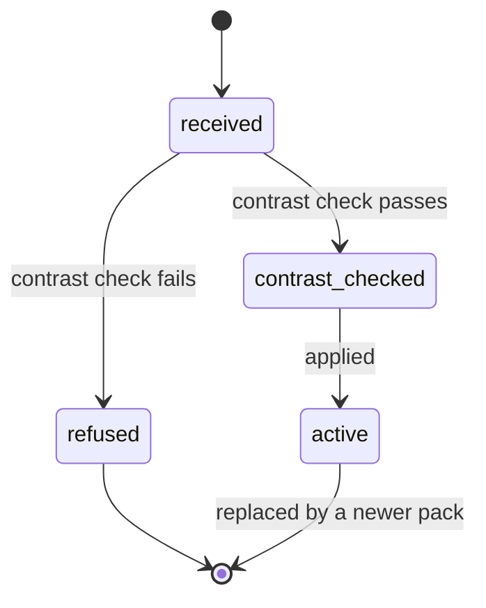

- Storage: SQLite table `brand_packs` in the journal database, owned by Brand. Asset files live under the application data root; the row holds their paths.

### LocalePreference
- Owner: **Localisation** (02:528) · Used by: App Shell, Ordin Host, Dictation Service, Approval Service.
- HLD trace: 04:17–19; ADR-042.

```rust
#[derive(Debug, Clone, PartialEq, Serialize, Deserialize)]
#[serde(rename_all = "snake_case")]
pub struct LocalePreference {
    pub locale: String,
    pub source: LocaleSource,
    pub updated_at: Timestamp,
}

#[derive(Debug, Clone, Copy, PartialEq, Eq, Serialize, Deserialize)]
#[serde(rename_all = "snake_case")]
pub enum LocaleSource { OperatingSystem, Person }
```

| Field | Rule | Error code |
|---|---|---|
| locale | BCP 47 tag, ≤ 35 chars, one of the locales offered to the person: the profile's offered bundled locales (04:19), or a language the person made or imported and confirmed (*amended January 2026, ADR-109*) | `LOC_NOT_OFFERED`; a person's language not yet confirmed → `LOC_LANGUAGE_NOT_CONFIRMED` |

- Storage: SQLite table `locale_preferences` (exactly one row per installation) in the journal database, owned by Localisation.
- *Amended January 2026 (ADR-109):* the languages a person makes or imports, and their edits to shipped languages, are Localisation's own tables (`person_languages`, `person_messages`; Localisation spec, migration step 2). They are used by Localisation only, so they are not shared types; `LocalePreference` is unchanged in shape.

### HarnessAttachment
- Owner: **Setup Assistant** (inferred from 02:712 "setup state and the results of checks"; no component names it — see *Bubble-up candidates*) · Used by: Claude Local Adapter, Copilot Local Adapter, Session Supervisor.
- HLD trace: 04:21–24; ADR-044; 04:400.

```rust
#[derive(Debug, Clone, PartialEq, Serialize, Deserialize)]
#[serde(rename_all = "snake_case")]
pub struct HarnessAttachment {
    pub id: HarnessAttachmentId,
    pub harness: HarnessKind,
    pub location: String,
    #[serde(skip_serializing_if = "Option::is_none")]
    pub version: Option<String>,
    pub tested: bool,
    pub signed_in: bool,
    /// As the harness reports it; free text, never a credential.
    #[serde(skip_serializing_if = "Option::is_none")]
    pub sign_in_method: Option<String>,
    pub state: HarnessAttachmentState,
    pub last_checked_at: Timestamp,
}

/// Defined once, here (`ordin_types::domain::identity`); part 2 §4 (`wire::hook`) re-exports it
/// (amended January 2026, decision 80: C-1).
#[derive(Debug, Clone, Copy, PartialEq, Eq, Serialize, Deserialize)]
#[serde(rename_all = "snake_case")]
pub enum HarnessKind { ClaudeCode, CopilotCli }

#[derive(Debug, Clone, Copy, PartialEq, Eq, Serialize, Deserialize)]
#[serde(rename_all = "snake_case")]
pub enum HarnessAttachmentState { Found, Checked, Ready, NeedsSignIn, NeedsUpdate }
```

| Field | Rule | Error code |
|---|---|---|
| harness | unique per installation | `HARN_DUPLICATE` |
| location | absolute path ≤ 4096 bytes | `HARN_PATH_INVALID` |
| version | ≤ 64 chars (assumed) | `HARN_VERSION_INVALID` |
| sign_in_method | ≤ 120 chars (assumed); never holds a token | `HARN_SIGN_IN_METHOD_INVALID` |
| state | `ready` requires `tested = true` and `signed_in = true` | `HARN_STATE_INCONSISTENT` |

| From | Event | To |
|---|---|---|
| — | harness found on the computer | found |
| found | version and sign-in checked | checked |
| checked | version tested and signed in | ready |
| checked | signed out | needs_sign_in |
| checked | version not tested | needs_update |
| ready, needs_sign_in, needs_update | next check | checked |

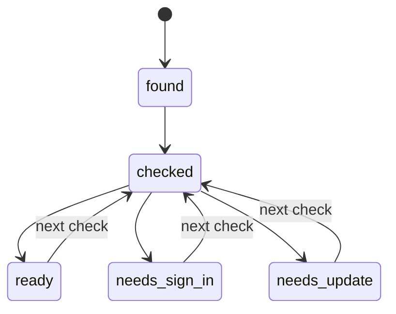

- Storage: SQLite table `harness_attachments` in the journal database, owned by Setup Assistant (pending bubble-up).

### OrganisationProfile
- Owner: **Organisation Profile** (02:703 "the cached, verified profile") · Used by: every core component that reads settings — Package Catalogue, Catalogue Service, Setup Assistant, Brand, Localisation, Usage Planner, Mail Service, Trigger Service, Craft Toolkit, Project Service, Remote API.
- HLD trace: 04:26–29; ADR-013; 04:412.
- The profile's content (marketplace, trust policy reference, remote agent catalogue, Slack settings, identity-provider settings, limits, update feed, help destination) is the **organisation profile document**, typed in the wire half of Phase 2C. This entity is the persisted record of one fetched version.

```rust
#[derive(Debug, Clone, PartialEq, Serialize, Deserialize)]
#[serde(rename_all = "snake_case")]
pub struct OrganisationProfile {
    pub id: OrganisationProfileId,
    pub profile_version: String,
    /// Detached signature as delivered, base64.
    pub signature: String,
    pub document_digest: Sha256Hex,
    pub cached_path: String,
    pub state: OrganisationProfileState,
    #[serde(skip_serializing_if = "Option::is_none")]
    pub refusal_reason: Option<String>,
    pub fetched_at: Timestamp,
    #[serde(skip_serializing_if = "Option::is_none")]
    pub verified_at: Option<Timestamp>,
    #[serde(skip_serializing_if = "Option::is_none")]
    pub activated_at: Option<Timestamp>,
}

#[derive(Debug, Clone, Copy, PartialEq, Eq, Serialize, Deserialize)]
#[serde(rename_all = "snake_case")]
pub enum OrganisationProfileState { Fetched, Verified, Active, Replaced, FailedVerification }
```

| Field | Rule | Error code |
|---|---|---|
| profile_version | 1–64 chars; strictly newer than the active version to become active | `PROF_VERSION_NOT_NEWER` |
| signature | non-empty base64, ≤ 8192 bytes (assumed); verifies against the installer's key | `PROF_SIGNATURE_INVALID` |
| state | at most one row `active` | `PROF_MULTIPLE_ACTIVE` |
| state | `failed_verification` never moves to `active` (04:29) | `PROF_UNVERIFIED_ACTIVATION` |

| From | Event | To |
|---|---|---|
| — | fetched from the installer's address | fetched |
| fetched | signature verifies | verified |
| fetched | signature fails | failed_verification |
| verified | becomes the served profile | active |
| active | a newer version becomes active | replaced |

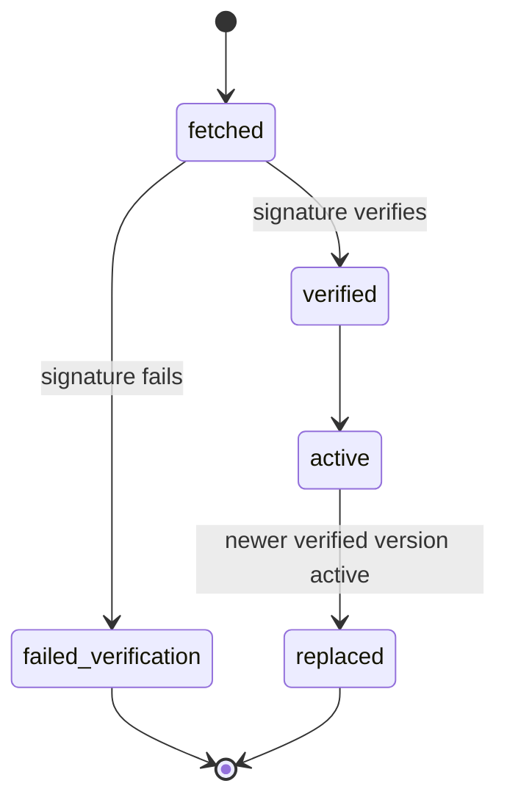

- Storage: SQLite table `organisation_profiles` in the journal database, owned by Organisation Profile; the document is a cached file under the application data root (04:412).

### Credential
- Owner: **Identity and Credentials** (02:688 "tokens and sign-in state") · Used by: Setup Assistant, Catalogue Service, Mail Service, Confluence Adapter, SharePoint Adapter, Slack Thread Adapter, wrightrun HTTP Adapter, Server Connector.
- HLD trace: 04:257–259; ADR-070, ADR-071; 04:399.

```rust
#[derive(Debug, Clone, PartialEq, Serialize, Deserialize)]
#[serde(rename_all = "snake_case")]
pub struct Credential {
    pub id: CredentialId,
    pub kind: CredentialKind,
    pub account_label: String,
    /// Key of the OS keychain item that holds the secret; the secret never enters the database.
    pub keychain_ref: String,
    #[serde(skip_serializing_if = "Option::is_none")]
    pub expires_at: Option<Timestamp>,
    pub state: CredentialState,
    pub created_at: Timestamp,
    #[serde(skip_serializing_if = "Option::is_none")]
    pub refreshed_at: Option<Timestamp>,
}

#[derive(Debug, Clone, Copy, PartialEq, Eq, Serialize, Deserialize)]
#[serde(rename_all = "snake_case")]
/// `Gitlab` (amended January 2026, decision 80: C-10, D9): Identity and Credentials holds the GitLab sign-in,
/// so the Project Service can push to GitLab remotes over HTTPS with a keychain token.
/// `Jira` (amended January 2026, ADR-106): one Jira Cloud credential per person, by the person's own API token
/// or by Atlassian OAuth; desktop only (IdentityAndCredentials.md amendment, `JiraAccess`).
pub enum CredentialKind {
    Github, Gitlab, Oidc, Slack, Confluence, Microsoft, Google,
    MailServerSingleSignOn, MailServerPassword, MailServerAppPassword,
    Jira,
}

#[derive(Debug, Clone, Copy, PartialEq, Eq, Serialize, Deserialize)]
#[serde(rename_all = "snake_case")]
pub enum CredentialState { Active, Revoked }
```

| Field | Rule | Error code |
|---|---|---|
| account_label | 1–254 chars (assumed) | `CRED_LABEL_INVALID` |
| keychain_ref | 1–255 chars (assumed); refers to an existing keychain item while `active` | `CRED_KEYCHAIN_MISSING` |
| (kind, account_label) | unique among `active` rows | `CRED_DUPLICATE` |
| any field | never holds secret material | `CRED_SECRET_IN_RECORD` |

| From | Event | To |
|---|---|---|
| — | sign-in completes | active |
| active | token refreshed (`refreshed_at` set) | active |
| active | sign-out | revoked |

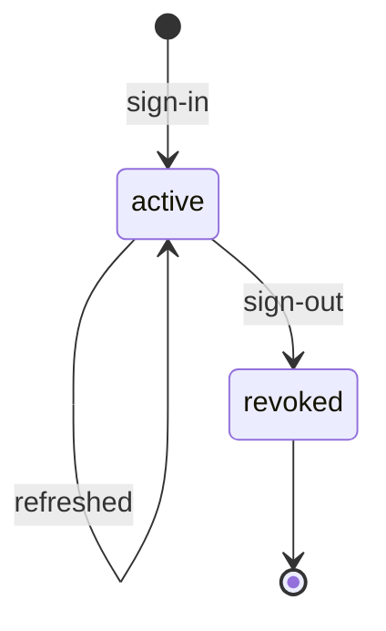

- Storage: SQLite table `credentials` in the journal database, owned by Identity and Credentials; secret in the OS keychain only (04:259).

### UsageSettings
- Owner: **Usage Planner** (02:366) · Used by: Ordin Host, Session Supervisor, Crew Orchestrator, MCP Front, App Shell.
- HLD trace: 04:180–182; ADR-062.

```rust
#[derive(Debug, Clone, PartialEq, Serialize, Deserialize)]
#[serde(rename_all = "snake_case")]
pub struct UsageSettings {
    pub choice: Setting<UsageChoice>,
    /// Kind of work → model level; both named in /spec from ADR-062's catalogue.
    pub model_level_per_kind: Setting<std::collections::BTreeMap<String, String>>,
    /// Three values (amended January 2026, decision 80: C-18).
    pub thinking: Setting<ThinkingLevel>,
    pub answer_simple_requests_without_model: Setting<bool>,
    pub reuse_answers: Setting<bool>,
    pub give_agents_only_needed_parts: Setting<bool>,
    /// Three choices (amended January 2026, decision 80: C-18).
    pub summarise_long_conversations: Setting<SummariseWhen>,
    pub continue_from_summary_after_break: Setting<bool>,
    /// When Ordin asks before starting estimated work: three choices (amended January 2026, decision 80: C-18).
    pub ask_before_estimated_requests: Setting<AskBefore>,
    pub agents_at_same_time: Setting<u32>,
    pub show_usage_on_each_run: Setting<bool>,
    /// Daily pause threshold in model requests; `None` = no daily pause (assumed unit).
    pub daily_pause_requests: Setting<Option<u32>>,
    pub updated_at: Timestamp,
}

#[derive(Debug, Clone, Copy, PartialEq, Eq, Serialize, Deserialize)]
#[serde(rename_all = "snake_case")]
pub enum UsageChoice { SaveMyPlan, Balanced, BestResults, Custom }

// `ThinkingLevel { Low, Automatic, High }` is defined once, in part 2 (§2, `ordin_types::wire::run`).
pub use crate::wire::run::ThinkingLevel;

#[derive(Debug, Clone, Copy, PartialEq, Eq, Serialize, Deserialize)]
#[serde(rename_all = "snake_case")]
pub enum SummariseWhen { Early, WhenNearlyFull, OnlyWhenAsked }

#[derive(Debug, Clone, Copy, PartialEq, Eq, Serialize, Deserialize)]
#[serde(rename_all = "snake_case")]
pub enum AskBefore { Heavy, MediumOrHeavy, Never }
```

| Field | Rule | Error code |
|---|---|---|
| any field with `set_by = company` | not changeable by the person | `USAGE_FIXED_BY_COMPANY` |
| every value | within the organisation profile's usage section (04:182) | `USAGE_ABOVE_PROFILE_LIMIT` |
| agents_at_same_time | 1–3 (ADR-062; profile may lower) (amended January 2026, decision 80: C-18) | `USAGE_AGENTS_OUT_OF_RANGE` |
| model_level_per_kind | keys and values from the /spec catalogue | `USAGE_LEVEL_UNKNOWN` |

- Storage: SQLite table `usage_settings` (one row per installation) in the journal database, owned by Usage Planner.

### VoiceSettings
- Owner: **none named in 02** — see *Bubble-up candidates* · Used by: Ordin Host, Localisation.
- HLD trace: 04:184–186; ADR-063; 09:1332; 10:263 (R-47).

```rust
#[derive(Debug, Clone, PartialEq, Serialize, Deserialize)]
#[serde(rename_all = "snake_case")]
pub struct VoiceSettings {
    pub tone: Setting<VoiceTone>,
    pub register: Setting<VoiceRegister>,
    pub length: Setting<VoiceLength>,
    pub name_to_use: Setting<Option<String>>,
    pub notes: Setting<Option<String>>,
    pub updated_at: Timestamp,
}

#[derive(Debug, Clone, Copy, PartialEq, Eq, Serialize, Deserialize)]
#[serde(rename_all = "snake_case")]
pub enum VoiceTone { Friendly, Neutral, Warm, Direct }

#[derive(Debug, Clone, Copy, PartialEq, Eq, Serialize, Deserialize)]
#[serde(rename_all = "snake_case")]
pub enum VoiceRegister { Everyday, Formal }

#[derive(Debug, Clone, Copy, PartialEq, Eq, Serialize, Deserialize)]
#[serde(rename_all = "snake_case")]
pub enum VoiceLength { Brief, Shortest }
```

| Field | Rule | Error code |
|---|---|---|
| notes | ≤ 300 chars (04:185; 09:1332) | `VOICE_NOTES_TOO_LONG` |
| name_to_use | ≤ 60 chars (assumed); empty string stored as `None` | `VOICE_NAME_TOO_LONG` |
| any field `set_by = company` | person may change it only within company terms (04:186) | `VOICE_FIXED_BY_COMPANY` |

- Storage: SQLite table `voice_settings` (one row per installation) in the journal database; owner pending bubble-up.

### ServerProfile
- Owner: **ordin server** setup command (02:573 "its setup command"; the record itself is not listed — see *Bubble-up candidates*) · Used by: every server component; Agent Loader; Session Supervisor.
- HLD trace: 04:347–350; ADR-097; 02:221.

```rust
#[derive(Debug, Clone, PartialEq, Serialize, Deserialize)]
#[serde(rename_all = "snake_case")]
pub struct ServerProfile {
    pub id: ServerProfileId,
    pub profile: ServerProfileKind,
    #[serde(skip_serializing_if = "Option::is_none")]
    pub shape: Option<ServerShape>,
    pub chosen_at: Timestamp,
}

#[derive(Debug, Clone, Copy, PartialEq, Eq, Serialize, Deserialize)]
#[serde(rename_all = "snake_case")]
pub enum ServerProfileKind { Personal, Agent }

#[derive(Debug, Clone, Copy, PartialEq, Eq, Serialize, Deserialize)]
#[serde(rename_all = "snake_case")]
pub enum ServerShape { Single, Scaled }
```

| Field | Rule | Error code |
|---|---|---|
| shape | present if and only if `profile = agent` (04:348) | `SPROF_SHAPE_MISMATCH` |
| row | written once; any update refused (04:350) | `SPROF_IMMUTABLE` |

- Storage: SQLite table `server_profiles` (one row) in the server's database; also PostgreSQL in the agent profile scaled shape (02:248).

---

## Agents and the catalogue

### AgentInstance
- Owner: **Package Catalogue** (02:427 "the list of agent instances and their install records"; Installers also claim "the install record", 02:455 — see *HLD inconsistencies*) · Used by: Installers, Agent Folder Manager, Package Inspector, Rules Engine, Session Supervisor, Ordin Host, Workspace Service, Crew Orchestrator.
- HLD trace: 04:41–48; ADR-082, ADR-083; A-16.

```rust
#[derive(Debug, Clone, PartialEq, Serialize, Deserialize)]
#[serde(rename_all = "snake_case")]
pub struct AgentInstance {
    pub id: AgentInstanceId,
    pub display_name: String,
    pub package_name: String,
    pub package_version: String,
    #[serde(skip_serializing_if = "Option::is_none")]
    pub agent_repository_id: Option<AgentRepositoryId>,
    #[serde(skip_serializing_if = "Option::is_none")]
    pub commit: Option<String>,
    pub agent_folder_path: String,
    /// Lock file inside the agent folder: repository, commit and digest per part (02:451).
    pub lock_file_path: String,
    #[serde(skip_serializing_if = "Option::is_none")]
    pub audit_result: Option<AuditResult>,
    pub authority: Authority,
    /// Key of the Package Inspector's parsed package model for this instance (02:476).
    pub parsed_declaration_ref: String,
    pub is_trial_of_own_draft: bool,
    pub status: AgentInstanceStatus,
    /// Why the instance was stopped, in plain words (a withdrawn part); with `status = refused`
    /// this is how a stopped instance reads (amended January 2026, decision 80: C-22).
    #[serde(skip_serializing_if = "Option::is_none")]
    pub stopped_reason: Option<String>,
    /// What stopped a `refused` instance that was once `ready`, and so which event may make it
    /// `ready` again (Phase 3 closing round, K13): `Withdrawal` → a fixed version the person
    /// accepts; `Trust` → the company's trust policy trusting its executable parts again.
    /// Present if and only if `stopped_reason` is present. Column `agent_instances.stopped_by`.
    #[serde(skip_serializing_if = "Option::is_none")]
    pub stopped_by: Option<StoppedBy>,
    /// Set when an update that changes nothing the agent may do or read was applied between runs (A-16).
    #[serde(skip_serializing_if = "Option::is_none")]
    pub updated_between_runs_at: Option<Timestamp>,
    pub installed_at: Timestamp,
}

#[derive(Debug, Clone, Copy, PartialEq, Eq, Serialize, Deserialize)]
#[serde(rename_all = "snake_case")]
pub enum AuditResult { Passed, Failed }

#[derive(Debug, Clone, Copy, PartialEq, Eq, Serialize, Deserialize)]
#[serde(rename_all = "snake_case")]
pub enum StoppedBy { Withdrawal, Trust }

#[derive(Debug, Clone, Copy, PartialEq, Eq, Serialize, Deserialize)]
#[serde(rename_all = "snake_case")]
pub enum Authority { DocumentOnly, SystemChanging, RoutingOnly }

#[derive(Debug, Clone, Copy, PartialEq, Eq, Serialize, Deserialize)]
#[serde(rename_all = "snake_case")]
pub enum AgentInstanceStatus {
    Installing, Ready, Refused, Updating,
    /// An update changes what it may do or read and waits for the person's choice (A-16).
    UpdateAwaitingChoice,
    Removed,
}
```

| Field | Rule | Error code |
|---|---|---|
| display_name | 1–120 chars (assumed) | `AGI_NAME_INVALID` |
| package_name | 1–214 chars `[a-z0-9._-]` (assumed) | `AGI_PACKAGE_NAME_INVALID` |
| package_version | 1–64 chars (assumed) | `AGI_PACKAGE_VERSION_INVALID` |
| commit | 40 lowercase hex chars when present | `AGI_COMMIT_INVALID` |
| agent_folder_path | absolute, under the application data root, unique | `AGI_FOLDER_INVALID` |
| commit, agent_repository_id | both present or both absent | `AGI_REPOSITORY_MISMATCH` |
| status | `refused` only when `audit_result = failed`, the Checker refused it, or `stopped_reason` is present (amended January 2026, decision 80: C-22) | `AGI_STATE_INCONSISTENT` |
| stopped_by | present if and only if `stopped_reason` is present; only with `status = refused` (closing round, K13) | `AGI_STATE_INCONSISTENT` |

| From | Event | To |
|---|---|---|
| — | person presses **Add** | installing |
| installing | install and checks pass | ready |
| installing | audit or check fails (folder removed) | refused |
| ready | a part it uses is withdrawn; `stopped_reason` set, `stopped_by = withdrawal` (amended January 2026, decision 80: C-22) | refused |
| ready | the trust policy no longer trusts one of its executable parts (Checker `reevaluate_trust`); `stopped_reason` set, `stopped_by = trust` (closing round, K13) | refused |
| refused (`stopped_by = trust`) | trust regained: `reevaluate_trust` trusts every executable part again; automatic, after the Agent Folder Manager has verified the agent folder against its lock file (a folder that fails verification stays `refused`); `stopped_reason`, `stopped_by` cleared (closing round, K13) | ready |
| refused (`stopped_by = withdrawal`) | the person accepts a fixed version offered after the withdrawal; installed and checked as an update; `stopped_reason`, `stopped_by` cleared (closing round, K13) | ready |
| ready | update that changes nothing it may do or read, between runs | updating |
| ready | update that changes what it may do or read | update_awaiting_choice |
| update_awaiting_choice | person accepts | updating |
| update_awaiting_choice | person declines | ready |
| updating | update installed | ready |
| ready | person confirms removal | removed |

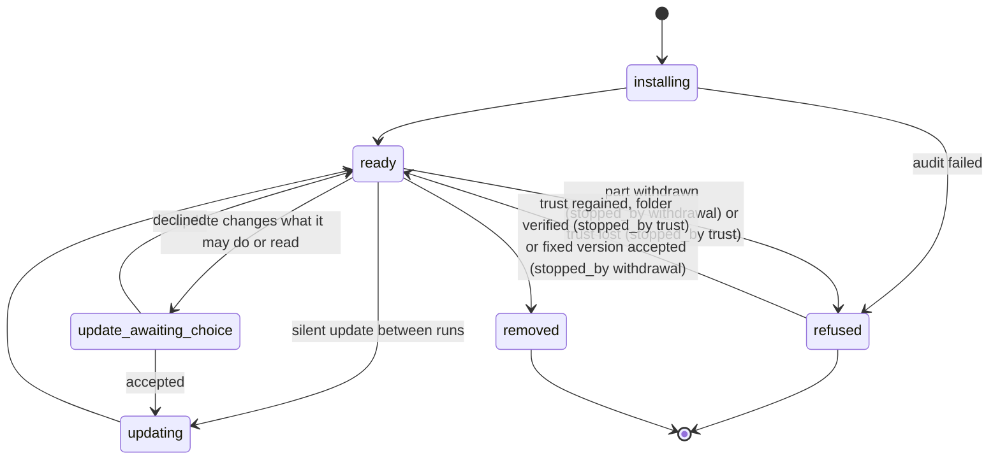

- Storage: SQLite table `agent_instances` in the journal database, owned by Package Catalogue.

### ExecutablePartDecision
- Owner: **Checker** (amended January 2026, decision 80: C-22; the 02 *Trust* bullet is superseded by the Checker; 04:50 had assigned the decision to "the organisation's recommended executable set") · Used by: Rules Engine, Session Supervisor, Package Inspector, Package Catalogue.
- HLD trace: 04:50–52; ADR-013.

```rust
#[derive(Debug, Clone, PartialEq, Serialize, Deserialize)]
#[serde(rename_all = "snake_case")]
pub struct ExecutablePartDecision {
    pub id: ExecutablePartDecisionId,
    pub agent_instance_id: AgentInstanceId,
    pub part_name: String,
    pub kind: ExecutablePartKind,
    pub decision: ExecutablePartTrust,
    pub source: DecisionSource,
    pub decided_at: Timestamp,
}

#[derive(Debug, Clone, Copy, PartialEq, Eq, Serialize, Deserialize)]
#[serde(rename_all = "snake_case")]
pub enum ExecutablePartKind { Hook, McpServer, BundledProgram }

#[derive(Debug, Clone, Copy, PartialEq, Eq, Serialize, Deserialize)]
#[serde(rename_all = "snake_case")]
pub enum ExecutablePartTrust { Trusted, NeedsItApproval }

#[derive(Debug, Clone, Copy, PartialEq, Eq, Serialize, Deserialize)]
#[serde(rename_all = "snake_case")]
pub enum DecisionSource { OrganisationPolicy }
```

| Field | Rule | Error code |
|---|---|---|
| part_name | 1–200 chars (assumed); unique per (agent_instance_id, kind) | `EXP_PART_DUPLICATE` |
| source | always `organisation_policy`; never the business user (04:50) | `EXP_SOURCE_NOT_POLICY` |

| From | Event | To |
|---|---|---|
| — | install, part in the recommended set | trusted |
| — | install, part outside the set | needs_it_approval |
| trusted | update changes the part, or policy changes, and it falls outside the set (instance disabled) | needs_it_approval |
| needs_it_approval | IT approves (policy change) | trusted |

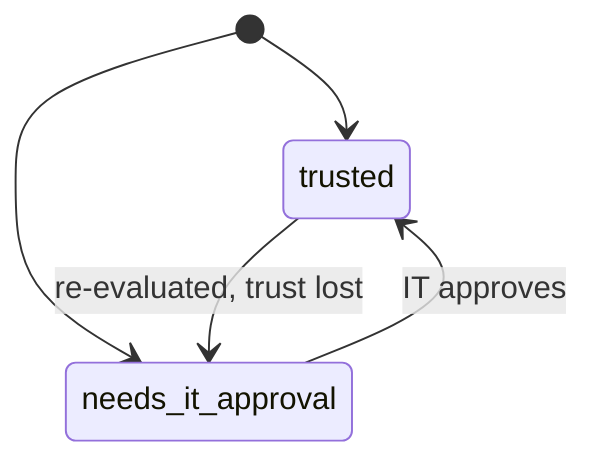

- Storage: SQLite table `executable_part_decisions` in the journal database, owned by the Checker (amended January 2026, decision 80: C-22).

### RemoteAgent
- Owner: **none named in 02** for the persisted status (the list is served by Organisation Profile, 02:703; thread bindings by Slack Thread Adapter, 02:567; run handles by wrightrun HTTP Adapter, 02:557) — see *Bubble-up candidates* · Used by: Session Supervisor, Crew Orchestrator, Ordin Host, Setup Assistant.
- HLD trace: 04:163–166; ADR-008, ADR-009.

```rust
#[derive(Debug, Clone, PartialEq, Serialize, Deserialize)]
#[serde(rename_all = "snake_case")]
pub struct RemoteAgent {
    pub id: RemoteAgentId,
    pub display_name: String,
    pub route: RemoteRoute,
    #[serde(skip_serializing_if = "Option::is_none")]
    pub deployment_address: Option<String>,
    #[serde(skip_serializing_if = "Option::is_none")]
    pub slack_account: Option<String>,
    #[serde(skip_serializing_if = "Option::is_none")]
    pub slack_channel: Option<String>,
    /// Name of the identity-provider settings entry in the active organisation profile.
    #[serde(skip_serializing_if = "Option::is_none")]
    pub identity_provider_ref: Option<String>,
    pub status: RemoteAgentStatus,
    pub listed_at: Timestamp,
}

#[derive(Debug, Clone, Copy, PartialEq, Eq, Serialize, Deserialize)]
#[serde(rename_all = "snake_case")]
pub enum RemoteRoute { Http, Slack }

#[derive(Debug, Clone, Copy, PartialEq, Eq, Serialize, Deserialize)]
#[serde(rename_all = "snake_case")]
pub enum RemoteAgentStatus { Listed, Enabled, Verified, Withdrawn }
```

| Field | Rule | Error code |
|---|---|---|
| display_name | 1–120 chars; unique among non-withdrawn rows | `RAG_NAME_INVALID` |
| route = http | `deployment_address` (`https`, ≤ 2048 bytes) and `identity_provider_ref` present; Slack fields absent | `RAG_HTTP_FIELDS_INVALID` |
| route = slack | `slack_account` and `slack_channel` present (each ≤ 80 chars, assumed); `deployment_address` absent | `RAG_SLACK_FIELDS_INVALID` |

| From | Event | To |
|---|---|---|
| — | listed by the profile | listed |
| listed | person first uses it and signs in to the route's account | enabled |
| enabled | one successful read of the deployment or channel | verified |
| listed, enabled, verified | profile drops it | withdrawn |

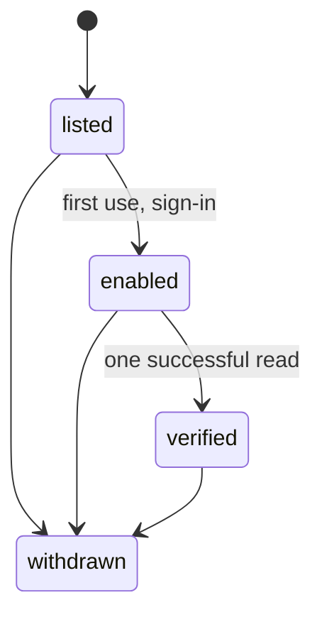

- Storage: SQLite table `remote_agents` in the journal database; owner pending bubble-up.

### AgentRepository
- Owner: **Catalogue Service** (02:437 "the clones and the index"; per-repository record described at 02:436) · Used by: Setup Assistant, Authoring Service, Checker, Handover Service, Package Catalogue.
- HLD trace: 04:297–300; ADR-082, ADR-086, ADR-087, ADR-091; 04:394.

```rust
#[derive(Debug, Clone, PartialEq, Serialize, Deserialize)]
#[serde(rename_all = "snake_case")]
pub struct AgentRepository {
    pub id: AgentRepositoryId,
    pub display_name: String,
    pub host: String,
    pub repository: String,
    pub protected_branch: String,
    pub format: AgentFormat,
    pub format_version: String,
    pub source: RepositorySource,
    /// Profile repositories only (04:298).
    #[serde(skip_serializing_if = "Option::is_none")]
    pub signed_merges_required: Option<bool>,
    pub person_can_publish: bool,
    pub person_can_curate: bool,
    #[serde(skip_serializing_if = "Option::is_none")]
    pub last_fetched_commit: Option<String>,
    pub clone_path: String,
    pub state: AgentRepositoryState,
    pub added_at: Timestamp,
}

#[derive(Debug, Clone, Copy, PartialEq, Eq, Serialize, Deserialize)]
#[serde(rename_all = "snake_case")]
pub enum AgentFormat { Ordin, Apm }

#[derive(Debug, Clone, Copy, PartialEq, Eq, Serialize, Deserialize)]
#[serde(rename_all = "snake_case")]
pub enum RepositorySource { Profile, Person }

#[derive(Debug, Clone, Copy, PartialEq, Eq, Serialize, Deserialize)]
#[serde(rename_all = "snake_case")]
pub enum AgentRepositoryState { Named, Cloned, Dropped, Removed }
```

| Field | Rule | Error code |
|---|---|---|
| host | DNS name ≤ 253 chars; `github.com` or a GitHub host the profile names (GitLab waits on OQ-45); or the reserved value `bundled` for the catalogue shipped with ordin (one row, `source = profile`, shown "From: ordin"; amended January 2026, decision 80: C-22) | `AREPO_HOST_UNSUPPORTED` |
| repository | `owner/name`, each 1–100 chars `[A-Za-z0-9._-]` (assumed, GitHub's limit) | `AREPO_NAME_INVALID` |
| (host, repository) | unique | `AREPO_DUPLICATE` |
| protected_branch | 1–255 bytes, a valid git ref name | `AREPO_BRANCH_INVALID` |
| signed_merges_required | present if and only if `source = profile` | `AREPO_SIGNED_MERGES_MISMATCH` |
| last_fetched_commit | 40 lowercase hex chars | `AREPO_COMMIT_INVALID` |
| removal | only `source = person` may be removed by the person | `AREPO_REMOVE_NOT_OWN` |
| add | refused when the profile turns adding off (04:300) | `AREPO_ADD_DISABLED` |

| From | Event | To |
|---|---|---|
| — | named by the profile, or added by the person | named |
| named | clone succeeds | cloned |
| cloned | background fetch (`last_fetched_commit` updated) | cloned |
| named, cloned | profile no longer names it (`source = profile`) | dropped |
| named, cloned | person removes it after confirmation (`source = person`) | removed |

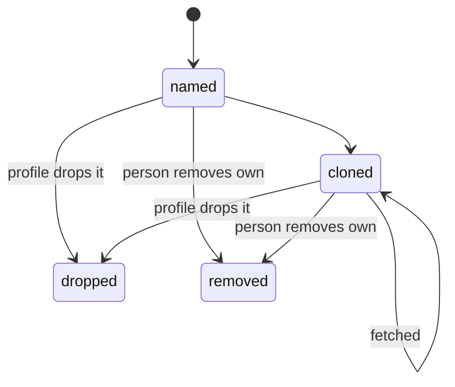

- Storage: SQLite table `agent_repositories` in the journal database, owned by Catalogue Service. The HLD puts the catalogue's search index in SQLite full-text search (02:436) without saying it is the journal database — see *HLD inconsistencies* item 9.

### Part
- Owner: **Catalogue Service** (02:437 "the index") · Used by: Checker, Resolver and Compiler, Authoring Service, Agent Model, Handover Service, Package Inspector.
- HLD trace: 04:312–315; ADR-082, ADR-091; `crucible/pkg/types/kinds.go` (25 kinds), `crucible/pkg/types/status.go`.

```rust
#[derive(Debug, Clone, PartialEq, Serialize, Deserialize)]
#[serde(rename_all = "snake_case")]
pub struct Part {
    pub id: PartId,
    pub agent_repository_id: AgentRepositoryId,
    pub kind: PartKind,
    /// `metadata.id`.
    pub identifier: String,
    pub name: String,
    pub version: String,
    pub status: PartStatus,
    /// `metadata.supersedes`.
    #[serde(skip_serializing_if = "Option::is_none")]
    pub supersedes: Option<String>,
    pub owner: String,
    pub file_path: String,
    pub commit: String,
    pub content_digest: Sha256Hex,
    pub vocabulary_terms_cited: Vec<VocabularyTermId>,
    /// Dependency edges (stored in child table `part_dependencies`).
    pub uses: Vec<PartId>,
    pub withdrawn: bool,
}

/// The 25 kinds, spelt as crucible declares them.
/// Ordered by declaration order, so a `BTreeMap<PartKind, _>` and a derived `Ord` on a type holding
/// a `PartKind` follow this list (amended January 2026, Phase 1 build corrections).
#[derive(Debug, Clone, Copy, PartialEq, Eq, PartialOrd, Ord, Hash, Serialize, Deserialize)]
pub enum PartKind {
    SystemRole, Rule, OperatingMode, Skill, Command, ContextResource, ToolBinding,
    AgentIdentity, Capability, WorkspaceProfile, CrewProfile, Journey, PracticePack,
    BrandOverlay, JurisdictionOverlay, LanguageOverlay, SourceWorkflowOverlay,
    StyleOverlay, HandoffOverlay, Evaluation, OutputContract, Vocabulary, Guideline,
    Memory, ControlLoop,
}

#[derive(Debug, Clone, Copy, PartialEq, Eq, Serialize, Deserialize)]
#[serde(rename_all = "snake_case")]
pub enum PartStatus { Draft, Approved, Deprecated }
```

`PartKind` keeps crucible's `UpperCamelCase` spelling on the wire (no `rename_all`) because the value is read from manifests; this is the one enum exempt from the `snake_case` convention.

| Field | Rule | Error code |
|---|---|---|
| kind | one of the 25 values (04:312) | `PART_KIND_UNKNOWN` |
| identifier | 1–200 chars (assumed); unique per (agent_repository_id, kind, version) | `PART_DUPLICATE` |
| status | absent in the manifest reads as `approved` (04:313) | — |
| version | semantic version (assumed) | `PART_VERSION_INVALID` |
| commit | 40 lowercase hex chars | `PART_COMMIT_INVALID` |
| supersedes | names a part of the same repository and kind; a part is replaced by at most one (04:314) | `PART_SUPERSEDES_INVALID` |
| status = deprecated | refused as an agent of its own (04:315) | `PKG_DEPRECATED_AS_AGENT` |
| withdrawn = true | never set back to false (04:315) | `PART_WITHDRAWAL_FINAL` |

| From | Event | To |
|---|---|---|
| — | merged on the protected branch | approved |
| approved | merged part draft sets `deprecated` | deprecated |
| approved, deprecated | entry merged on the withdrawn list | withdrawn |
| approved | merged part draft with a new version | approved (new row) |

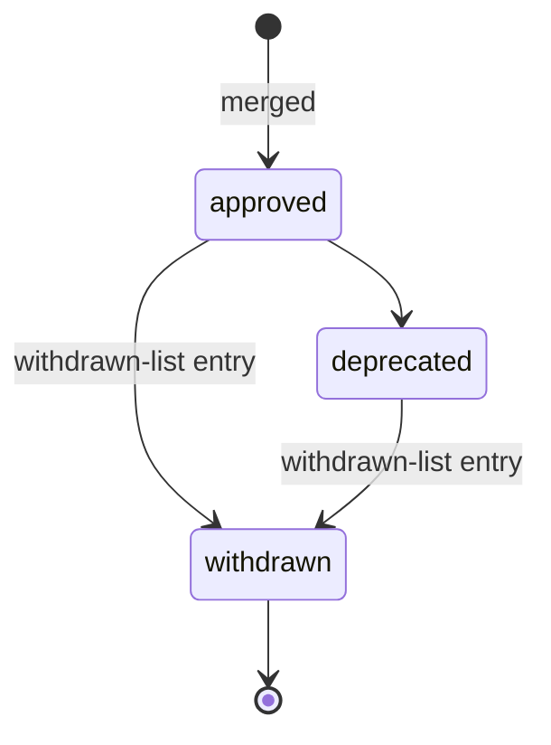

`withdrawn` is represented by `withdrawn = true`, not by `status`, because crucible's status set has no such value.

- Storage: SQLite tables `parts` and `part_dependencies (part_id, uses_part_id)` in the journal database, owned by Catalogue Service.

### WithdrawnListEntry
- Owner: **Catalogue Service** (02:436 "reads the withdrawn list") · Used by: Checker, Package Catalogue, Authoring Service, Diagnostics (App Shell).
- HLD trace: 04:322–325; ADR-090, ADR-091; 04:397; `crucible/pkg/types/revocation.go`.

```rust
#[derive(Debug, Clone, PartialEq, Serialize, Deserialize)]
#[serde(rename_all = "snake_case")]
pub struct WithdrawnListEntry {
    pub id: WithdrawnListEntryId,
    pub agent_repository_id: AgentRepositoryId,
    pub part_kind: PartKind,
    pub part_identifier: String,
    #[serde(skip_serializing_if = "Option::is_none")]
    pub part_version: Option<String>,
    #[serde(skip_serializing_if = "Option::is_none")]
    pub part_content_digest: Option<Sha256Hex>,
    pub reason: String,
    pub withdrawn_at: Timestamp,
    #[serde(skip_serializing_if = "Option::is_none")]
    pub replacement_identifier: Option<String>,
    #[serde(skip_serializing_if = "Option::is_none")]
    pub replacement_version: Option<String>,
    /// Set when a later read no longer finds the entry; it stays in force (04:325).
    #[serde(skip_serializing_if = "Option::is_none")]
    pub removed_by_hand_seen_at: Option<Timestamp>,
    pub read_at: Timestamp,
}
```

| Field | Rule | Error code |
|---|---|---|
| part_version, part_content_digest | both present or both absent (04:323) | `WDL_VERSION_DIGEST_MISMATCH` |
| replacement_identifier, replacement_version | both present or both absent | `WDL_REPLACEMENT_INCOMPLETE` |
| reason | 1–1000 chars (assumed) | `WDL_REASON_INVALID` |
| row | never updated except `removed_by_hand_seen_at`; never deleted while the repository is read | `WDL_APPEND_ONLY` |

- Storage: SQLite table `withdrawn_list_entries` in the journal database, owned by Catalogue Service. No state machine: written once (04:325).

### VocabularyTerm
- Owner: **Catalogue Service** · Used by: Checker, Authoring Service, Agent Model.
- HLD trace: 04:342–345; ADR-091; `crucible/pkg/types/vocabulary_set.go` (eight axes).

```rust
#[derive(Debug, Clone, PartialEq, Serialize, Deserialize)]
#[serde(rename_all = "snake_case")]
pub struct VocabularyTerm {
    pub id: VocabularyTermId,
    pub agent_repository_id: AgentRepositoryId,
    pub vocabulary_part_id: PartId,
    pub axis: VocabularyAxis,
    pub code: String,
    pub label: String,
    pub description: String,
    pub state: VocabularyTermState,
    /// The code of the term that replaces a retired one, when the vocabulary names it; enables
    /// ADR-094 item 4 *Fix it* (amended January 2026, decision 80: C-32; name *chosen here*).
    #[serde(skip_serializing_if = "Option::is_none")]
    pub replacement_code: Option<String>,
}

/// Fixed in ordin's code (04:345); spelt as crucible's values.
#[derive(Debug, Clone, Copy, PartialEq, Eq, Serialize, Deserialize)]
#[serde(rename_all = "kebab-case")]
pub enum VocabularyAxis {
    PackClass, Category, AudienceRole, RuleSubvariant,
    ArtefactStatus, MemoryContentClass, LoopStrategy, RuntimeCapability,
}

#[derive(Debug, Clone, Copy, PartialEq, Eq, Serialize, Deserialize)]
#[serde(rename_all = "snake_case")]
pub enum VocabularyTermState { Active, Retired }
```

`VocabularyAxis` serialises `kebab-case` to match crucible's values (`pack-class`); second exemption from the `snake_case` rule. "The parts that cite it" is the reverse of `Part.vocabulary_terms_cited` and is not stored twice.

| Field | Rule | Error code |
|---|---|---|
| code | 1–64 chars `[a-z0-9-]` (assumed); unique per (agent_repository_id, axis) | `VOCAB_CODE_INVALID` |
| label | 1–120 chars (assumed) | `VOCAB_LABEL_INVALID` |
| description | ≤ 1000 chars (assumed) | `VOCAB_DESCRIPTION_TOO_LONG` |
| retire | refused while any part of the repository cites it (04:345) | `VOCAB_TERM_CITED` |
| retire | refused for `draft`, `approved`, `deprecated` on `artefact-status` (04:345) | `VOCAB_STATUS_TERM_FIXED` |

| From | Event | To |
|---|---|---|
| — | merged part draft adds it | active |
| active | merged part draft retires it, no citing part | retired |

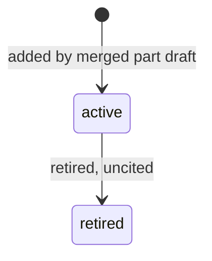

- Storage: SQLite table `vocabulary_terms` in the journal database, owned by Catalogue Service.

### Lifecycle
- Owner: **Catalogue Service** (as a Part of kind `Journey`, 04:330); the stage each workspace follows is kept by **Handover Service** (02:736, no *Owns* line — see *Bubble-up candidates*) · Used by: Handover Service, Checker, Authoring Service, App Shell.
- HLD trace: 04:327–331; ADR-092, ADR-099.

```rust
#[derive(Debug, Clone, PartialEq, Serialize, Deserialize)]
#[serde(rename_all = "snake_case")]
pub struct Lifecycle {
    pub id: LifecycleId,
    pub part_id: PartId,
    pub agent_repository_id: AgentRepositoryId,
    pub identifier: String,
    pub name: String,
    pub stages: Vec<LifecycleStage>,
    pub status: PartStatus,
    pub version: String,
}

#[derive(Debug, Clone, PartialEq, Serialize, Deserialize)]
#[serde(rename_all = "snake_case")]
pub struct LifecycleStage {
    pub name: String,
    pub role: String,
    /// WorkspaceProfile identifier.
    #[serde(skip_serializing_if = "Option::is_none")]
    pub agent: Option<String>,
    /// OutputContract identifier.
    #[serde(skip_serializing_if = "Option::is_none")]
    pub hands_over: Option<String>,
    pub handover_place_id: HandoverPlaceId,
    /// 0 = not set (no reminder); otherwise 1–365 (amended January 2026, decision 80: C-21).
    pub days_to_answer: u32,
    pub next: StageNext,
    pub send_backs: Vec<SendBack>,
    /// The Slack channel where this stage's handover notices are posted, as the person who acted
    /// (amended January 2026, ADR-102). Absent = no stage channel.
    #[serde(skip_serializing_if = "Option::is_none")]
    pub slack_channel: Option<StageSlackChannel>,
}

#[derive(Debug, Clone, PartialEq, Serialize, Deserialize)]
#[serde(tag = "kind", rename_all = "snake_case")]
pub enum StageNext {
    One { stage: String },
    OneOf { choices: Vec<StageChoice> },
    SideBySide { stages: Vec<String> },
    Nothing,
}

#[derive(Debug, Clone, PartialEq, Serialize, Deserialize)]
#[serde(rename_all = "snake_case")]
pub struct StageChoice { pub stage: String, pub when: String }

#[derive(Debug, Clone, PartialEq, Serialize, Deserialize)]
#[serde(rename_all = "snake_case")]
pub struct SendBack { pub to_stage: String, pub when: String, pub max_rounds: u32 }

#[derive(Debug, Clone, PartialEq, Serialize, Deserialize)]
#[serde(rename_all = "snake_case")]
pub struct StageSlackChannel {
    pub channel_id: String,
    pub name: String,
}

/// Which stage a workspace follows (at most one per workspace, 04:330).
#[derive(Debug, Clone, PartialEq, Serialize, Deserialize)]
#[serde(rename_all = "snake_case")]
pub struct WorkspaceStage {
    pub id: WorkspaceStageId,
    pub workspace_id: WorkspaceId,
    pub lifecycle_id: LifecycleId,
    pub stage_name: String,
    pub set_at: Timestamp,
}
```

| Field | Rule | Error code |
|---|---|---|
| stages | at least 1, at most 30 (assumed); names unique, 1–80 chars (assumed) | `LIFE_STAGES_INVALID` |
| stages | every stage reachable from the first (04:329) | `LIFE_STAGE_UNREACHABLE` |
| next | no stage leads to an earlier one (04:329) | `LIFE_STAGE_BACKWARD` |
| next.one_of | 2–4 choices (assumed, mirrors workflow paths) | `LIFE_CHOICES_INVALID` |
| send_backs.to_stage | names an earlier stage | `LIFE_SEND_BACK_NOT_EARLIER` |
| send_backs.max_rounds | 1–10 (04:329) | `LIFE_SEND_BACK_ROUNDS_OUT_OF_RANGE` |
| days_to_answer | 0 (not set) or 1–365 (assumed) | `LIFE_DAYS_OUT_OF_RANGE` |
| slack_channel | `channel_id` matches `^[CG][A-Z0-9]{8,20}$` (SA-CLOSE-04's form); `name` 1–80 chars, not starting with `#`; a malformed value is dropped by the Catalogue Service with a health line, the lifecycle stays offered (amended January 2026, ADR-102) | `LIFE_SLACK_CHANNEL_INVALID` |
| role | 1–200 chars (assumed) | `LIFE_ROLE_INVALID` |
| WorkspaceStage.workspace_id | unique | `LIFE_WORKSPACE_FOLLOWS_TWO` |

- State machine: as `Part` (04:331).
- Storage: SQLite tables `lifecycles` (Catalogue Service) and `workspace_stages` (Handover Service, pending bubble-up) in the journal database.
- In the ordin format the field is the stage's `slackChannel: { id, name }` (camelCase as `answerWithinDays`; Agent Model `JourneyStage.slack_channel`); crucible journeys never carry it (amended January 2026, ADR-102).

### AgentDraft
- Owner: **Authoring Service** (02:460 "drafts and rehearsal records") · Used by: Checker, Format Plug-ins, Push Service, Package Catalogue (trial instances), App Shell.
- HLD trace: 04:302–305; ADR-083, ADR-084; 04:395.

```rust
#[derive(Debug, Clone, PartialEq, Serialize, Deserialize)]
#[serde(rename_all = "snake_case")]
pub struct AgentDraft {
    pub id: AgentDraftId,
    pub agent_repository_id: AgentRepositoryId,
    pub name: String,
    pub purpose: String,
    pub jobs: Vec<DraftJob>,
    pub tasks: Vec<String>,
    pub will: Vec<String>,
    pub wont: Vec<String>,
    pub needs: Vec<String>,
    /// Identifiers of reused parts.
    pub reused_parts: Vec<PartId>,
    pub origin: DraftOrigin,
    pub branch: String,
    /// Key of the Checker's latest result set for this draft (02:446).
    #[serde(skip_serializing_if = "Option::is_none")]
    pub check_results_ref: Option<String>,
    pub wording_changes: Vec<WordingChange>,
    /// Who wrote each field (ADR-090 §7), as on `PartDraft`; stored in the side table
    /// `draft_field_authors` (amended January 2026, decision 80: C-21).
    pub field_authors: Vec<FieldAuthor>,
    #[serde(skip_serializing_if = "Option::is_none")]
    pub rehearsal_id: Option<RehearsalId>,
    pub trial: bool,
    #[serde(skip_serializing_if = "Option::is_none")]
    pub pull_request: Option<PullRequestRef>,
    pub state: ReviewDraftState,
    pub created_at: Timestamp,
    pub updated_at: Timestamp,
}

#[derive(Debug, Clone, PartialEq, Serialize, Deserialize)]
#[serde(rename_all = "snake_case")]
pub struct DraftJob { pub text: String, pub came_from: String }

#[derive(Debug, Clone, PartialEq, Serialize, Deserialize)]
#[serde(rename_all = "snake_case")]
pub struct WordingChange { pub field: String, pub before: String, pub after: String }

#[derive(Debug, Clone, Copy, PartialEq, Eq, Serialize, Deserialize)]
#[serde(rename_all = "snake_case")]
pub enum DraftOrigin { Made, Imported }

#[derive(Debug, Clone, PartialEq, Serialize, Deserialize)]
#[serde(rename_all = "snake_case")]
pub struct PullRequestRef { pub number: u64, pub url: String, pub state: PullRequestState }

#[derive(Debug, Clone, Copy, PartialEq, Eq, Serialize, Deserialize)]
#[serde(rename_all = "snake_case")]
pub enum PullRequestState { Open, Closed, Merged }

/// Shared by AgentDraft and PartDraft (04:305, 04:320).
#[derive(Debug, Clone, Copy, PartialEq, Eq, Serialize, Deserialize)]
#[serde(rename_all = "snake_case")]
pub enum ReviewDraftState {
    Draft, WaitingForReview, ChangesAskedFor, ApprovedNotSignedYet, Published, Discarded,
}
```

| Field | Rule | Error code |
|---|---|---|
| name | 1–80 chars (assumed) | `ADRAFT_NAME_INVALID` |
| purpose | 1–500 chars (assumed) | `ADRAFT_PURPOSE_INVALID` |
| jobs, tasks, will, wont, needs | each list ≤ 50 items, each item ≤ 500 chars (assumed) | `ADRAFT_LIST_TOO_LONG` |
| branch | valid git ref, ≤ 255 bytes | `ADRAFT_BRANCH_INVALID` |
| pull_request | at most one open per draft (04:304) | `ADRAFT_PR_ALREADY_OPEN` |
| trial or publish | refused when the draft changed after its rehearsal (04:310) | `ADRAFT_REHEARSAL_STALE` |
| state = approved_not_signed_yet | only where the repository requires signed merges (ADR-084) | `ADRAFT_SIGNING_NOT_REQUIRED` |

| From | Event | To |
|---|---|---|
| — | made with the agent maker, or APM package imported | draft |
| draft | pull request opened | waiting_for_review |
| waiting_for_review | reviewer asks for changes | changes_asked_for |
| changes_asked_for | changes pushed | waiting_for_review |
| waiting_for_review | approved, unsigned, signing required | approved_not_signed_yet |
| approved_not_signed_yet | signed and merged | published |
| waiting_for_review | merged | published |
| waiting_for_review, changes_asked_for | pull request closed | draft |
| draft, changes_asked_for | person discards | discarded |

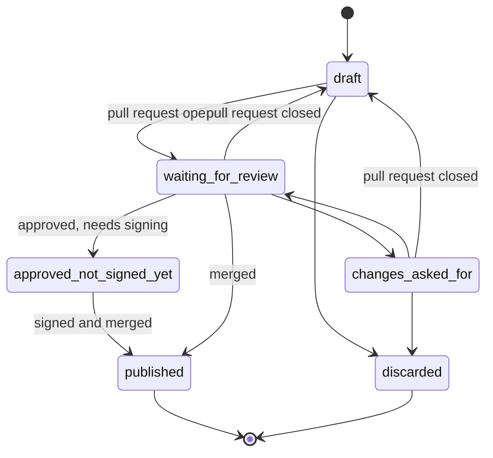

- Storage: SQLite table `agent_drafts` in the journal database, owned by Authoring Service; the draft's files are on a branch of the person's clone (04:395).

### Rehearsal
- Owner: **Authoring Service** (02:460) · Used by: Checker (expectation checks against the journal, 02:445), App Shell.
- HLD trace: 04:307–310; ADR-083, ADR-085; 04:395.

```rust
#[derive(Debug, Clone, PartialEq, Serialize, Deserialize)]
#[serde(rename_all = "snake_case")]
pub struct Rehearsal {
    pub id: RehearsalId,
    pub agent_draft_id: AgentDraftId,
    /// Commit of the draft's branch rehearsed.
    pub draft_version: String,
    pub situations: Vec<RehearsalSituation>,
    pub run_ids: Vec<RunId>,
    pub rehearsed_at: Timestamp,
}

#[derive(Debug, Clone, PartialEq, Serialize, Deserialize)]
#[serde(rename_all = "snake_case")]
pub struct RehearsalSituation {
    pub description: String,
    pub documents_used: Vec<String>,
    pub expectations: Vec<RehearsalExpectation>,
    pub reviewer_opinion: String,
}

#[derive(Debug, Clone, PartialEq, Serialize, Deserialize)]
#[serde(rename_all = "snake_case")]
pub struct RehearsalExpectation {
    pub text: String,
    /// The machine rule the Checker checks (ADR-085, ADR-090 §4); absent for a model-judged
    /// expectation, which is an opinion and never checked by the Checker (amended January 2026, decision 80: C-32).
    #[serde(skip_serializing_if = "Option::is_none")]
    pub rule: Option<ExpectationRule>,
    pub outcome: ExpectationOutcome,
}

/// A deterministic rehearsal expectation; closed set, as the Checker spec defines it
/// (amended January 2026, decision 80: C-32).
#[derive(Debug, Clone, PartialEq, Eq, Serialize, Deserialize)]
#[serde(tag = "kind", rename_all = "snake_case")]
pub enum ExpectationRule {
    ResultContains { text: String },
    ResultHasSection { heading: String },
    ToolUsed { tool: String },
    ToolNotUsed { tool: String },
    ApprovalAsked,
    NoExternalAction,
    ArtefactProduced { name_suffix: String },
}

#[derive(Debug, Clone, Copy, PartialEq, Eq, Serialize, Deserialize)]
#[serde(rename_all = "snake_case")]
pub enum ExpectationOutcome { Met, NotMet }
```

| Field | Rule | Error code |
|---|---|---|
| situations | 1–20 (assumed) | `REH_SITUATIONS_OUT_OF_RANGE` |
| situation.description | 1–1000 chars (assumed) | `REH_DESCRIPTION_INVALID` |
| expectations | 1–20 per situation (assumed); text 1–500 chars (assumed) | `REH_EXPECTATIONS_INVALID` |
| row | written once (04:310) | `REH_IMMUTABLE` |

- Storage: SQLite table `rehearsals` in the journal database, owned by Authoring Service; retention with the journal (04:395, A-08). No state machine.

### PartDraft
- Owner: **Authoring Service** (02:460 "drafts") · Used by: Checker, Agent Model, Format Plug-ins, Push Service, Catalogue Service.
- HLD trace: 04:317–320; ADR-090, ADR-091, ADR-084; 04:396.

```rust
#[derive(Debug, Clone, PartialEq, Serialize, Deserialize)]
#[serde(rename_all = "snake_case")]
pub struct PartDraft {
    pub id: PartDraftId,
    pub agent_repository_id: AgentRepositoryId,
    pub change_kind: PartChangeKind,
    /// None for a new part until it is merged (04:319).
    #[serde(skip_serializing_if = "Option::is_none")]
    pub part_id: Option<PartId>,
    /// The part's fields as the Agent Model holds them (02:433).
    pub fields: serde_json::Value,
    pub computed_version: String,
    #[serde(skip_serializing_if = "Option::is_none")]
    pub changes_what_part_does: Option<bool>,
    pub used_by_at_check: Vec<PartId>,
    pub branch: String,
    #[serde(skip_serializing_if = "Option::is_none")]
    pub check_results_ref: Option<String>,
    pub wording_changes: Vec<WordingChange>,
    pub field_authors: Vec<FieldAuthor>,
    #[serde(skip_serializing_if = "Option::is_none")]
    pub pull_request: Option<PullRequestRef>,
    pub state: ReviewDraftState,
    pub created_at: Timestamp,
    pub updated_at: Timestamp,
}

#[derive(Debug, Clone, Copy, PartialEq, Eq, Serialize, Deserialize)]
#[serde(rename_all = "snake_case")]
pub enum PartChangeKind { NewPart, ChangedPart, Deprecation, Withdrawal, VocabularyTerm }

#[derive(Debug, Clone, PartialEq, Serialize, Deserialize)]
#[serde(rename_all = "snake_case")]
pub struct FieldAuthor { pub field: String, pub written_by: FieldWriter }

#[derive(Debug, Clone, Copy, PartialEq, Eq, Serialize, Deserialize)]
#[serde(rename_all = "snake_case")]
pub enum FieldWriter { Person, ModelThenPerson, Model }
```

| Field | Rule | Error code |
|---|---|---|
| part_id | absent if and only if `change_kind = new_part` and not yet merged | `PDRAFT_PART_MISMATCH` |
| computed_version | semantic version | `PDRAFT_VERSION_INVALID` |
| changes_what_part_does | required before `waiting_for_review` for `changed_part` | `PDRAFT_ANSWER_MISSING` |
| agent repository | person can open a review in it (04:319) | `PDRAFT_NO_REVIEW_RIGHT` |
| pull_request | at most one open per draft | `PDRAFT_PR_ALREADY_OPEN` |
| (person, part_id) | at most one open part draft (04:314) | `PDRAFT_ALREADY_OPEN_FOR_PART` |
| fields | ≤ 256 KiB serialised (assumed) | `PDRAFT_FIELDS_TOO_LARGE` |

- State machine: identical to `AgentDraft` (`ReviewDraftState`, 04:320).
- Storage: SQLite table `part_drafts` in the journal database, owned by Authoring Service; files on a branch of the person's clone (04:396).

### AgentRelease
- Owner: **Release Builder** builds the release (02:780 "the release record"); the `agent_releases` table is owned by the **Agent Loader**, written through its `LoaderStore`, which the server program implements over the Journal (amended January 2026, decision 80: C-33) · Used by: Agent Loader, Agent Configuration, Release Builder.
- HLD trace: 04:357–360; ADR-098; 04:419.

```rust
#[derive(Debug, Clone, PartialEq, Serialize, Deserialize)]
#[serde(rename_all = "snake_case")]
pub struct AgentRelease {
    pub id: AgentReleaseId,
    /// Registry reference, `registry/repository:tag`.
    pub reference: String,
    pub digest: String,
    pub bundle_path: String,
    pub agent_configuration_path: String,
    pub configuration_files: Vec<String>,
    pub package_name: String,
    pub package_version: String,
    pub ordin_version: String,
    pub contract_version: String,
    pub startup_report_id: StartupReportId,
    pub state: AgentReleaseState,
    pub published_at: Timestamp,
}

#[derive(Debug, Clone, Copy, PartialEq, Eq, Serialize, Deserialize)]
#[serde(rename_all = "snake_case")]
pub enum AgentReleaseState { Published, Obtained, Running }
```

| Field | Rule | Error code |
|---|---|---|
| digest | `sha256:` followed by 64 lowercase hex chars | `REL_DIGEST_INVALID` |
| reference | ≤ 255 bytes (OCI reference) | `REL_REFERENCE_INVALID` |
| reference | an existing reference with a different digest is refused (02:779) | `REL_EXISTS_DIFFERENT` |
| row | never changed after publish except `state` (04:360) | `REL_IMMUTABLE` |

| From | Event | To |
|---|---|---|
| — | check passes, written to the registry | published |
| published | an instance obtains it and the digest verifies | obtained |
| obtained | Agent Loader starts it | running |

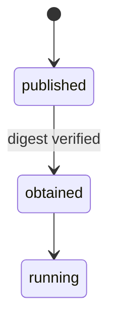

- Storage: the release lives in the container registry (04:419); the release record is SQLite table `agent_releases` in the server's database, owned by the Agent Loader through `LoaderStore` (amended January 2026, decision 80: C-33); also PostgreSQL in the agent profile scaled shape.

---

## Workspaces, places and content

### Workspace
- Owner: **Workspace Service** (02:730); `last_seen_at` written by **Home and Search** (02:374) · Used by: File Service, Rules Engine, Ordin Host, Crew Orchestrator, Mail Service, Knowledge Service, Trigger Service, Handover Service, Push Service.
- HLD trace: 04:63–66; ADR-025, ADR-058; UX-A68; 04:404, 04:410.

```rust
#[derive(Debug, Clone, PartialEq, Serialize, Deserialize)]
#[serde(rename_all = "snake_case")]
pub struct Workspace {
    pub id: WorkspaceId,
    pub name: String,
    pub own_folder_place_id: PlaceId,
    pub state: WorkspaceState,
    /// Not stored in `workspaces`: filled on read from Home and Search's own table
    /// `workspace_last_seen` (amended January 2026, decision 80: C-31).
    #[serde(skip_serializing_if = "Option::is_none")]
    pub last_seen_at: Option<Timestamp>,
    #[serde(skip_serializing_if = "Option::is_none")]
    pub moved_to_bin_at: Option<Timestamp>,
    pub created_at: Timestamp,
}

#[derive(Debug, Clone, Copy, PartialEq, Eq, Serialize, Deserialize)]
#[serde(rename_all = "snake_case")]
pub enum WorkspaceState { Active, Archived, InBin }
```

The HLD field "archived or not" (04:64) is `state = archived`.

| Field | Rule | Error code |
|---|---|---|
| name | 1–80 chars after trimming (assumed) | `WS_NAME_EMPTY`, `WS_NAME_TOO_LONG` |
| name | unique among non-bin workspaces (assumed) | `WS_NAME_DUPLICATE` |
| moved_to_bin_at | present if and only if `state = in_bin` | `WS_BIN_MISMATCH` |

| From | Event | To |
|---|---|---|
| — | person creates it with a name | active |
| active | person archives it | archived |
| archived | person restores it | active |
| active, archived | person removes it (moved to ordin's Bin) | in_bin |
| in_bin | person restores it from the Bin | active |
| in_bin | person deletes it in the Bin, or empties the Bin | (row deleted) |

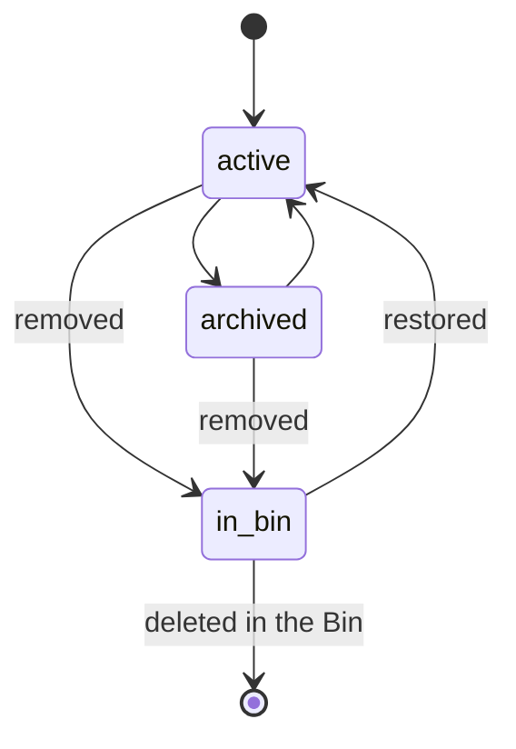

- Storage: SQLite table `workspaces` in the journal database, owned by Workspace Service; `last_seen_at` lives in Home and Search's `workspace_last_seen` (amended January 2026, decision 80: C-31).

### HomeMarks
- Owner: **Home and Search** (02:374) · Used by: App Shell, File Service (changed marks in the tree).
- HLD trace: 04:68–71; ADR-058, ADR-079; 04:410.

```rust
#[derive(Debug, Clone, PartialEq, Serialize, Deserialize)]
#[serde(rename_all = "snake_case")]
pub struct HomeMarks {
    #[serde(skip_serializing_if = "Option::is_none")]
    pub home_last_opened_at: Option<Timestamp>,
    pub changed_marks: Vec<ChangedMark>,
}

/// A document changed elsewhere that the person has not opened since (ADR-079).
#[derive(Debug, Clone, PartialEq, Serialize, Deserialize)]
#[serde(rename_all = "snake_case")]
pub struct ChangedMark {
    pub id: ChangedMarkId,
    pub workspace_id: WorkspaceId,
    pub place_id: PlaceId,
    pub path: String,
    pub changed_at: Timestamp,
}
```

| Field | Rule | Error code |
|---|---|---|
| ChangedMark (workspace_id, place_id, path) | unique | `HOME_MARK_DUPLICATE` |
| ChangedMark.path | relative to the place, ≤ 4096 bytes | `HOME_PATH_INVALID` |
| workspace removed | its marks deleted (04:71) | — |

- Storage: SQLite tables `home_marks` (one row) and `changed_marks` in the journal database, owned by Home and Search.

### Place
- Owner: **File Service** (02:722) · Used by: Workspace Service, Agent Folder Manager, Rules Engine, Craft Toolkit, Project Service, Knowledge Service.
- HLD trace: 04:54–57; ADR-015.

```rust
#[derive(Debug, Clone, PartialEq, Serialize, Deserialize)]
#[serde(rename_all = "snake_case")]
pub struct Place {
    pub id: PlaceId,
    pub friendly_name: String,
    pub path: String,
    pub kind: PlaceKind,
    pub added_at: Timestamp,
}

#[derive(Debug, Clone, Copy, PartialEq, Eq, Serialize, Deserialize)]
#[serde(rename_all = "snake_case")]
/// `WorkingCopy` (the local working copy of a SharePoint or Confluence link) and
/// `CodingTaskWorktree` (a coding task's worktree) amended January 2026, decision 80: C-9.
pub enum PlaceKind { PersonsFolder, WorkspaceFolder, AgentFolder, WorkingCopy, CodingTaskWorktree }

/// Membership of a place in a workspace (a place may belong to several, 04:65).
#[derive(Debug, Clone, PartialEq, Serialize, Deserialize)]
#[serde(rename_all = "snake_case")]
pub struct WorkspacePlace { pub workspace_id: WorkspaceId, pub place_id: PlaceId, pub added_at: Timestamp }
```

| Field | Rule | Error code |
|---|---|---|
| friendly_name | 1–120 chars (assumed) | `PLACE_NAME_INVALID` |
| path | absolute, ≤ 4096 bytes, unique; set only from the system folder picker (02:716) | `PLACE_PATH_INVALID` |
| kind = agent_folder | never listed to the person (04:54) | — |
| removal | never deletes the folder (04:57) | — |

- No state machine: added → renamed → row deleted.
- Storage: SQLite tables `places` (File Service) and `workspace_places` (Workspace Service, 02:730 "membership of places") in the journal database.

### FolderGrant
- Owner: **Workspace Service** (02:730 "per-workspace grants"; File Service 02:718 and Agent Folder Manager 02:480 also record grants — see *HLD inconsistencies*) · Used by: File Service, Agent Folder Manager, Rules Engine.
- HLD trace: 04:59–61; ADR-025.

```rust
#[derive(Debug, Clone, PartialEq, Serialize, Deserialize)]
#[serde(rename_all = "snake_case")]
pub struct FolderGrant {
    pub id: FolderGrantId,
    pub workspace_id: WorkspaceId,
    pub grantee: Grantee,
    pub place_id: PlaceId,
    pub access: FolderAccess,
    pub granted_at: Timestamp,
}

#[derive(Debug, Clone, Copy, PartialEq, Eq, Serialize, Deserialize)]
#[serde(tag = "kind", rename_all = "snake_case")]
pub enum Grantee {
    AgentInstance { agent_instance_id: AgentInstanceId },
    /// "crew" is not given an identifier in 04; the charter is assumed (LD-31).
    Crew { crew_charter_id: CrewCharterId },
}

/// "can't use" is the absence of a grant (04:61).
#[derive(Debug, Clone, Copy, PartialEq, Eq, Serialize, Deserialize)]
#[serde(rename_all = "snake_case")]
pub enum FolderAccess { Read, ReadAndChange }
```

| Field | Rule | Error code |
|---|---|---|
| (workspace_id, grantee, place_id) | unique | `GRANT_DUPLICATE` |
| place_id | place is a member of the workspace | `GRANT_PLACE_NOT_IN_WORKSPACE` |
| revoke | on person's choice, instance removal, or place leaving the workspace (04:61) | — |

- No state machine: a grant exists or does not.
- Storage: SQLite table `folder_grants` in the journal database, owned by Workspace Service.

### SourceLink
- Owner: **Workspace Service** (02:730 "links"); SharePoint and Confluence sync state with their adapters (02:387, 02:743) · Used by: Push Service, File Service, SharePoint Adapter, Confluence Adapter, Project Service.
- HLD trace: 04:73–76; ADR-029; UX-A57.

```rust
#[derive(Debug, Clone, PartialEq, Serialize, Deserialize)]
#[serde(rename_all = "snake_case")]
pub struct SourceLink {
    pub id: SourceLinkId,
    pub workspace_id: WorkspaceId,
    pub kind: SourceLinkKind,
    pub origin_location: String,
    pub display_name: String,
    /// Set for local and repository folders, which are also places (04:75), and for SharePoint
    /// and Confluence links once their working copy exists (amended January 2026, decision 80: C-9).
    #[serde(skip_serializing_if = "Option::is_none")]
    pub place_id: Option<PlaceId>,
    pub state: SourceLinkState,
    pub added_at: Timestamp,
    #[serde(skip_serializing_if = "Option::is_none")]
    pub last_read_at: Option<Timestamp>,
}

#[derive(Debug, Clone, Copy, PartialEq, Eq, Serialize, Deserialize)]
#[serde(rename_all = "snake_case")]
pub enum SourceLinkKind { LocalFolder, GitRepositoryFolder, SharepointLocation, ConfluenceLocation,
    /// A repository folder linked without a local clone (`LinkLocation::GitRemote { url, branch, path }`,
    /// WorkspaceService.md SA-CLOSE-03; closing round, K21). `origin_location` = `git:<url without .git>#<branch>:<path>`.
    GitRemote,
    /// A Jira Cloud issue, read only (`LinkLocation::JiraIssue { address }`; amended January 2026, ADR-106).
    /// `origin_location` = the canonical `https://{site}.atlassian.net/browse/{KEY}-{N}`.
    JiraIssue }

#[derive(Debug, Clone, Copy, PartialEq, Eq, Serialize, Deserialize)]
#[serde(rename_all = "snake_case")]
pub enum SourceLinkState { Proposed, Active }
```

| Field | Rule | Error code |
|---|---|---|
| origin_location | 1–2048 bytes | `SRC_LOCATION_INVALID` |
| display_name | 1–120 chars (assumed) | `SRC_NAME_INVALID` |
| place_id | required when kind ∈ {local_folder, git_repository_folder}; allowed when kind ∈ {sharepoint_location, confluence_location}, naming the link's working copy (a place of kind `working_copy`) (amended January 2026, decision 80: C-9); absent when kind = git_remote (K21); allowed when kind = jira_issue, naming the link's working copy (amended January 2026, ADR-106) | `SRC_PLACE_MISMATCH` |
| (workspace_id, kind, origin_location) | unique | `SRC_DUPLICATE` |

| From | Event | To |
|---|---|---|
| — | Ordin proposes it in a file block | proposed |
| proposed | person confirms | active |
| proposed | person declines | (row deleted) |
| active | person confirms removal | (row deleted) |

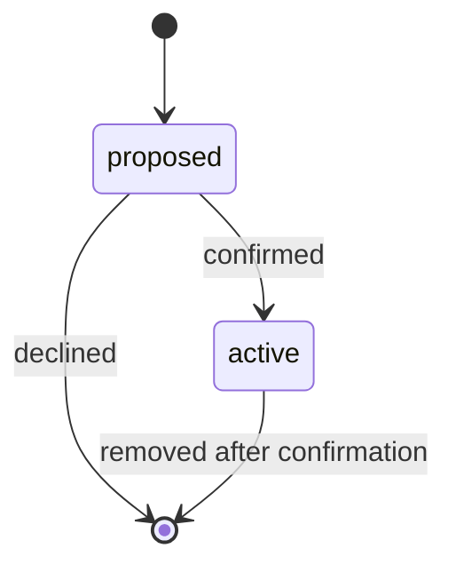

- Storage: SQLite table `source_links` in the journal database, owned by Workspace Service.

### WorkingCopyItem
- Owner: **unclear** — 02:726 places the working copy in the Workspace Service's description without an *Owns* entry; the SharePoint Adapter fetches into it (02:384) — see *Bubble-up candidates* · Used by: Push Service, SharePoint Adapter, Confluence Adapter, File Service.
- HLD trace: 04:78–80; ADR-029, ADR-035; A-25.

```rust
#[derive(Debug, Clone, PartialEq, Serialize, Deserialize)]
#[serde(rename_all = "snake_case")]
pub struct WorkingCopyItem {
    pub id: WorkingCopyItemId,
    pub source_link_id: SourceLinkId,
    pub origin_path: String,
    /// Version or change time at the origin when read (A-25).
    pub origin_version_read: String,
    pub local_version: u32,
    pub state: WorkingCopyState,
    pub read_at: Timestamp,
    /// Jira issue items only: when the origin check saw a newer version, which waits for
    /// **Bring in the new version** (amended January 2026, ADR-106; WorkspaceService.md §J).
    #[serde(skip_serializing_if = "Option::is_none")]
    pub origin_newer_at: Option<Timestamp>,
}

#[derive(Debug, Clone, Copy, PartialEq, Eq, Serialize, Deserialize)]
#[serde(rename_all = "snake_case")]
pub enum WorkingCopyState { Read, Changed, AwaitingPush, Pushed, OriginChanged }
```

| Field | Rule | Error code |
|---|---|---|
| origin_path | 1–2048 bytes | `WCI_PATH_INVALID` |
| (source_link_id, origin_path) | unique | `WCI_DUPLICATE` |
| origin_version_read | 1–256 chars (assumed) | `WCI_VERSION_INVALID` |

| From | Event | To |
|---|---|---|
| — | read from the origin | read |
| read | agent changes it | changed |
| changed | included in a pending push | awaiting_push |
| awaiting_push | pushed (new origin version recorded) | pushed |
| awaiting_push | origin has a newer version (push stopped) | origin_changed |
| origin_changed, pushed | re-read | read |
| awaiting_push | the person takes the file out of the pending push, or the push is discarded (closing round, K21) | changed |

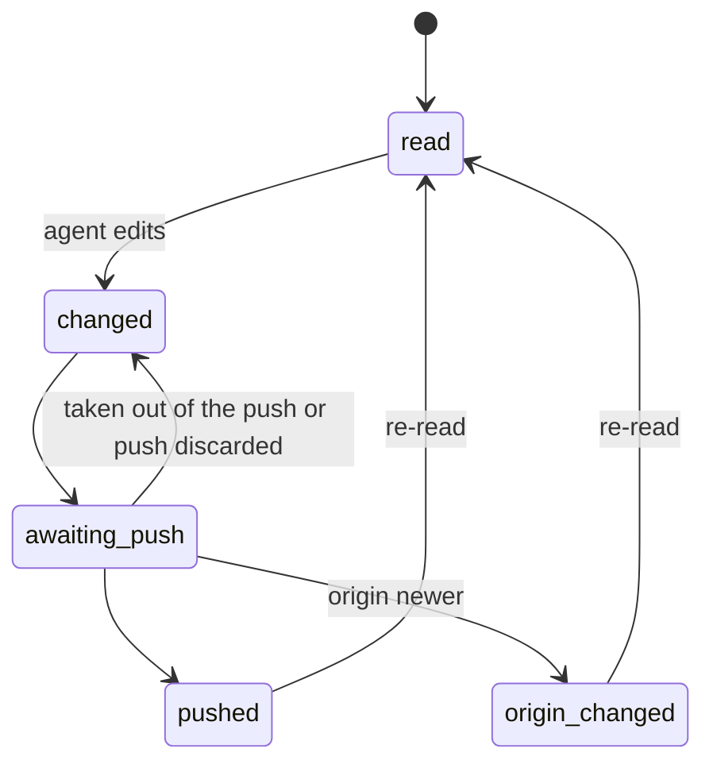

- Storage: SQLite table `working_copy_items` in the journal database; owner pending bubble-up.

### PendingPush
- Owner: **Push Service** (02:411) · Used by: Approval Service, Ordin Host (*propose push*), SharePoint Adapter, Confluence Adapter, Project Service.
- HLD trace: 04:101–104; ADR-029, ADR-035.

```rust
#[derive(Debug, Clone, PartialEq, Serialize, Deserialize)]
#[serde(rename_all = "snake_case")]
pub struct PendingPush {
    pub id: PendingPushId,
    pub workspace_id: WorkspaceId,
    /// The person's request the changes answer, as text (assumed, LD-30).
    pub request: String,
    pub items: Vec<PendingPushItem>,
    pub origins: Vec<SourceLinkId>,
    #[serde(skip_serializing_if = "Option::is_none")]
    pub approval_id: Option<ApprovalId>,
    pub state: PendingPushState,
    pub created_at: Timestamp,
}

#[derive(Debug, Clone, PartialEq, Serialize, Deserialize)]
#[serde(rename_all = "snake_case")]
pub struct PendingPushItem {
    pub working_copy_item_id: WorkingCopyItemId,
    pub summary: String,
    #[serde(skip_serializing_if = "Option::is_none")]
    pub external_action_key: Option<ExternalActionKey>,
}

#[derive(Debug, Clone, Copy, PartialEq, Eq, Serialize, Deserialize)]
#[serde(rename_all = "snake_case")]
pub enum PendingPushState { Proposed, Held, Approved, Rejected, Closed }
```

| Field | Rule | Error code |
|---|---|---|
| request | 1–4000 chars (assumed) | `PUSH_REQUEST_INVALID` |
| items | 1–200 (assumed) | `PUSH_ITEMS_OUT_OF_RANGE` |
| items.summary | 1–120 chars, one line (assumed) | `PUSH_SUMMARY_INVALID` |
| items.external_action_key | set only once the item is pushed (04:103) | `PUSH_ACTION_KEY_PREMATURE` |
| approval_id | required to enter `approved` | `PUSH_APPROVAL_MISSING` |

| From | Event | To |
|---|---|---|
| — | Ordin proposes it | proposed |
| proposed | person changes a document locally meanwhile | held |
| held | person chooses a version | proposed |
| proposed | person approves | approved |
| proposed | person rejects (changes kept locally) | rejected |
| approved | every item pushed or stopped | closed |
| rejected | — | closed |

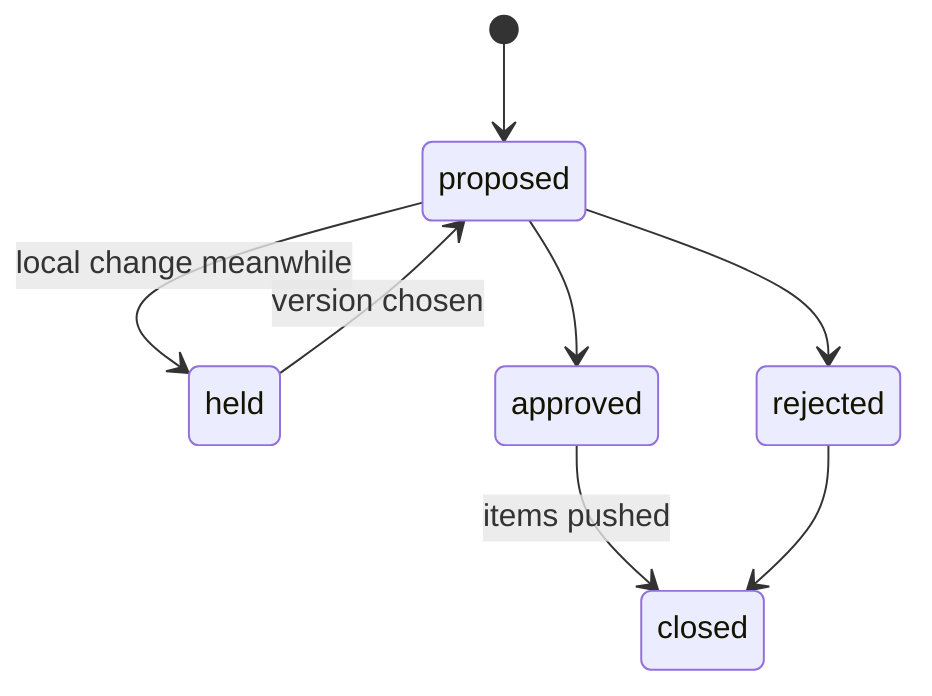

- Storage: SQLite tables `pending_pushes` and `pending_push_items` in the journal database, owned by Push Service.

### FileVersion
- Owner: **File Service** (02:722) · Used by: Knowledge Service, Push Service, Home and Search, Craft Toolkit.
- HLD trace: 04:128–130; 04:393.

```rust
#[derive(Debug, Clone, PartialEq, Serialize, Deserialize)]
#[serde(rename_all = "snake_case")]
pub struct FileVersion {
    pub id: FileVersionId,
    pub place_id: PlaceId,
    pub path: String,
    pub version: u32,
    pub hash: Sha256Hex,
    pub origin: FileVersionOrigin,
    pub created_at: Timestamp,
}

#[derive(Debug, Clone, PartialEq, Serialize, Deserialize)]
#[serde(tag = "kind", rename_all = "snake_case")]
pub enum FileVersionOrigin {
    Person,
    Run { run_id: RunId, tool: String },
    ArtCraftEdit { app: String },
}
```

| Field | Rule | Error code |
|---|---|---|
| path | relative to the place, ≤ 4096 bytes | `FVER_PATH_INVALID` |
| (place_id, path, version) | unique; version starts at 1 and increases by 1 | `FVER_VERSION_GAP` |
| pruning | the latest version of each path is never pruned (04:130) | `FVER_LATEST_PRUNE` |

- Storage: SQLite table `file_versions` in the journal database, owned by File Service; copies under the application data root, referenced by hash (04:393).

### Artefact
- Owner: **Journal and Artefact Store** (02:677 "the artefact index") · Used by: Session Supervisor, Crew Orchestrator, File Service, Ordin Host.
- HLD trace: 04:202–204; 04:385.

```rust
#[derive(Debug, Clone, PartialEq, Serialize, Deserialize)]
#[serde(rename_all = "snake_case")]
pub struct Artefact {
    pub id: ArtefactId,
    pub location: ArtefactLocation,
    pub path: String,
    pub version: u32,
    pub hash: Sha256Hex,
    #[serde(skip_serializing_if = "Option::is_none")]
    pub producing_run_id: Option<RunId>,
    pub media_type: String,
    pub created_at: Timestamp,
}

#[derive(Debug, Clone, Copy, PartialEq, Eq, Serialize, Deserialize)]
#[serde(tag = "kind", rename_all = "snake_case")]
pub enum ArtefactLocation {
    AgentFolder { agent_instance_id: AgentInstanceId },
    Place { place_id: PlaceId },
}
```

| Field | Rule | Error code |
|---|---|---|
| path | relative to its folder, ≤ 4096 bytes | `ART_PATH_INVALID` |
| media_type | RFC 6838 `type/subtype`, ≤ 255 chars | `ART_MEDIA_TYPE_INVALID` |
| deletion in a person's place | moved to the system's bin, never deleted (04:204) | `ART_DELETE_IN_PLACE` |

- No state machine (created → new versions → exported → deleted).
- Storage: SQLite table `artefacts` in the journal database, owned by Journal and Artefact Store.

### MemoryFact
- Owner: **Memory Service** (02:353 "the memory store") · Used by: Ordin Host, Crew Orchestrator, Knowledge Service (citations).
- HLD trace: 04:106–108; ADR-030; 02:349–351.
- 04:106 says the fields are the memory component's (`memory/`). Only the HLD-named relationships are typed here; the component's own fact type is imported unchanged (see *Bubble-up candidates*).

```rust
#[derive(Debug, Clone, PartialEq, Serialize, Deserialize)]
#[serde(rename_all = "snake_case")]
pub struct MemoryFactRef {
    pub id: MemoryFactId,
    /// None = installation-wide scope; Some = the workspace's team scope (02:350).
    #[serde(skip_serializing_if = "Option::is_none")]
    pub workspace_id: Option<WorkspaceId>,
}
```

- Lifecycle (04:108): written → recalled → corrected or deleted by the person, or faded by the memory component. States belong to the memory component.
- Storage: the memory component's own store in the application data folder (02:348), owned by Memory Service; also PostgreSQL in the agent profile scaled shape (02:349).
- *Amended January 2026 (ADR-103):* a fact got from a team knowledge folder keeps the sharer's `MemoryFactId` and the memory component's `fact:<uuid>` everywhere it travels, and carries `shared_by` (the first sharer's name, 1–200 chars) and `shared_at` (2C `Timestamp`), shown on the memory block. Never written to a team folder: installation-wide facts (`workspace_id` None), facts from knowledge-page sections, facts not yet kept or not kept, facts held for a personal-data check, embeddings, `salience`, `stability`, `last_recalled_at`, `ingested_at` and source trust. File format: TeamKnowledgeService.md *Shared Context* §3 (SA-TEAM-02).

- *Amended January 2026 (ADR-110):* a fact got from a **read folder** carries that folder's `TeamFolderId` for good (Memory Service `memory_fact_refs.read_folder_id`; the memory component's `Fact.collection` = `"tk:<folder uuid>"`), is never exported to any folder, and leaves recall when the folder stops being read; a person's correction of such a fact keeps the same folder. A fact adopted from a read folder is a new own fact with a new `MemoryFactId`. Recall results (`FactView`) gain the additive fields `folder`, `folder_description`, `set_by_company` (serialised when `folder` is set), `adopted_from` and `adoption_mark` (`changed_at_source` \| `removed_at_source`); MemoryService.md amendment January 2026.

- *Amended January 2026 (ADR-111):* a fact may name **things** (the memory component's entities, `MemoryThingId`, each with a name and up to 32 other names) and state **links** between them (the component's relationships, `MemoryLinkId`, with a kind, a validity of their own and the facts that asserted or ended them); a link is closed, not overwritten, when no live fact asserts it any more. Every fact has a **kind** shown in words — *something that happened* (`episodic`), *something known* (`semantic`), *a summary* (`consolidated`) — and an episodic fact not used for the last 20% of its decay time is **fading** until the person chooses **Keep**, which makes it known. A summary is written only by Ordin and records the facts it was made from; forgetting one of them forgets the summary too. Each recall is logged by `MemoryRecallId` with the identifiers of the facts and links it returned (never text), kept for the person's history period, so an answer can show **What Ordin used**. Lifecycle (04:108) gains: kept → fading → kept (Keep) and thing merged (Same as…). `FactView` gains `kind`, `true_from`, `true_until`, `replaces`, `fading`, `not_used_since`, `things`, `made_from_count`; MemoryService.md amendment January 2026.

### KnowledgePage
- Owner: **Knowledge Service** (02:362) · Used by: Ordin Host, MCP Front, File Service (versions, published copies), Memory Service (citations).
- HLD trace: 04:110–115; ADR-057, ADR-069.

```rust
#[derive(Debug, Clone, PartialEq, Serialize, Deserialize)]
#[serde(rename_all = "snake_case")]
pub struct KnowledgePage {
    pub id: KnowledgePageId,
    pub workspace_id: WorkspaceId,
    pub title: String,
    pub body_markdown: String,
    pub written_by: KnowledgeAuthor,
    pub edited_by_person: bool,
    pub sources: Vec<KnowledgeSource>,
    pub state: KnowledgePageState,
    pub last_changed_at: Timestamp,
}

#[derive(Debug, Clone, Copy, PartialEq, Eq, Serialize, Deserialize)]
#[serde(rename_all = "snake_case")]
pub enum KnowledgeAuthor { Ordin, Person }

#[derive(Debug, Clone, PartialEq, Serialize, Deserialize)]
#[serde(rename_all = "snake_case")]
pub struct KnowledgeSource { pub origin: String, pub location: String, pub version_read: String }

#[derive(Debug, Clone, Copy, PartialEq, Eq, Serialize, Deserialize)]
#[serde(rename_all = "snake_case")]
pub enum KnowledgePageState { Current, MayBeOutOfDate, Removed }
```

"Published copies" (04:111) are the `PublishedCopy` rows whose `original` names this page; they are not stored on the page.

*Amended January 2026 (ADR-104):* the page file's header may also hold `tags` (≤ 32, each 1–64 characters, no white space), `aliases` (≤ 16, each 1–200 characters; titles and aliases are unique together per workspace) and keys written by other Markdown apps, kept unchanged (≤ 64 KiB); pages link to each other with `[[Title]]`, `[[Title#Heading]]`, `[[Title|shown]]` and Markdown links to a page file, kept by the Knowledge Service as a link graph keyed by page id. A page's file name follows its title (KnowledgeService.md SA-KLINK-04). `KnowledgeSuggestionId` (UUIDv7) names one link or duplicate suggestion of a page. Owner of every rule: Knowledge Service (amendment January 2026 — Page links).

*Amended January 2026 (ADR-103):* a page shared through a team knowledge folder keeps its `KnowledgePageId`; its file header gains two optional keys after `last_changed`, `shared_by` (1–200 chars) and `shared_at` (2C `Timestamp`), written once by the first share and kept on every copy. When two people changed the same page since the last share, the newer `last_changed` wins and the other is kept as an earlier version of the page (File Service versions). A `place` source names a place of the sharer's computer (SA-TEAM-05).

| Field | Rule | Error code |
|---|---|---|
| title | 1–200 chars (assumed); unique per workspace among non-removed pages (assumed) | `KNOW_TITLE_INVALID` |
| body_markdown | ≤ 1 MiB UTF-8 (assumed) | `KNOW_BODY_TOO_LARGE` |
| sources | ≤ 100 (assumed) | `KNOW_SOURCES_TOO_MANY` |

| From | Event | To |
|---|---|---|
| — | written by Ordin or by the person | current |
| current | a cited source has a newer version | may_be_out_of_date |
| may_be_out_of_date | person uses the update | current |
| current, may_be_out_of_date | person removes it (system's bin) | removed |
| removed | Undo | previous state |

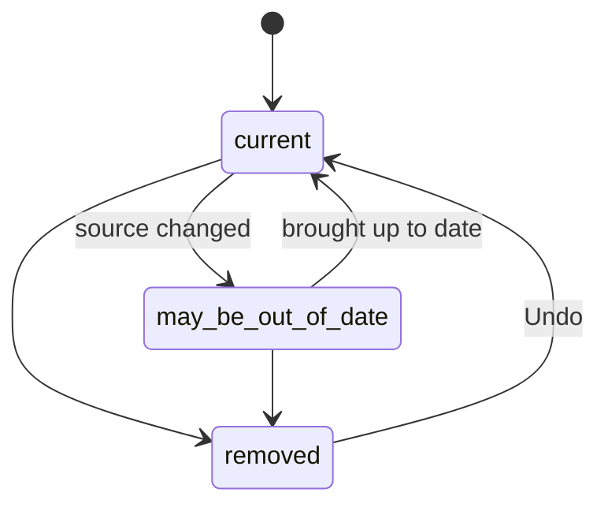

- Storage: SQLite table `knowledge_pages` in the journal database, owned by Knowledge Service; versions kept by the File Service (04:113).

*Amended January 2026 (ADR-112):* the page file is an Open Knowledge Format 0.2 concept. Beside the keys above, ordin writes `type` (never empty; one of `Explanation`, `How-to`, `Decision`, `Reference`, `Glossary` when chosen through ordin, default `Explanation`; any other value read from a file is kept as written), `description` (one sentence, 1–200 characters; when a save carries none, the body's first sentence), `generated` (`by: ordin/<version>`, `at`) and, when the person writes or edits the page or accepts **Use the update**, a `verified` entry (`by: human:<Git host login>`, `at`; at most 20 entries). It reads `status` (`draft`, `stable`, `deprecated`) and `stale_after`. Each `sources` entry keeps `origin`, `location` and `version_read` and gains `resource`, `id` and `last_modified`; every other key and every other field of a `sources` entry is kept byte for byte, in its order. The page's trust tier is derived, never stored in the file: *human-reviewed* (a `human:` verifier), *machine-confirmed* (verifiers, none `human:`), *unverified* (none) — `PageTier`, wire §`knowledge_query`. `index.md` and `log.md` are never pages. Field rules and codes: KnowledgeService.md amendment January 2026 (`KNOW_TYPE_INVALID`, `KNOW_DESCRIPTION_INVALID`).

*Amended January 2026 (ADR-110):* a page got from a **read folder** is not a `KnowledgePage` of the workspace: it is kept read-only in the Knowledge Service's own table of read pages (never in the person's `knowledge/` folder, never exported), with its folder's `TeamFolderId`; its title is unique per folder and its links resolve against pages of the same folder. A page adopted from a read folder becomes a new `KnowledgePage` with a new id, written by the person. `PageView` and `PageSummary` gain the additive fields `folder`, `folder_description`, `set_by_company`, `read_only`, `adopted_from` and `adoption_mark`; KnowledgeService.md amendment January 2026.

### ConfluenceLink
- Owner: **Workspace Service** (02:730 "links"); sync state with **Confluence Adapter** (02:743) · Used by: File Service, Push Service, Approval Service.
- HLD trace: 04:117–120; ADR-026.

```rust
#[derive(Debug, Clone, PartialEq, Serialize, Deserialize)]
#[serde(rename_all = "snake_case")]
pub struct ConfluenceLink {
    pub id: ConfluenceLinkId,
    pub workspace_id: WorkspaceId,
    pub place_id: PlaceId,
    /// Folder relative to the place; empty = the place's root.
    pub folder: String,
    pub confluence_space: String,
    pub parent_page_id: String,
    pub audience: String,
    #[serde(skip_serializing_if = "Option::is_none")]
    pub approval_id: Option<ApprovalId>,
    #[serde(skip_serializing_if = "Option::is_none")]
    pub approved_at: Option<Timestamp>,
    pub state: ConfluenceLinkState,
}

#[derive(Debug, Clone, Copy, PartialEq, Eq, Serialize, Deserialize)]
#[serde(rename_all = "snake_case")]
pub enum ConfluenceLinkState { Proposed, Active, Paused }
```

| Field | Rule | Error code |
|---|---|---|
| confluence_space | 1–255 chars (Confluence space key, assumed) | `CFL_SPACE_INVALID` |
| parent_page_id | 1–64 chars `[0-9]` (assumed) | `CFL_PARENT_INVALID` |
| audience | 1–500 chars (assumed) | `CFL_AUDIENCE_INVALID` |
| approval_id, approved_at | present for `active` and `paused` | `CFL_NOT_APPROVED` |

| From | Event | To |
|---|---|---|
| — | proposed | proposed |
| proposed | person approves | active |
| active | person pauses | paused |
| paused | person resumes | active |
| active, paused | person removes (no Confluence page deleted) | (row deleted) |

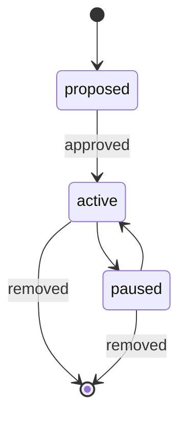

- Storage: SQLite table `confluence_links` in the journal database, owned by Workspace Service.

### PublishedCopy
- Owner: **File Service** (02:722; 02:387 and 02:743 both say published copies are recorded by the File Service) · Used by: Push Service, Confluence Adapter, SharePoint Adapter, Approval Service, Craft Toolkit, Project Service.
- HLD trace: 04:122–126; ADR-026, ADR-048, ADR-069; 04:404.

```rust
#[derive(Debug, Clone, PartialEq, Serialize, Deserialize)]
#[serde(rename_all = "snake_case")]
pub struct PublishedCopy {
    pub id: PublishedCopyId,
    pub original: CopyOriginal,
    pub destination: CopyDestination,
    #[serde(skip_serializing_if = "Option::is_none")]
    pub destination_item_id: Option<String>,
    pub format: CopyFormat,
    pub maker: CopyMaker,
    pub published_via: PublishedVia,
    #[serde(skip_serializing_if = "Option::is_none")]
    pub followed_branch: Option<String>,
    pub keep_up_to_date: bool,
    pub audience: String,
    #[serde(skip_serializing_if = "Option::is_none")]
    pub original_version_published: Option<String>,
    #[serde(skip_serializing_if = "Option::is_none")]
    pub destination_version_pushed: Option<String>,
    #[serde(skip_serializing_if = "Option::is_none")]
    pub last_updated_at: Option<Timestamp>,
    pub state: PublishedCopyState,
    #[serde(skip_serializing_if = "Option::is_none")]
    pub failure_reason: Option<String>,
}

#[derive(Debug, Clone, PartialEq, Serialize, Deserialize)]
#[serde(tag = "kind", rename_all = "snake_case")]
pub enum CopyOriginal {
    PlaceFile { place_id: PlaceId, path: String },
    KnowledgePage { knowledge_page_id: KnowledgePageId },
}

#[derive(Debug, Clone, PartialEq, Serialize, Deserialize)]
#[serde(tag = "kind", rename_all = "snake_case")]
pub enum CopyDestination {
    ConfluencePage { space: String, parent_page_id: String },
    ConfluenceAttachment { space: String, parent_page_id: String },
    SharepointFile { site: String, library: String, folder: String },
}

#[derive(Debug, Clone, Copy, PartialEq, Eq, Serialize, Deserialize)]
#[serde(rename_all = "snake_case")]
pub enum CopyFormat { Page, Word, Pdf, Slides, ExactFile }

#[derive(Debug, Clone, Copy, PartialEq, Eq, Serialize, Deserialize)]
#[serde(rename_all = "snake_case")]
pub enum CopyMaker { Ordin, WordCraft, PdfCraft, DeckCraft, None }

#[derive(Debug, Clone, Copy, PartialEq, Eq, Serialize, Deserialize)]
#[serde(tag = "kind", rename_all = "snake_case")]
pub enum PublishedVia {
    ConfluenceLink { confluence_link_id: ConfluenceLinkId },
    PublishACopy,
}

#[derive(Debug, Clone, Copy, PartialEq, Eq, Serialize, Deserialize)]
#[serde(rename_all = "snake_case")]
pub enum PublishedCopyState {
    ReadyToPublish, AwaitingApproval, Current, OutOfDate, Updating,
    ChangedAtDestination, Failed, NotKeptUpToDate, Removed,
}
```

| Field | Rule | Error code |
|---|---|---|
| format = exact_file | only with `confluence_attachment` and `maker = none` (04:123) | `PUB_FORMAT_MAKER_MISMATCH` |
| format = page | only with `confluence_page` | `PUB_FORMAT_DESTINATION_MISMATCH` |
| followed_branch | present only for an original in a repository | `PUB_BRANCH_UNEXPECTED` |
| audience | 1–500 chars (assumed); an automatic update to a grown audience holds the copy for a new approval (04:426) | `PUSH_AUDIENCE_GREW` |
| failure_reason | present if and only if `state = failed`; ≤ 500 chars (assumed) | `PUB_FAILURE_REASON_MISMATCH` |
| delete at destination | only after the person's check (04:126) | `PUSH_DELETE_UNCHECKED` |

| From | Event | To |
|---|---|---|
| — | new file in a linked folder | ready_to_publish |
| — | **Publish a copy…** | awaiting_approval |
| ready_to_publish | person checks it | awaiting_approval |
| awaiting_approval | approved and pushed | current |
| current | original gets a newer version | out_of_date |
| out_of_date | keep up to date on and change reached origin, or person approves | updating |
| updating | push succeeds | current |
| updating | push fails | failed |
| failed | **Try again** | updating |
| current, out_of_date | destination has a newer version than pushed | changed_at_destination |
| changed_at_destination | person brings change into original, or leaves it to be replaced | current |
| any non-removed | person turns updates off | not_kept_up_to_date |
| not_kept_up_to_date | person turns updates on | out_of_date |
| any non-removed | person removes it after the check | removed |

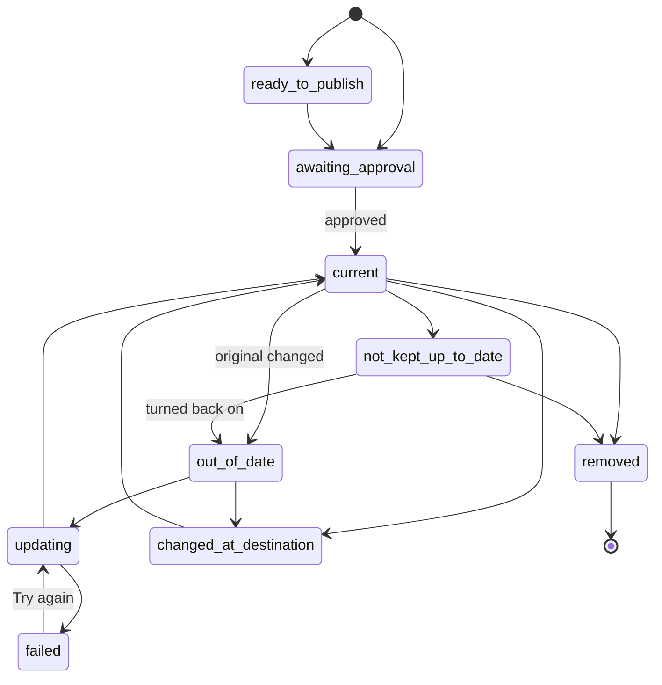

- Storage: SQLite table `published_copies` in the journal database, owned by File Service.

---

## Email

### EmailLink
- Owner: **Workspace Service** (02:730 links; 02:729 email links); check state with **Mail Service** (02:402) · Used by: Mail Service, MCP Front, Home and Search.
- HLD trace: 04:82–85; ADR-070, ADR-071; UX-A57.

```rust
#[derive(Debug, Clone, PartialEq, Serialize, Deserialize)]
#[serde(rename_all = "snake_case")]
pub struct EmailLink {
    pub id: EmailLinkId,
    pub workspace_id: WorkspaceId,
    pub kind: EmailLinkKind,
    #[serde(skip_serializing_if = "Option::is_none")]
    pub folder_or_label: Option<String>,
    pub addresses: Vec<String>,
    pub domains: Vec<String>,
    pub display_name: String,
    pub state: EmailLinkState,
    pub added_at: Timestamp,
    /// Check fields: owned by the Mail Service in its own table `mail_link_check_state`, not
    /// stored in `email_links`; filled on read from the Mail Service (amended January 2026, decision 80: C-26).
    #[serde(skip_serializing_if = "Option::is_none")]
    pub last_checked_at: Option<Timestamp>,
    pub new_since_last_looked: u32,
    /// Company mail server only (ADR-071).
    pub imap_folders: Vec<ImapFolderState>,
}

#[derive(Debug, Clone, Copy, PartialEq, Eq, Serialize, Deserialize)]
#[serde(rename_all = "snake_case")]
pub enum EmailLinkKind { FolderOrLabel, PeopleAndDomains }

#[derive(Debug, Clone, Copy, PartialEq, Eq, Serialize, Deserialize)]
#[serde(rename_all = "snake_case")]
pub enum EmailLinkState { Proposed, Active }

#[derive(Debug, Clone, PartialEq, Serialize, Deserialize)]
#[serde(rename_all = "snake_case")]
pub struct ImapFolderState { pub folder: String, pub uid_validity: u32, pub highest_uid: u32 }
```

| Field | Rule | Error code |
|---|---|---|
| kind = folder_or_label | `folder_or_label` 1–255 chars present; lists empty | `MAIL_LINK_FIELDS_MISMATCH` |
| kind = people_and_domains | at least one address or domain; `folder_or_label` absent | `MAIL_LINK_FIELDS_MISMATCH` |
| addresses | RFC 5321 address ≤ 254 chars each; ≤ 200 entries (assumed) | `MAIL_ADDRESS_INVALID` |
| domains | DNS name ≤ 253 chars each; ≤ 100 entries (assumed) | `MAIL_DOMAIN_INVALID` |
| imap_folders | `uid_validity` and `highest_uid` are IMAP 32-bit unsigned values | `MAIL_IMAP_STATE_INVALID` |

- State machine: identical in shape to `SourceLink` (proposed → active → row deleted after confirmation; 04:85).
- Storage: SQLite table `email_links` in the journal database, owned by Workspace Service; it does not hold `last_checked_at`, `new_since_last_looked` or `imap_folders`, which the Mail Service keeps in `mail_link_check_state` (amended January 2026, decision 80: C-26).

### EmailGrant
- Owner: **Workspace Service** records it (02:730; 02:395 "Records each grant with the Workspace Service"); **Mail Service** enforces it (02:402) · Used by: Mail Service, MCP Front, Rules Engine.
- HLD trace: 04:87–89; ADR-070.

```rust
#[derive(Debug, Clone, PartialEq, Serialize, Deserialize)]
#[serde(rename_all = "snake_case")]
pub struct EmailGrant {
    pub id: EmailGrantId,
    pub workspace_id: WorkspaceId,
    pub agent_instance_id: AgentInstanceId,
    pub access: EmailAccess,
    pub granted_at: Timestamp,
}

#[derive(Debug, Clone, Copy, PartialEq, Eq, Serialize, Deserialize)]
#[serde(rename_all = "snake_case")]
pub enum EmailAccess { ReadEmail, ReadAndDraftEmail }
```

| Field | Rule | Error code |
|---|---|---|
| (workspace_id, agent_instance_id) | unique | `MAIL_GRANT_DUPLICATE` |
| removal | on revoke, instance removal or workspace removal (04:89) | — |

- Storage: SQLite table `email_grants` in the journal database, owned by Workspace Service.

### TelegramGrant
*Amended January 2026, decision 80: C-25 (SA-TG-01).* An agent's access to a workspace's linked Telegram chats, recorded like `EmailGrant`. Owner: **Workspace Service** records it; **Telegram Service** enforces it.

```rust
#[derive(Debug, Clone, PartialEq, Serialize, Deserialize)]
#[serde(rename_all = "snake_case")]
pub struct TelegramGrant {
    pub id: TelegramGrantId,
    pub workspace_id: WorkspaceId,
    pub agent_instance_id: AgentInstanceId,
    pub access: TelegramAccess,
    pub granted_at: Timestamp,
}

#[derive(Debug, Clone, Copy, PartialEq, Eq, Serialize, Deserialize)]
#[serde(rename_all = "snake_case")]
pub enum TelegramAccess { ReadTelegram, ReadAndDraftTelegram }
```

| Field | Rule | Error code |
|---|---|---|
| (workspace_id, agent_instance_id) | unique | — |
| removal | on revoke, instance removal or workspace removal, as `EmailGrant` | — |

- Storage: SQLite table `telegram_grants` *(chosen here)* in the journal database, owned by Workspace Service.

### SlackGrant
*Amended January 2026 (ADR-102).* An agent's access to a workspace's linked Slack channels, recorded like `TelegramGrant`. Owner: **Workspace Service** records it; **Slack Service** enforces it.

```rust
#[derive(Debug, Clone, PartialEq, Serialize, Deserialize)]
#[serde(rename_all = "snake_case")]
pub struct SlackGrant {
    pub id: SlackGrantId,
    pub workspace_id: WorkspaceId,
    pub agent_instance_id: AgentInstanceId,
    pub access: SlackAccess,
    pub granted_at: Timestamp,
}

#[derive(Debug, Clone, Copy, PartialEq, Eq, Serialize, Deserialize)]
#[serde(rename_all = "snake_case")]
pub enum SlackAccess { ReadSlack, ReadAndDraftSlack }
```

| Field | Rule | Error code |
|---|---|---|
| (workspace_id, agent_instance_id) | unique | — |
| removal | on revoke, instance removal or workspace removal, as `TelegramGrant` | — |

- Storage: SQLite table `slack_grants` *(chosen here)* in the journal database, owned by Workspace Service.

### TeamKnowledgeBinding
*Amended January 2026 (ADR-103); amended January 2026 (ADR-110).* One team knowledge folder a workspace is bound to: its **own** folder, the one folder it shares its memory facts and knowledge pages to (0 or 1 per workspace), or a **read** folder, another team's folder it reads and never writes to (up to 20 per workspace, person-added and company-named together). Owner: **Team Knowledge Service** · Used by: Service API (`team_knowledge.status`), Screens module (workspace header, team knowledge panel, share card, Adopt), Memory Service and Knowledge Service (through the program's `MemoryFolders` implementation: folder names and descriptions on recalled items).

```rust
#[derive(Debug, Clone, Copy, PartialEq, Eq, Serialize, Deserialize)]
#[serde(rename_all = "snake_case")]
pub enum TeamFolderRole { Own, Read }

#[derive(Debug, Clone, PartialEq, Serialize, Deserialize)]
#[serde(rename_all = "snake_case")]
pub struct TeamKnowledgeBinding {
    pub id: TeamFolderId,
    pub workspace_id: WorkspaceId,
    pub role: TeamFolderRole,
    /// Own: Some (an active GitRemote link). Read: Some only when chosen from a link; a read folder added by address adds no link.
    #[serde(skip_serializing_if = "Option::is_none")]
    pub source_link_id: Option<SourceLinkId>,
    pub host: String,               // "github.com", or the company GitLab host
    pub repository: String,         // "owner/name"
    pub branch: String,             // the linked branch, 1–255 bytes
    pub folder: String,             // relative, no "..", ≤ 1,024 bytes; "" = repository root; a read binding may name a sub-path
    pub access: TeamAccess,
    /// The person added it (person origin).
    pub added_by_person: bool,
    /// Company origin: the `team_knowledge.read_folders[].key` that names it.
    #[serde(skip_serializing_if = "Option::is_none")]
    pub company_key: Option<String>,
    /// The company entry's display name; the folder's shown name when present.
    #[serde(skip_serializing_if = "Option::is_none")]
    pub display_name: Option<String>,
    /// The company entry's `review_required`; false otherwise.
    pub review_required: bool,
    /// False only when the binding has the company origin alone and the entry's `person_may_stop` is false.
    pub person_may_stop: bool,
    pub enabled_at: Timestamp,
}

#[derive(Debug, Clone, Copy, PartialEq, Eq, Serialize, Deserialize)]
#[serde(rename_all = "snake_case")]
pub enum TeamAccess { ReadWrite, ReadOnly }
```

Shown name of a folder: `display_name` when present, else `"owner/name › folder"`, or `"owner/name"` when `folder` is `""`.

| Field | Rule | Error code |
|---|---|---|
| source_link_id (Own) | an `active` `GitRemote` link of the same workspace whose host is GitHub or the profile's `gitlab.host` | `TEAM_LINK_NOT_SUITABLE` |
| role Own | at most one per workspace | `TEAM_ALREADY_ON` |
| role Own | not a place (host, repository, branch, folder) the workspace reads | `TEAM_FOLDER_IS_READ` |
| role Read | not the workspace's own folder's place | `TEAM_FOLDER_IS_OWN` |
| role Read | (workspace_id, host, repository, branch, folder) unique; a person adding a place the company already names gains the person origin on the same binding | `TEAM_FOLDER_ALREADY_READ` |
| role Read, person origin | the workspace has an own folder | `TEAM_NOT_ON` |
| role Read | ≤ 20 per workspace; company-named ones are never refused | `TEAM_READ_LIMIT` |
| removal | own: turning the mode off, removing the link or deleting the workspace removes the binding, and every person-only read binding with it; local facts and pages of the own folder and the folder's files are left as they are. Read: **Stop reading** (person origin, or `person_may_stop`), a profile that stops naming it (company origin), or the workspace's deletion; its items leave recall and adopted copies stay | `TEAM_FOLDER_SET_BY_COMPANY` (stop refused) |

- Storage: SQLite table `team_knowledge_bindings` in the journal database, keyed by `id` from the Team Knowledge Service's ADR-110 migration step (TeamKnowledgeService.md amendment January 2026), owned by Team Knowledge Service; not in the agent profile.

### TeamAdoption
*Amended January 2026 (ADR-110).* Where an adopted fact or page came from. Owner: **Team Knowledge Service** · Used by: Memory Service and Knowledge Service (`adopted_from`, `adoption_mark` through the program's `MemoryFolders`), Screens module (Adopt again, Keep as it is), the share's review request text. Kept locally per workspace and written to the own folder as `adoptions/<adopted item id>.json` (format 1; older readers ignore the sub-folder).

```rust
#[derive(Debug, Clone, PartialEq, Serialize, Deserialize)]
#[serde(rename_all = "snake_case", deny_unknown_fields)]
pub struct TeamAdoption {
    pub format: u8,                 // 1
    pub kind: String,               // "fact" | "page"
    pub id: String,                 // the adopted item's id; equals the file stem
    pub from_folder: String,        // "owner/name › path"
    pub from_host: String,
    pub from_repository: String,
    pub from_branch: String,
    pub from_path: String,
    pub source_id: String,          // the source item's id in the read folder
    pub source_blob: String,        // 40 lowercase hex: the source file's blob at adoption
    pub adopted_by: String,         // 1–200, PersonProfile.name
    pub adopted_at: Timestamp,
    pub edited: bool,
    pub version: u32,               // ≥ 1; Adopt again adds 1
}

#[derive(Debug, Clone, Copy, PartialEq, Eq, Serialize, Deserialize)]
#[serde(rename_all = "snake_case")]
pub enum AdoptionMark { ChangedAtSource, RemovedAtSource }
```

| Field | Rule | Error code |
|---|---|---|
| kind | `fact` or `page` | `TEAM_FILE_UNREADABLE` (in a file) |
| id | a UUIDv7 equal to the file stem; the item exists in the own folder | `TEAM_FILE_UNREADABLE` |
| source_blob | 40 lowercase hex | `TEAM_FILE_UNREADABLE` |
| adopted_by | 1–200 characters | `TEAM_FILE_UNREADABLE` |
| version | ≥ 1 | `TEAM_FILE_UNREADABLE` |

`AdoptionMark` is raised only by an installation that reads the source folder (SA-READ-07): `ChangedAtSource` when the source path's blob differs from `source_blob` and from the blob the person last kept as it is; `RemovedAtSource` when the source path is gone; cleared by **Adopt again** or **Keep as it is**.

- Storage: SQLite table of adoptions owned by Team Knowledge Service (TeamKnowledgeService.md amendment January 2026); not in the agent profile.

### EmailDraft
- Owner: **Mail Service** (02:402 "drafts") · Used by: Approval Service, MCP Front, Handover Service, App Shell.
- HLD trace: 04:91–95; ADR-070, ADR-071; 04:406.

```rust
#[derive(Debug, Clone, PartialEq, Serialize, Deserialize)]
#[serde(rename_all = "snake_case")]
pub struct EmailDraft {
    pub id: EmailDraftId,
    pub workspace_id: WorkspaceId,
    pub kind: EmailDraftKind,
    /// Message-ID of the message it answers or forwards.
    #[serde(skip_serializing_if = "Option::is_none")]
    pub answers_message_id: Option<String>,
    pub from: String,
    pub to: Vec<String>,
    pub cc: Vec<String>,
    pub bcc: Vec<String>,
    pub subject: String,
    pub body: String,
    pub attachments: Vec<EmailAttachment>,
    pub drafted_by: DraftedBy,
    pub edited_by_person: bool,
    pub state: EmailDraftState,
    #[serde(skip_serializing_if = "Option::is_none")]
    pub approval_id: Option<ApprovalId>,
    #[serde(skip_serializing_if = "Option::is_none")]
    pub failure_reason: Option<String>,
    #[serde(skip_serializing_if = "Option::is_none")]
    pub refused_address: Option<String>,
    pub created_at: Timestamp,
}

#[derive(Debug, Clone, Copy, PartialEq, Eq, Serialize, Deserialize)]
#[serde(rename_all = "snake_case")]
pub enum EmailDraftKind { New, Reply, Forward }

#[derive(Debug, Clone, PartialEq, Serialize, Deserialize)]
#[serde(rename_all = "snake_case")]
pub struct EmailAttachment { pub place_id: PlaceId, pub path: String }

#[derive(Debug, Clone, Copy, PartialEq, Eq, Serialize, Deserialize)]
#[serde(tag = "kind", rename_all = "snake_case")]
pub enum DraftedBy {
    AgentInstance { agent_instance_id: AgentInstanceId },
    CrewMember { crew_run_id: CrewRunId, member: AgentRef },
    Person,
}

#[derive(Debug, Clone, Copy, PartialEq, Eq, Serialize, Deserialize)]
#[serde(rename_all = "snake_case")]
pub enum EmailDraftState {
    Draft, WaitingForYou, Sending, Sent, NotSureItWasSent, NotSent, Discarded,
}
```

| Field | Rule | Error code |
|---|---|---|
| answers_message_id | present if and only if kind ∈ {reply, forward}; ≤ 998 bytes | `MAIL_ANSWERS_MISMATCH` |
| from | the person's own address | `MAIL_FROM_NOT_PERSON` |
| to ∪ cc ∪ bcc | at least one recipient; each RFC 5321 ≤ 254 chars; ≤ 100 in all (assumed) | `MAIL_RECIPIENTS_INVALID` |
| recipients, attachments | pass the profile's email rules when written and again before sending (04:94) | `MAIL_RULE_REFUSED` |
| subject | ≤ 998 chars (RFC 5322 line limit) | `MAIL_SUBJECT_TOO_LONG` |
| body | ≤ 1 MiB UTF-8 (assumed) | `MAIL_BODY_TOO_LARGE` |
| attachments | ≤ 20 files, ≤ 25 MiB in all (assumed) | `MAIL_ATTACHMENTS_TOO_LARGE` |
| state → sending | only through the Approval Service's card (04:94) | `MAIL_SEND_WITHOUT_APPROVAL` |
| failure_reason | present if and only if `state = not_sent`; ≤ 500 chars (assumed) | `MAIL_FAILURE_REASON_MISMATCH` |

| From | Event | To |
|---|---|---|
| — | drafted | draft |
| draft | person edits (`edited_by_person = true`) | draft |
| draft | *ask to send* opens a card | waiting_for_you |
| waiting_for_you | approved | sending |
| waiting_for_you | rejected | draft |
| sending | mail system accepts | sent |
| sending | send fails | not_sent |
| sending | crash before outcome known | not_sure_it_was_sent |
| not_sure_it_was_sent | found in Sent, or **Mark as sent** | sent |
| not_sure_it_was_sent | **Send again** | waiting_for_you |
| not_sent | **Try again** | waiting_for_you |
| draft, not_sent | person confirms discard | discarded |

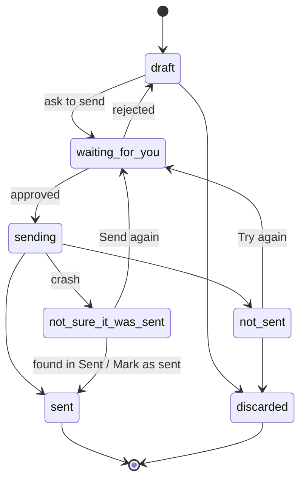

"Try again" and "Send again" are routed through a new card because 04:94 allows only the card to move a draft to *sending*; recorded as (assumed) LD-29.

- Storage: SQLite table `email_drafts` in the journal database, owned by Mail Service.

### SentEmail
- Owner: **Mail Service** (02:402 "sent-email records") · Used by: Journal, Approval Service, App Shell.
- HLD trace: 04:97–99; ADR-070, ADR-071.

```rust
#[derive(Debug, Clone, PartialEq, Serialize, Deserialize)]
#[serde(rename_all = "snake_case")]
pub struct SentEmail {
    pub id: SentEmailId,
    pub email_draft_id: EmailDraftId,
    pub approval_id: ApprovalId,
    pub action_key: ExternalActionKey,
    /// Mail system's message identifier; with the company mail server, ordin's Message-ID recorded before sending.
    pub message_id: String,
    pub sent_at: Timestamp,
    pub recipients: Vec<String>,
    pub attachment_names: Vec<String>,
    pub saved_in_sent: bool,
}
```

| Field | Rule | Error code |
|---|---|---|
| email_draft_id | unique | `MAIL_SENT_DUPLICATE` |
| message_id | 1–998 bytes | `MAIL_MESSAGE_ID_INVALID` |
| row | written once, when the mail system accepts the message (04:99) | `MAIL_SENT_IMMUTABLE` |

- Storage: SQLite table `sent_emails` in the journal database, owned by Mail Service; journal retention (04:406).

---

## Engineering mode and Craft

### Project
- Owner: **Project Service** (02:770 "project records") · Used by: File Service, Rules Engine, MCP Front, Handover Service.
- HLD trace: 04:132–135; ADR-019 to ADR-021.

```rust
#[derive(Debug, Clone, PartialEq, Serialize, Deserialize)]
#[serde(rename_all = "snake_case")]
pub struct Project {
    pub id: ProjectId,
    pub place_id: PlaceId,
    pub display_name: String,
    pub is_git_repository: bool,
    #[serde(skip_serializing_if = "Option::is_none")]
    pub current_branch: Option<String>,
    pub language_servers_in_use: Vec<String>,
    pub check_commands: Vec<String>,
    pub state: ProjectState,
    pub opened_at: Timestamp,
}

#[derive(Debug, Clone, Copy, PartialEq, Eq, Serialize, Deserialize)]
#[serde(rename_all = "snake_case")]
pub enum ProjectState { Opened, Indexed, Closed }
```

| Field | Rule | Error code |
|---|---|---|
| place_id | unique among non-closed projects | `PROJ_PLACE_ALREADY_OPEN` |
| current_branch | present if and only if `is_git_repository` | `PROJ_BRANCH_MISMATCH` |
| check_commands | ≤ 20, each ≤ 1000 chars (assumed) | `PROJ_CHECKS_INVALID` |

| From | Event | To |
|---|---|---|
| — | person opens it | opened |
| opened | indexing completes | indexed |
| opened, indexed | person closes it (no file changed) | closed |
| closed | person opens it again | opened |

```mermaid
stateDiagram-v2
    [*] --> opened
    opened --> indexed
    opened --> closed
    indexed --> closed
    closed --> opened: reopened
```

- Storage: SQLite table `projects` in the journal database, owned by Project Service.

### GithubOperationSetting
- Owner: **Project Service** (02:770 "git operations"; inferred) · Used by: Rules Engine, Approval Service.
- HLD trace: 04:137–139.

```rust
#[derive(Debug, Clone, PartialEq, Serialize, Deserialize)]
#[serde(rename_all = "snake_case")]
pub struct GithubOperationSetting {
    pub id: GithubOperationSettingId,
    pub project_id: ProjectId,
    /// `gh` operation kind; the catalogue of kinds is fixed in /spec (LD-33).
    pub operation_kind: String,
    pub is_write: bool,
    pub approval_required: bool,
    pub set_by: GithubSettingSource,
    pub set_at: Timestamp,
}

#[derive(Debug, Clone, Copy, PartialEq, Eq, Serialize, Deserialize)]
#[serde(rename_all = "snake_case")]
pub enum GithubSettingSource { OrganisationProfile, Engineer }
```

| Field | Rule | Error code |
|---|---|---|
| (project_id, operation_kind) | unique | `GHOP_DUPLICATE` |
| approval_required = false | refused when the profile's ceiling requires approval for the kind (04:139) | `GHOP_ABOVE_CEILING` |
| profile tightens ceiling | row reset to the profile default, `set_by = organisation_profile` | — |

- No state machine (value changes only).
- Storage: SQLite table `github_operation_settings` in the journal database, owned by Project Service.

### LanguagePlugin
- Owner: **Project Service** (02:770 "language-server lifecycles") · Used by: MCP Front (code intelligence), App Shell (editor).
- HLD trace: 04:141–143; ADR-024, ADR-055.

```rust
#[derive(Debug, Clone, PartialEq, Serialize, Deserialize)]
#[serde(rename_all = "snake_case")]
pub struct LanguagePlugin {
    pub id: LanguagePluginId,
    pub language: String,
    pub approved_servers: Vec<String>,
    pub default_server: String,
    #[serde(skip_serializing_if = "Option::is_none")]
    pub chosen_server: Option<String>,
    #[serde(skip_serializing_if = "Option::is_none")]
    pub pinned_version: Option<String>,
    pub source: LanguagePluginSource,
    pub enabled: bool,
    /// The engineer's server settings (JSON object).
    pub server_settings: serde_json::Value,
    pub status: LanguagePluginStatus,
}

#[derive(Debug, Clone, Copy, PartialEq, Eq, Serialize, Deserialize)]
#[serde(rename_all = "snake_case")]
pub enum LanguagePluginSource { AgentPackage, OrganisationProfile }

#[derive(Debug, Clone, Copy, PartialEq, Eq, Serialize, Deserialize)]
#[serde(rename_all = "snake_case")]
pub enum LanguagePluginStatus { Available, Added, Installed, Removed }
```

| Field | Rule | Error code |
|---|---|---|
| language | 1–40 chars (assumed); unique | `LANG_DUPLICATE` |
| default_server, chosen_server | members of `approved_servers` | `LANG_SERVER_NOT_APPROVED` |
| server_settings | JSON object ≤ 64 KiB (assumed) | `LANG_SETTINGS_INVALID` |

| From | Event | To |
|---|---|---|
| — | listed in the profile or a package | available |
| available | engineer adds it in Settings, or first use in a project of the language | added |
| added | installed on first use | installed |
| installed | pin changes | installed (updated) |
| installed | turned off / on (`enabled` toggles; highlighting stays) | installed |
| added, installed | engineer removes it | removed |

```mermaid
stateDiagram-v2
    [*] --> available
    available --> added
    added --> installed: first use
    installed --> installed: pin changed / on-off
    added --> removed
    installed --> removed
```

- Storage: SQLite table `language_plugins` in the journal database, owned by Project Service.

### CodingTask
- Owner: **Project Service** (02:760 coding tasks; 02:770) · Used by: Session Supervisor, Crew Orchestrator, Rules Engine, MCP Front.
- HLD trace: 04:145–148; ADR-053.

```rust
#[derive(Debug, Clone, PartialEq, Serialize, Deserialize)]
#[serde(rename_all = "snake_case")]
pub struct CodingTask {
    pub id: CodingTaskId,
    pub origin: RunOrigin,
    pub project_id: ProjectId,
    pub agent_instance_id: AgentInstanceId,
    pub request: String,
    pub worktree_path: String,
    /// `ordin/<task name>`.
    pub branch: String,
    pub base_branch: String,
    pub base_commit: String,
    #[serde(skip_serializing_if = "Option::is_none")]
    pub attempt_group_id: Option<AttemptGroupId>,
    #[serde(skip_serializing_if = "Option::is_none")]
    pub test_outcome: Option<TestOutcome>,
    pub new_problems: u32,
    pub state: CodingTaskState,
}

#[derive(Debug, Clone, Copy, PartialEq, Eq, Serialize, Deserialize)]
#[serde(rename_all = "snake_case")]
pub enum TestOutcome { Passed, Failed }

#[derive(Debug, Clone, Copy, PartialEq, Eq, Serialize, Deserialize)]
#[serde(rename_all = "snake_case")]
pub enum CodingTaskState { Working, ReadyForReview, Settled, SetAside }
```

| Field | Rule | Error code |
|---|---|---|
| branch | `ordin/` + 1–100 chars `[a-z0-9-]` (assumed), valid git ref | `CODE_BRANCH_INVALID` |
| base_commit | 40 lowercase hex chars | `CODE_COMMIT_INVALID` |
| worktree_path | under the application data root (02:760) | `CODE_WORKTREE_OUTSIDE_ROOT` |
| attempt_group_id | a group holds 2 or more tasks on the same request (04:147) | `CODE_GROUP_TOO_SMALL` |
| request | 1–4000 chars (assumed) | `CODE_REQUEST_INVALID` |

| From | Event | To |
|---|---|---|
| — | task starts in its worktree | working |
| working | run ends with edits | ready_for_review |
| ready_for_review | every change accepted or rejected (worktree and branch removed) | settled |
| working, ready_for_review | another attempt in the group is kept (worktree and branch removed) | set_aside |

```mermaid
stateDiagram-v2
    [*] --> working
    working --> ready_for_review
    ready_for_review --> settled: every change decided
    working --> set_aside: other attempt kept
    ready_for_review --> set_aside: other attempt kept
```

- Storage: SQLite table `coding_tasks` in the journal database, owned by Project Service.

### ChangeSet
- Owner: **Project Service** (02:770 "change sets") · Used by: App Shell (review), Session Supervisor.
- HLD trace: 04:150–152; 02:759.

```rust
#[derive(Debug, Clone, PartialEq, Serialize, Deserialize)]
#[serde(rename_all = "snake_case")]
pub struct ChangeSet {
    pub id: ChangeSetId,
    pub coding_task_id: CodingTaskId,
    pub run_id: RunId,
    pub project_id: ProjectId,
    pub entries: Vec<ChangeSetEntry>,
    pub state: ChangeSetState,
    pub created_at: Timestamp,
}

#[derive(Debug, Clone, PartialEq, Serialize, Deserialize)]
#[serde(rename_all = "snake_case")]
pub struct ChangeSetEntry {
    pub id: ChangeSetEntryId,
    pub file: String,
    /// Unified-diff hunk text.
    pub hunk: String,
    pub state: ChangeEntryState,
}

#[derive(Debug, Clone, Copy, PartialEq, Eq, Serialize, Deserialize)]
#[serde(rename_all = "snake_case")]
pub enum ChangeEntryState { Pending, Accepted, Rejected }

#[derive(Debug, Clone, Copy, PartialEq, Eq, Serialize, Deserialize)]
#[serde(rename_all = "snake_case")]
pub enum ChangeSetState { Open, InReview, Settled }
```

| Field | Rule | Error code |
|---|---|---|
| coding_task_id | unique (one change set per coding task, 04:147) | `CSET_DUPLICATE` |
| entries.hunk | ≤ 1 MiB each (assumed) | `CSET_HUNK_TOO_LARGE` |
| state = settled | no entry `pending` | `CSET_UNDECIDED_ENTRIES` |

| From | Event | To |
|---|---|---|
| — | run starts editing | open |
| open | run ends | in_review |
| in_review | last entry accepted or rejected (rejected reverted) | settled |

```mermaid
stateDiagram-v2
    [*] --> open
    open --> in_review: run ends
    in_review --> settled: every entry decided
```

- Storage: SQLite tables `change_sets` and `change_set_entries` in the journal database, owned by Project Service.

### CraftInstallation
- Owner: **Craft Toolkit** (02:752) · Used by: File Service, MCP Front, Setup Assistant.
- HLD trace: 04:154–156; ADR-016, ADR-017.

```rust
#[derive(Debug, Clone, PartialEq, Serialize, Deserialize)]
#[serde(rename_all = "snake_case")]
pub struct CraftInstallation {
    pub id: CraftInstallationId,
    pub app_name: String,
    pub pinned_version: String,
    #[serde(skip_serializing_if = "Option::is_none")]
    pub installed_version: Option<String>,
    #[serde(skip_serializing_if = "Option::is_none")]
    pub verification_result: Option<VerificationResult>,
    pub cli_modes: Vec<CraftCliMode>,
    pub status: CraftInstallationStatus,
}

#[derive(Debug, Clone, Copy, PartialEq, Eq, Serialize, Deserialize)]
#[serde(rename_all = "snake_case")]
pub enum VerificationResult { Verified, Failed }

#[derive(Debug, Clone, Copy, PartialEq, Eq, Serialize, Deserialize)]
#[serde(rename_all = "snake_case")]
pub enum CraftCliMode { Mcp, Run, Batch }

#[derive(Debug, Clone, Copy, PartialEq, Eq, Serialize, Deserialize)]
#[serde(rename_all = "snake_case")]
pub enum CraftInstallationStatus { Approved, Downloaded, Installed, VerificationFailed, Removed }
```

| Field | Rule | Error code |
|---|---|---|
| app_name | unique; 1–40 chars (assumed) | `CRAFT_DUPLICATE` |
| status = installed | requires `verification_result = verified` | `CRAFT_UNVERIFIED_INSTALL` |

| From | Event | To |
|---|---|---|
| — | approved in the profile | approved |
| approved | downloaded | downloaded |
| downloaded | verification passes, installed | installed |
| downloaded | verification fails | verification_failed |
| installed | pin changes | downloaded |
| any | profile withdraws it | removed |

```mermaid
stateDiagram-v2
    [*] --> approved
    approved --> downloaded
    downloaded --> installed: verified
    downloaded --> verification_failed
    installed --> downloaded: pin changed
    installed --> removed: withdrawn
    approved --> removed: withdrawn
    verification_failed --> removed: withdrawn
```

- Storage: SQLite table `craft_installations` in the journal database, owned by Craft Toolkit.

### FileTypeMapEntry
- Owner: **Craft Toolkit** (02:752 "the file-type map in use") · Used by: File Service, MCP Front.
- HLD trace: 04:158–161; ADR-029, ADR-048.

```rust
#[derive(Debug, Clone, PartialEq, Serialize, Deserialize)]
#[serde(rename_all = "snake_case")]
pub struct FileTypeMapEntry {
    pub id: FileTypeMapEntryId,
    pub extensions: Vec<String>,
    pub media_types: Vec<String>,
    /// App that opens it for the person; `None` = the system's default app.
    #[serde(skip_serializing_if = "Option::is_none")]
    pub open_with_app: Option<String>,
    /// Craft tools agents use to change it; empty = agents do not change it.
    pub craft_tools: Vec<String>,
    pub profile_version: String,
}
```

| Field | Rule | Error code |
|---|---|---|
| extensions | ≥ 1, each `[a-z0-9]{1,16}` without the dot (assumed) | `FTM_EXTENSION_INVALID` |
| extensions | an extension appears in at most one entry | `FTM_EXTENSION_DUPLICATE` |
| media_types | RFC 6838 | `FTM_MEDIA_TYPE_INVALID` |
| row | changed only by a new profile (04:160) | `FTM_IMMUTABLE` |

- Storage: SQLite table `file_type_map_entries` in the journal database, owned by Craft Toolkit.

---

## Tasks, runs and crews

### Task
- Owner: **none named in 02** (Workspace Service records each task's workspace, 02:728; Session Supervisor starts its run) — see *Bubble-up candidates* · Used by: Session Supervisor, Crew Orchestrator, Ordin Host, Home and Search (Run again).
- HLD trace: 04:168–171; ADR-060.

```rust
#[derive(Debug, Clone, PartialEq, Serialize, Deserialize)]
#[serde(rename_all = "snake_case")]
pub struct Task {
    pub id: TaskId,
    pub workspace_id: WorkspaceId,
    pub target: TaskTarget,
    #[serde(skip_serializing_if = "Option::is_none")]
    pub command: Option<String>,
    #[serde(skip_serializing_if = "Option::is_none")]
    pub free_text: Option<String>,
    pub arguments: Vec<TaskArgument>,
    pub attached_artefacts: Vec<ArtefactId>,
    #[serde(skip_serializing_if = "Option::is_none")]
    pub run_again_of: Option<TaskId>,
    pub requested_at: Timestamp,
}

#[derive(Debug, Clone, Copy, PartialEq, Eq, Serialize, Deserialize)]
#[serde(tag = "kind", rename_all = "snake_case")]
pub enum TaskTarget {
    AgentInstance { agent_instance_id: AgentInstanceId },
    RemoteAgent { remote_agent_id: RemoteAgentId },
    Crew { crew_charter_id: CrewCharterId },
}

#[derive(Debug, Clone, PartialEq, Serialize, Deserialize)]
#[serde(rename_all = "snake_case")]
pub struct TaskArgument { pub name: String, pub value: String }
```

| Field | Rule | Error code |
|---|---|---|
| command, free_text | exactly one present | `TASK_COMMAND_XOR_TEXT` |
| command | 1–100 chars (assumed) | `TASK_COMMAND_INVALID` |
| free_text | 1–8000 chars (assumed) | `TASK_TEXT_INVALID` |
| arguments | ≤ 50; name 1–64 chars, value ≤ 4000 chars (assumed) | `TASK_ARGUMENTS_INVALID` |
| row | immutable once submitted (04:171) | `TASK_IMMUTABLE` |

- Storage: SQLite table `tasks` in the journal database; owner pending bubble-up.

### Run
- Owner: **Session Supervisor** (02:491 "run state"); rows written through the Journal (02:672) · Used by: every adapter, Rules Engine, Approval Service, Crew Orchestrator, Usage Planner, MCP Front, Home and Search.
- HLD trace: 04:173–178; ADR-060, ADR-062; A-29; 04:386.

```rust
#[derive(Debug, Clone, PartialEq, Serialize, Deserialize)]
#[serde(rename_all = "snake_case")]
pub struct Run {
    pub id: RunId,
    pub origin: RunOrigin,
    pub agent: AgentRef,
    pub adapter: AdapterKind,
    #[serde(skip_serializing_if = "Option::is_none")]
    pub runtime_session_id: Option<String>,
    #[serde(skip_serializing_if = "Option::is_none")]
    pub remote_run_id: Option<String>,
    #[serde(skip_serializing_if = "Option::is_none")]
    pub remote_thread_id: Option<String>,
    pub state: RunState,
    #[serde(skip_serializing_if = "Option::is_none")]
    pub pause_reason: Option<RunPauseReason>,
    pub limits: RunLimits,
    pub usage: UsageCounters,
    #[serde(skip_serializing_if = "Option::is_none")]
    pub started_at: Option<Timestamp>,
    #[serde(skip_serializing_if = "Option::is_none")]
    pub ended_at: Option<Timestamp>,
    #[serde(skip_serializing_if = "Option::is_none")]
    pub end_reason: Option<String>,
    pub inputs_used: Vec<InputUsed>,
    pub queued_at: Timestamp,
}

#[derive(Debug, Clone, Copy, PartialEq, Eq, Serialize, Deserialize)]
#[serde(tag = "kind", rename_all = "snake_case")]
pub enum RunOrigin {
    Task { task_id: TaskId },
    CrewRound { crew_run_id: CrewRunId, round_number: u32 },
    /// Ordin's conversation run for one workspace (amended January 2026, decision 80).
    Conversation { workspace_id: WorkspaceId },
}

// `AdapterKind` is defined once, in part 2 (wire §2, `ordin_types::wire::run`), with the
// variant `HostedAgent` (ADR-098), stored `hosted_agent`; this module re-exports it
// (amended January 2026, decision 80: C-1, C-3).
pub use crate::wire::run::AdapterKind;

#[derive(Debug, Clone, Copy, PartialEq, Eq, Serialize, Deserialize)]
#[serde(rename_all = "snake_case")]
pub enum RunState {
    Queued, Running, Paused,
    Completed, Failed, StoppedAtLimit, Cancelled, Interrupted, Abandoned, NoReply,
}

#[derive(Debug, Clone, Copy, PartialEq, Eq, Serialize, Deserialize)]
#[serde(rename_all = "snake_case")]
pub enum RunPauseReason { Approval, SignIn, Person }

// `RunLimits` is defined once, in part 2 (wire §2, `ordin_types::wire::run`), with
// `request_budget: Option<u32>` (no default ceiling until OQ-3); this module re-exports it
// (amended January 2026, decision 80: C-1, C-4).
pub use crate::wire::run::RunLimits;

/// Turns, tool calls, level, tokens and cache share where the harness reports them (ADR-062).
#[derive(Debug, Clone, PartialEq, Serialize, Deserialize)]
#[serde(rename_all = "snake_case")]
pub struct UsageCounters {
    pub model_turns: u32,
    pub tool_calls: u32,
    #[serde(skip_serializing_if = "Option::is_none")]
    pub model_level: Option<String>,
    #[serde(skip_serializing_if = "Option::is_none")]
    pub tokens: Option<u64>,
    #[serde(skip_serializing_if = "Option::is_none")]
    pub tokens_from_cache: Option<u64>,
}
```

The "share served from cache" (04:174) is derived as `tokens_from_cache / tokens`; storing two integers avoids a float.

| Field | Rule | Error code |
|---|---|---|
| adapter | `claude_local`/`copilot_local` only with `agent.kind = agent_instance`; `hosted_agent`/`slack_thread` only with `remote_agent` | `RUNST_ADAPTER_MISMATCH` |
| pause_reason | present if and only if `state = paused` | `RUNST_PAUSE_REASON_MISMATCH` |
| state = no_reply | only with `adapter = slack_thread` (04:178) | `RUNST_NO_REPLY_NOT_SLACK` |
| state = abandoned | only with a remote adapter (04:178) | `RUNST_ABANDONED_NOT_REMOTE` |
| ended_at | present if and only if the state is an ended state | `RUNST_ENDED_AT_MISMATCH` |
| end_reason | ≤ 500 chars (assumed) | `RUNST_END_REASON_TOO_LONG` |
| limits | each ≥ 1 (`request_budget` when present) and within the profile's maxima | `RUNST_LIMIT_OUT_OF_RANGE` |
| tokens_from_cache | ≤ tokens | `RUNST_CACHE_EXCEEDS_TOKENS` |
| inputs_used | ≤ 100 (assumed) | `RUNST_INPUTS_TOO_MANY` |
| pruning | in-progress runs never pruned (04:386) | — |

| From | Event | To |
|---|---|---|
| — | submitted | queued |
| queued | session started | running |
| running | awaiting approval, sign-in or the person | paused |
| paused | resumed | running |
| running | finishes | completed |
| running | error | failed |
| running | a limit reached | stopped_at_limit |
| queued, running, paused | person or crew cancels | cancelled |
| running, paused | application restart, not resumable | interrupted |
| running | application stops waiting for a remote run | abandoned |
| running | no Slack reply within the limit | no_reply |

```mermaid
stateDiagram-v2
    [*] --> queued
    queued --> running
    running --> paused
    paused --> running
    running --> completed
    running --> failed
    running --> stopped_at_limit
    queued --> cancelled
    running --> cancelled
    paused --> cancelled
    running --> interrupted
    paused --> interrupted
    running --> abandoned
    running --> no_reply
```

- Storage: SQLite table `runs` in the journal database, owned by Session Supervisor.

### StartupReport
- Owner: **unclear** — stored with the run or crew run (04:255), so the **Journal and Artefact Store** holds it; no component is named as generating it on the desktop (the Agent Loader builds it in the agent profile, 02:297) — see *Bubble-up candidates* · Used by: Session Supervisor, Crew Orchestrator, App Shell (Diagnostics), Release Builder.
- HLD trace: 04:253–255; G9; 02:297. The report's interchange form is in 08 — Interfaces (wire half); this is the persisted record.

```rust
#[derive(Debug, Clone, PartialEq, Serialize, Deserialize)]
#[serde(rename_all = "snake_case")]
pub struct StartupReport {
    pub id: StartupReportId,
    pub subject: StartupSubject,
    pub enforced_rules: Vec<String>,
    pub rules_not_enforced: Vec<RuleNotEnforced>,
    pub unavailable_parts: Vec<String>,
    pub available_tools: Vec<String>,
    pub adapter_verbs_not_offered: Vec<String>,
    pub generated_at: Timestamp,
}

#[derive(Debug, Clone, Copy, PartialEq, Eq, Serialize, Deserialize)]
#[serde(tag = "kind", rename_all = "snake_case")]
pub enum StartupSubject {
    Run { run_id: RunId },
    CrewRun { crew_run_id: CrewRunId },
    AgentRelease { agent_release_id: AgentReleaseId },
}

#[derive(Debug, Clone, PartialEq, Serialize, Deserialize)]
#[serde(rename_all = "snake_case")]
pub struct RuleNotEnforced { pub rule: String, pub reason: String }
```

| Field | Rule | Error code |
|---|---|---|
| subject | one report per subject per start | `START_DUPLICATE` |
| each list | ≤ 500 items, each ≤ 500 chars (assumed) | `START_LIST_TOO_LONG` |
| rules_not_enforced.reason | 1–500 chars (assumed) | `START_REASON_MISSING` |

- Storage: SQLite table `startup_reports` in the journal database, owned by Journal and Artefact Store (pending bubble-up).

### ToolRequest
- Owner: **Journal and Artefact Store** (02:672 "tool requests, rule decisions"); decided by **Rules Engine** · Used by: Hook Relay, MCP Front, Approval Service, Session Supervisor.
- HLD trace: 04:190–192; ADR-005, ADR-007, ADR-045.

```rust
#[derive(Debug, Clone, PartialEq, Serialize, Deserialize)]
#[serde(rename_all = "snake_case")]
pub struct ToolRequest {
    pub id: ToolRequestId,
    pub run_id: RunId,
    pub tool: String,
    pub arguments_digest: Sha256Hex,
    #[serde(skip_serializing_if = "Option::is_none")]
    pub decision: Option<ToolRequestDecision>,
    #[serde(skip_serializing_if = "Option::is_none")]
    pub deciding_rule: Option<String>,
    #[serde(skip_serializing_if = "Option::is_none")]
    pub approval_id: Option<ApprovalId>,
    pub state: ToolRequestState,
    pub requested_at: Timestamp,
}

#[derive(Debug, Clone, Copy, PartialEq, Eq, Serialize, Deserialize)]
#[serde(rename_all = "snake_case")]
/// The stored verdict of a Tool request. Renamed from `ToolDecision` (amended January 2026,
/// decision 80: C-2); the wire `ToolDecision` (part 2 §3, the Rules Engine's full decision
/// with its `Verdict`) keeps its name.
pub enum ToolRequestDecision { Allow, Deny, Ask }

#[derive(Debug, Clone, Copy, PartialEq, Eq, Serialize, Deserialize)]
#[serde(rename_all = "snake_case")]
pub enum ToolRequestState { Requested, Decided, Executed, Refused }
```

| Field | Rule | Error code |
|---|---|---|
| tool | 1–200 chars (assumed) | `TREQ_NAME_INVALID` |
| decision, deciding_rule | present from `decided` on | `TREQ_UNDECIDED` |
| approval_id | present if and only if `decision = ask` once decided by the person | `TREQ_APPROVAL_MISMATCH` |
| row | immutable after `executed` or `refused` (04:192) | `TREQ_IMMUTABLE` |

| From | Event | To |
|---|---|---|
| — | session asks for a tool call | requested |
| requested | Rules Engine decides (ask → approval) | decided |
| decided | allowed or approved; executed | executed |
| decided | denied or rejected | refused |

```mermaid
stateDiagram-v2
    [*] --> requested
    requested --> decided
    decided --> executed
    decided --> refused
```

- Storage: SQLite table `tool_requests` in the journal database, owned by Journal and Artefact Store; also PostgreSQL in the agent profile scaled shape (journal on PostgreSQL, 02:248).

### Approval
- Owner: **Approval Service** (02:656 "approval records") · Used by: Rules Engine, Session Supervisor, Crew Orchestrator, Mail Service, Push Service, Channel Gateway, Remote API, Handover Service, App Shell.
- HLD trace: 04:194–196; 04:386.

```rust
#[derive(Debug, Clone, PartialEq, Serialize, Deserialize)]
#[serde(rename_all = "snake_case")]
pub struct Approval {
    pub id: ApprovalId,
    /// Who asked: a run, a crew round, or the person (person-initiated cards such as a push,
    /// a handover, an email or a Telegram post started from a screen); amended January 2026, decision 80: C-19.
    pub asked_by: ApprovalAsker,
    /// Absent for an `ApprovalAsker::Person` card.
    #[serde(skip_serializing_if = "Option::is_none")]
    pub subject: Option<ApprovalSubject>,
    pub action: String,
    pub destination: String,
    pub affected_records: Vec<String>,
    pub consequence: String,
    pub state: ApprovalState,
    #[serde(skip_serializing_if = "Option::is_none")]
    pub decided_by: Option<String>,
    #[serde(skip_serializing_if = "Option::is_none")]
    pub decided_at: Option<Timestamp>,
    pub created_at: Timestamp,
}

/// "run or crew round" (04:195).
#[derive(Debug, Clone, Copy, PartialEq, Eq, Serialize, Deserialize)]
#[serde(tag = "kind", rename_all = "snake_case")]
pub enum ApprovalSubject {
    Run { run_id: RunId },
    CrewRound { crew_run_id: CrewRunId, round_number: u32 },
}

// `ApprovalAsker { Run, CrewRound, Person }` is defined once, in part 2 (§5, `ordin_types::wire::approval`);
// this module re-exports it (amended January 2026, decision 80: C-19).
pub use crate::wire::approval::ApprovalAsker;

#[derive(Debug, Clone, Copy, PartialEq, Eq, Serialize, Deserialize)]
#[serde(rename_all = "snake_case")]
pub enum ApprovalState { Pending, Approved, Rejected, Expired }
```

(`ApprovalSubject` differs from `RunOrigin` because an approval names a run, not a task.)

| Field | Rule | Error code |
|---|---|---|
| action | 1–500 chars (assumed) | `APPR_ACTION_INVALID` |
| destination | 1–2048 chars (assumed) | `APPR_DESTINATION_INVALID` |
| consequence | 1–2000 chars (assumed) | `APPR_CONSEQUENCE_INVALID` |
| affected_records | ≤ 1000 entries (assumed) | `APPR_RECORDS_TOO_MANY` |
| decided_by, decided_at | present if and only if state ∈ {approved, rejected} | `APPR_DECISION_MISMATCH` |
| decision | only from `pending` | `APPR_ALREADY_DECIDED` |
| pruning | never pruned while `pending` (04:386) | — |

| From | Event | To |
|---|---|---|
| — | rule decides "ask" | pending |
| pending | person approves | approved |
| pending | person rejects | rejected |
| pending | its run ends first | expired |
| pending (`asked_by = person`) | never expires on its own; closed by the asking component only when it has a run (amended January 2026, decision 80: C-19) | — |
| pending | application restarts | pending (survives) |

```mermaid
stateDiagram-v2
    [*] --> pending
    pending --> approved
    pending --> rejected
    pending --> expired: run ended first
    pending --> pending: restart
```

- Storage: SQLite table `approvals` in the journal database, owned by Approval Service; also PostgreSQL in the agent profile scaled shape.

### ExternalAction
- Owner: **Journal and Artefact Store** (02:673 "external actions, each with a unique action key") · Used by: Session Supervisor (recovery), Mail Service, Push Service, Slack Thread Adapter, wrightrun HTTP Adapter, Telegram Service, Confluence Adapter, SharePoint Adapter.
- HLD trace: 04:198–200; G8.

```rust
#[derive(Debug, Clone, PartialEq, Serialize, Deserialize)]
#[serde(rename_all = "snake_case")]
pub struct ExternalAction {
    pub action_key: ExternalActionKey,
    /// Absent for an action the person started outside any run (a push, a handover, a post
    /// from a screen); amended January 2026, decision 80: C-7.
    #[serde(skip_serializing_if = "Option::is_none")]
    pub run_id: Option<RunId>,
    pub kind: ExternalActionKind,
    pub destination: String,
    pub state: ExternalActionState,
    pub sent_at: Timestamp,
    #[serde(skip_serializing_if = "Option::is_none")]
    pub confirmed_at: Option<Timestamp>,
}

/// Kinds named across 04: Slack post (04:198), declared-connection write (04:198), wrightrun run start (04:198),
/// email send (04:98), origin push (04:103), copy publish (04:125), Telegram post (04:295);
/// pull request opened and handover written (amended January 2026, decision 80: C-7).
#[derive(Debug, Clone, Copy, PartialEq, Eq, Serialize, Deserialize)]
#[serde(rename_all = "snake_case")]
pub enum ExternalActionKind {
    SlackPost, ConnectionWrite, WrightrunRunStart, EmailSend, OriginPush, CopyPublish, TelegramPost,
    PullRequestOpened, HandoverWritten,
}

#[derive(Debug, Clone, Copy, PartialEq, Eq, Serialize, Deserialize)]
#[serde(rename_all = "snake_case")]
pub enum ExternalActionState { Sent, Confirmed, UnknownOutcome }
```

| Field | Rule | Error code |
|---|---|---|
| action_key | unique; written before the action leaves the application | `EXT_KEY_DUPLICATE` |
| destination | 1–2048 chars (assumed) | `EXT_DESTINATION_INVALID` |
| resend | never resent automatically (04:200) | `EXT_AUTO_RESEND` |

| From | Event | To |
|---|---|---|
| — | action sent | sent |
| sent | destination confirms | confirmed |
| sent | crash before confirmation | unknown_outcome |
| unknown_outcome | the person confirms the action went out (amended January 2026, decision 80: C-7) | confirmed |

```mermaid
stateDiagram-v2
    [*] --> sent
    sent --> confirmed
    sent --> unknown_outcome: crash
    unknown_outcome --> confirmed: person confirms
```

- Storage: SQLite table `external_actions` in the journal database, owned by Journal and Artefact Store; also PostgreSQL in the agent profile scaled shape.

### ReusedAnswer
- Owner: **Usage Planner** (02:366 "the answer-reuse index"; 04:188 calls it a journal entry — see *HLD inconsistencies*) · Used by: Ordin Host, Session Supervisor.
- HLD trace: 04:188; ADR-062.

```rust
#[derive(Debug, Clone, PartialEq, Serialize, Deserialize)]
#[serde(rename_all = "snake_case")]
pub struct ReusedAnswer {
    pub id: ReusedAnswerId,
    pub request: String,
    pub agent: AgentRef,
    pub workspace_id: WorkspaceId,
    pub input_versions: Vec<InputUsed>,
    pub source_run_id: RunId,
    /// The earlier answer, shown again when nothing has changed (ADR-062; amended January 2026, orchestrator decision F2).
    pub text: String,
    pub answered_at: Timestamp,
    pub shown_again_at: Timestamp,
    pub expires_at: Timestamp,
}
```

| Field | Rule | Error code |
|---|---|---|
| expires_at | = `answered_at` + 7 days (04:188) | `REUSE_EXPIRY_INVALID` |
| reuse | refused when any input has a newer version (04:188) | `REUSE_INPUT_NEWER` |
| request | 1–8000 chars (assumed) | `REUSE_REQUEST_INVALID` |

- Storage: SQLite table `reused_answers` in the journal database, owned by Usage Planner.

### CrewCharter
- Owner: **Ordin Host** (02:345 "saved charters") · Used by: Crew Orchestrator, Workspace Service, Rules Engine.
- HLD trace: 04:206–215; ADR-006, ADR-027, ADR-064; UX-A35.

```rust
#[derive(Debug, Clone, PartialEq, Serialize, Deserialize)]
#[serde(rename_all = "snake_case")]
pub struct CrewCharter {
    pub id: CrewCharterId,
    pub workspace_id: WorkspaceId,
    #[serde(skip_serializing_if = "Option::is_none")]
    pub name: Option<String>,
    pub purpose: String,
    pub charter_version: u32,
    /// Ordin from revision 0.8.0; no other value exists.
    pub coordinator: CoordinatorKind,
    pub members: Vec<CrewMember>,
    pub allowed_handoffs: Vec<Handoff>,
    pub guardrails: Guardrails,
    pub input_fields: Vec<String>,
    #[serde(skip_serializing_if = "Option::is_none")]
    pub workflow_id: Option<WorkflowId>,
    #[serde(skip_serializing_if = "Option::is_none")]
    pub workflow_version: Option<u32>,
    pub steps: Vec<WorkflowStep>,
    pub state: CrewCharterState,
    pub written_at: Timestamp,
}

#[derive(Debug, Clone, Copy, PartialEq, Eq, Serialize, Deserialize)]
#[serde(rename_all = "snake_case")]
/// Renamed from `Coordinator` (amended January 2026, decision 80: C-6), because `Coordinator` is the
/// Crew Orchestrator's hub trait (2B-1 rule 4, ADR-100). Stored value unchanged: `ordin`.
pub enum CoordinatorKind { Ordin }

#[derive(Debug, Clone, PartialEq, Serialize, Deserialize)]
#[serde(rename_all = "snake_case")]
pub struct CrewMember { pub member: AgentRef, pub role: String }

#[derive(Debug, Clone, Copy, PartialEq, Eq, Serialize, Deserialize)]
#[serde(rename_all = "snake_case")]
pub struct Handoff { pub from: AgentRef, pub to: AgentRef }

#[derive(Debug, Clone, PartialEq, Serialize, Deserialize)]
#[serde(rename_all = "snake_case")]
pub struct Guardrails {
    pub max_rounds: u32,
    pub wall_clock_secs: u32,
    pub request_budget: u32,
    pub max_members_running: u32,
    pub members_allowed_external_actions: Vec<AgentRef>,
    pub approval_points: Vec<String>,
    pub failure_repeat_limit: u32,
}

#[derive(Debug, Clone, Copy, PartialEq, Eq, Serialize, Deserialize)]
#[serde(rename_all = "snake_case")]
pub enum CrewCharterState { Written, Valid, Started, Kept, Discarded, Archived }
```

| Field | Rule | Error code |
|---|---|---|
| name | present when `kept`; 1–80 chars (assumed, matches workflow names) | `CHRT_NAME_INVALID` |
| purpose | 1–2000 chars (assumed) | `CHRT_PURPOSE_INVALID` |
| members | 1–20 (assumed); every member installed or in the remote agent catalogue | `CHRT_MEMBER_UNKNOWN` |
| members.role | 1–200 chars (assumed) | `CHRT_ROLE_INVALID` |
| allowed_handoffs | both ends are members | `CHRT_HANDOFF_INVALID` |
| guardrails | each value ≥ 1 and at or below the profile's maximum | `CHRT_GUARDRAIL_ABOVE_MAX` |
| members_allowed_external_actions | subset of members | `CHRT_EXTERNAL_NOT_MEMBER` |
| start | nothing starts until the person presses **Start** (UX-A35) | `CHRT_NOT_STARTED_BY_PERSON` |

| From | Event | To |
|---|---|---|
| — | Ordin Host writes it when Ordin forms a crew | written |
| written | checked against installed instances and the catalogue | valid |
| valid | person presses **Start** | started |
| started | crew run ends, not kept | discarded |
| started | person asks to keep it | kept |
| kept | archived | archived |

```mermaid
stateDiagram-v2
    [*] --> written
    written --> valid: checked
    valid --> started: person presses Start
    started --> discarded: used once
    started --> kept: kept on request
    kept --> archived
```

- Storage: SQLite table `crew_charters` in the journal database, owned by Ordin Host.

### CrewRun
- Owner: **Crew Orchestrator** (02:666 "crew runs, rounds and guardrail counters") · Used by: Session Supervisor, Ordin Host, Approval Service, Workspace Service, Trigger Service.
- HLD trace: 04:217–220; ADR-006, ADR-060, ADR-064; A-29.

```rust
#[derive(Debug, Clone, PartialEq, Serialize, Deserialize)]
#[serde(rename_all = "snake_case")]
pub struct CrewRun {
    pub id: CrewRunId,
    pub workspace_id: WorkspaceId,
    pub crew_charter_id: CrewCharterId,
    pub charter_version: u32,
    #[serde(skip_serializing_if = "Option::is_none")]
    pub workflow_id: Option<WorkflowId>,
    #[serde(skip_serializing_if = "Option::is_none")]
    pub workflow_version: Option<u32>,
    /// Step position from which Ordin took over, in the workflow's display numbering (for
    /// example `"2.3"`); text because positions inside branches and loops are dotted
    /// (amended January 2026, decision 80).
    #[serde(skip_serializing_if = "Option::is_none")]
    pub taken_over_from_step: Option<String>,
    pub inputs: Vec<InputUsed>,
    pub state: CrewRunState,
    #[serde(skip_serializing_if = "Option::is_none")]
    pub pause_reason: Option<CrewPauseReason>,
    pub round_counter: u32,
    pub budget: CrewBudgetCounters,
    #[serde(skip_serializing_if = "Option::is_none")]
    pub end_reason: Option<String>,
    pub started_at: Timestamp,
    #[serde(skip_serializing_if = "Option::is_none")]
    pub ended_at: Option<Timestamp>,
}

#[derive(Debug, Clone, Copy, PartialEq, Eq, Serialize, Deserialize)]
#[serde(rename_all = "snake_case")]
pub enum CrewRunState { Starting, Running, Paused, Finished, Escalated, StoppedAtLimit, Killed, Failed }

#[derive(Debug, Clone, Copy, PartialEq, Eq, Serialize, Deserialize)]
#[serde(rename_all = "snake_case")]
pub enum CrewPauseReason { Approval, Restart, Escalation }

#[derive(Debug, Clone, Copy, PartialEq, Eq, Serialize, Deserialize)]
#[serde(rename_all = "snake_case")]
pub struct CrewBudgetCounters { pub requests_used: u32, pub wall_clock_used_secs: u32, pub repeated_failures: u32 }
```

| Field | Rule | Error code |
|---|---|---|
| workflow_id, workflow_version | both present or both absent | `CREW_WORKFLOW_MISMATCH` |
| round_counter | ≤ charter `max_rounds` | `CREW_ROUNDS_EXCEEDED` |
| budget.requests_used | ≤ charter `request_budget` | `CREW_BUDGET_EXCEEDED` |
| pause_reason | present if and only if `state = paused` | `CREW_PAUSE_REASON_MISMATCH` |
| end_reason | ≤ 500 chars (assumed) | `CREW_END_REASON_TOO_LONG` |

| From | Event | To |
|---|---|---|
| — | person presses **Start** | starting |
| starting | first round begins | running |
| running | approval, restart or escalation | paused |
| paused | resumed | running |
| running | coordinator finishes | finished |
| running, paused | escalated to the person | escalated |
| running | a guardrail limit reached | stopped_at_limit |
| starting, running, paused | person stops it | killed |
| starting, running | unrecoverable error | failed |

```mermaid
stateDiagram-v2
    [*] --> starting
    starting --> running
    running --> paused
    paused --> running
    running --> finished
    running --> escalated
    paused --> escalated
    running --> stopped_at_limit
    starting --> killed
    running --> killed
    paused --> killed
    starting --> failed
    running --> failed
```

- Storage: SQLite table `crew_runs` in the journal database, owned by Crew Orchestrator.

### Round
- Owner: **Crew Orchestrator** (02:666) · Used by: Approval Service, Session Supervisor, App Shell.
- HLD trace: 04:249–251.

```rust
#[derive(Debug, Clone, PartialEq, Serialize, Deserialize)]
#[serde(rename_all = "snake_case")]
pub struct Round {
    pub crew_run_id: CrewRunId,
    pub number: u32,
    pub coordinator_decision: String,
    pub guardrail_decisions: Vec<String>,
    pub member_runs: Vec<RunId>,
    pub opened_at: Timestamp,
    #[serde(skip_serializing_if = "Option::is_none")]
    pub closed_at: Option<Timestamp>,
}
```

| Field | Rule | Error code |
|---|---|---|
| (crew_run_id, number) | primary key; number starts at 1, no gaps | `ROUND_NUMBER_GAP` |
| coordinator_decision | 1–4000 chars (assumed) | `ROUND_DECISION_INVALID` |
| member_runs | ≤ charter `max_members_running` running at once | `ROUND_TOO_MANY_RUNNING` |
| row | immutable once `closed_at` set (04:251) | `ROUND_IMMUTABLE` |

- Storage: SQLite table `rounds` in the journal database, owned by Crew Orchestrator.

### Workflow
- Owner: **Ordin Host** (02:345 "workflows and their versions"; Trigger Service reads them from the Workspace Service, 02:636 — see *HLD inconsistencies*) · Used by: Crew Orchestrator, Trigger Service, Workspace Service, Push Service (sharing), Project Service (`gh`).
- HLD trace: 04:222–233; ADR-064, ADR-065, ADR-066; 04:390. The exported file form (`.workflow.yaml`) is in the wire half.

```rust
#[derive(Debug, Clone, PartialEq, Serialize, Deserialize)]
#[serde(rename_all = "snake_case")]
pub struct Workflow {
    pub id: WorkflowId,
    pub workspace_id: WorkspaceId,
    pub name: String,
    pub state: WorkflowState,
    pub origin: WorkflowOrigin,
    #[serde(skip_serializing_if = "Option::is_none")]
    pub shared: Option<WorkflowShare>,
    pub created_at: Timestamp,
}

#[derive(Debug, Clone, PartialEq, Serialize, Deserialize)]
#[serde(rename_all = "snake_case")]
pub struct WorkflowVersion {
    pub workflow_id: WorkflowId,
    pub version: u32,
    pub purpose: String,
    pub change_note: String,
    pub inputs: Vec<WorkflowInput>,
    pub agents: Vec<WorkflowAgent>,
    pub steps: Vec<WorkflowStep>,
    /// The format 3 file's limits (part 2 §8), so a saved version and its file carry the same
    /// values (amended January 2026, decision 80: C-24).
    pub limits: crate::wire::workflow_file::WorkflowFileLimits,
    /// Set when made by **Restore** (equal to an earlier version).
    #[serde(skip_serializing_if = "Option::is_none")]
    pub restored_from_version: Option<u32>,
    pub saved_at: Timestamp,
}

#[derive(Debug, Clone, PartialEq, Serialize, Deserialize)]
#[serde(rename_all = "snake_case")]
pub struct WorkflowInput { pub label: String, pub kind: WorkflowInputKind, pub required: bool }

// `WorkflowInputKind` is defined once, in part 2 (§8, `ordin_types::wire::workflow_file`),
// with the variants `Document`, `Text`, `List` (2C I-1); this module re-exports it
// (amended January 2026, decision 80: C-1).
pub use crate::wire::workflow_file::WorkflowInputKind;

#[derive(Debug, Clone, PartialEq, Serialize, Deserialize)]
#[serde(rename_all = "snake_case")]
pub struct WorkflowAgent {
    /// Short local name the steps use, unique in the version (format 3 `key`; amended January 2026, decision 80: C-24).
    pub key: String,
    /// Format 3 agent identity: the repository (profile key or address) and the `urn:ordin:`
    /// WorkspaceProfile identifier (amended January 2026, decision 80: C-24).
    pub repository: crate::wire::workflow_file::AgentRepositoryRef,
    pub id: String,
    pub agent: AgentRef,
    pub package: String,
    /// Range of versions it was saved with, e.g. `>=1.2.0, <2.0.0`.
    pub version_range: String,
    pub role: String,
}

#[derive(Debug, Clone, PartialEq, Serialize, Deserialize)]
#[serde(tag = "kind", rename_all = "snake_case")]
pub enum WorkflowOrigin {
    SavedFromCrewRun { crew_run_id: CrewRunId },
    DraftedByOrdin,
    Duplicated { from_workflow_id: WorkflowId, from_version: u32 },
    Imported { file_name: String, imported_on: Timestamp },
}

#[derive(Debug, Clone, Copy, PartialEq, Eq, Serialize, Deserialize)]
#[serde(rename_all = "snake_case")]
pub enum WorkflowState { NotSavedYet, Saved, NeedsAgents }

#[derive(Debug, Clone, PartialEq, Serialize, Deserialize)]
#[serde(rename_all = "snake_case")]
pub struct WorkflowShare {
    pub host: ShareHost,
    pub repository: String,
    pub folder: String,
    pub file_name: String,
    pub followed_date: Timestamp,
    pub followed_by: String,
    pub followed_commit: String,
    pub changed_here_not_sent: bool,
    pub newer_in_repository: bool,
}

#[derive(Debug, Clone, Copy, PartialEq, Eq, Serialize, Deserialize)]
#[serde(rename_all = "snake_case")]
pub enum ShareHost { Github, Gitlab }
```

| Field | Rule | Error code |
|---|---|---|
| name | required, ≤ 80 chars (04:233) | `WFF_NAME_EMPTY`, `WFF_NAME_TOO_LONG` |
| name | unique among the workspace's workflows (04:233) | `WFF_NAME_DUPLICATE` |
| purpose | 1–2000 chars (assumed) | `WFF_PURPOSE_INVALID` |
| change_note | one line, 1–200 chars (assumed) | `WFF_CHANGE_NOTE_INVALID` |
| inputs.label | 1–80 chars (assumed); unique per version | `WFF_INPUT_LABEL_INVALID` |
| agents.role | one line, 1–200 chars (assumed) | `WFF_AGENT_ROLE_INVALID` |
| agents | every agent in the workspace, else state `needs_agents` | — |
| limits | each at or below the company's maximum (04:228) | `WFF_LIMIT_ABOVE_MAX` |
| version | starts at 1, +1 per **Save** or **Restore** | `WFF_VERSION_GAP` |
| any version | that fails the core's check is never saved (04:233) | `WFF_CHECK_FAILED` |
| followed_commit | 40 lowercase hex chars | `WFF_COMMIT_INVALID` |

| From | Event | To |
|---|---|---|
| — | drafted from a run, by Ordin, by duplicating or by importing | not_saved_yet |
| not_saved_yet | **Save** passes the check (version 1) | saved |
| saved | **Save** / **Restore** (new version) | saved |
| saved | an agent it uses leaves the workspace | needs_agents |
| needs_agents | the agent returns, or a saved version drops it | saved |
| any | person removes it | (rows deleted) |

```mermaid
stateDiagram-v2
    [*] --> not_saved_yet
    not_saved_yet --> saved: Save (version 1)
    saved --> saved: Save / Restore
    saved --> needs_agents
    needs_agents --> saved
    saved --> [*]: removed
    needs_agents --> [*]: removed
    not_saved_yet --> [*]: removed
```

- Storage: SQLite tables `workflows` and `workflow_versions` in the journal database, owned by Ordin Host. A version's content (inputs, agents, steps, limits) is stored as the format 3 file body (part 2 §8), which the fields above mirror (amended January 2026, decision 80: C-24).

### WorkflowStep
- Owner: **Ordin Host** (part of a workflow version) · Used by: Crew Orchestrator, Trigger Service.
- HLD trace: 04:235–237; ADR-064, ADR-065.

```rust
#[derive(Debug, Clone, PartialEq, Serialize, Deserialize)]
#[serde(tag = "kind", rename_all = "snake_case")]
pub enum WorkflowStep {
    Agent(AgentStep),
    If(IfBlock),
    Each(EachBlock),
    Until(UntilBlock),
    Call(CallBlock),
}

#[derive(Debug, Clone, PartialEq, Serialize, Deserialize)]
#[serde(rename_all = "snake_case")]
pub struct AgentStep {
    /// Format 3 display number ("3", "2.1", "3a"); steps sharing a number with letters run at
    /// the same time (amended January 2026, decision 80: C-24).
    pub position: String,
    /// Steps sharing a group start at the same time; derived from the position's letters.
    #[serde(skip_serializing_if = "Option::is_none")]
    pub group: Option<u32>,
    pub agent: AgentRef,
    pub line: String,
    pub uses: Vec<StepUse>,
    pub asks_first: bool,
    pub ordin_checks_result: bool,
    pub if_it_fails: IfItFails,
}

/// `domain::runs::StepUse` — the saved workflow's step input. A distinct type from
/// `wire::workflow_file::StepUse` (part 2 §8, the file format's); the Ordin Host converts
/// between them on import and export (amended January 2026, decision 80: C-1, namespaced).
#[derive(Debug, Clone, PartialEq, Serialize, Deserialize)]
#[serde(tag = "kind", rename_all = "snake_case")]
pub enum StepUse {
    Input { label: String },
    Result { position: String },
}

// `IfItFails` is defined once, in part 2 (§8, `ordin_types::wire::workflow_file`), with
// `#[default] OrdinTakesOver`; this module re-exports it (amended January 2026, decision 80: C-1).
pub use crate::wire::workflow_file::IfItFails;

#[derive(Debug, Clone, PartialEq, Serialize, Deserialize)]
#[serde(rename_all = "snake_case")]
pub struct IfBlock { pub position: String, pub condition: Condition, pub paths: Vec<NamedPath> }

/// `domain::runs::NamedPath` — distinct from `wire::workflow_file::NamedPath` (part 2 §8);
/// converted by the Ordin Host on import and export (amended January 2026, decision 80: C-1, namespaced).
#[derive(Debug, Clone, PartialEq, Serialize, Deserialize)]
#[serde(rename_all = "snake_case")]
pub struct NamedPath { pub name: String, pub steps: Vec<WorkflowStep> }

#[derive(Debug, Clone, PartialEq, Serialize, Deserialize)]
#[serde(rename_all = "snake_case")]
pub struct EachBlock { pub position: String, pub list: StepUse, pub maximum: u32, pub steps: Vec<WorkflowStep> }

#[derive(Debug, Clone, PartialEq, Serialize, Deserialize)]
#[serde(rename_all = "snake_case")]
pub struct UntilBlock { pub position: String, pub condition: Condition, pub maximum: u32, pub steps: Vec<WorkflowStep> }

#[derive(Debug, Clone, PartialEq, Serialize, Deserialize)]
#[serde(rename_all = "snake_case")]
pub struct CallBlock { pub position: String, pub workflow_id: WorkflowId }

#[derive(Debug, Clone, PartialEq, Serialize, Deserialize)]
#[serde(tag = "decided_by", rename_all = "snake_case")]
pub enum Condition {
    /// Kind catalogue fixed in /spec (LD-34).
    Application { condition_kind: String, looks_at_position: String },
    Ordin { words: String },
    Person { words: String },
}
```

| Field | Rule | Error code |
|---|---|---|
| line | one sentence, 1–200 chars (assumed) | `STEP_LINE_INVALID` |
| uses | only inputs and results of earlier steps that exist on the step's path (04:237) | `STEP_USES_LATER_OR_ABSENT` |
| group | holds at most the company's maximum of agents running at once (04:237) | `STEP_GROUP_TOO_LARGE` |
| if.paths | 2–4 named paths (04:237); names 1–40 chars (assumed), unique | `STEP_IF_PATHS_OUT_OF_RANGE` |
| each.list | a list input or an earlier step's list result | `STEP_EACH_NOT_LIST` |
| each.maximum | 1–50 (04:237) | `STEP_EACH_MAX_OUT_OF_RANGE` |
| until.maximum | 1–10 (04:237) | `STEP_UNTIL_MAX_OUT_OF_RANGE` |
| nesting | at most 4 deep (04:237) | `STEP_NESTING_TOO_DEEP` |
| count | at most 50 steps and blocks in all (04:237) | `STEP_TOO_MANY` |
| call | another workflow of the same workspace; at most 3 levels; no cycle (04:237) | `STEP_CALL_INVALID`, `STEP_CALL_CYCLE` |
| condition words | 1–500 chars (assumed) | `STEP_CONDITION_INVALID` |
| position | format 3 display number (digits, dots, one trailing letter); unique within its path; ascending (amended January 2026, decision 80: C-24) | `STEP_POSITION_INVALID` |

- Storage: JSON in `workflow_versions.steps` (and `crew_charters.steps`); no table of its own.

### Report
- Owner: **Journal and Artefact Store** (02:675 "the reports runs produced and the dashboards kept from them") · Used by: Block Renderer, MCP Front, Ordin Host, Home and Search, Craft Toolkit (**Save as…**).
- HLD trace: 04:239–242; ADR-067 (09:1466–1480); A-34 (10:45); 04:391. The block schema the MCP tool accepts is in the wire half; this is the stored record.
- Namespacing (amended January 2026, decision 80: C-1; amended January 2026, Phase 1 build corrections: the stored family's `ReportSection`, `ReportTableColumn`, `ReportKeyFigure` and `ReportFigureChange` were `ReportPart`, `TableColumn`, `KeyFigure` and `FigureChange`, renamed so the generated screen types carry one name per shape): `ReportSection`, `ReportTableColumn`, `ColumnType`, `ChartKind`, `ReportKeyFigure` and `ReportFigureChange` below are the stored family, `ordin_types::domain::runs::{…}`, with numbers as `DecimalString`. The block catalogue's `ReportPart`, `TableColumn`, `KeyFigure` and `FigureChange` (part 2 §7) live in `ordin-service-api` with numbers as `f64`; they are distinct types. The block check converts each `f64` into a `DecimalString` after refusing non-finite values, and the Journal stores this form. Neither family is in the prelude. The mapping from a block to the stored form (amended January 2026, decision 80: C-23): each `f64` cell or figure → `DecimalString` (non-finite refused); `ColumnType::Number { decimals }` → `ReportTableColumn.decimals`; `ColumnType::Money { currency }` → `ReportTableColumn.currency`; `ChartKind::Bar { orientation, arrangement }` → `BarVertical`/`BarHorizontal` plus `bar_arrangement`.

```rust
#[derive(Debug, Clone, PartialEq, Serialize, Deserialize)]
#[serde(rename_all = "snake_case")]
pub struct Report {
    pub id: ReportId,
    pub workspace_id: WorkspaceId,
    pub run_id: RunId,
    pub title: String,
    pub as_of: Timestamp,
    pub parts: Vec<ReportSection>,
}

#[derive(Debug, Clone, PartialEq, Serialize, Deserialize)]
#[serde(rename_all = "snake_case")]
pub struct ReportSection { pub heading: String, pub data: ReportData, pub sources: Vec<ReportSource> }

#[derive(Debug, Clone, PartialEq, Serialize, Deserialize)]
#[serde(tag = "kind", rename_all = "snake_case")]
pub enum ReportData {
    Table { columns: Vec<ReportTableColumn>, rows: Vec<Vec<CellValue>> },
    Chart { chart_kind: ChartKind, columns: Vec<ReportTableColumn>, rows: Vec<Vec<CellValue>>,
            x_column: String, series_columns: Vec<String>, x_title: String, y_title: String,
            /// For bar charts only (amended January 2026, decision 80: C-23).
            #[serde(skip_serializing_if = "Option::is_none")]
            bar_arrangement: Option<BarArrangement> },
    KeyFigures { figures: Vec<ReportKeyFigure> },
}

#[derive(Debug, Clone, PartialEq, Serialize, Deserialize)]
#[serde(rename_all = "snake_case")]
pub struct ReportTableColumn {
    pub name: String,
    pub column_type: ColumnType,
    /// ISO 4217, for `money` only.
    #[serde(skip_serializing_if = "Option::is_none")]
    pub currency: Option<String>,
    /// Decimal places shown, for `number` only (amended January 2026, decision 80: C-23).
    #[serde(skip_serializing_if = "Option::is_none")]
    pub decimals: Option<u8>,
}

#[derive(Debug, Clone, Copy, PartialEq, Eq, Serialize, Deserialize)]
#[serde(rename_all = "snake_case")]
pub enum ColumnType { Text, Number, Money, Percentage, Date, DocumentLink }

#[derive(Debug, Clone, PartialEq, Serialize, Deserialize)]
#[serde(untagged)]
pub enum CellValue { Text(String), Number(DecimalString), Null }

#[derive(Debug, Clone, Copy, PartialEq, Eq, Serialize, Deserialize)]
#[serde(rename_all = "snake_case")]
pub enum ChartKind { BarVertical, BarHorizontal, Line, Area, Scatter, Pie }

/// Defined once, here; the block catalogue (part 2 §7) re-exports it (amended January 2026, decision 80: C-23).
#[derive(Debug, Clone, Copy, PartialEq, Eq, Serialize, Deserialize)]
#[serde(rename_all = "snake_case")]
pub enum BarArrangement { Grouped, Stacked }

#[derive(Debug, Clone, PartialEq, Serialize, Deserialize)]
#[serde(rename_all = "snake_case")]
pub struct ReportKeyFigure {
    pub label: String,
    pub value: DecimalString,
    pub unit: String,
    #[serde(skip_serializing_if = "Option::is_none")]
    pub change_against: Option<ReportFigureChange>,
}

#[derive(Debug, Clone, PartialEq, Serialize, Deserialize)]
#[serde(rename_all = "snake_case")]
pub struct ReportFigureChange { pub earlier_label: String, pub earlier_value: DecimalString }

#[derive(Debug, Clone, PartialEq, Serialize, Deserialize)]
#[serde(tag = "kind", rename_all = "snake_case")]
pub enum ReportSource {
    Document { location: String, version_read: String },
    CompanySystem { system: String, read_at: Timestamp },
    EarlierResult { run_id: RunId },
    WorkedOutBy { agent: AgentRef, from: String },
}

/// A report kept under a name (04:240, 04:242).
#[derive(Debug, Clone, PartialEq, Serialize, Deserialize)]
#[serde(rename_all = "snake_case")]
pub struct Dashboard {
    pub id: DashboardId,
    pub workspace_id: WorkspaceId,
    pub name: String,
    pub made_by: DashboardSource,
    pub inputs: Vec<InputUsed>,
    /// Each refresh's run, oldest first; the last one's report is shown.
    pub refresh_runs: Vec<RunId>,
    pub kept_at: Timestamp,
}

#[derive(Debug, Clone, Copy, PartialEq, Eq, Serialize, Deserialize)]
#[serde(tag = "kind", rename_all = "snake_case")]
pub enum DashboardSource {
    Task { task_id: TaskId },
    Workflow { workflow_id: WorkflowId, version: u32 },
}
```

`ChartKind` splits ADR-067's "bar (vertical or horizontal, grouped or stacked)" into two orientations; grouped versus stacked is a chart property fixed in the wire half (09:1472).

| Field | Rule | Error code |
|---|---|---|
| parts | 1–12 (04:240; A-34) | `REPORT_PARTS_OUT_OF_RANGE` |
| whole report | ≤ 2 MB serialised (A-34) | `REPORT_TOO_LARGE` |
| table | ≤ 10 000 rows, ≤ 30 columns (A-34) | `REPORT_TABLE_TOO_LARGE` |
| chart | ≤ 8 series, ≤ 5 000 points (A-34) | `REPORT_CHART_TOO_LARGE` |
| chart pie | ≤ 6 slices (09:1472) | `REPORT_PIE_TOO_MANY_SLICES` |
| key_figures | 1–8 (A-34; 09:1473) | `REPORT_FIGURES_OUT_OF_RANGE` |
| sources | ≥ 1 per part (04:241) | `REPORT_PART_NO_SOURCE` |
| any text | data only: no markup, script, style, formulas or expressions (04:241) | `REPORT_ACTIVE_CONTENT` |
| document_link | points only to a document or place in the workspace (09:1476) | `REPORT_LINK_OUTSIDE_WORKSPACE` |
| currency | present if and only if `column_type = money`; ISO 4217 | `REPORT_CURRENCY_MISMATCH` |
| title, heading | 1–200 chars (assumed) | `REPORT_TITLE_INVALID` |
| Dashboard.name | 1–80 chars (assumed); unique in its workspace (04:242) | `REPORT_DASHBOARD_NAME_DUPLICATE` |

| From (Dashboard) | Event | To |
|---|---|---|
| — | **Keep as dashboard** | kept (row created) |
| kept | **Refresh** (new run, new "as of") | kept |
| kept | person confirms removal | (row deleted) |

```mermaid
stateDiagram-v2
    [*] --> kept: Keep as dashboard
    kept --> kept: Refresh
    kept --> [*]: removed after confirmation
```

- Storage: SQLite tables `reports` (retention with its run, A-08) and `dashboards` (until removed) in the journal database, owned by Journal and Artefact Store (04:391).

### RunStep
- Owner: **Journal and Artefact Store** (02:675 "each run's stated plan, changes to it and step marks") · Used by: MCP Front (**plan** tool), Block Renderer, Crew Orchestrator.
- HLD trace: 04:244–247; ADR-068; 09:1505.

```rust
#[derive(Debug, Clone, PartialEq, Serialize, Deserialize)]
#[serde(rename_all = "snake_case")]
pub struct RunStep {
    pub id: RunStepId,
    pub run_id: RunId,
    pub plan_version: u32,
    pub position: u32,
    pub line: String,
    pub came_from: StepSource,
    pub mark: StepMark,
    pub marks_set: Vec<MarkSet>,
    /// Journal sequence numbers of the events seen while `now` (assumed representation, LD-35).
    pub events_seen: Vec<u64>,
}

#[derive(Debug, Clone, Copy, PartialEq, Eq, Serialize, Deserialize)]
#[serde(rename_all = "snake_case")]
pub enum StepSource { Workflow, CrewPlan, AgentsPlan, HarnessTodoList, AddedByOrdin }

// `StepMark` is defined once, in part 2 (§1, `ordin_types::wire::run`); this module
// re-exports it (amended January 2026, decision 80: C-1, C-17).
pub use crate::wire::run::StepMark;

#[derive(Debug, Clone, Copy, PartialEq, Eq, Serialize, Deserialize)]
#[serde(rename_all = "snake_case")]
pub struct MarkSet { pub mark: StepMark, pub at: Timestamp }
```

| Field | Rule | Error code |
|---|---|---|
| line | 1–80 chars (04:245) | `RSTEP_LINE_TOO_LONG` |
| steps per (run_id, plan_version) | 3–7 (04:246) | `RSTEP_PLAN_SIZE_OUT_OF_RANGE` |
| plan_version | a changed plan is a new version, starting at 1 (04:246) | `RSTEP_PLAN_VERSION_GAP` |
| row | immutable once its run ends (04:247) | `RSTEP_IMMUTABLE` |

| From | Event | To |
|---|---|---|
| — | plan stated | next |
| next | step started | now |
| now | step completed | done |
| next, now | step skipped | skipped |

```mermaid
stateDiagram-v2
    [*] --> next: stated
    next --> now
    now --> done
    next --> skipped
    now --> skipped
```

- Storage: SQLite table `run_steps` in the journal database, owned by Journal and Artefact Store.

---

## Server, channels and triggers

### ChannelPairing
- Owner: **Channel Gateway** (02:599 "the pairing (one chat account per installation)"); the Slack pairing is also claimed by **Slack Channel Adapter** (02:614) — see *HLD inconsistencies* · Used by: Telegram Adapter, Slack Channel Adapter, Approval Service, Trigger Service.
- HLD trace: 04:261–264; ADR-073, ADR-076.

```rust
#[derive(Debug, Clone, PartialEq, Serialize, Deserialize)]
#[serde(rename_all = "snake_case")]
pub struct ChannelPairing {
    pub id: ChannelPairingId,
    pub channel_kind: ChannelKind,
    #[serde(skip_serializing_if = "Option::is_none")]
    pub chat_user_id: Option<String>,
    #[serde(skip_serializing_if = "Option::is_none")]
    pub private_chat_id: Option<String>,
    /// The setup-command invocation that made it.
    pub paired_by: String,
    pub code_expires_at: Timestamp,
    #[serde(skip_serializing_if = "Option::is_none")]
    pub paired_at: Option<Timestamp>,
    #[serde(skip_serializing_if = "Option::is_none")]
    pub ended_at: Option<Timestamp>,
    pub state: PairingState,
}

#[derive(Debug, Clone, Copy, PartialEq, Eq, Serialize, Deserialize)]
#[serde(rename_all = "snake_case")]
pub enum ChannelKind { Telegram, Slack }

/// Shared by ChannelPairing and DesktopPairing.
#[derive(Debug, Clone, Copy, PartialEq, Eq, Serialize, Deserialize)]
#[serde(rename_all = "snake_case")]
pub enum PairingState { Pending, Paired, Ended }
```

The pairing code itself is held by the Telegram Adapter only while valid (02:606) and is not stored here.

| Field | Rule | Error code |
|---|---|---|
| code_expires_at | = creation + 10 minutes (04:264) | `CHAN_CODE_EXPIRED` |
| chat_user_id, private_chat_id | present from `paired`; each ≤ 64 chars | `CHAN_IDS_MISSING` |
| state | at most one `paired` row per installation; a new pairing ends the previous one (04:264) | `CHAN_ALREADY_PAIRED` |
| transitions | only through the setup command (04:264) | `CHAN_NOT_SETUP_COMMAND` |

| From | Event | To |
|---|---|---|
| — | setup command shows a code | pending |
| pending | code used within 10 minutes | paired |
| pending | 10 minutes pass | ended |
| paired | setup command ends it, or a new pairing completes | ended |

```mermaid
stateDiagram-v2
    [*] --> pending: code shown
    pending --> paired: code used in 10 min
    pending --> ended: code expired
    paired --> ended: ended or replaced
```

- Storage: SQLite table `channel_pairings` in the server's database, owned by Channel Gateway.

### CardReference
- Owner: **Channel Gateway** (02:599 "open card references") · Used by: Telegram Adapter, Slack Channel Adapter, Approval Service.
- HLD trace: 04:276–278; ADR-073.

```rust
#[derive(Debug, Clone, PartialEq, Serialize, Deserialize)]
#[serde(rename_all = "snake_case")]
pub struct CardReference {
    pub id: CardReferenceId,
    pub channel_pairing_id: ChannelPairingId,
    /// Random, single use; fits the channel's button data.
    pub reference: String,
    pub card: CardSubject,
    pub button: CardButton,
    pub state: CardReferenceState,
    pub created_at: Timestamp,
    #[serde(skip_serializing_if = "Option::is_none")]
    pub used_at: Option<Timestamp>,
}

#[derive(Debug, Clone, PartialEq, Serialize, Deserialize)]
#[serde(tag = "kind", rename_all = "snake_case")]
pub enum CardSubject {
    Approval { approval_id: ApprovalId },
    /// Question cards have no domain entity in 04; identifier form fixed in /spec (LD-36).
    Question { question_id: String },
}

#[derive(Debug, Clone, Copy, PartialEq, Eq, Serialize, Deserialize)]
#[serde(rename_all = "snake_case")]
pub enum CardButton { Approve, NotNow, ShowDetails }

#[derive(Debug, Clone, Copy, PartialEq, Eq, Serialize, Deserialize)]
#[serde(rename_all = "snake_case")]
pub enum CardReferenceState { Open, Used, Closed }

/// One delivery of an approval card to one paired channel (amended January 2026, decision 80: C-27).
#[derive(Debug, Clone, PartialEq, Serialize, Deserialize)]
#[serde(rename_all = "snake_case")]
pub struct CardDelivery {
    pub approval_id: ApprovalId,
    pub channel_pairing_id: ChannelPairingId,
    /// The channel's message identifier; absent until sent.
    #[serde(skip_serializing_if = "Option::is_none")]
    pub message_id: Option<String>,
    /// The text sent, kept to edit the message once the card is decided.
    pub card_text: String,
    pub pressed: bool,
}
```

*Amended January 2026, decision 80: C-27.* A `CardReference` is one row **per button** of a card, shared by every channel the card is delivered to (the first pairing in the send loop is recorded in `channel_pairing_id`); each channel's message is a `CardDelivery`, unique per (approval, pairing). Question cards carry **choice buttons**, one per choice of the question, as single-use chat actions owned by the Channel Gateway (payload `{"t":"choice","b":<block id>,"i":<index>}`), not as `CardButton` values; `CardButton` stays the approval card's three buttons.

| Field | Rule | Error code |
|---|---|---|
| reference | ≤ 64 bytes (Telegram's button data, 04:277); ≥ 128 bits of randomness (assumed); unique | `CARD_REFERENCE_INVALID` |
| use | only from `open`; a second use is refused | `CARD_ALREADY_USED` |

| From | Event | To |
|---|---|---|
| — | card sent | open |
| open | button pressed | used |
| used | — | closed |
| open | card decided elsewhere, or the run ends | closed |

```mermaid
stateDiagram-v2
    [*] --> open
    open --> used: pressed
    used --> closed
    open --> closed: decided elsewhere / run ended
```

- Storage: SQLite tables `card_references` and `card_deliveries` in the server's database, owned by Channel Gateway.

### DesktopPairing
- Owner: **Remote API** (02:581 "desktop pairings") · Used by: Journal (sequence numbers), Approval Service.
- HLD trace: 04:266–269; ADR-096.

```rust
#[derive(Debug, Clone, PartialEq, Serialize, Deserialize)]
#[serde(rename_all = "snake_case")]
pub struct DesktopPairing {
    pub id: DesktopPairingId,
    pub computer_name: String,
    pub desktop_key_hash: Sha256Hex,
    pub code_expires_at: Timestamp,
    #[serde(skip_serializing_if = "Option::is_none")]
    pub paired_at: Option<Timestamp>,
    #[serde(skip_serializing_if = "Option::is_none")]
    pub last_connected_at: Option<Timestamp>,
    pub last_sequence_sent: u64,
    pub state: PairingState,
}
```

| Field | Rule | Error code |
|---|---|---|
| computer_name | 1–63 chars (assumed, host-name length) | `DESK_NAME_INVALID` |
| desktop_key_hash | the key is never stored, only its hash (02:578) | `DESK_KEY_STORED` |
| code_expires_at | creation + 10 minutes (04:268) | `DESK_CODE_EXPIRED` |
| key check | after 10 failures in a minute the address is refused for 10 minutes (02:578) | `DESK_ADDRESS_LOCKED` |

| From | Event | To |
|---|---|---|
| — | setup command shows a code | pending |
| pending | code used within 10 minutes | paired |
| pending | 10 minutes pass | ended |
| paired | **Disconnect this computer**, or setup command ends it (event stream closed at once) | ended |

```mermaid
stateDiagram-v2
    [*] --> pending
    pending --> paired
    pending --> ended: code expired
    paired --> ended: disconnected
```

- Storage: SQLite table `desktop_pairings` in the server's database, owned by Remote API.

### ServerConnection
- Owner: **Server Connector** (02:591) · Used by: App Shell, Command Bridge, Identity and Credentials (desktop keys).
- HLD trace: 04:271–274; ADR-096; OQ-39; 04:389.

```rust
#[derive(Debug, Clone, PartialEq, Serialize, Deserialize)]
#[serde(rename_all = "snake_case")]
pub struct ServerConnection {
    pub id: ServerConnectionId,
    pub display_name: String,
    pub address: String,
    pub port: u16,
    #[serde(skip_serializing_if = "Option::is_none")]
    pub service_api_version: Option<String>,
    pub last_sequence_received: u64,
    /// Keychain item holding the desktop key; the key never enters the database.
    pub keychain_ref: String,
    pub state: ServerConnectionState,
    pub paired_at: Timestamp,
}

#[derive(Debug, Clone, Copy, PartialEq, Eq, Serialize, Deserialize)]
#[serde(rename_all = "snake_case")]
pub enum ServerConnectionState { Connected, NotConnected, Disconnected, RefusedForVersion }
```

| Field | Rule | Error code |
|---|---|---|
| address | host name ≤ 253 chars or IP literal | `CONN_ADDRESS_INVALID` |
| port | 1025–65535 (02:576 "a port above 1024") | `CONN_PORT_OUT_OF_RANGE` |
| (address, port) | unique | `CONN_DUPLICATE` |
| display_name | 1–120 chars (assumed); the server's own name from the pairing reply, so a name out of range is a bad answer | `CONN_BAD_ANSWER` |

| From | Event | To |
|---|---|---|
| — | pairing succeeds | connected |
| connected | 45 seconds without event or heartbeat (02:589) | not_connected |
| not_connected | stream resumes | connected |
| connected, not_connected | server reports a Service API version this desktop cannot use | refused_for_version |
| connected, not_connected | person ends it, or the server refuses the key | disconnected |
| any | **Remove this server** | (row deleted) |

```mermaid
stateDiagram-v2
    [*] --> connected: paired
    connected --> not_connected: 45 s silent
    not_connected --> connected
    connected --> refused_for_version
    not_connected --> refused_for_version
    connected --> disconnected
    not_connected --> disconnected
    disconnected --> [*]: Remove this server
    refused_for_version --> [*]: Remove this server
```

- Storage: SQLite table `server_connections` in the journal database (desktop), owned by Server Connector; the last state received from each server is cached alongside and never merged into the desktop's own workspaces (04:389).

### Trigger
- Owner: **Trigger Service** (02:635) · Used by: NATS Adapter, Channel Gateway, Session Supervisor, Ordin Host (proposal).
- HLD trace: 04:280–283; ADR-074; 02:628–636.

```rust
#[derive(Debug, Clone, PartialEq, Serialize, Deserialize)]
#[serde(rename_all = "snake_case")]
pub struct Trigger {
    pub id: TriggerId,
    pub workspace_id: WorkspaceId,
    pub name: String,
    pub listens_for: TriggerSource,
    #[serde(skip_serializing_if = "Option::is_none")]
    pub delivery: Option<NatsDelivery>,
    pub filter: Vec<FilterCondition>,
    pub input_mapping: Vec<InputMapping>,
    #[serde(skip_serializing_if = "Option::is_none")]
    pub identifier_source: Option<IdentifierSource>,
    pub workflow_id: WorkflowId,
    pub workflow_version: u32,
    pub limits: TriggerLimits,
    pub state: TriggerState,
    #[serde(skip_serializing_if = "Option::is_none")]
    pub turned_on_by: Option<String>,
    #[serde(skip_serializing_if = "Option::is_none")]
    pub turned_on_at: Option<Timestamp>,
}

#[derive(Debug, Clone, PartialEq, Serialize, Deserialize)]
#[serde(tag = "kind", rename_all = "snake_case")]
pub enum TriggerSource {
    ChatFile { file_kind: String, name_pattern: String },
    NatsEvent { subject: String },
}

#[derive(Debug, Clone, PartialEq, Serialize, Deserialize)]
#[serde(tag = "kind", rename_all = "snake_case")]
pub enum NatsDelivery { JetStream { consumer_name: String }, CoreNats }

#[derive(Debug, Clone, PartialEq, Serialize, Deserialize)]
#[serde(rename_all = "snake_case")]
pub struct FilterCondition {
    pub field: String,
    pub operator: FilterOperator,
    #[serde(skip_serializing_if = "Option::is_none")]
    pub value: Option<serde_json::Value>,
}

/// Fixed-code operators of 02:632.
#[derive(Debug, Clone, Copy, PartialEq, Eq, Serialize, Deserialize)]
#[serde(rename_all = "snake_case")]
pub enum FilterOperator { Equals, IsOneOf, Exists, LessThan, LessOrEqual, GreaterThan, GreaterOrEqual }

#[derive(Debug, Clone, PartialEq, Serialize, Deserialize)]
#[serde(rename_all = "snake_case")]
pub struct InputMapping { pub input: String, pub from: MappingSource }

#[derive(Debug, Clone, PartialEq, Serialize, Deserialize)]
#[serde(tag = "kind", rename_all = "snake_case")]
pub enum MappingSource { PayloadField { path: String }, Fixed { value: String } }

#[derive(Debug, Clone, PartialEq, Serialize, Deserialize)]
#[serde(tag = "kind", rename_all = "snake_case")]
pub enum IdentifierSource { NatsMsgId, CloudeventsId, Field { name: String } }

#[derive(Debug, Clone, Copy, PartialEq, Eq, Serialize, Deserialize)]
#[serde(rename_all = "snake_case")]
pub struct TriggerLimits { pub max_waiting: u32 }

#[derive(Debug, Clone, Copy, PartialEq, Eq, Serialize, Deserialize)]
#[serde(rename_all = "snake_case")]
pub enum TriggerState { Proposed, On, Off, PausedByDailyLimit }
```

| Field | Rule | Error code |
|---|---|---|
| name | 1–80 chars (assumed); unique per workspace | `TRIG_NAME_INVALID` |
| delivery, identifier_source | present if and only if `listens_for.kind = nats_event` | `TRIG_NATS_FIELDS_MISMATCH` |
| subject | within the profile's list of subjects (04:281) | `TRIG_SUBJECT_NOT_ALLOWED` |
| consumer_name | 1–255 chars `[A-Za-z0-9_-]` (NATS consumer name rule, assumed) | `TRIG_CONSUMER_INVALID` |
| input_mapping | every required workflow input mapped; payload field value as text ≤ 4000 chars (02:633) | `TRIG_INPUT_UNMAPPED`, `TRIG_PAYLOAD_TOO_LONG` |
| filter | ≤ 20 conditions (assumed) | `TRIG_FILTER_TOO_LONG` |
| limits.max_waiting | 0–10 (02:634) | `TRIG_WAITING_OUT_OF_RANGE` |
| running runs | one at a time per trigger (02:634) | `TRIG_RUN_IN_PROGRESS` |
| daily count | ≤ 20 per installation, profile up to 200 (02:634) | `TRIG_DAILY_LIMIT_REACHED` |

| From | Event | To |
|---|---|---|
| — | Ordin proposes it as a card | proposed |
| proposed | person presses **Turn on** | on |
| on | **Turn off**, workflow removed, or subject removed from the profile | off |
| on | daily limit reached | paused_by_daily_limit |
| paused_by_daily_limit | next day | on |
| off | **Turn on** | on |
| proposed, off | removed | (row deleted) |

```mermaid
stateDiagram-v2
    [*] --> proposed
    proposed --> on: Turn on
    on --> off: Turn off / workflow or subject removed
    on --> paused_by_daily_limit
    paused_by_daily_limit --> on: next day
    off --> on: Turn on
    off --> [*]: removed
    proposed --> [*]: removed
```

- Storage: SQLite table `triggers` in the server's database, owned by Trigger Service.

### TriggerEvent
- Owner: **Trigger Service** (02:635 "event identifiers seen in the last 7 days"; outcomes in the journal, 02:633) · Used by: NATS Adapter (acknowledgement), Ordin Host (workflow runs start through it; H02-15).
- HLD trace: 04:285–287; 04:415.

```rust
#[derive(Debug, Clone, PartialEq, Serialize, Deserialize)]
#[serde(rename_all = "snake_case")]
pub struct TriggerEvent {
    pub id: TriggerEventId,
    pub trigger_id: TriggerId,
    pub identifier: String,
    pub received_at: Timestamp,
    pub outcome: TriggerOutcome,
    /// The crew run of the workflow the trigger started (through the Ordin Host), set once
    /// that run has started; amended January 2026, decision 80: C-8.
    #[serde(skip_serializing_if = "Option::is_none")]
    pub crew_run_id: Option<CrewRunId>,
}

#[derive(Debug, Clone, Copy, PartialEq, Eq, Serialize, Deserialize)]
#[serde(rename_all = "snake_case")]
pub enum TriggerOutcome { Started, SkippedByFilter, Duplicate, RefusedByLimit, Unreadable }
```

| Field | Rule | Error code |
|---|---|---|
| identifier | 1–256 chars (assumed) | `TEV_IDENTIFIER_INVALID` |
| (trigger_id, identifier) within 7 days | a repeat is recorded as `duplicate` (04:287) | — |
| crew_run_id | absent unless `outcome = started`; set once the workflow run has started (amended January 2026, decision 80: C-8) | `TEV_RUN_MISMATCH` |
| payload | never stored (04:286) | `TEV_PAYLOAD_STORED` |
| write order | recorded before acknowledgement (04:287) | — |

- Storage: SQLite table `trigger_events` in the server's database, owned by Trigger Service; identifiers kept 7 days, outcomes with the journal (04:287).

### TelegramLink
- Owner: **Telegram Service** (02:622 "Telegram links") · Used by: MCP Front, Workspace Service.
- HLD trace: 04:289–291; ADR-075; UX-A57.

```rust
#[derive(Debug, Clone, PartialEq, Serialize, Deserialize)]
#[serde(rename_all = "snake_case")]
pub struct TelegramLink {
    pub id: TelegramLinkId,
    pub workspace_id: WorkspaceId,
    pub chat_id: i64,
    #[serde(skip_serializing_if = "Option::is_none")]
    pub topic_id: Option<i64>,
    pub title: String,
    pub kind: TelegramChatKind,
    pub bot_state: TelegramBotState,
    #[serde(skip_serializing_if = "Option::is_none")]
    pub member_count: Option<u32>,
    pub state: TelegramLinkState,
    #[serde(skip_serializing_if = "Option::is_none")]
    pub linked_at: Option<Timestamp>,
}

#[derive(Debug, Clone, Copy, PartialEq, Eq, Serialize, Deserialize)]
#[serde(rename_all = "snake_case")]
pub enum TelegramChatKind { Group, ForumTopic, Channel }

#[derive(Debug, Clone, Copy, PartialEq, Eq, Serialize, Deserialize)]
#[serde(rename_all = "snake_case")]
pub enum TelegramBotState { Member, Administrator, Removed }

#[derive(Debug, Clone, Copy, PartialEq, Eq, Serialize, Deserialize)]
#[serde(rename_all = "snake_case")]
/// `Offered` is never written to `telegram_links`: the chats the bot is in but no workspace has
/// linked are the Telegram Service's offer list, kept apart; a row is written `linked`
/// (amended January 2026, decision 80: C-25). The variant stays for reading older rows.
pub enum TelegramLinkState { Offered, Linked }
```

`chat_id` and `topic_id` are signed because Telegram's group and channel identifiers are negative 64-bit integers; this is the one signed counter-like field.

| Field | Rule | Error code |
|---|---|---|
| topic_id | present if and only if `kind = forum_topic` | `TG_TOPIC_MISMATCH` |
| title | 1–255 chars (Telegram's chat title limit) | `TG_TITLE_INVALID` |
| (chat_id, topic_id) | unique | `TG_LINK_DUPLICATE` |

| From | Event | To |
|---|---|---|
| — | person links a chat from the offer list (amended January 2026, decision 80: C-25) | linked |
| linked | bot removed from the chat (`bot_state = removed`) | linked (marked) |
| offered, linked | person confirms removal (kept messages deleted) | (row deleted) |

```mermaid
stateDiagram-v2
    [*] --> linked: linked from the offer list
    linked --> linked: bot removed (marked)
    linked --> [*]: removed, messages deleted
```

- Storage: SQLite table `telegram_links` in the server's database, owned by Telegram Service.

### KeptTelegramMessage
- Owner: **Telegram Service** (02:622 "kept messages") · Used by: MCP Front (*search Telegram*, *read Telegram*), File Service (*Save file*).
- HLD trace: 04:293; ADR-075; 04:416.

```rust
#[derive(Debug, Clone, PartialEq, Serialize, Deserialize)]
#[serde(rename_all = "snake_case")]
pub struct KeptTelegramMessage {
    pub id: KeptTelegramMessageId,
    pub telegram_link_id: TelegramLinkId,
    pub message_id: i64,
    pub sender_name: String,
    pub sent_at: Timestamp,
    pub text: String,
    #[serde(skip_serializing_if = "Option::is_none")]
    pub reply_to_message_id: Option<i64>,
    pub files: Vec<TelegramFile>,
}

#[derive(Debug, Clone, PartialEq, Serialize, Deserialize)]
#[serde(rename_all = "snake_case")]
pub struct TelegramFile { pub file_id: String, pub file_name: String, pub size_bytes: u64 }
```

| Field | Rule | Error code |
|---|---|---|
| (telegram_link_id, message_id) | unique | `TG_MESSAGE_DUPLICATE` |
| text | ≤ 4096 chars (Telegram message limit) | `TG_TEXT_TOO_LONG` |
| row | deleted with its link (04:293) | — |

- Storage: SQLite table `kept_telegram_messages` in the server's database, owned by Telegram Service.

### TelegramDraft
- Owner: **Telegram Service** (02:622 "drafts and post records") · Used by: Approval Service, MCP Front, Journal (external action).
- HLD trace: 04:295; ADR-075.

```rust
#[derive(Debug, Clone, PartialEq, Serialize, Deserialize)]
#[serde(rename_all = "snake_case")]
pub struct TelegramDraft {
    pub id: TelegramDraftId,
    pub telegram_link_id: TelegramLinkId,
    #[serde(skip_serializing_if = "Option::is_none")]
    pub reply_to_message_id: Option<i64>,
    pub text: String,
    pub files: Vec<EmailAttachment>,
    pub drafted_by: DraftedBy,
    #[serde(skip_serializing_if = "Option::is_none")]
    pub action_key: Option<ExternalActionKey>,
    #[serde(skip_serializing_if = "Option::is_none")]
    pub telegram_message_id: Option<i64>,
    pub state: TelegramDraftState,
    pub created_at: Timestamp,
}

#[derive(Debug, Clone, Copy, PartialEq, Eq, Serialize, Deserialize)]
#[serde(rename_all = "snake_case")]
pub enum TelegramDraftState { Draft, Posted }
```

`files` reuses `EmailAttachment` (place and path); /spec may rename the shared type to `PlaceFileRef`.

| Field | Rule | Error code |
|---|---|---|
| text | 1–4096 chars (Telegram message limit) | `TG_DRAFT_TEXT_INVALID` |
| files | ≤ 10 (assumed) | `TG_DRAFT_FILES_TOO_MANY` |
| action_key, telegram_message_id | present if and only if `state = posted` | `TG_POST_FIELDS_MISMATCH` |

| From | Event | To |
|---|---|---|
| — | drafted by an agent or Ordin | draft |
| draft | approved and posted | posted |

```mermaid
stateDiagram-v2
    [*] --> draft
    draft --> posted: approved and posted
```

- Storage: SQLite table `telegram_drafts` in the server's database, owned by Telegram Service.

### TelegramPostRequest
*Amended January 2026, decision 80: C-25.* One record per approval card asked for a draft; it holds the approval and a refused outcome, which `TelegramDraft` does not. Owner: **Telegram Service**.

```rust
#[derive(Debug, Clone, PartialEq, Serialize, Deserialize)]
#[serde(rename_all = "snake_case")]
pub struct TelegramPostRequest {
    pub id: TelegramPostRequestId,
    pub draft_id: TelegramDraftId,
    pub workspace_id: WorkspaceId,
    pub run_id: RunId,
    pub approval_id: ApprovalId,
    pub state: TelegramPostRequestState,
    #[serde(skip_serializing_if = "Option::is_none")]
    pub action_key: Option<ExternalActionKey>,
    #[serde(skip_serializing_if = "Option::is_none")]
    pub refusal_code: Option<String>,
    #[serde(skip_serializing_if = "Option::is_none")]
    pub refusal_reason: Option<String>,
    pub created_at: Timestamp,
    #[serde(skip_serializing_if = "Option::is_none")]
    pub decided_at: Option<Timestamp>,
}

#[derive(Debug, Clone, Copy, PartialEq, Eq, Serialize, Deserialize)]
#[serde(rename_all = "snake_case")]
pub enum TelegramPostRequestState {
    WaitingForYou, Posting, Posted, Refused, Rejected, Expired, UnknownOutcome,
}
```

| Field | Rule | Error code |
|---|---|---|
| approval_id | unique | — |
| draft_id | at most one request in `waiting_for_you` or `posting` per draft | — |
| refusal_reason | ≤ 500 chars | — |

- Storage: SQLite table `telegram_post_requests` in the server's database, owned by Telegram Service.

### SlackLink
- *Amended January 2026 (ADR-102).* Owner: **Slack Service** ("Slack links") · Used by: MCP Front, Workspace Service, Trigger Service.
- HLD trace: 04 *Slack link* (revision 0.50.0); ADR-102.

```rust
#[derive(Debug, Clone, PartialEq, Serialize, Deserialize)]
#[serde(rename_all = "snake_case")]
pub struct SlackLink {
    pub id: SlackLinkId,
    pub workspace_id: WorkspaceId,
    pub team_id: String,
    pub channel_id: String,
    pub name: String,
    pub private: bool,
    /// "Let Ordin look at new messages" (ADR-102); default false.
    pub ordin_reads: bool,
    pub state: SlackLinkState,
    pub linked_at: Timestamp,
    #[serde(skip_serializing_if = "Option::is_none")]
    pub read_up_to_ts: Option<String>,
}

#[derive(Debug, Clone, Copy, PartialEq, Eq, Serialize, Deserialize)]
#[serde(rename_all = "snake_case")]
pub enum SlackLinkState { Linked, NoAccess }
```

| Field | Rule | Error code |
|---|---|---|
| team_id | `^T[A-Z0-9]{8,20}$` | `SLK_LINK_INVALID` |
| channel_id | `^[CG][A-Z0-9]{8,20}$` (SA-CLOSE-04's form) | `SLK_LINK_INVALID` |
| name | 1–80 chars, without `#` | `SLK_LINK_INVALID` |
| read_up_to_ts | `^[0-9]{10}\.[0-9]{6}$` | `SLK_LINK_INVALID` |
| (workspace_id, channel_id) | unique | `SLK_LINK_DUPLICATE` |
| channel_id | in `slack.allowed_channels` when the profile lists any | `SLK_CHANNEL_NOT_ALLOWED` |

| From | Event | To |
|---|---|---|
| — | person links a channel they belong to | linked |
| linked | Slack answers `not_in_channel` or `channel_not_found` on a read | no_access |
| no_access | a later read succeeds (the person rejoined) | linked |
| linked, no_access | person confirms removal (kept messages deleted) | (row deleted) |

```mermaid
stateDiagram-v2
    [*] --> linked: linked by the person
    linked --> no_access: person left or lost the channel
    no_access --> linked: read works again
    linked --> [*]: removed, messages deleted
    no_access --> [*]: removed, messages deleted
```

- Storage: SQLite table `slack_links` *(chosen here)* in the journal database, owned by Slack Service.

### KeptSlackMessage
- *Amended January 2026 (ADR-102).* Owner: **Slack Service** ("kept messages") · Used by: MCP Front (`slack_search`, `slack_read`), Trigger Service (Slack-message triggers), Ordin Host (reacting, through `SlackReactor`).
- HLD trace: 04 *Kept Slack message*; ADR-102.

```rust
#[derive(Debug, Clone, PartialEq, Serialize, Deserialize)]
#[serde(rename_all = "snake_case")]
pub struct KeptSlackMessage {
    pub id: KeptSlackMessageId,
    pub slack_link_id: SlackLinkId,
    pub ts: String,
    #[serde(skip_serializing_if = "Option::is_none")]
    pub thread_ts: Option<String>,
    pub sender_member_id: String,
    pub sender_name: String,
    pub sent_at: Timestamp,
    pub text: String,
    pub from_person: bool,
}
```

| Field | Rule | Error code |
|---|---|---|
| (slack_link_id, ts) | unique | `SLK_MESSAGE_DUPLICATE` |
| ts, thread_ts | `^[0-9]{10}\.[0-9]{6}$` | — (a message failing it is not kept; logged) |
| sender_member_id | `^[UW][A-Z0-9]{8,20}$` | — (as above) |
| sender_name | 1–255 chars; the member id when `users:read` is not granted | — |
| text | ≤ 40,000 chars; longer kept truncated | `SLK_TEXT_TOO_LONG` |
| row | deleted with its link | — |

- Storage: SQLite table `kept_slack_messages` *(chosen here)* in the journal database, owned by Slack Service.

### SlackDraft
- *Amended January 2026 (ADR-102).* Owner: **Slack Service** ("drafts") · Used by: Approval Service, MCP Front, Journal (external action).
- HLD trace: 04 *Slack draft and post record*; ADR-102.

```rust
#[derive(Debug, Clone, PartialEq, Serialize, Deserialize)]
#[serde(rename_all = "snake_case")]
pub struct SlackDraft {
    pub id: SlackDraftId,
    pub slack_link_id: SlackLinkId,
    #[serde(skip_serializing_if = "Option::is_none")]
    pub thread_ts: Option<String>,
    pub text: String,
    pub drafted_by: DraftedBy,
    pub state: SlackDraftState,
    #[serde(skip_serializing_if = "Option::is_none")]
    pub slack_post_id: Option<SlackPostId>,
    pub created_at: Timestamp,
}

#[derive(Debug, Clone, Copy, PartialEq, Eq, Serialize, Deserialize)]
#[serde(rename_all = "snake_case")]
pub enum SlackDraftState { Draft, Posted }
```

| Field | Rule | Error code |
|---|---|---|
| text | 1–4,000 chars, foot line included (the Slack Thread Adapter's limit) | `SLK_DRAFT_TEXT_INVALID` |
| slack_post_id | present if and only if `state = posted` | `SLK_POST_FIELDS_MISMATCH` |
| thread_ts | a kept message's `ts` of the same link | `SLK_MESSAGE_NOT_FOUND` |

| From | Event | To |
|---|---|---|
| — | drafted by an agent or Ordin | draft |
| draft | approved (or allowed by an Ordin-answers rule) and posted | posted |

- Storage: SQLite table `slack_drafts` *(chosen here)* in the journal database, owned by Slack Service.

### SlackRule
- *Amended January 2026 (ADR-102, decision 82).* A rule the person set once: one channel, one kind of message, a daily cap. Owner: **Slack Service** ("rules") · Used by: Handover Service (reads whether a stage's rule is on).
- HLD trace: 04 *Slack rule*; ADR-102.

```rust
#[derive(Debug, Clone, PartialEq, Serialize, Deserialize)]
#[serde(rename_all = "snake_case")]
pub struct SlackRule {
    pub id: SlackRuleId,
    pub kind: SlackRuleKind,
    pub scope: SlackRuleScope,
    pub channel_id: String,
    pub channel_name: String,
    pub daily_cap: u32,
    pub state: SlackRuleState,
    pub created_at: Timestamp,
    #[serde(skip_serializing_if = "Option::is_none")]
    pub turned_off_at: Option<Timestamp>,
}

#[derive(Debug, Clone, Copy, PartialEq, Eq, Serialize, Deserialize)]
#[serde(rename_all = "snake_case")]
pub enum SlackRuleKind { HandoverNotices, OrdinAnswers }

#[derive(Debug, Clone, PartialEq, Serialize, Deserialize)]
#[serde(tag = "kind", rename_all = "snake_case")]
pub enum SlackRuleScope {
    Stage { lifecycle_id: LifecycleId, stage_name: String },
    Link { slack_link_id: SlackLinkId },
}

#[derive(Debug, Clone, Copy, PartialEq, Eq, Serialize, Deserialize)]
#[serde(rename_all = "snake_case")]
pub enum SlackRuleState { On, Off }
```

| Field | Rule | Error code |
|---|---|---|
| kind, scope | `handover_notices` with `stage`; `ordin_answers` with `link` | `SLK_RULE_SCOPE_MISMATCH` |
| channel_id | `^[CG][A-Z0-9]{8,20}$`; for `link` scope, the link's channel | `SLK_RULE_SCOPE_MISMATCH` |
| daily_cap | 1–20, default 20 | `SLK_RULE_CAP_INVALID` |
| (kind, scope) | at most one rule `on` | `SLK_RULE_DUPLICATE` |
| turned_off_at | present if and only if `state = off` | — |
| effect | none while `slack.rules_allowed = false`, or on the personal server while `slack_post` is in `server.external_actions_off` | — |

| From | Event | To |
|---|---|---|
| — | the person sets it on the stage's or the link's screen, after a confirmation | on |
| on | the person turns it off | off |

- Storage: SQLite table `slack_rules` *(chosen here)* in the journal database, owned by Slack Service; rows are kept after `off` for the journal's record of rule-sent posts.

### SlackPost
- *Amended January 2026 (ADR-102).* One record per Slack post the person approved or a rule allowed, from preparing to its outcome. Owner: **Slack Service** ("post records") · Used by: Handover Service (`handover_slack_posts`), Approval Service (card), Journal (external action, kind `slack_post`).
- HLD trace: 04 *Slack draft and post record*; ADR-102; 04:200 (never resent).

```rust
#[derive(Debug, Clone, PartialEq, Serialize, Deserialize)]
#[serde(rename_all = "snake_case")]
pub struct SlackPost {
    pub id: SlackPostId,
    pub destination: SlackDestination,
    #[serde(skip_serializing_if = "Option::is_none")]
    pub thread_ts: Option<String>,
    pub text: String,
    pub origin: SlackPostOrigin,
    #[serde(skip_serializing_if = "Option::is_none")]
    pub authority: Option<SlackPostAuthority>,
    #[serde(skip_serializing_if = "Option::is_none")]
    pub action_key: Option<ExternalActionKey>,
    pub state: SlackPostState,
    #[serde(skip_serializing_if = "Option::is_none")]
    pub ts: Option<String>,
    #[serde(skip_serializing_if = "Option::is_none")]
    pub permalink: Option<String>,
    #[serde(skip_serializing_if = "Option::is_none")]
    pub refusal_code: Option<String>,
    pub created_at: Timestamp,
}

#[derive(Debug, Clone, PartialEq, Serialize, Deserialize)]
#[serde(tag = "kind", rename_all = "snake_case")]
pub enum SlackDestination {
    Channel { channel_id: String, channel_name: String },
    DirectMessage { member_id: String, person_name: String },
}

#[derive(Debug, Clone, PartialEq, Serialize, Deserialize)]
#[serde(tag = "kind", rename_all = "snake_case")]
pub enum SlackPostOrigin {
    Handover { handover_id: HandoverId, notice: HandoverNoticeKind },
    Draft { slack_draft_id: SlackDraftId },
}

#[derive(Debug, Clone, PartialEq, Serialize, Deserialize)]
#[serde(tag = "kind", rename_all = "snake_case")]
pub enum SlackPostAuthority {
    Approval { approval_id: ApprovalId },
    Rule { slack_rule_id: SlackRuleId },
}

#[derive(Debug, Clone, Copy, PartialEq, Eq, Serialize, Deserialize)]
#[serde(rename_all = "snake_case")]
pub enum SlackPostState { Prepared, Waiting, Posting, Posted, Refused, Rejected, Expired, UnknownOutcome }
```

| Field | Rule | Error code |
|---|---|---|
| text | 1–4,000 chars; frozen when prepared | `SLK_DRAFT_TEXT_INVALID` |
| destination | a channel id `^[CG][A-Z0-9]{8,20}$` or a member id `^[UW][A-Z0-9]{8,20}$` | `SLK_LINK_INVALID` |
| authority | present before `posting`; a `rule` authority never on a post whose origin is an agent's or crew member's draft | `SLK_NO_AUTHORITY` |
| action_key | present from `posting` on; one per post, never reused | `EXT_KEY_DUPLICATE` |
| ts, permalink | present if and only if `state = posted` | `SLK_POST_FIELDS_MISMATCH` |
| state | `unknown_outcome` is final and never resent (04:200) | `EXT_AUTO_RESEND` |

| From | Event | To |
|---|---|---|
| — | prepared by the Handover Service or from a draft | prepared |
| prepared | bound to a card | waiting |
| prepared, waiting | rule allows it, or card approved, and the caller sends | posting |
| waiting | card rejected / expired | rejected / expired |
| posting | Slack returns `ok` | posted |
| posting | Slack refuses | refused |
| posting | no answer, or a crash before the answer | unknown_outcome |

- Storage: SQLite table `slack_posts` *(chosen here)* in the journal database, owned by Slack Service.

---

## Handover

### Handover
- Owner: **Handover Service** (02:733–737; no *Owns* line — see *Bubble-up candidates*) · Used by: Checker, Approval Service, Push Service, Project Service, SharePoint Adapter, Mail Service, Workspace Service, Home and Search, Slack Service (amended January 2026, ADR-102).
- HLD trace: 04:333–336; ADR-092; 04:398.

```rust
#[derive(Debug, Clone, PartialEq, Serialize, Deserialize)]
#[serde(rename_all = "snake_case")]
pub struct Handover {
    pub id: HandoverId,
    pub title: String,
    #[serde(skip_serializing_if = "Option::is_none")]
    pub lifecycle_id: Option<LifecycleId>,
    #[serde(skip_serializing_if = "Option::is_none")]
    pub stage_name: Option<String>,
    pub sender: String,
    pub receiver: HandoverReceiver,
    pub results: Vec<String>,
    pub note: HandoverNote,
    pub checks_passed: Vec<String>,
    pub handover_place_id: HandoverPlaceId,
    pub round: u32,
    /// True once a declared send-back takes `round` past the stage's agreed `max_rounds`; the
    /// round is marked, never refused (ADR-099 item 5; amended January 2026, decision 80: C-21).
    pub beyond_agreed_rounds: bool,
    pub events: Vec<HandoverEvent>,
    pub state: HandoverState,
    #[serde(skip_serializing_if = "Option::is_none")]
    pub from_workspace_id: Option<WorkspaceId>,
    #[serde(skip_serializing_if = "Option::is_none")]
    pub accepted_into_workspace_id: Option<WorkspaceId>,
    /// Slack messages posted about this handover, appended by the installation that posted and
    /// copied from the record (amended January 2026, ADR-102). Empty when none.
    #[serde(default, skip_serializing_if = "Vec::is_empty")]
    pub slack_messages: Vec<HandoverSlackMessage>,
}

#[derive(Debug, Clone, PartialEq, Serialize, Deserialize)]
#[serde(rename_all = "snake_case")]
pub struct HandoverReceiver {
    pub name: String,
    pub address: String,
    pub uses_ordin: bool,
    /// For a Git handover place, the receiver's GitHub login (ADR-092 item 3; amended January 2026, decision 80: C-21).
    #[serde(skip_serializing_if = "Option::is_none")]
    pub github_login: Option<String>,
    /// For a Jira handover place, the receiver's Atlassian account id, 1–128 of `[A-Za-z0-9:_-]`;
    /// `address` may then be "" when Jira hides it (amended January 2026, ADR-106; C-88).
    #[serde(skip_serializing_if = "Option::is_none")]
    pub jira_account_id: Option<String>,
}

/// Four headings; their names are fixed in /spec from ADR-092 (LD-37).
#[derive(Debug, Clone, PartialEq, Serialize, Deserialize)]
#[serde(rename_all = "snake_case")]
pub struct HandoverNote { pub sections: [NoteSection; 4] }

#[derive(Debug, Clone, PartialEq, Serialize, Deserialize)]
#[serde(rename_all = "snake_case")]
pub struct NoteSection { pub heading: String, pub body: String, pub drafted_by_ordin: bool }

#[derive(Debug, Clone, PartialEq, Serialize, Deserialize)]
#[serde(rename_all = "snake_case")]
pub struct HandoverEvent {
    pub kind: HandoverEventKind,
    /// An email address; on a Jira place `jira:<accountId>` (amended January 2026, ADR-106).
    pub by: String,
    pub at: Timestamp,
    #[serde(skip_serializing_if = "Option::is_none")]
    pub reason: Option<String>,
    /// UUIDv7 that de-duplicates a re-read after an unknown write outcome; always set on a Jira place
    /// (amended January 2026, ADR-106).
    #[serde(skip_serializing_if = "Option::is_none")]
    pub event_id: Option<uuid::Uuid>,
}

#[derive(Debug, Clone, Copy, PartialEq, Eq, Serialize, Deserialize)]
#[serde(rename_all = "snake_case")]
pub enum HandoverEventKind { Sent, Seen, Accepted, SentBack, TakenBack }

#[derive(Debug, Clone, Copy, PartialEq, Eq, Serialize, Deserialize)]
#[serde(rename_all = "snake_case")]
pub enum HandoverState { Draft, Sent, Seen, Accepted, SentBack, TakenBack }

#[derive(Debug, Clone, PartialEq, Serialize, Deserialize)]
#[serde(rename_all = "snake_case")]
pub struct HandoverSlackMessage {
    pub notice: HandoverNoticeKind,
    pub permalink: String,
    pub by: String,
    pub at: Timestamp,
}

/// The handover moments a Slack notice announces (amended January 2026, ADR-102).
#[derive(Debug, Clone, Copy, PartialEq, Eq, Serialize, Deserialize)]
#[serde(rename_all = "snake_case")]
pub enum HandoverNoticeKind { HandedOver, Accepted, Returned, TakenBack, Reminder }
```

| Field | Rule | Error code |
|---|---|---|
| title | 1–120 chars (assumed) | `HAND_TITLE_INVALID` |
| lifecycle_id, stage_name | both present or both absent | `HAND_STAGE_MISMATCH` |
| receiver.address | RFC 5321 address ≤ 254 chars | `HAND_RECEIVER_INVALID` |
| results | 1–50 links (assumed), each readable by the receiver (Checker, 02:734) | `HAND_RESULT_UNREADABLE` |
| note sections body | ≤ 4000 chars each (assumed) | `HAND_NOTE_TOO_LONG` |
| events.reason | required for `sent_back`; ≤ 1000 chars (assumed) | `HAND_REASON_MISSING` |
| round | ≥ 1; a declared send-back past the stage's `max_rounds` is marked (`beyond_agreed_rounds = true`), never refused (amended January 2026, decision 80: C-21) | — |
| events | append-only; each installation appends only its own (04:398) | `HAND_EVENT_NOT_APPEND` |
| slack_messages | append-only; each installation appends only its own; `permalink` an `https` URL on a host ending `.slack.com`, ≤ 2048; `by` an RFC 5321 address; an invalid entry read from a record is dropped, the record stays readable (amended January 2026, ADR-102) | — |
| draft | visible to the sender only (04:336) | — |

| From | Event | To |
|---|---|---|
| — | sender starts it | draft |
| draft | sent after the approval card | sent |
| sent | receiver opens it | seen |
| seen | **Accept and start** | accepted |
| sent, seen | **Send back…** with reason (after approval card) | sent_back |
| sent_back | next round drafted | draft |
| draft, sent, seen, sent_back | sender takes it back | taken_back |

```mermaid
stateDiagram-v2
    [*] --> draft
    draft --> sent
    sent --> seen
    seen --> accepted
    sent --> sent_back
    seen --> sent_back
    sent_back --> draft: next round
    draft --> taken_back
    sent --> taken_back
    seen --> taken_back
    sent_back --> taken_back
    accepted --> [*]
    taken_back --> [*]
```

- Storage: SQLite table `handovers` in the journal database (each side's journal keeps the events it wrote and read, 04:398); owner pending bubble-up. The record file in the handover place is a file format in the wire half. The record's optional key `slack_messages` (HandoverService.md, *Handover record*) carries the same entries; record schema stays `ordin.handover/v1` (amended January 2026, ADR-102).

### HandoverPlace
- Owner: **Handover Service** (no *Owns* line — see *Bubble-up candidates*) · Used by: Push Service, SharePoint Adapter, Project Service, Catalogue Service (lifecycle stages name it).
- HLD trace: 04:338–340; ADR-092.

```rust
#[derive(Debug, Clone, PartialEq, Serialize, Deserialize)]
#[serde(rename_all = "snake_case")]
pub struct HandoverPlace {
    pub id: HandoverPlaceId,
    pub place_type: HandoverPlaceType,
    pub address: String,
    pub display_name: String,
}

#[derive(Debug, Clone, Copy, PartialEq, Eq, Serialize, Deserialize)]
#[serde(rename_all = "snake_case")]
/// `Jira` (amended January 2026, ADR-106): a Jira Cloud project; desktop only.
pub enum HandoverPlaceType { Git, Sharepoint, Jira }
```

| Field | Rule | Error code |
|---|---|---|
| address | `https` URL ≤ 2048 bytes; unique; for `jira`, the canonical project address `https://{site}.atlassian.net/projects/{KEY}` (amended January 2026, ADR-106) | `HPLACE_ADDRESS_INVALID` |
| display_name | 1–120 chars (assumed) | `HPLACE_NAME_INVALID` |

- Storage: SQLite table `handover_places` in the journal database; owner pending bubble-up.

---

## Agent profile (ordin server, ADR-097, ADR-098)

### RunRecord
- Owner: **Run Queue** (02:797 "run records, leases, thread ownership") · Used by: Caller API, Session Supervisor, Duty Timer, Approval Service, Retention and Erasure.
- HLD trace: 04:362–365; ADR-098; 04:417.

```rust
#[derive(Debug, Clone, PartialEq, Serialize, Deserialize)]
#[serde(rename_all = "snake_case")]
pub struct RunRecord {
    pub id: RunRecordId,
    pub run_id: String,
    pub thread_id: String,
    pub started_by: RunStarter,
    pub scope_id: ScopeId,
    pub request: RunRequest,
    /// Gathered context; its shape is wrightrun's (LD-38).
    pub gathered_context: serde_json::Value,
    pub state: RunRecordState,
    #[serde(skip_serializing_if = "Option::is_none")]
    pub end_kind: Option<RunEndKind>,
    #[serde(skip_serializing_if = "Option::is_none")]
    pub lease_holder: Option<String>,
    #[serde(skip_serializing_if = "Option::is_none")]
    pub lease_expires_at: Option<Timestamp>,
    #[serde(skip_serializing_if = "Option::is_none")]
    pub result: Option<String>,
    pub stretch_summaries: Vec<String>,
    pub queued_at: Timestamp,
    /// amended January 2026, decision 80: C-28.
    pub created_at: Timestamp,
    /// The first time an instance took the run; a resumed run keeps it.
    #[serde(skip_serializing_if = "Option::is_none")]
    pub started_at: Option<Timestamp>,
    #[serde(skip_serializing_if = "Option::is_none")]
    pub ended_at: Option<Timestamp>,
}

#[derive(Debug, Clone, PartialEq, Serialize, Deserialize)]
#[serde(tag = "kind", rename_all = "snake_case")]
pub enum RunStarter {
    Caller { caller_id: String },
    ScheduleEntry { entry: String },
    Intake { intake: String },
    ChatConnection { connection: String, asker: String },
}

#[derive(Debug, Clone, PartialEq, Serialize, Deserialize)]
#[serde(tag = "kind", rename_all = "snake_case")]
pub enum RunRequest {
    Command { command: String, arguments: Vec<TaskArgument> },
    Message { text: String },
}

#[derive(Debug, Clone, Copy, PartialEq, Eq, Serialize, Deserialize)]
#[serde(rename_all = "snake_case")]
pub enum RunRecordState { Queued, Executing, Paused, Ended, Cancelled, Interrupted }

#[derive(Debug, Clone, Copy, PartialEq, Eq, Serialize, Deserialize)]
#[serde(rename_all = "snake_case")]
/// `Control`: the run was ended by a control (wire state `ended-by-control`); amended January 2026, decision 80: C-28.
pub enum RunEndKind { Completed, Control, Failed, RunLimit }
```

`run_id` and `thread_id` are strings because the caller interface is wrightrun-compatible (02:788) and their form is fixed by that interface in the wire half.

| Field | Rule | Error code |
|---|---|---|
| (thread_id) | at most one run in `queued`, `executing` or `paused` (04:364) | `RUN_THREAD_BUSY` (the carried wrightrun code callers parse; was `RREC_THREAD_BUSY`, amended January 2026, decision 80: C-28) |
| lease_holder, lease_expires_at | present if and only if `state = executing` | `RREC_LEASE_MISMATCH` |
| end_kind | present if and only if `state = ended` | `RREC_END_KIND_MISMATCH` |
| state = interrupted | never started again (04:365) | `RREC_INTERRUPTED_RESTART` |
| message text | 1–262,144 chars (the Caller API's limit, ADR-098 item 2; amended January 2026, decision 80: C-28) | `RREC_MESSAGE_INVALID` |
| command arguments | values joined ≤ 1 MiB (1,048,576 bytes) UTF-8, no NUL (amended January 2026, decision 80: C-28) | `RREC_MESSAGE_INVALID` |
| started_at, ended_at | `ended_at` present if and only if the state is `ended`, `cancelled` or `interrupted` | — |

| From | Event | To |
|---|---|---|
| — | accepted by the Caller API, Duty Timer, intake or chat | queued |
| queued | an instance takes it with a lease | executing |
| executing | approval needed (session record stored) | paused |
| paused | decision arrives | queued |
| executing | completes, fails or hits the run limit | ended |
| queued, executing, paused | caller cancels | cancelled |
| executing | lease lapses | interrupted |

```mermaid
stateDiagram-v2
    [*] --> queued
    queued --> executing: lease taken
    executing --> paused: approval
    paused --> queued: decision
    executing --> ended
    queued --> cancelled
    executing --> cancelled
    paused --> cancelled
    executing --> interrupted: lease lapsed
```

- Storage: SQLite table `run_records` in the hosted agent's datastore (single shape); also PostgreSQL in the agent profile scaled shape (02:248; 04:417), owned by Run Queue.

### Scope
- Owner: **none named in 02** (Memory Service keeps memory by scope, 02:349; Settings Store keeps values by scope, 02:812; Retention and Erasure erases one scope, 02:820) — see *Bubble-up candidates* · Used by: Memory Service, Settings Store, Knowledge Service, Run Queue, Retention and Erasure, Slack Channel Adapter.
- HLD trace: 04:367–370; ADR-097; 04:417, 04:429.

```rust
#[derive(Debug, Clone, PartialEq, Serialize, Deserialize)]
#[serde(rename_all = "snake_case")]
pub struct Scope {
    pub id: ScopeId,
    pub kind: ScopeKind,
    /// The chat system's identifier; None for the agent-wide scope.
    #[serde(skip_serializing_if = "Option::is_none")]
    pub chat_identifier: Option<String>,
    /// The chat connection the scope belongs to; None for the agent-wide scope (amended January 2026, decision 80: C-28;
    /// name *chosen here* from Retention and Erasure's `ScopeEntry.connection`).
    #[serde(skip_serializing_if = "Option::is_none")]
    pub connection: Option<String>,
    pub state: ScopeState,
    #[serde(skip_serializing_if = "Option::is_none")]
    pub erased_at: Option<Timestamp>,
    pub enabled_at: Timestamp,
}

#[derive(Debug, Clone, Copy, PartialEq, Eq, Serialize, Deserialize)]
#[serde(rename_all = "snake_case")]
pub enum ScopeKind { Channel, DirectChat, AgentWide, Knowledge } // Knowledge: amended January 2026 (ADR-113)

#[derive(Debug, Clone, Copy, PartialEq, Eq, Serialize, Deserialize)]
#[serde(rename_all = "snake_case")]
pub enum ScopeState { Enabled, Disabled, Erased }
```

| Field | Rule | Error code |
|---|---|---|
| chat_identifier | present if and only if kind ∈ {channel, direct_chat}; ≤ 64 chars | `SCOPE_IDENTIFIER_MISMATCH` |
| kind = agent_wide | exactly one per agent | `SCOPE_AGENT_WIDE_DUPLICATE` |
| kind = knowledge *(amended January 2026, ADR-113)* | exactly one per agent, and only when the agent configuration has a `knowledge-agent` section; no `chat_identifier` and no `connection` | `SCOPE_KNOWLEDGE_DUPLICATE` |
| direct chat content | never written to another scope (04:369) | `MEM_SCOPE_CROSS_WRITE` |
| state = erased | silent until removed and added again (04:370) | `SCOPE_ERASED_SILENT` |

| From | Event | To |
|---|---|---|
| — | agent's account added to the channel, or first direct message from a listed user | enabled |
| enabled | removed from the channel | disabled |
| disabled | added again | enabled |
| enabled, disabled | operator erases it | erased |
| erased | removed and added again | enabled |

```mermaid
stateDiagram-v2
    [*] --> enabled
    enabled --> disabled: removed
    disabled --> enabled: added again
    enabled --> erased: operator erasure
    disabled --> erased: operator erasure
    erased --> enabled: removed and added again
```

- Storage: SQLite table `scopes` in the hosted agent's datastore; also PostgreSQL in the agent profile scaled shape; owner pending bubble-up.

*Amended January 2026 (ADR-113):* a **knowledge scope** (`kind = knowledge`) holds a knowledge agent's graph: the facts, things and links the Knowledge Reader writes from its repositories and glossaries, and nothing said in a channel or a direct chat. It is created, enabled, on the first start of an agent whose configuration has a `knowledge-agent` section, and its id is kept by the ordin server program as the `server_settings` row `knowledge_scope_id` (OrdinServer.md amendment January 2026). Only the Knowledge Reader writes to it (Memory Service `index_knowledge_document`, `MemoryCaller::KnowledgeAgent { scope_id }`) and only the Knowledge Query Server recalls from it; no chat reply and no run of the hosted agent reads it. It is never disabled by a chat event; an operator's erasure of it empties the graph, which the next fetch rebuilds from Git.

---

## Entities not typed here

| 04 entity | Line | Reason |
|---|---|---|
| Marketplace | 04:31–34 | Replaced by Agent repository from revision 0.25.0 (ADR-082). |
| Package version | 04:36–39 | Replaced by a WorkspaceProfile part at a commit (ADR-082); `AgentInstance.package_name`/`package_version` carry the values still shown. |
| Agent configuration | 04:352–355 | A file-format document (wrightrun's configuration file) — typed in the wire half. |
| Approver list | 04:372–375 | Part of the agent configuration — typed in the wire half. |
| Schedule firing, Job record, Setting value, Knowledge entry, Note | 04:377 | Defined by `agent-wright-runtime/docs/design/agent-runtime/04-domain.md`, outside this HLD — see *Bubble-up candidates*. |

---

## HLD inconsistencies

1. **One chat account versus two paired channels.** `04-domain.md:261–264` and `02-architecture.md:599` say the server answers one chat account and "a new pairing ends the previous one"; `02-architecture.md:626` says "When Telegram and Slack are both paired, a card goes to both", and `02-architecture.md:614` gives the Slack Channel Adapter its own "Slack pairing". Either one pairing per installation or one per channel kind.
2. **Workflow owner.** `02-architecture.md:345` gives workflows and their versions to the Ordin Host; `02-architecture.md:636` has the Trigger Service depend on "Workspace Service (saved workflows)".
3. **Agent instance install record owner.** `02-architecture.md:427` (Package Catalogue: "the list of agent instances and their install records") and `02-architecture.md:455` (Installers: "the install record").
4. **Folder grant recorder.** `02-architecture.md:730` (Workspace Service owns per-workspace grants), `02-architecture.md:718` (File Service "records which agent instances and crews may read…"), `02-architecture.md:479–480` (Agent Folder Manager "records each grant").
5. **Reused answer storage.** `04-domain.md:188` calls it "a journal entry"; `02-architecture.md:366` gives the answer-reuse index to the Usage Planner.
6. **Rehearsal storage.** `04-domain.md:395` puts rehearsals "in the journal"; `02-architecture.md:460` gives "rehearsal records" to the Authoring Service.
7. **Credential kinds.** `04-domain.md:257` lists GitHub, OIDC, Slack, Confluence, Microsoft, Google and the company mail server's sign-in; the Data Lifecycle row `04-domain.md:399` lists GitHub, Okta, Slack, Confluence, Microsoft, Google — no mail-server sign-in, and Okta instead of OIDC.
8. **Workspace own folder and A-23.** `04-domain.md:64` and `02-architecture.md:729` cite A-23 for each workspace's own folder for loose files; `10-risks.md:33` and `02-architecture.md:726` mark A-23 superseded by ADR-029 ("loose dropped files are linked where they are, not copied").
9. **Catalogue index database.** `02-architecture.md:436` says the catalogue index is SQLite full-text search and `04-domain.md:394` stores it "under the application data root", while `02-architecture.md:677` gives "the local database" to the Journal and Artefact Store; whether the catalogue tables (`agent_repositories`, `parts`, `withdrawn_list_entries`, `vocabulary_terms`) live in the journal database or a separate index database is not stated.
10. **Crew charter keeping.** `04-domain.md:215` keeps a charter "under a name on the person's request" and `02-architecture.md:345` still lists "saved charters", while the same entry (04:215) says that from revision 0.11.0 a crew is kept as a Workflow, not as a named charter. `CrewCharterState::Kept` is retained above until the HLD settles which applies.

## Bubble-up candidates

| Entity | Issue | Suggested owner |
|---|---|---|
| HarnessAttachment (04:21) | No *Owns* line names it. | Setup Assistant (02:712) |
| ExecutablePartDecision (04:50) | 02's *Trust* bullet that described it is superseded by ADR-082; no current owner. | Package Catalogue or Checker |
| RemoteAgent (04:163) | Status (enabled, verified) has no owner; the profile serves the list only. | Organisation Profile, or Session Supervisor |
| VoiceSettings (04:184) | No component owns it. | Ordin Host or Localisation |
| Task (04:168) | No component owns it; the Workspace Service only records its workspace (02:728). | Session Supervisor |
| StartupReport (04:253) | No desktop component named as producing it. | Session Supervisor (runs), Crew Orchestrator (crew runs) |
| WorkingCopyItem (04:78) | Working copy described in the Workspace Service but absent from its *Owns*. | Workspace Service |
| Handover, HandoverPlace, WorkspaceStage (04:333, 04:338, 02:736) | Handover Service has no *Owns* line at all (02:733–737). | Handover Service |
| ServerProfile (04:347) | The ordin server owns its setup command, not the record. | ordin server |
| Scope (04:367) | No agent-profile component owns it. | Retention and Erasure, or a new scope registry in Memory Service |
| MemoryFact (04:106) | Fields deferred to the memory component; /spec must import its type verbatim. | Memory Service (import) |
| Schedule firing, Job record, Setting value, Knowledge entry, Note (04:377) | Defined only in wrightrun's HLD; this HLD has no fields. | Duty Timer, Job Runner, Settings Store, Knowledge Service — import types |

## Assumed limits

Every entry below becomes a Phase 1A assumption.

| ID | Limit or choice |
|---|---|
| LD-01 | `Vec`, struct and data-carrying enum fields are stored as one JSON `TEXT` column unless a child table is named. |
| LD-02 | Display, friendly and short names not limited by the HLD: 1–120 chars. |
| LD-03 | Local paths: absolute (or place-relative where stated), ≤ 4096 bytes UTF-8. |
| LD-04 | URLs and remote addresses: `https`, ≤ 2048 bytes. |
| LD-05 | `DecimalString`: up to 28 integer and 10 fractional digits. |
| LD-06 | `InputUsed`: name ≤ 120, location ≤ 2048, version ≤ 256 chars. |
| LD-07 | Brand pack: identifier `[a-z0-9-]{1,64}`; product/coordinator names ≤ 60; About/legal ≤ 8000; ≤ 500 design tokens of ≤ 256 chars; refusal reason ≤ 500. |
| LD-08 | Organisation profile signature ≤ 8192 bytes base64. |
| LD-09 | Harness version ≤ 64 chars; sign-in method ≤ 120 chars. |
| LD-10 | Credential account label ≤ 254; keychain reference ≤ 255. |
| LD-11 | Usage settings: `ask_before` measured in estimated model requests (1–10 000); daily pause measured in model requests; agents at the same time 1–16. |
| LD-12 | Voice settings: name to use ≤ 60 chars. |
| LD-13 | Agent instance: package name `[a-z0-9._-]{1,214}`; package version ≤ 64. |
| LD-14 | Executable part name ≤ 200. |
| LD-15 | Remote agent Slack account and channel ≤ 80 chars. |
| LD-16 | Agent repository `owner/name` each ≤ 100 chars. |
| LD-17 | Part identifier ≤ 200; part and draft versions are semantic versions. |
| LD-18 | Withdrawn entry reason ≤ 1000. |
| LD-19 | Vocabulary code `[a-z0-9-]{1,64}`, label ≤ 120, description ≤ 1000. |
| LD-20 | Lifecycle: ≤ 30 stages, stage names ≤ 80, role ≤ 200, 2–4 choices per branch, days to answer 1–365. |
| LD-21 | Agent draft: name ≤ 80, purpose ≤ 500, ≤ 50 items per list of ≤ 500 chars. |
| LD-22 | Rehearsal: 1–20 situations, 1–20 expectations each; description ≤ 1000, expectation ≤ 500. |
| LD-23 | Part draft fields ≤ 256 KiB. |
| LD-24 | Workspace name 1–80 chars and unique among workspaces not in the Bin. |
| LD-25 | Knowledge page: title ≤ 200 and unique per workspace; body ≤ 1 MiB; ≤ 100 sources. |
| LD-26 | Confluence: space key ≤ 255, parent page id numeric ≤ 64, audience ≤ 500; published-copy audience ≤ 500, failure reason ≤ 500. |
| LD-27 | Email links: ≤ 200 addresses, ≤ 100 domains. |
| LD-28 | Email draft: ≤ 100 recipients in all; body ≤ 1 MiB; ≤ 20 attachments, ≤ 25 MiB in all; failure reason ≤ 500. |
| LD-29 | **Try again** and **Send again** on an email draft go back through a new approval card. |
| LD-30 | Pending push `request` is the person's request text, ≤ 4000; ≤ 200 items; item summary ≤ 120. |
| LD-31 | A folder grant to a "crew" names the crew charter. |
| LD-32 | Project check commands ≤ 20 of ≤ 1000 chars; language name ≤ 40; language server settings ≤ 64 KiB; Craft app name ≤ 40; file-type extensions `[a-z0-9]{1,16}`. |
| LD-33 | GitHub operation kinds are strings from a /spec catalogue, each tagged read or write. |
| LD-34 | Workflow condition kinds (application-decided) are strings from a /spec catalogue; condition words ≤ 500; path names ≤ 40; step line ≤ 200. |
| LD-35 | Run step "events seen" are journal sequence numbers. |
| LD-36 | Question cards are identified by a string until /spec defines a question entity. |
| LD-37 | Handover note has exactly four sections, headings fixed in /spec; body ≤ 4000 each; title ≤ 120; ≤ 50 results; send-back reason ≤ 1000. |
| LD-38 | Run record gathered context is wrightrun's shape, stored as JSON; message ≤ 32 000 chars. |
| LD-39 | Coding task branch suffix `[a-z0-9-]{1,100}`; request ≤ 4000; change-set hunk ≤ 1 MiB. |
| LD-40 | Task: command ≤ 100, free text ≤ 8000, ≤ 50 arguments (name ≤ 64, value ≤ 4000). |
| LD-41 | Run end reason ≤ 500; ≤ 100 inputs used; crew run end reason ≤ 500. |
| LD-42 | Start-up report lists ≤ 500 items of ≤ 500 chars. |
| LD-43 | Tool name ≤ 200. |
| LD-44 | Approval: action ≤ 500, destination ≤ 2048, consequence ≤ 2000, ≤ 1000 affected records. |
| LD-45 | External action destination ≤ 2048. |
| LD-46 | Reused answer request ≤ 8000. |
| LD-47 | Crew charter: name ≤ 80, purpose ≤ 2000, 1–20 members, role ≤ 200. |
| LD-48 | Workflow: purpose ≤ 2000, change note ≤ 200, input label ≤ 80, agent role ≤ 200. |
| LD-49 | Report title and part heading ≤ 200; dashboard name ≤ 80. |
| LD-50 | Round coordinator decision ≤ 4000. |
| LD-51 | Card reference carries ≥ 128 bits of randomness. |
| LD-52 | Desktop computer name ≤ 63; server display name ≤ 120. |
| LD-53 | Trigger name ≤ 80; ≤ 20 filter conditions; NATS consumer name `[A-Za-z0-9_-]{1,255}`; trigger event identifier ≤ 256. |
| LD-54 | Telegram draft ≤ 10 files. |
| LD-55 | Handover place display name ≤ 120. |
| LD-56 | Field-type choices where 04 is vague: brand design tokens as a string map; `UsageSettings.model_level_per_kind` as a string map; `PartDraft.fields` and `LanguagePlugin.server_settings` as JSON values; `AgentInstance.parsed_declaration_ref` and `check_results_ref` as opaque string keys; `Run.usage` cache share as two integers. |
